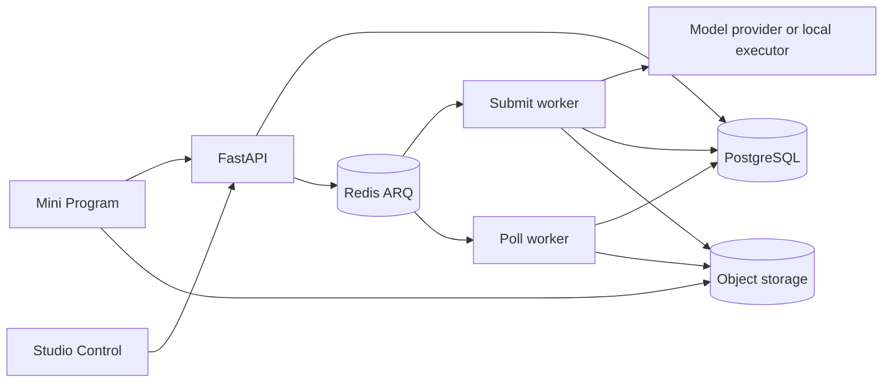

# Architecture and execution

The API accepts bounded HTTP work; workers execute slow AI and conversion work against durable database records. Redis delivery can be reconciled from PostgreSQL rather than treated as the only task record.

## Processes

| Process | Entrypoint | Responsibility |
| --- | --- | --- |
| API | `uvicorn app.main:app` | `/v1`, admin HTML/forms, public handoff pages, health and OpenAPI |
| Submit worker | `arq app.worker.SubmitWorkerSettings` | Workflow Operations/Submissions, local PPTX and video execution |
| Poll worker | `arq app.worker.PollWorkerSettings` | Execution reconciliation, payment compensation, deletion, account/Asset cleanup |

The active queues are `arq:admission_queue` and `arq:poll_queue`, defined in `app/core/queue_names.py`. The worker classes use `queue_name`, not a list of legacy provider queues. A PPTX queue constant also exists; current PPTX work is registered on the admission worker.

## Request to result

1. Validate the strict request, bearer session, workspace and Feature access; resolve an exact idempotent replay before new work.
2. Lock the commercial/execution configuration, verify immutable Assets, freeze prompts and inputs, and reserve the billed wallet's Tokens in the admission transaction.
3. Persist the Workflow run, Operation graph and durable dispatch evidence; enqueue execution.
4. Execute provider-neutral operations with frozen model/connection configuration and generation fencing. Local video/PPTX executors have their own bounded process/lease controls.
5. Publish immutable result Assets and settle or release the reservation exactly once. Reconcilers recover eligible interrupted transitions.

## Code map

| Package | Owns |
| --- | --- |
| `app/core`, `app/persistence` | Settings, HTTP safety, DB sessions, schemas, ORM and shared metrics |
| `app/identity`, `app/workspaces` | Authentication, legal consent, workspaces, projects and activity |
| `app/workflows`, `app/providers` | Admission, execution, retries, product Operations and provider protocols |
| `app/assets`, `app/conversion` | Direct uploads, versioned storage, handoff and PowerPoint conversion |
| `app/billing`, `app/marketing`, `app/prompts`, `app/admin` | Commercial transactions, campaigns, prompts and administration |

Application startup may create schema only when the explicit development `DATABASE_AUTO_CREATE` option is enabled. Production migrations run before cutover; startup is not a migration runner. See [deployment](/deploy/production) and [observability](/backend/observability).

---

Source evidence · backend `b13cc566`: [app/main.py](https://github.com/Orientation-CD/YuanZhu-AI/blob/b13cc5668920620a274cb91a3393ed9fadac72ae/app/main.py) · [app/worker.py](https://github.com/Orientation-CD/YuanZhu-AI/blob/b13cc5668920620a274cb91a3393ed9fadac72ae/app/worker.py) · [app/core/queue_names.py](https://github.com/Orientation-CD/YuanZhu-AI/blob/b13cc5668920620a274cb91a3393ed9fadac72ae/app/core/queue_names.py).
