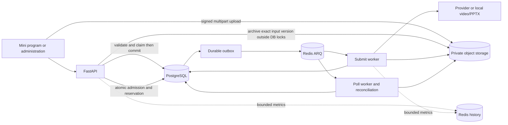

# Architecture and execution

The API prepares and admits work; Submit workers execute slow Operations, while Poll workers reconcile persisted state. PostgreSQL owns business truth, object storage owns exact-version bytes, and Redis delivers work and bounded telemetry. Follow a concrete request in [the system walkthrough](/reference/system-walkthrough).

## Processes and authority

| Process | Entrypoint | Owns |
| --- | --- | --- |
| API | `uvicorn app.main:app` | Strict `/v1` requests, auth, input preparation, admission, administration and health |
| Submit worker | `arq app.worker.SubmitWorkerSettings` | Ready Operations/Submissions and bounded local PPTX/video execution |
| Poll worker | `arq app.worker.PollWorkerSettings` | Provider polling, outbox/execution reconciliation, financial compensation and retained-object cleanup |

`app/core/queue_names.py` defines `arq:admission_queue` and `arq:poll_queue`. A Redis message is a delivery attempt, not the only record of the task. Queue loss must be resolved from SQL outbox/execution evidence. The API's readiness check does not prove workers, provider credits or supplier media pipelines are healthy.

## The acceptance boundary

1. Validate the request and inspect an exact same-key/body replay. Replay returns the accepted Job without another archive, reservation or new execution.
2. Prepare direct owned inputs: validate the complete inventory, commit a copy receipt/lease, copy and verify the exact storage version outside DB locks, then publish the canonical private locator. A prepared Asset can still be READY and expiring.
3. Enter the serialized admission transaction. Recheck workspace, Feature/configuration, role/type/pins, active-job count and financial authority. For enterprise members, check pool capacity before the member monthly quota.
4. Atomically activate owned inputs with no expiry, create Job/Workflow/Operation records, freeze execution and prices, reserve Tokens and persist dispatch outbox. Only this commit accepts paid work.
5. Dispatch from committed SQL evidence. Workers publish verified immutable output Assets and settle/release the reservation once. Generation fencing prevents a stale worker from publishing over a later attempt.

A storage copy and the final SQL transaction are separate recoverable phases. A later rejection may leave a reusable receipt and expiring READY input; it must leave no new Job or financial reservation. See the [admission sequence](/reference/flows/design-job-lifecycle) and [Asset lifecycle](/reference/flows/asset-upload-flow).

## Code map

| Package | Start reading at | Responsibility |
| --- | --- | --- |
| `app/assets` | `asset_completion.py`, `asset_input_archival.py` | Prove bytes, archive owned direct inputs, retain receipts and exact object versions |
| `app/workflows` | `api.py`, `workflow_admission.py` | Public projection, atomic acceptance, frozen graph and billing |
| `app/workflows/submissions` | coordinator, scheduler, finalizer and local executors | Durable operation transitions and bounded provider/local execution |
| `app/billing` | `billing.py`, `member_token_quotas.py` | Wallet ledger and independent member monthly capacity |
| `app/workspaces` | `workspace_api.py`, `projects.py` | Membership, creator-private Projects and owner read projections |
| `app/core` | `request_stages.py`, `performance_history.py`, `performance_reports.py` | Safe correlation and bounded operational observations |

Production schema changes run before cutover; application startup is not a migration runner. Preserve the application's [deployment and recovery](/deploy/production) controls. Current UI callers and API compatibility are recorded in [integration status](/reference/integration-status), rather than inferred from the public route's preferred name.

---

Source evidence · backend `e59716c8`: [app/main.py](https://github.com/Orientation-CD/YuanZhu-AI/blob/e59716c83e087deda8477da5ea7b327a40cf65c5/app/main.py) · [app/worker.py](https://github.com/Orientation-CD/YuanZhu-AI/blob/e59716c83e087deda8477da5ea7b327a40cf65c5/app/worker.py) · [app/workflows/workflow_admission.py](https://github.com/Orientation-CD/YuanZhu-AI/blob/e59716c83e087deda8477da5ea7b327a40cf65c5/app/workflows/workflow_admission.py) · [app/assets/asset_input_archival.py](https://github.com/Orientation-CD/YuanZhu-AI/blob/e59716c83e087deda8477da5ea7b327a40cf65c5/app/assets/asset_input_archival.py).
