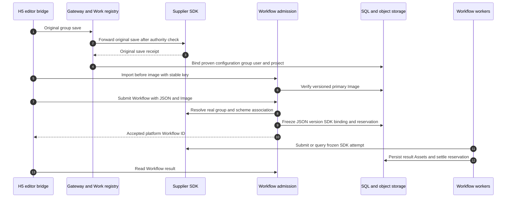

# Floor plans and the shared ThreeVjia SDK

Start with one example: a member saves a supplier Work, submits an image render, then opens its result from Plans. Three different boundaries matter: **opening the editor is free**, **supplier save registers local ownership**, and **paid rendering is a platform Workflow**. [Frontend entry](/frontend/floor-plans) explains the native handoff; [the endpoint guide](/reference/flows/floor-plan-flow) follows each API.

## A release is an integration contract

The active `ThreeVjiaSDKConfiguration` selects a `ThreeVjiaRelease` and exact contract digest. `current_editor_model` reports available only when there is exactly one configuration, its release is `AVAILABLE`, and its digest matches. `prepare_editor_entry` verifies the required operations, probes supplier login outside a database transaction, then locks and rereads configuration, Feature and user/project authority. If the fingerprint changed, it refuses the URL rather than mixing releases.

`account_identity` selects the renewable account-credential service; existing encrypted API-key configuration remains a supported credential branch. Supplier credentials stay behind the platform boundary. Short-lived editor aliases/cookies use Redis scopes containing user, configuration and credential generation. Those aliases are different from the independent platform auth pair handed to H5. The SDK configuration is not a model in the generic Provider catalog. Historical frozen executions retain their exact release; they never silently select the latest release.

Sources: [current_editor_model](https://github.com/Orientation-CD/YuanZhu-AI/blob/f34b8a4d6307c83c6f7bbc905485a4f586d59a99/app/floor_plans/editor_entry.py#L37) · [prepare_editor_entry](https://github.com/Orientation-CD/YuanZhu-AI/blob/f34b8a4d6307c83c6f7bbc905485a4f586d59a99/app/floor_plans/editor_entry.py#L182) · [AccountCredentials](https://github.com/Orientation-CD/YuanZhu-AI/blob/f34b8a4d6307c83c6f7bbc905485a4f586d59a99/app/three_vjia/account_credentials.py#L95) · [sdk_render_execution](https://github.com/Orientation-CD/YuanZhu-AI/blob/f34b8a4d6307c83c6f7bbc905485a4f586d59a99/app/workflows/workflow_sdk_execution.py#L60).

## What SQL stores and what remains remote

| Object | Durable evidence |
| --- | --- |
| `FloorPlanWork` | Configuration/group identity, original user, workspace, project, management-write and deletion fences |
| Supplier Work | Live name, cover and layout ID; normal listing reads metadata rather than maintaining a local mirror |
| `DesignJob` / Workflow run | User, current project, Work association, frozen inputs/configuration, reservation and execution state |
| Input `Document` + primary `Image` | Versioned private JSON request and verified before image, pinned to this execution |
| Output `Image` Assets | Persisted result identity and metadata used by normal history/download/viewing paths |

There is no persistent editor Session resource to create or renew. A platform authentication session may be created for `bootstrap_auth`; that is the normal access/refresh session, not an editor Work. `group_id` is opaque and paired with the SDK configuration ID, not globally interchangeable with a Workflow UUID.

Sources: [FloorPlanWork](https://github.com/Orientation-CD/YuanZhu-AI/blob/f34b8a4d6307c83c6f7bbc905485a4f586d59a99/app/persistence/db_models.py#L2225) · [WorkIdentity](https://github.com/Orientation-CD/YuanZhu-AI/blob/f34b8a4d6307c83c6f7bbc905485a4f586d59a99/app/floor_plans/ownership.py#L15) · [finish_group_save](https://github.com/Orientation-CD/YuanZhu-AI/blob/f34b8a4d6307c83c6f7bbc905485a4f586d59a99/app/floor_plans/registration.py#L78).

## Follow save and paid render separately

| Steps | Source symbol | Checkpoint and purpose |
| --- | --- | --- |
| 1–4 | [relay](https://github.com/Orientation-CD/YuanZhu-AI/blob/f34b8a4d6307c83c6f7bbc905485a4f586d59a99/app/floor_plans/gateway.py#L263) · [prepare_group_save](https://github.com/Orientation-CD/YuanZhu-AI/blob/f34b8a4d6307c83c6f7bbc905485a4f586d59a99/app/floor_plans/registration.py#L50) · [finish_group_save](https://github.com/Orientation-CD/YuanZhu-AI/blob/f34b8a4d6307c83c6f7bbc905485a4f586d59a99/app/floor_plans/registration.py#L78) | Supplier save is observed once; proven receipt binds ownership. `x-floor-plan-work-registration: unavailable` describes failed local registration, not permission to replay the supplier save |
| 5–6 | [import_before_asset](https://github.com/Orientation-CD/YuanZhu-AI/blob/f34b8a4d6307c83c6f7bbc905485a4f586d59a99/app/floor_plans/before_assets.py#L88) | Cleanup ownership exists before download; image bytes and version pass normal Asset completion |
| 7–10 | [admit_workflow_job](https://github.com/Orientation-CD/YuanZhu-AI/blob/f34b8a4d6307c83c6f7bbc905485a4f586d59a99/app/workflows/workflow_admission.py#L3301) · [stage_render_document](https://github.com/Orientation-CD/YuanZhu-AI/blob/f34b8a4d6307c83c6f7bbc905485a4f586d59a99/app/floor_plans/rendering.py#L142) | Version and Work authority match; accepted ID does not mean supplier execution has succeeded |
| 11–12 | [sdk_render_execution](https://github.com/Orientation-CD/YuanZhu-AI/blob/f34b8a4d6307c83c6f7bbc905485a4f586d59a99/app/workflows/workflow_sdk_execution.py#L60) · [ThreeVjiaRenderExecution](https://github.com/Orientation-CD/YuanZhu-AI/blob/f34b8a4d6307c83c6f7bbc905485a4f586d59a99/app/workflows/operations/image/three_vjia_execution.py#L148) | Worker consumes frozen release/input identity and uses existing attempt, artifact and settlement machinery |
| 13 | [work_workflows](https://github.com/Orientation-CD/YuanZhu-AI/blob/f34b8a4d6307c83c6f7bbc905485a4f586d59a99/app/floor_plans/group_works.py#L634) · [panorama_viewer_url](https://github.com/Orientation-CD/YuanZhu-AI/blob/f34b8a4d6307c83c6f7bbc905485a4f586d59a99/app/floor_plans/panorama.py#L38) | Authorized readers receive standard Workflow results or a fresh read-only panorama capability |

The editor toolbar shows scene preparation and opens render settings after saving and confirming Work registration. The user can then submit a render through platform admission. H5 can guide users to the store if a personal subscription is missing, pending, expired or lacks the Feature. Returning refreshes the entitlement display and leaves the user to submit explicitly. The server decides final permission and cost. See the [toolbar save patch](https://github.com/Orientation-CD/YuanZhu-AI/blob/f34b8a4d6307c83c6f7bbc905485a4f586d59a99/app/static/3vjia/h5/patches.json) and [membershipReason](https://github.com/Orientation-CD/YuanZhu-AI/blob/f34b8a4d6307c83c6f7bbc905485a4f586d59a99/app/static/3vjia/h5/bootstrap.js#L172).

## Input and admission boundaries

`FloorPlanWorkflowCreate` carries `type`, workspace, optional project, name, `render_mode`, one `kind:json, role:render_request` input and one `kind:asset, role:primary, port:images` input. `floor_plan_render` maps to image and `floor_plan_panorama` to panorama; mismatches fail. The supplier request JSON is opaque to generic workflow logic, but its release version and association are checked. Old single-JSON bodies are parsed only to recover a matching prior receipt; they cannot create new jobs.

The H5 bridge first imports the before image, then posts the exact frozen body with `Idempotency-Key` and `X-Editor-Version`. Admission checks the release version and current execution fingerprint, resolves the real supplier group, checks registered Work scope, and stores a private versioned request Document. The final short transaction rechecks project/Work authority, reserves tokens and records the Work association. External supplier HTTP is not performed while holding those final database locks. Unused staged input Documents retain normal temporary cleanup ownership.

Sources: [FloorPlanWorkflowCreate](https://github.com/Orientation-CD/YuanZhu-AI/blob/f34b8a4d6307c83c6f7bbc905485a4f586d59a99/app/core/models.py#L711) · [dispatchStored](https://github.com/Orientation-CD/YuanZhu-AI/blob/f34b8a4d6307c83c6f7bbc905485a4f586d59a99/app/static/3vjia/h5/bridge.js#L454) · [resolve_render_scheme](https://github.com/Orientation-CD/YuanZhu-AI/blob/f34b8a4d6307c83c6f7bbc905485a4f586d59a99/app/floor_plans/rendering.py#L96).

## Gateway transport is not a second render engine

The gateway selects the exact release/service origin and preserves ordinary supplier path/query bytes. Unknown ordinary paths within that selected service remain forwardable. It intercepts known paid render/history signatures, normalizes quote replies from platform Feature metadata, and fences group saves, updates and removals. All nine declared HTTP methods enter this same boundary; declaration alone does not make every supplier operation valid.

The gateway around `ThreeVjiaSDK.forward` strips or substitutes sensitive headers and returns bounded receipts without following redirects. Gateway authentication cache misses are recoverable auth failures, not evidence that a previous remote write failed. A confirmed original save or removal must not be repeated merely because local response handling failed.

Sources: [relay](https://github.com/Orientation-CD/YuanZhu-AI/blob/f34b8a4d6307c83c6f7bbc905485a4f586d59a99/app/floor_plans/gateway.py#L263) · [forward](https://github.com/Orientation-CD/YuanZhu-AI/blob/f34b8a4d6307c83c6f7bbc905485a4f586d59a99/app/three_vjia/sdk.py#L276) · [selected_contract](https://github.com/Orientation-CD/YuanZhu-AI/blob/f34b8a4d6307c83c6f7bbc905485a4f586d59a99/app/floor_plans/sdk_binding.py#L24).

## Move, delete and panorama have distinct semantics

Move is one platform transaction: `move_group` checks expected source, owns admission locks, validates every related execution and both projects, then moves the Work and associated jobs together. It sends no supplier move request.

Deletion first persists a claim and waits for in-flight management writes. Recovery dispatches supplier removal at most once per durable claim, then confirms through metadata reads and delegates normal job/asset cleanup. After 120 seconds, an uncertain dispatched claim enters `supplier_unconfirmed`; manual confirmation performs one read under the original claim. Local ownership becomes an identity-free tombstone only after supplier absence and related job cleanup are established. Redis wake failure does not erase the durable claim.

Panorama viewing checks readable Workflow scope and panorama mode, loads the current exact release's complete viewer files, then rechecks read authority before optional bootstrap auth commits. View access is separate from author-only editing and does not submit another render.

Sources: [move_group](https://github.com/Orientation-CD/YuanZhu-AI/blob/f34b8a4d6307c83c6f7bbc905485a4f586d59a99/app/floor_plans/group_move.py#L73) · [resume_group_deletion](https://github.com/Orientation-CD/YuanZhu-AI/blob/f34b8a4d6307c83c6f7bbc905485a4f586d59a99/app/floor_plans/group_recovery.py#L172) · [finalize_group](https://github.com/Orientation-CD/YuanZhu-AI/blob/f34b8a4d6307c83c6f7bbc905485a4f586d59a99/app/floor_plans/group_recovery.py#L51) · [panorama_viewer_url](https://github.com/Orientation-CD/YuanZhu-AI/blob/f34b8a4d6307c83c6f7bbc905485a4f586d59a99/app/floor_plans/panorama.py#L38).
