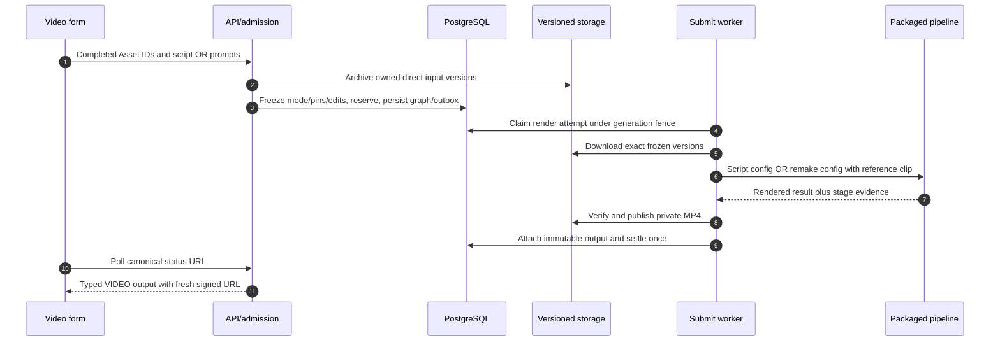

# Video: script generation and same-style remake

`video_generation` is one Feature backed by the local `render_video` Operation. The packaged private jinqiu pipeline performs slow media/model orchestration; ordinary provider-model routing is not the local executor. Both video modes use the shared Job/Workflow, input archive, wallet and output publication machinery.

## Three request paths, one operation

| Path | Request body | Story source | Extra constraints |
| --- | --- | --- | --- |
| Script | `script`, no `prompts` | Frozen script | Character sheet exactly1; scene images0..12; recording0..1 |
| System same-style | One named `prompts` selection, no `script` | Template's reference clip | Active `purpose=same_style_video`, field exactly `称呼`, scene images0..1, required MP3 recording>5s |
| Custom same-style | `prompts` name `__user_reference__`, uploaded `reference_video`, no `script` | User's version-pinned clip | Same field/recording/scene limits; no template lookup/render and no script pin |

All paths require exactly one `character_image`/`primary` Image. An uploaded reference clip is a completed Video Asset, at most100 MiB and120s. Port/role must both be `reference_video`; repeated Asset IDs fail. The structural request caps inputs at14, which can reject an oversized inventory before mode-specific rules. UI requirements can be narrower than the public schema; check [integration status](/reference/integration-status).

A script is at most20,000 characters. Current txt dialect uses one `【场景N】` heading per scene and structured labels; accepted historical markdown dialect is isolated in [compatibility](/reference/compatibility). Sending script+prompts or script+reference clip is `VIDEO_SCRIPT_CONFLICT`; neither body is `VIDEO_SCRIPT_REQUIRED`.

## Template selection and optional dialogue edits

The mobile picker reads `GET /v1/prompt-templates?purpose=same_style_video`. Omitting purpose lists only general templates. Same-style metadata contains display name and short-lived reference clip/poster URLs, never the private template body. Refetch after playback capability expiry; preview neither creates a Job nor reserves Tokens.

A system template has exactly the field `称呼`, no system/negative prompt, a rendered script of at most15,000 characters and a matching `【人物】` in every scene. The salutation cannot contain whitespace or `、`,`,` ,`，`. Its rendered text is validated/frozen, but the reference clip drives the remake pipeline; the worker does not forward a competing script. Custom mode validates the same field but writes no script input.

Optional top-level `replacements:[{"from":"old","to":"new"}]` uses trimmed nonblank strings. `replace_scope` is `all` (default) or `dialogue`, and requires at least one pair. The backend freezes and forwards pairs/scope to shot planning; it does not perform substitution. Default all keeps the default canonical fingerprint; dialogue changes semantic identity. Do not change edits while reusing an accepted action key.

## From accepted Job to MP4

Read [`_build_render_request`](https://github.com/Orientation-CD/YuanZhu-AI/blob/e59716c83e087deda8477da5ea7b327a40cf65c5/app/workflows/submissions/workflow_local_video_submission.py#L552), then [`build_config`](https://github.com/Orientation-CD/YuanZhu-AI/blob/e59716c83e087deda8477da5ea7b327a40cf65c5/app/conversion/video_jinqiu_adapter.py#L224). A reference clip selects `_remake_config`, leaving script_path unset; otherwise `_script_config` uses staged script/maps. Outputs are verified `video/mp4` Assets, not arbitrary supplier URLs.

## Models, recovery and proof limits

`VIDEO_MODEL_SELECTION_ENABLED` controls whether model choices are offered/forwarded. Disabled defaults to `Doubao-Seedance-2.0-mini`; discover supported choices/prices instead of hardcoding a supplier-credit table. Platform Tokens are separate from real supplier spending.

Rendering has bounded leases, wall-clock/stage budgets, spool and upload limits and can take hours. An API health check does not prove supplier capacity. Failed local video renders are terminal with no automatic rerender; support owns any manual paid rerun decision. Stale attempts cannot publish over the current generation. Record the packaged private supplier revision with release evidence, and distinguish simulated tests from deferred real-provider/long-duration validation. The [product full chain](/reference/flows/workflow-products-flow#video-branch) lists failure codes and code navigation.

---

Source evidence · backend `e59716c8`: [app/core/models.py](https://github.com/Orientation-CD/YuanZhu-AI/blob/e59716c83e087deda8477da5ea7b327a40cf65c5/app/core/models.py) · [app/workflows/video_template_rules.py](https://github.com/Orientation-CD/YuanZhu-AI/blob/e59716c83e087deda8477da5ea7b327a40cf65c5/app/workflows/video_template_rules.py) · [app/workflows/workflow_admission.py](https://github.com/Orientation-CD/YuanZhu-AI/blob/e59716c83e087deda8477da5ea7b327a40cf65c5/app/workflows/workflow_admission.py) · [app/workflows/submissions/workflow_local_video_submission.py](https://github.com/Orientation-CD/YuanZhu-AI/blob/e59716c83e087deda8477da5ea7b327a40cf65c5/app/workflows/submissions/workflow_local_video_submission.py) · [app/conversion/video_jinqiu_adapter.py](https://github.com/Orientation-CD/YuanZhu-AI/blob/e59716c83e087deda8477da5ea7b327a40cf65c5/app/conversion/video_jinqiu_adapter.py).
