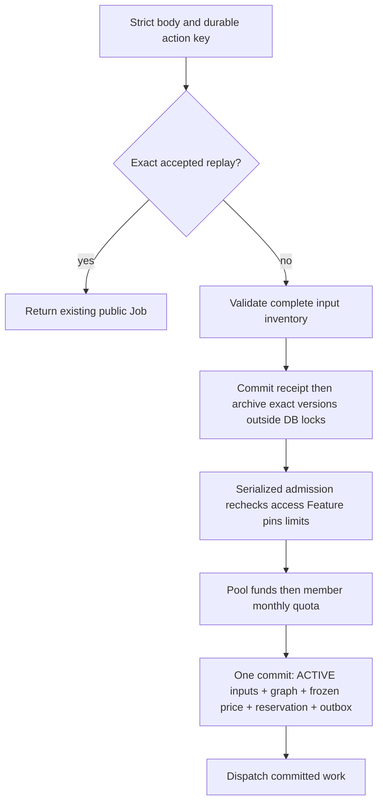
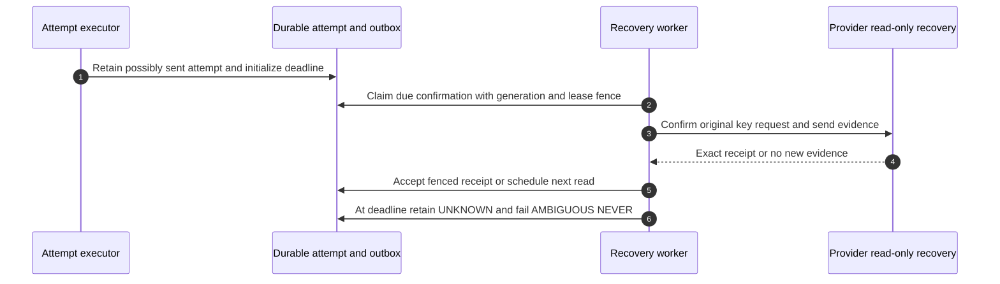

# Canonical Workflows and durable execution

A Feature is a public commercial capability; it maps to an executable Workflow definition. A Job is the public task aggregate, a WorkflowRun is one persisted graph execution, an OperationRun is a graph node and a Submission is a concrete execution attempt. The public Workflow ID remains the Job ID, not an internal WorkflowRun UUID.

## Public contract and shipped callers

Use `POST /v1/workflows`, `GET /v1/workflows/{id}` and the Workflow history/action routes for new integrations. Existing UI wrappers still select some implemented compatibility adapters; inspect [integration status](/reference/integration-status) before mapping a button to a URL. Adapters share the durable runtime and do not create a second engine. The isolated [compatibility reference](/reference/compatibility) records remaining server aliases and retired requests.

Discover active Feature prices, result kinds, input roles and allowed models. A personal submission needs the Feature grant in its current plan; an enterprise uses its separate access and shared-pool rules. An empty personal grant list denies new work. Accepted Jobs and exact replays keep their original evidence.

## Admission is more than enqueue

READY means uploaded and verified; archive COMPLETED means durable location prepared; only final admission activates the owned input without expiry and binds it exclusively to a Job. A later rejection may leave a valid prepared input, but no accepted work or new charge. [Admission deep dive](/reference/flows/design-job-lifecycle) maps every stage to functions and records.

## Idempotency, retry and charging

An exact same-key/body create returns the accepted task, including a lost-response replay. A changed semantic fingerprint is `IDEMPOTENCY_KEY_REUSED`; do not silently generate another key. Public states are pending→running→completed/failed, while internal graph/attempt states carry recovery detail. Progress is an estimate and not evidence of settlement.

A failed-task retry is a separate action at `/v1/workflows/{id}/retry`, using its own durable key and server eligibility. It retains the same Job, advances a retry generation, uses the frozen price and rechecks funding/member capacity. It is not a reconstructed create request. Ambiguous paid provider acceptance is unsafe to repeat; `retry_block_code` and persisted disposition control recovery. Local video rendering does not gain automatic paid reruns from a timeout.

## Read, move and delete

`GET /v1/workflows` without a project is original-author history. With a readable project filter it can return previous authors' tasks in that project; `/v1/workspace/workflows` remains a selected-workspace owner projection. Collection rows hide other authors' inputs, while authorized by-ID detail deliberately exposes input Assets to the author, current project assignee or enterprise owner. `submitted_by` stays original; `project_assignee` and `permissions` describe current responsibility. Fresh SQL rechecks access after capability signing. None of these read paths grants another author's write or input-reuse rights.

New move/retry/continue actions require original authorship and current responsibility, with each action's current scope/lifecycle rules. Move checks expected source and terminal state; a linked floor-plan execution delegates to whole-Group move. A new deletion claim requires original author/current assignee, while already durable cleanup continues without treating later assignment as cancellation. Retained author deletion need not acquire new membership, although frontend write preflight can be stricter. A cleanup outage leaves `deletion_pending`, empty media projection and a visible retryable placeholder. See [history actions](/reference/flows/workflow-history-flow).

Sources: [readable_design_job](https://github.com/Orientation-CD/YuanZhu-AI/blob/f34b8a4d6307c83c6f7bbc905485a4f586d59a99/app/workflows/read_access.py#L79) · [finalize_workflow_reads](https://github.com/Orientation-CD/YuanZhu-AI/blob/f34b8a4d6307c83c6f7bbc905485a4f586d59a99/app/workflows/read_access.py#L117) · [move_design_job](https://github.com/Orientation-CD/YuanZhu-AI/blob/f34b8a4d6307c83c6f7bbc905485a4f586d59a99/app/workspaces/project_jobs.py#L185) · [delete_terminal_design_job](https://github.com/Orientation-CD/YuanZhu-AI/blob/f34b8a4d6307c83c6f7bbc905485a4f586d59a99/app/workflows/design_job.py#L487).

## Recover UNKNOWN without another paid POST {#unknown-recovery}

A timeout after dispatch cannot prove that the supplier rejected the task. The existing attempt retains its immutable encrypted request envelope, provider attempt key, generation and acceptance uncertainty. `ensure_unknown_deadline` initializes durable `provider_unknown_started_at`/`provider_unknown_deadline_at` once: the window is 120 seconds, and requeue/restart does not reset it. An explicitly recorded UNKNOWN starts from its recorded ambiguity; a recovered lost lease can derive the clock from original send evidence. This is separate from a known accepted job's normal result polling.

| Steps | Source | Evidence and boundary |
| --- | --- | --- |
| 1 | [finish_provider_attempt](https://github.com/Orientation-CD/YuanZhu-AI/blob/f34b8a4d6307c83c6f7bbc905485a4f586d59a99/app/providers/provider_attempt.py#L586) · [ensure_unknown_deadline](https://github.com/Orientation-CD/YuanZhu-AI/blob/f34b8a4d6307c83c6f7bbc905485a4f586d59a99/app/workflows/provider_unknown.py#L11) | UNKNOWN retains original request evidence; another reservation must not open a new paid send |
| 2 | [reconcile_unknown_provider_handoffs](https://github.com/Orientation-CD/YuanZhu-AI/blob/f34b8a4d6307c83c6f7bbc905485a4f586d59a99/app/workflows/submissions/workflow_submission_dispatch.py#L525) | Outbox uses recovery_only, protocol/generation and recovery-epoch deduplication; Redis wake is not a new provider attempt |
| 3–5 | [recover_unknown_provider_attempt](https://github.com/Orientation-CD/YuanZhu-AI/blob/f34b8a4d6307c83c6f7bbc905485a4f586d59a99/app/providers/provider_attempt.py#L773) · [unknown_query_due](https://github.com/Orientation-CD/YuanZhu-AI/blob/f34b8a4d6307c83c6f7bbc905485a4f586d59a99/app/workflows/provider_unknown.py#L40) | At most eight confirmations, each at most three seconds and bounded by remaining time; network time never extends the deadline |
| 6 | [preserve_unknown_failure](https://github.com/Orientation-CD/YuanZhu-AI/blob/f34b8a4d6307c83c6f7bbc905485a4f586d59a99/app/providers/provider_attempt.py#L324) | Terminal failure keeps acceptance UNKNOWN, failure_class AMBIGUOUS and retry disposition NEVER; it does not assert the supplier did nothing |

Only a provider implementing `AmbiguityRecoverableProvider` can perform these confirmations. Recovery decodes the exact envelope and invokes `recover_unknown`, never `submit`; unavailable/malformed evidence or an unsupported provider waits for expiry. Follow-up delays are 1, 2, 4, 8, 16, 30 and 30 seconds, clipped to the original deadline; hitting eight queries schedules no ninth query. Leases, query count, envelope, request count and generation are checked again before a receipt changes state. Late or stale responses cannot revive an expired/new-generation execution. A read error does not establish acceptance or rejection.

If a trustworthy original receipt is recovered before expiry, existing finish/finalization logic resumes that attempt and its normal result path. If not, the graph reaches the existing terminal ambiguous failure; same-ID explicit retry stays blocked by its retained uncertainty. Operator investigation uses the same Job/submission/attempt evidence. Changing URL, key, generation or manually replaying supplier POST is not a recovery operation. [Runtime tracing](/reference/flows/runtime-debugging) explains how to locate that evidence.

---

Source evidence · backend `749e82df`: [app/workflows/api.py](https://github.com/Orientation-CD/YuanZhu-AI/blob/f34b8a4d6307c83c6f7bbc905485a4f586d59a99/app/workflows/api.py) · [app/workflows/workflow_admission.py](https://github.com/Orientation-CD/YuanZhu-AI/blob/f34b8a4d6307c83c6f7bbc905485a4f586d59a99/app/workflows/workflow_admission.py) · [app/workflows/submissions/workflow_submission_retry.py](https://github.com/Orientation-CD/YuanZhu-AI/blob/f34b8a4d6307c83c6f7bbc905485a4f586d59a99/app/workflows/submissions/workflow_submission_retry.py) · [app/billing/member_token_quotas.py](https://github.com/Orientation-CD/YuanZhu-AI/blob/f34b8a4d6307c83c6f7bbc905485a4f586d59a99/app/billing/member_token_quotas.py).
