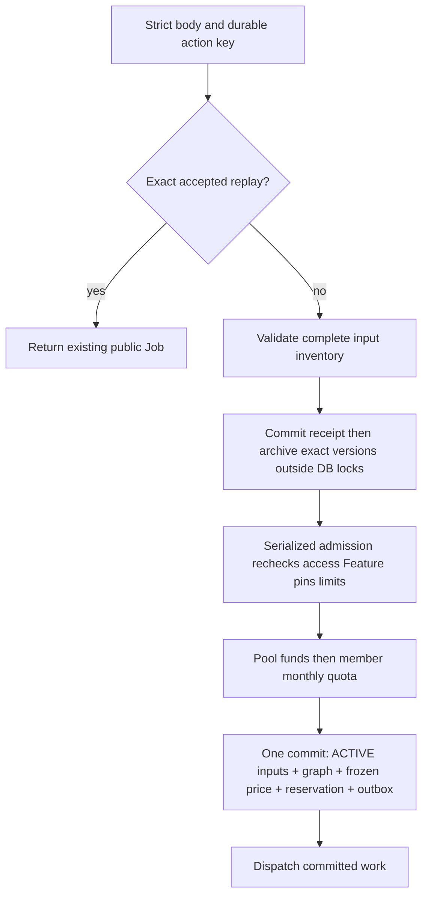

# Canonical Workflows and durable execution

A Feature is a public commercial capability; it maps to an executable Workflow definition. A Job is the public task aggregate, a WorkflowRun is one persisted graph execution, an OperationRun is a graph node and a Submission is a concrete execution attempt. The public Workflow ID remains the Job ID, not an internal WorkflowRun UUID.

## Public contract and shipped callers

Use `POST /v1/workflows`, `GET /v1/workflows/{id}` and the Workflow history/action routes for new integrations. Existing UI wrappers still select some implemented compatibility adapters; inspect [integration status](/reference/integration-status) before mapping a button to a URL. Adapters share the durable runtime and do not create a second engine. The isolated [compatibility reference](/reference/compatibility) records remaining server aliases and retired requests.

Discover active Feature prices, result kinds, input roles and allowed models. A personal submission needs the Feature grant in its current plan; an enterprise uses its separate access and shared-pool rules. An empty personal grant list denies new work. Accepted Jobs and exact replays keep their original evidence.

## Admission is more than enqueue

READY means uploaded and verified; archive COMPLETED means durable location prepared; only final admission activates the owned input without expiry and binds it exclusively to a Job. A later rejection may leave a valid prepared input, but no accepted work or new charge. [Admission deep dive](/reference/flows/design-job-lifecycle) maps every stage to functions and records.

## Idempotency, retry and charging

An exact same-key/body create returns the accepted task, including a lost-response replay. A changed semantic fingerprint is `IDEMPOTENCY_KEY_REUSED`; do not silently generate another key. Public states are pending→running→completed/failed, while internal graph/attempt states carry recovery detail. Progress is an estimate and not evidence of settlement.

A failed-task retry is a separate action at `/v1/workflows/{id}/retry`, using its own durable key and server eligibility. It retains the same Job, advances a retry generation, uses the frozen price and rechecks funding/member capacity. It is not a reconstructed create request. Ambiguous paid provider acceptance is unsafe to repeat; `retry_block_code` and persisted disposition control recovery. Local video rendering does not gain automatic paid reruns from a timeout.

## Read, move and delete

`GET /v1/workflows` is creator history; `/v1/workspace/workflows` is the owner projection. A current enterprise owner may read another creator's visible detail with `inputs:[]` and the actual `submitted_by`; this does not grant write authority. Each read rechecks access and returns fresh result capabilities.

Move checks expected source Project, same workspace, terminal lifecycle and creator ownership. Delete records durable cleanup intent and removes exact retained versions only when allowed. A cleanup outage can leave an accepted deletion claim; use its documented retry/reconciliation rather than manual SQL deletion. See [history actions](/reference/flows/workflow-history-flow).

---

Source evidence · backend `e59716c8`: [app/workflows/api.py](https://github.com/Orientation-CD/YuanZhu-AI/blob/e59716c83e087deda8477da5ea7b327a40cf65c5/app/workflows/api.py) · [app/workflows/workflow_admission.py](https://github.com/Orientation-CD/YuanZhu-AI/blob/e59716c83e087deda8477da5ea7b327a40cf65c5/app/workflows/workflow_admission.py) · [app/workflows/submissions/workflow_submission_retry.py](https://github.com/Orientation-CD/YuanZhu-AI/blob/e59716c83e087deda8477da5ea7b327a40cf65c5/app/workflows/submissions/workflow_submission_retry.py) · [app/billing/member_token_quotas.py](https://github.com/Orientation-CD/YuanZhu-AI/blob/e59716c83e087deda8477da5ea7b327a40cf65c5/app/billing/member_token_quotas.py).
