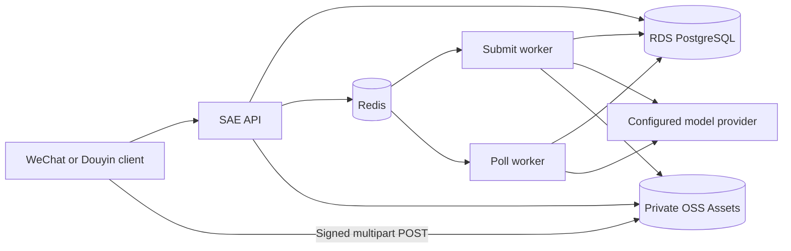

# Cloud Architecture

The API, submit worker and poll worker run as three SAE applications using one backend revision and one immutable image digest. PostgreSQL is authoritative business state; Redis supports queues, rate limits, sessions and operational coordination; OSS stores version-bound Assets and published output.

## Boundaries and workload roles

| Boundary | Purpose |
| --- | --- |
| `yuanzhu-test` | Cloud-test/integration boundary; verify its current provider and payment modes before testing |
| `yuanzhu-prod` | Production boundary; changes require protected release evidence |
| `--stage=test` / `--stage=production` | Risk classification independent of namespace naming; never rewrites `ENVIRONMENT` |
| `yuanzhu-ai-api` | HTTP API and Admin console |
| `yuanzhu-ai-submit-worker` | Workflow/Operation scheduling, provider dispatch and local conversion work |
| `yuanzhu-ai-poll-worker` | Provider polling, reconciliation, expiry and periodic work |

The workload names are resolved to namespace-local application IDs. Mock providers are local test services, not additional production rollout targets. API and workers must agree on provider/payment/crypto configuration and on feature activation state.

## Artifact identity and registry transport

Build the `runtime` image for `linux/amd64` from an exact committed backend revision. Publish a full-SHA tag, resolve its immutable digest, and carry both revision and digest into deployment. Builds also resolve the private `jinqiuai` supplier commit; preserve that provenance.

Build/push/digest verification use the configured public Personal ACR host. SAE pulls the same repository and digest through the validated same-instance, same-region VPC registry host. These hosts are an approved pair, not arbitrary interchangeable registries. Existing pull-Secret selection is a read-only precondition; deployment never silently repairs Secret contents. An ECI cache is optional acceleration.

## Database and storage access

Runtime database credentials have application privileges. The namespace-local `yuanzhu-migration-secrets` contains only `MIGRATION_DATABASE_URL` for the temporary migration runner. `configure-migration-db.sh` reconciles ownership and grants through its own reviewed apply workflow; a routine deployment consumes the verified contract.

The normal owner is `yuanzhu_app`; API and workers use a separate runtime account. Never mount migration credentials into long-running application roles or use runtime credentials to improvise DDL.

Private downloads use fresh OSS presigned URLs. Direct uploads require the public OSS S3 endpoint and all returned POST fields. Public delivery is restricted to approved public prefixes. A CDN hostname is not a replacement for `S3_PRESIGN_ENDPOINT`: request-host identity is part of signing. Earlier docs described private CDN delivery as universally enabled; verify the namespace configuration instead.

## Configuration and compatibility

Cloud environment arrays, Secret/ConfigMap references and runtime settings are authoritative for a deployment. A developer `.env` is only input to local tooling. Preserve unrelated cloud values during changes; use the complete-array merge procedure in the pinned runbook.

Migrations, API and workers form one compatibility boundary. Current schema includes Workflows/Operations, typed Assets, private Projects, project outcomes and trusted activity state. Legacy provider/output tables cannot be restored by rolling application code backward. Read [production recovery](/deploy/production) before choosing any rollback image.

## Source evidence

Verified against the [documented source revisions](/reference/source-revisions). Runtime values and cloud activation must be checked separately.

- [Canonical SAE architecture](https://github.com/Orientation-CD/YuanZhu-AI/blob/b13cc5668920620a274cb91a3393ed9fadac72ae/deploy/sae/SAE_DEPLOYMENT_ARCHITECTURE.md)
- [Namespace and release runbook](https://github.com/Orientation-CD/YuanZhu-AI/blob/b13cc5668920620a274cb91a3393ed9fadac72ae/deploy/sae/SAE_DEPLOYMENT_RUNBOOK.md)
- [SAE artifact deployment](https://github.com/Orientation-CD/YuanZhu-AI/blob/b13cc5668920620a274cb91a3393ed9fadac72ae/deploy/sae/deploy-image.sh)
