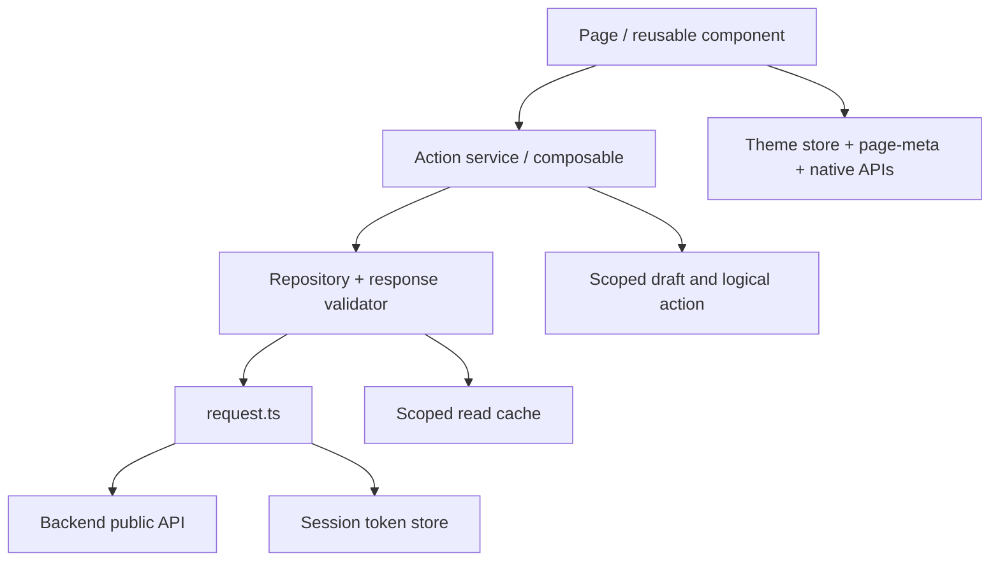
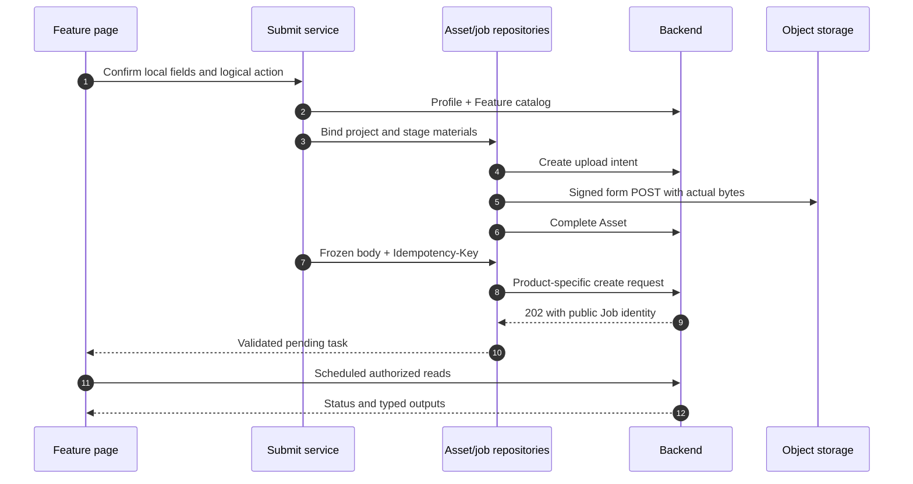

# Frontend Architecture

A page owns its visible lifecycle; a service coordinates one action; a repository validates the server contract; the request client owns transport. Read these layers together. A TypeScript DTO alone cannot validate remote JSON, and a hidden button cannot enforce server authorization.

## Find the implementation selected by the build

`src/pages.json` registers the main package and subpackages. `vite.config.ts` selects runtime aliases before bundling. For an import ending in `Runtime`, inspect the alias rather than assuming it points to the adjacent API file.

| Boundary | Representative runtime alias | Consequence |
| --- | --- | --- |
| Account/task data | `AccountRepositoryRuntime`, `TaskRepositoryRuntime` | Frontend Mock and API packages contain different implementations |
| Project binding | `DesignProjectBindingServiceRuntime` | Projectless builds exclude binding behavior |
| Current Home scope | `HomeScopeSwitchRuntime` | No project UI in a disabled-project artifact |
| Member result access | `MemberProjectReadRuntime` | Read-only member views compile only with projects |
| Floor-plan movement | `FloorPlanMoveRuntime` | Project-disabled builds cannot acquire project move behavior |

`PRIVATE_PROJECTS` preprocessing also changes registered pages and Tab items. The [package gate](/frontend/testing) checks actual JS/JSON/template/style edges: a main package cannot import a feature subpackage, and sibling subpackages cannot directly import each other. A small duplicate handoff adapter can be deliberate when it preserves that boundary.

## Session generations and late responses

`src/stores/session.ts` owns the credential pair and a monotonically changing session generation. A scoped read records the generation, owner, workspace, project and page revision before its request. When it returns, those values must still match before it updates the screen.

For example: an owner opens member A's project, then switches workspace before the overview response arrives. `memberProjectRead` invalidates its membership proof and the page's current operation. The old response is discarded even if its HTTP status was 200. The same pattern prevents a failed old request from clearing a new user's data.

`request.ts` resolves routes against `VITE_API_BASE_URL`, adds `X-Request-ID`, attaches Bearer credentials only for authenticated requests, and normalizes transport/API failures as `ApiRequestError`. Concurrent expired-token requests share the refresh operation. This is separate from application submission replay: refreshing credentials does not grant permission to rotate an uncertain action's key.

## Follow upload, submit and polling

Read the numbered steps in `standardDesignSubmit.ts` / `videoGenerationSubmit.ts`, `designAssets.ts`, `designJobSubmit.ts`, then the result page. Upload completion establishes a verified Asset; the backend's later durable input archival is a separate step before execution admission. Its actual transactions/queue boundaries are explained in [Admission and workers](/reference/flows/design-job-lifecycle).

The poll scheduler respects advertised delays and `Retry-After`, pauses with hidden pages and stops on disposal. It does not declare failure after a local timer. Result URLs are short-lived capabilities, so viewers obtain fresh authorized data instead of persisting signed links as durable identifiers.

## Three different kinds of persistence

| State | Location and lifetime | What recovery must verify |
| --- | --- | --- |
| Selected local media | `localMediaStore.ts`, device filesystem | File still exists and has expected metadata |
| Draft / uncertain action | Owner/workspace-scoped storage | Scope, local material availability, exact frozen request/key |
| Accepted task / Asset | Backend database and object storage | Server access, persistent status and fresh output capability |

On WeChat, when its local user directory is available, the content-addressed media store uses a 50 MiB budget, a 5 MiB per-file persistence threshold and reference counts. Douyin and runtimes without that directory use the native saving fallback; the shared cache budget is not a cross-platform persistence guarantee. `persistLocalMedia` hashes small files into `USER_DATA_PATH/media`; repeated content shares a path. Without a digest it uses a random name. Files above 5 MiB keep their temporary path. Old unreferenced files can be reclaimed after 10 minutes, with a quota-error sweep and one copy retry. This is a cache, not durable storage for every saved draft.

`releaseLocalMedia` drops a reference before deleting an owned file. The sweep counts the entire local user root and prioritizes old owned media before other old cache files. Do not replace these rules with unconditional `saveFile` calls or assume a 100 MiB upload limit guarantees 100 MiB local persistence.

## Theme startup is another lifecycle

`main.ts` installs `themePageMixin`. The theme store hydrates synchronously, pages bind `usePageTheme` to `page-meta` and their root, and every `onShow` reapplies native Tab/navigation/background APIs. Retained Tab pages therefore refresh theme without recreating their component. See [Design system](/frontend/design-system).

## Source evidence

Verified 2026-10-28: [Build aliases](https://github.com/Orientation-CD/wechat_mini_program/blob/3662578b384fd5b0fbe7509229b2a08a6fe44ab9/vite.config.ts) · [Transport](https://github.com/Orientation-CD/wechat_mini_program/blob/3662578b384fd5b0fbe7509229b2a08a6fe44ab9/src/services/request.ts) · [Sessions](https://github.com/Orientation-CD/wechat_mini_program/blob/3662578b384fd5b0fbe7509229b2a08a6fe44ab9/src/stores/session.ts) · [Submit transport](https://github.com/Orientation-CD/wechat_mini_program/blob/3662578b384fd5b0fbe7509229b2a08a6fe44ab9/src/pkg-features/repositories/designJobSubmit.ts#L182) · [Uploads](https://github.com/Orientation-CD/wechat_mini_program/blob/3662578b384fd5b0fbe7509229b2a08a6fe44ab9/src/pkg-features/repositories/designAssets.ts#L156) · [Local media lifecycle](https://github.com/Orientation-CD/wechat_mini_program/blob/3662578b384fd5b0fbe7509229b2a08a6fe44ab9/src/pkg-features/services/localMediaStore.ts#L280) · [Member scope](https://github.com/Orientation-CD/wechat_mini_program/blob/3662578b384fd5b0fbe7509229b2a08a6fe44ab9/src/services/memberProjectRead.ts#L25).
