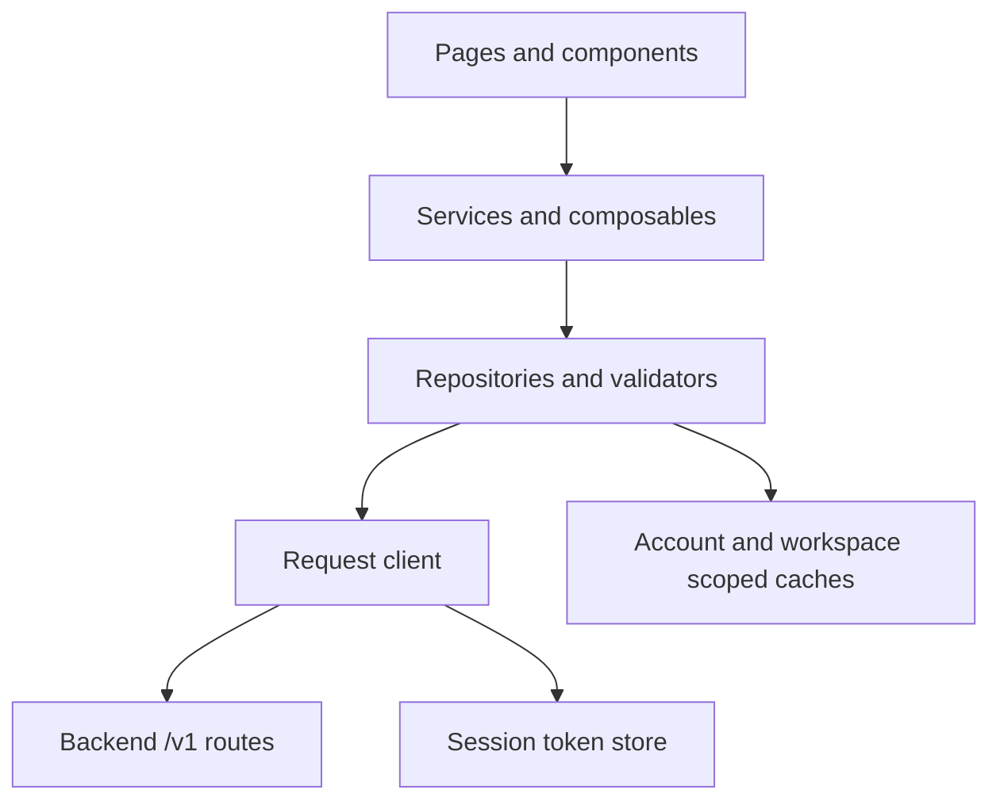

# Frontend Architecture

Pages coordinate presentation and lifecycle. Services orchestrate a user action. Repositories validate server data and manage scoped caching. The request client owns transport and token refresh. Production and tests select some implementations using aliases, so a passing mock test alone does not prove an API artifact is correct.

## Build-time boundaries

`vite.config.ts` selects `AccountRepositoryRuntime`, `TaskRepositoryRuntime`, platform login helpers, developer overlays and subscription scenarios. `VITE_ENABLE_PRIVATE_PROJECTS` also sets the `PRIVATE_PROJECTS` preprocessing condition in `pages.json`, and selects enabled/disabled project implementations. Merely hiding a button is insufficient when a feature must be absent from a release artifact.

The old broad account repository is deliberately unavailable in API mode. Production uses narrower repositories for sessions, profiles, workspaces, projects, jobs, Workflows, billing and organization. Some narrow repositories branch internally; do not assume every repository has one separate mock file and one API file.

`src/pages.json` owns page/subpackage registration. Main-package code must respect the subpackage boundaries; compiled-artifact checks catch module-placement and startup problems that source-only tests cannot detect.

## Sessions and transport

`src/stores/session.ts` stores the token pair under `yuanzhu.session.tokens.v1`. Session generations invalidate reads and scoped UI when an account changes. The store has no Pinia dependency.

`src/services/request.ts` appends a route to `VITE_API_BASE_URL`, assigns `X-Request-ID`, attaches Bearer authentication when requested and normalizes failures into `ApiRequestError`. Concurrent expired-token requests share one refresh promise and replay with rotated credentials. Other authentication failures clear the session as appropriate.

The base URL must use HTTPS, except loopback HTTP or explicitly enabled private-LAN HTTP for development. This transport rule is distinct from the platform's legal-domain list. Result files and reports have additional exact-origin/expiry checks; a valid API URL does not automatically authorize every media URL.

## Discovery and data validation

`designCatalog.ts` reads public `/v1/billing/features`, sends `If-None-Match` and caches ETag-backed `200/304` responses. It distinguishes standard job types, report Workflows and copywriting products. Template metadata is authenticated; client field controls must still match the advertised fields.

DTO types describe expected JSON; repository normalizers enforce it at runtime. Job list/detail normalization validates input/output kinds, identifiers and media metadata. Typed errors such as `*_RESPONSE_INVALID` prevent malformed responses from becoming apparently valid UI state.

Session read caches deduplicate reads and expire scoped data. Project selection, plan counts, list filters and member reads additionally track owner, workspace, project and session. Delayed responses must not write into a newer scope after a switch or permission loss.

## Submission, recovery and results

Preparation validates local fields, server catalog, subscription permission, balance, workspace/project binding and staged Assets. One logical submission keeps a stable body/key while its acceptance is uncertain. Changed content becomes a new logical action. A request accepted with `202` continues as a pending/running task; a local timeout does not prove server failure.

The poll scheduler respects `poll_after_seconds` and `Retry-After`, pauses when hidden and disposes on exit. Result viewers revalidate access and fetch fresh capabilities for expired reports/files. Retry operates on the server-authorized existing task; deletion, movement and read-only enterprise views have separate write guards.

App startup hydrates credentials and installs the app-update presenter. A ready update prompts while foregrounded and restarts only on explicit confirmation; cancellation lets the current version continue.

See [Workflows](/frontend/workflows) for request families, [Projects](/frontend/projects) for scope behavior, and [Testing](/frontend/testing) for contract/artifact checks.

## Source evidence

Frontend `eca0a5f` (2026-10-20): [Build aliases](https://github.com/Orientation-CD/wechat_mini_program/blob/eca0a5f9e0a2aa1cb3fd4f9714114bb3db7fae5f/vite.config.ts) · [Request client](https://github.com/Orientation-CD/wechat_mini_program/blob/eca0a5f9e0a2aa1cb3fd4f9714114bb3db7fae5f/src/services/request.ts) · [Session store](https://github.com/Orientation-CD/wechat_mini_program/blob/eca0a5f9e0a2aa1cb3fd4f9714114bb3db7fae5f/src/stores/session.ts) · [App update](https://github.com/Orientation-CD/wechat_mini_program/blob/eca0a5f9e0a2aa1cb3fd4f9714114bb3db7fae5f/src/services/appUpdate.ts).
