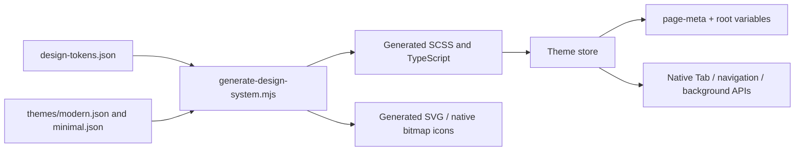

# Design System, Themes and Home Content

The current UI is driven by generated semantic tokens, theme definitions and shared components. Home's artwork/configuration is another layer. Changing a CDN image cannot grant a Feature, and changing theme JSON alone cannot recolor native navigation bars.

## Source → generated output → live page



| Source or implementation | Purpose |
| --- | --- |
| `src/styles/design-tokens.json` | Primitive, semantic and component token baseline |
| `src/styles/themes/*.json` | Theme metadata and overrides |
| `scripts/lib/design-themes.mjs` | Resolve token references and merged themes |
| `scripts/generate-design-system.mjs` | Emit token/style modules, theme data and icons |
| `src/styles/themes.generated.ts` | Generated runtime theme definitions |
| `src/stores/theme.ts` | Validated saved selection, reactive colors and native application |
| `src/composables/usePageTheme.ts` | Per-page root and `page-meta` styles |
| `src/main.ts` | Install the app-wide `themePageMixin` |

Run from the frontend root after editing source definitions:

```bash
pnpm design:generate
pnpm check:design-system
```

Commit inputs and generated outputs together. The checker covers generated drift, semantic usage, contrast for merged themes, theme coverage across registered pages, button layout and project press feedback. The `uview-plus@3.8.55` patch is part of the frozen install; bypassing it can change native component behavior.

## What users can actually select

`DEFAULT_THEME` is `modern`. `minimal` remains a defined theme but has `selectable:false`; `SETTINGS_ENTRY_VISIBLE` is false. The current product must not be described as exposing an active two-theme switcher.

At startup `savedTheme` accepts only a selectable saved ID, otherwise chooses modern. `setTheme` validates and writes storage before changing reactive state. A failed storage write returns false and shows a failure message; it must not claim the choice will persist. The storage key is `yuanzhu.theme.v1`.

`themePageMixin.onShow` reapplies native APIs on initial entry, returning from a subpackage and switching Tabs. Each page also binds `themeStyle` and `themePageStyle`: a page background and a component root are different surfaces. `applyThemeTabBar` omits the Project Tab when its build flag is off and tolerates native API unavailability before the bar exists.

## Home artwork and availability have different authorities

Home composes `HeroCarousel`, `HomeBrandBar`, `HomeShortcutStrip`, `FeatureGroupEntries`, `HomeQuickEntries`, `HomeStores` and a conditional scope switch. Layout must work when any optional section is empty or an image fails. A failed hero image is removed; returning Home refreshes configuration without unnecessarily resetting already-bound media.

| Data | Owner | What it may change |
| --- | --- | --- |
| Group tree, shortcut/quick definitions | `featureGroups.ts`, `homeEntries.ts` | Names, ordering and navigation |
| CDN object paths | `homeAssets.ts`, `designLandingAssets.ts` | Which artwork belongs to each entry |
| Version manifest and `homeHeroBanners` | CDN `config/ad-assets.json`, parsed by `adAssetVersions.ts` | Asset versions and ordered hero campaigns |
| Feature availability, entitlement and prices | Backend catalog/profile and submit checks | Whether a business action is allowed |

`refreshAdAssetVersions` deduplicates concurrent refreshes. An omitted `homeHeroBanners` preserves the last valid list, while an explicit valid empty array clears it. Failed fetching preserves cached configuration and produces a diagnostic warning. Register the CDN as a **request** domain for JSON as well as the domains needed for images.

Production wrappers use `cdn.yuanzhushuzhi.com`; test wrappers and `.env.example` use `static.yuanzhushuzhi.com`. Follow the selected build's setting rather than replacing all environments with one host. The pinned [Home banner guide](https://github.com/Orientation-CD/wechat_mini_program/blob/21db6d824a7b32417bda88e7e31d3f0b91dfa51c/documents/HOME_BANNERS.md) owns the full manifest shape and operator procedure.

## Shared components and native verification

`PageNavBar` owns common back/home controls; group breadcrumbs derive their path from `featureGroups`. `FeatureShell`, option/upload/confirmation steps and account shells preserve state and touch behavior across products. Professional-design availability is [a separate integration boundary](/frontend/floor-plans).

Inspect actual WeChat/Douyin artifacts after a visual change. Native button line boxes differ from browser layout; shared `_button-layout.scss` resets and aligns them. Check narrow screens, long project/member names, safe areas, loading/error/empty states, disabled controls and owner read-only views. Browser component tests cannot establish native pixel correctness.

Markdown result rendering sanitizes input HTML and supplies known styles for rich-text descendants. Unsupported markup remains text. This result renderer should not be replaced by unrestricted HTML injection to match a design mockup.

## Source evidence

Verified 2026-10-28: [Theme state](https://github.com/Orientation-CD/wechat_mini_program/blob/21db6d824a7b32417bda88e7e31d3f0b91dfa51c/src/stores/theme.ts#L4) · [Page theme binding](https://github.com/Orientation-CD/wechat_mini_program/blob/21db6d824a7b32417bda88e7e31d3f0b91dfa51c/src/composables/usePageTheme.ts) · [Generator](https://github.com/Orientation-CD/wechat_mini_program/blob/21db6d824a7b32417bda88e7e31d3f0b91dfa51c/scripts/generate-design-system.mjs) · [Design gate](https://github.com/Orientation-CD/wechat_mini_program/blob/21db6d824a7b32417bda88e7e31d3f0b91dfa51c/scripts/check-design-system.mjs) · [Home lifecycle](https://github.com/Orientation-CD/wechat_mini_program/blob/21db6d824a7b32417bda88e7e31d3f0b91dfa51c/src/pages/home/index.vue) · [Manifest parsing](https://github.com/Orientation-CD/wechat_mini_program/blob/21db6d824a7b32417bda88e7e31d3f0b91dfa51c/src/services/adAssetVersions.ts#L136) · [Markdown rendering](https://github.com/Orientation-CD/wechat_mini_program/blob/21db6d824a7b32417bda88e7e31d3f0b91dfa51c/src/pkg-plans/services/markdownSummary.ts).
