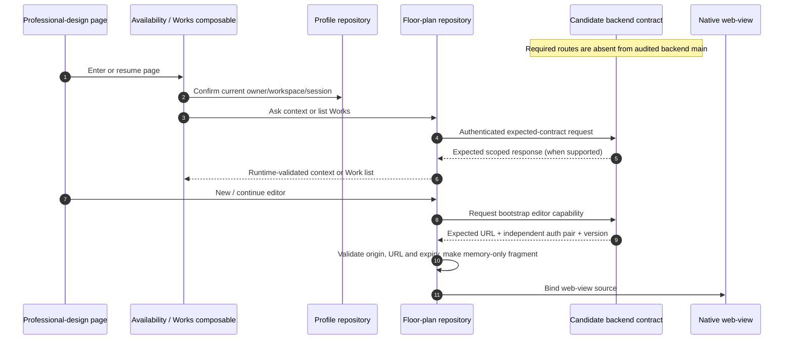

# Professional Floor Plans: Frontend Contract and Integration Boundary

**The audited pair does not yet connect this feature end to end.** Frontend `ui-integration@21db6d8` has professional-design pages, repositories and source-derived contract fixtures. Backend `main@e59716c8` has no floor-plan editor/Works/panorama routes or corresponding feature runtime. The following API table is the frontend's **candidate contract**, not the public-route inventory of that backend or proof of an active deployment.

The [frontend contract notes](https://github.com/Orientation-CD/wechat_mini_program/blob/21db6d824a7b32417bda88e7e31d3f0b91dfa51c/documents/REST_API_INTERFACE.md) explicitly distinguish candidate source fragments from live evidence. The [audited backend router](https://github.com/Orientation-CD/YuanZhu-AI/blob/e59716c83e087deda8477da5ea7b327a40cf65c5/app/api/__init__.py) and [REST contract](https://github.com/Orientation-CD/YuanZhu-AI/blob/e59716c83e087deda8477da5ea7b327a40cf65c5/documents/REST_API_INTERFACE.md) establish the other side of the boundary. When backend support lands, update both source pins, trace the real implementations and validate against the intended environment before promoting this guide to an integrated feature.

## Separate four identities

| Name | Meaning in frontend code |
| --- | --- |
| `colored_floor_plan` | Existing image-generation product; separate from professional modeling |
| `floor_plan_render` / `floor_plan_panorama` | Professional image/panorama Feature or result metadata expected by this frontend |
| Work / `group_id` | A professional Work grouping; opaque text, preserved and URL-encoded without UUID coercion |
| Workflow / Job ID | Standard result identity of a related execution; not interchangeable with the Work group |

Home → AI design → AI professional design uses `useFloorPlanAvailability`. A feature entry leads to the Works view/new-editor path; Profile can open Works without the same new-card behavior. Related results also appear in their supported Plans/project result surfaces.

## Read the implemented frontend chain

This is an executable frontend reading map with an explicit missing producer, not a fabricated database/supplier chain. On the audited backend the request cannot establish availability. A context error is not a successfully empty Works list, and no release flag in the frontend repairs the missing routes.

| Number | Implementation to open | What to verify |
| --- | --- | --- |
| 1–3 | `useFloorPlanAvailability.ts`, `useFloorPlanWorks.ts` | API-only/guest state, owner/workspace and generation/lifetime guards |
| 4–6 | `repositories/floorPlan.ts` | Scope matches response; enabled Feature and release availability; bounded list/count validation |
| 7–9 | `floorPlanHandoff.ts`, editor/panorama page | Independent expiring auth, exact origin, no credential query, safe web-view binding |
| Return/resume | Editor page and Works composable | Loaded editor is not reopened automatically; unknown completion returns to authoritative Works |

## Candidate API surface consumed by the frontend

These are authenticated expected operations extracted from the pinned frontend source fixtures. Do not add them to the backend-main API index without an actual backend implementation.

| Operation | Frontend expectation |
| --- | --- |
| `GET /v1/floor-plan-editor/context` | Scoped owner/workspace, optional project/group, Feature/release availability; optional dual image/panorama capability |
| `POST /v1/floor-plan-editor/editor-url` | New/continue editor with `bootstrap_auth:true`; URL, version and independent auth pair |
| `POST /v1/floor-plan-editor/panorama-viewer-url` | Workflow/workspace-scoped panorama viewer capability |
| `GET /v1/floor-plan-works` | Page/page_size (1–100), optional project; items/total with actual Work scope |
| `GET /v1/floor-plan-works/detail` | Actual Work detail by workspace and opaque group |
| `PATCH /v1/floor-plan-works/{group_id}` | Rename with workspace/name, validated returned Work |
| `POST /v1/floor-plan-works/{group_id}/move` | Expected source project plus target project; validated resulting scope |
| `DELETE /v1/floor-plan-works/{group_id}` | 204 complete or 202 with group/project and cleanup phase |
| `GET /v1/floor-plan-works/{group_id}/deletion` | Continue checking accepted deletion, including supplier-unknown/waiting/cleanup phases |
| `GET /v1/floor-plan-works/workflows` | Bounded limit 1–100/offset, related standard Workflow rows and explicit has_more |

A Work's optional `workflow_count` describes all visible related executions, not just the currently fetched page. When absent, the UI does not invent zero or enable unsupported expansion. Response normalization checks count type, response group/project and each embedded standard Workflow's identity/workspace. It does not scan all history or fan out detail reads to reconstruct a missing server count.

## Availability, ownership and authentication

`useFloorPlanAvailability` returns unavailable in frontend Mock and guest when no access credential exists. API context is considered available only when its Feature is enabled **and** release_available is true. Optional `features.image`, `features.panorama` and render_modes are validated and intersected; they are not inferred from the displayed card.

The page captures account, workspace, session generation and operation revision. Leaving/hiding or switching sessions invalidates pending work. A late capability cannot open an editor for a new owner. Existing Works continue with their actual project; a new Work follows its explicitly accepted current binding.

`floorPlanHandoff` requires:

- Exact `VITE_FLOOR_PLAN_WEB_ORIGIN`, or the API origin when omitted; HTTPS except expressly allowed local development HTTP.
- No URL credentials, preexisting fragment, or auth/access/refresh token query parameters.
- Separate nonempty access/refresh credentials with valid future expiry timestamps.
- A source formed only in memory as `editor_url#auth=<encoded-auth-pair>`.

Do not copy that full source into route parameters, logs, diagnostics, persistent drafts or screenshots. The feature and plans packages keep their own small handoff adapters so one subpackage does not import its sibling. The platform business-domain allow-list remains an additional requirement.

## Management and result behavior

`floorPlanManagement` supports detail, rename, move, deletion and deletion status. Movement is selected through `FloorPlanMoveRuntime`, so a build without project capability cannot acquire project-moving behavior. Delete phases distinguish accepted cleanup from a finished 204; a supplier-unknown result is not permission to delete local records unconditionally.

`floorPlanResults.ts` recognizes professional image/panorama metadata and preserves group identity. A panorama result obtains a fresh viewer capability rather than treating an output image as an interactive panorama URL. General image/copywriting/report paths keep their own result routing.

## What is required to close the integration gap

Use this guide to find frontend code today. Before claiming full availability, verify actual backend routes/Feature definitions, editor release selection, object/Workflow persistence and permission/cleanup behavior against the newly audited backend. Then perform the owned-stack and device checks, including scope switches, expired capabilities, Work continuation, image/panorama results and asynchronous deletion. Committed source fixtures alone cannot close those checks.

## Source evidence

Verified 2026-10-28: [Frontend contract notes](https://github.com/Orientation-CD/wechat_mini_program/blob/21db6d824a7b32417bda88e7e31d3f0b91dfa51c/documents/REST_API_INTERFACE.md) · [Repository](https://github.com/Orientation-CD/wechat_mini_program/blob/21db6d824a7b32417bda88e7e31d3f0b91dfa51c/src/repositories/floorPlan.ts) · [Availability](https://github.com/Orientation-CD/wechat_mini_program/blob/21db6d824a7b32417bda88e7e31d3f0b91dfa51c/src/pkg-features/composables/useFloorPlanAvailability.ts) · [Works lifecycle](https://github.com/Orientation-CD/wechat_mini_program/blob/21db6d824a7b32417bda88e7e31d3f0b91dfa51c/src/composables/useFloorPlanWorks.ts#L31) · [Management](https://github.com/Orientation-CD/wechat_mini_program/blob/21db6d824a7b32417bda88e7e31d3f0b91dfa51c/src/repositories/floorPlanManagement.ts) · [Handoff](https://github.com/Orientation-CD/wechat_mini_program/blob/21db6d824a7b32417bda88e7e31d3f0b91dfa51c/src/pkg-features/services/floorPlanHandoff.ts#L8) · [Editor page](https://github.com/Orientation-CD/wechat_mini_program/blob/21db6d824a7b32417bda88e7e31d3f0b91dfa51c/src/pkg-features/pages/floor_plan_editor/index.vue) · [Panorama page](https://github.com/Orientation-CD/wechat_mini_program/blob/21db6d824a7b32417bda88e7e31d3f0b91dfa51c/src/pkg-plans/pages/panorama/index.vue) · [Candidate contract fixture](https://github.com/Orientation-CD/wechat_mini_program/blob/21db6d824a7b32417bda88e7e31d3f0b91dfa51c/tests/fixtures/backend-floor-plan-group-6060-4bd4094c.json).
