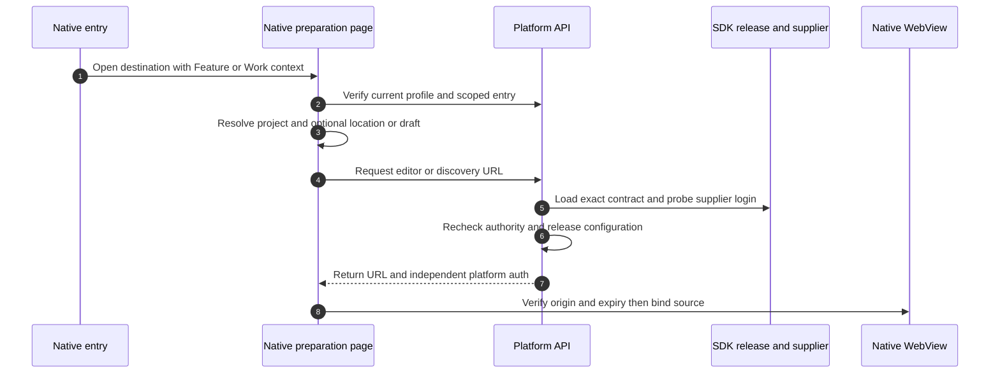

# Floor plans, professional design and native H5 entry

The audited frontend and backend now contain the floor-plan editor, Works, panorama viewer and ThreeVjia image/discovery integration. Availability still depends on the selected SDK release, enabled Features, current account and project authority. A source implementation does not establish that a particular environment or device has passed supplier acceptance. Follow [the server model](/backend/floor-plans) and [each endpoint's execution chain](/reference/flows/floor-plan-flow).

## Prepare the editor in the destination page

The professional catalog checks Feature and release availability in API mode. The floor-plan card shows its packaged background while the check runs and waits for an actionable state before opening. Recent professional entries and discovery shortcuts navigate directly to the native `floor_plan_editor` page. `useFloorPlanEntry` handles navigation. The destination verifies the account and project, then prepares optional location, drafts and the editor URL. Guests use the same preparation page to sign in. See the [professional catalog card](https://github.com/Orientation-CD/wechat_mini_program/blob/7f1a3169338c10bd4139c24318f7a35caf86310c/src/pkg-features/components/DesignProLanding.vue) and [useFloorPlanEntry](https://github.com/Orientation-CD/wechat_mini_program/blob/7f1a3169338c10bd4139c24318f7a35caf86310c/src/composables/useFloorPlanEntry.ts#L11).

Preparation and location both show three orange dots and “正在加载…”. The page clears the native title during preparation and sets the target title on WebView load. The floor-plan shortcut checks availability before offering “AI找我家” or “上传户型图”. Dismissing this choice returns to the previous page without requesting location or recording use. The shortcut records use once its WebView source is ready. See [native preparation](https://github.com/Orientation-CD/wechat_mini_program/blob/7f1a3169338c10bd4139c24318f7a35caf86310c/src/pkg-features/pages/floor_plan_editor/index.vue#L92) and [markLoaded](https://github.com/Orientation-CD/wechat_mini_program/blob/7f1a3169338c10bd4139c24318f7a35caf86310c/src/pkg-features/pages/floor_plan_editor/index.vue#L161).

| Steps | Source to read | What has become true |
| --- | --- | --- |
| 1–3 | [useFloorPlanEntry](https://github.com/Orientation-CD/wechat_mini_program/blob/7f1a3169338c10bd4139c24318f7a35caf86310c/src/composables/useFloorPlanEntry.ts#L11) · [native preparation](https://github.com/Orientation-CD/wechat_mini_program/blob/7f1a3169338c10bd4139c24318f7a35caf86310c/src/pkg-features/pages/floor_plan_editor/index.vue#L92) | The destination has checked its route and entry scope. Restoring an image draft keeps its saved project and source. |
| 4–7 | [refresh_editor_url](https://github.com/Orientation-CD/YuanZhu-AI/blob/f34b8a4d6307c83c6f7bbc905485a4f586d59a99/app/floor_plans/api.py#L156) · [prepare_editor_entry](https://github.com/Orientation-CD/YuanZhu-AI/blob/f34b8a4d6307c83c6f7bbc905485a4f586d59a99/app/floor_plans/editor_entry.py#L182) | The supplier probe succeeded and the final platform authority and configuration still match. |
| 8 | [floorPlanHandoff](https://github.com/Orientation-CD/wechat_mini_program/blob/7f1a3169338c10bd4139c24318f7a35caf86310c/src/pkg-features/services/floorPlanHandoff.ts#L8) · [markLoaded](https://github.com/Orientation-CD/wechat_mini_program/blob/7f1a3169338c10bd4139c24318f7a35caf86310c/src/pkg-features/pages/floor_plan_editor/index.vue#L161) | The page binds a trusted, unexpired source. A paid submission is a later user action. |

Only a new house-catalog entry, design inspiration or same-city shops attempt native location. The consent page explains that coordinates go through the platform to ThreeVjia to match a city. The user can choose a city manually from that screen or in H5 after location is denied or fails. Upload, ordinary image design and nationwide shops skip device location. Inspiration can pass a validated public city when opening an image design from a case. See [discoveryUsesLocation](https://github.com/Orientation-CD/wechat_mini_program/blob/7f1a3169338c10bd4139c24318f7a35caf86310c/src/services/floorPlanPage.ts#L6) and the [WeChat location purpose](https://github.com/Orientation-CD/wechat_mini_program/blob/7f1a3169338c10bd4139c24318f7a35caf86310c/src/manifest.json).

## Four identifiers with different owners

| Identifier | Owner and use |
| --- | --- |
| `group_id` | Opaque supplier Work grouping; preserve it as text and URL-encode it |
| `layout_scheme_id` / supplier scheme ID | Supplier layout/render association; backend resolves it from the registered Work |
| Workflow ID | Platform execution, with its own inputs, reservations, status and persisted output Assets |
| SDK configuration ID + release ID/digest | Shared integration identity and immutable protocol/assets selected for the request |

`colored_floor_plan` remains an ordinary image Feature. `floor_plan_render` and `floor_plan_panorama` are separate professional Features sharing a Workflow. The seven ThreeVjia ordinary-image Features use another Workflow; see [image and discovery handoff](/reference/flows/three-vjia-image-flow). Old frontend schema fixtures are historical/candidate evidence, not an alternative authoritative API specification. New integrations follow the actual backend index.

## Read Works without inventing permissions

`floorPlanRepository.works` validates page/page_size, item identity, permission/assignment fields and optional `workflow_count`. It does not scan all job history to manufacture a missing count. `useFloorPlanWorks` expands related executions only when a positive server count and Work state permit it; the related endpoint has its own bounded limit, offset and `has_more`.

The server stores local ownership and project association, then obtains title, cover and layout metadata from the supplier. It applies readable-project/Workflow rules and revalidates after external reads. An enterprise owner or assignee who may read a Work does not thereby receive author-only editor/rename/delete permission. Respect returned permission fields and read-only result routing. Project reassignment changes current access without rewriting the original submitter identity.

Sources: [floorPlanRepository](https://github.com/Orientation-CD/wechat_mini_program/blob/7f1a3169338c10bd4139c24318f7a35caf86310c/src/repositories/floorPlan.ts#L78) · [useFloorPlanWorks](https://github.com/Orientation-CD/wechat_mini_program/blob/7f1a3169338c10bd4139c24318f7a35caf86310c/src/composables/useFloorPlanWorks.ts#L35) · [finalize_work_views](https://github.com/Orientation-CD/YuanZhu-AI/blob/f34b8a4d6307c83c6f7bbc905485a4f586d59a99/app/floor_plans/group_works.py#L401).

## Trusted handoff and return behavior

`floorPlanHandoff` requires an exact configured web origin (or API origin), HTTPS except explicitly allowed local development HTTP, no URL credentials, no pre-existing fragment or credential query, and nonempty independent access/refresh credentials with future expiries. It creates `editor_url#auth=<encoded-pair>` only in memory. Do not persist this source in drafts, route parameters, diagnostics or logs. Platform business-domain configuration is an additional deployment requirement.

Hiding or unloading the preparation page invalidates pending location and entry work. A change in session generation clears the bound source. `prepared=1` still supports older event-channel handoffs. Panorama keeps its own result page and requests a viewer URL for the Workflow and workspace. Reopen the seven image editors from Drafts and floor-plan Works from Plans → Editing. See [image draft recovery](/reference/flows/three-vjia-image-flow#image-draft).

## Management, uncertainty and recovery

`floorPlanManagement` supports detail, rename, move, delete and deletion status. The build-selected `FloorPlanMoveRuntime` prevents builds without project support from importing project-moving behavior. Move sends the expected source project, so a stale selection cannot silently move a Work from a newly changed project.

Delete is complete only on 204. A 202 keeps a visible deleting item and phase; `supplier_unknown` means the original removal may have been sent, while `supplier_unconfirmed` stops automatic polling after its deadline. Manual confirmation reuses that claim and performs a read; it is not a fresh supplier removal. A timeout is not permission to drop the item locally or replay a remote write. See [the deletion chain](/reference/flows/floor-plan-flow#delete-work).

Sources: [floorPlanManagement](https://github.com/Orientation-CD/wechat_mini_program/blob/7f1a3169338c10bd4139c24318f7a35caf86310c/src/repositories/floorPlanManagement.ts#L34) · [moveFloorPlanWork](https://github.com/Orientation-CD/wechat_mini_program/blob/7f1a3169338c10bd4139c24318f7a35caf86310c/src/repositories/floorPlanMove.ts#L3) · [deletion_view](https://github.com/Orientation-CD/YuanZhu-AI/blob/f34b8a4d6307c83c6f7bbc905485a4f586d59a99/app/floor_plans/group_works.py#L760).

## Verify a real environment

Use an API-mode build and an environment with an available release and enabled Feature. Verify catalog entry and upload separately, session/workspace changes during preparation, original save registration, a successful persisted image/panorama result, read-only enterprise access, expected-source move and accepted asynchronous deletion. The code audit and documentation browser checks do not substitute for these device/supplier checks.
