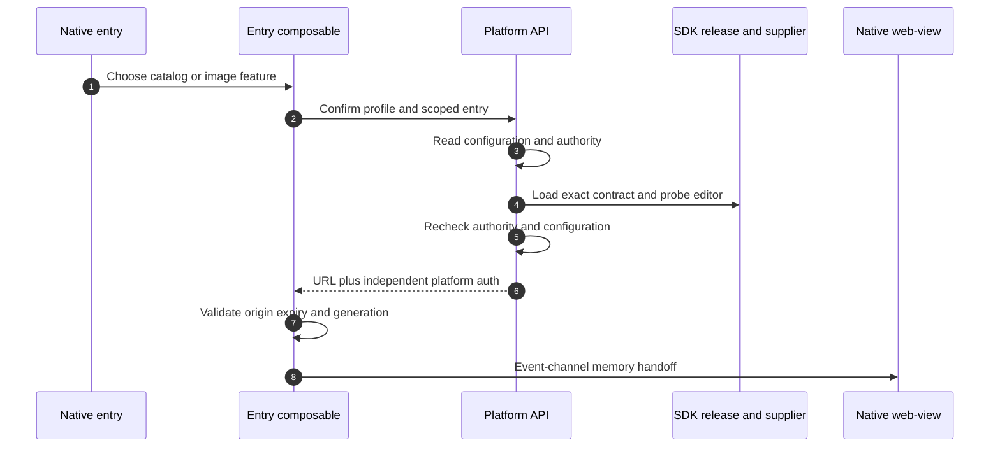

# Floor plans, professional design and native H5 entry

The audited frontend and backend now contain the floor-plan editor, Works, panorama viewer and ThreeVjia image/discovery integration. Availability still depends on the selected SDK release, enabled Features, current account and project authority. A source implementation does not establish that a particular environment or device has passed supplier acceptance. Follow [the server model](/backend/floor-plans) and [each endpoint's execution chain](/reference/flows/floor-plan-flow).

## Start from the user's choice

The professional-design entry uses `useFloorPlanAvailability`: frontend Mock is unavailable, an account without credentials is a guest, and API mode loads the current profile followed by editor context. Only enabled render modes **and** an available release produce an available entry. A context failure produces an error, rather than an empty list of Works.

The user can upload a plan or select one from the house catalog. Catalog entry prepares the capability before native navigation. `useFloorPlanEntry` captures account, workspace, project and session generation, optionally asks for location/privacy consent, requests the URL, then checks the profile again. Location failure permits manual city selection. It sends the prepared source to the destination through the navigation event channel; route parameters carry `prepared=1`, never the bearer fragment.

| Steps | Source to read | What has become true |
| --- | --- | --- |
| 1–2 | [useFloorPlanAvailability](https://github.com/Orientation-CD/wechat_mini_program/blob/88c75c1f15cd65f45c7fb09d560df80430ddc198/src/pkg-features/composables/useFloorPlanAvailability.ts#L13) · [useFloorPlanEntry](https://github.com/Orientation-CD/wechat_mini_program/blob/88c75c1f15cd65f45c7fb09d560df80430ddc198/src/composables/useFloorPlanEntry.ts#L24) | Entry still belongs to the captured account; location is optional context |
| 3–6 | [refresh_editor_url](https://github.com/Orientation-CD/YuanZhu-AI/blob/749e82df3a51c441335ba6a4db607a98bacbcf97/app/floor_plans/api.py#L156) · [prepare_editor_entry](https://github.com/Orientation-CD/YuanZhu-AI/blob/749e82df3a51c441335ba6a4db607a98bacbcf97/app/floor_plans/editor_entry.py#L182) | Supplier probe succeeded and final platform authority/configuration still match |
| 7–8 | [floorPlanHandoff](https://github.com/Orientation-CD/wechat_mini_program/blob/88c75c1f15cd65f45c7fb09d560df80430ddc198/src/services/floorPlanHandoff.ts#L8) | A trusted, unexpired URL can be bound to this web-view; no paid render has been submitted |

## Four identifiers with different owners

| Identifier | Owner and use |
| --- | --- |
| `group_id` | Opaque supplier Work grouping; preserve it as text and URL-encode it |
| `layout_scheme_id` / supplier scheme ID | Supplier layout/render association; backend resolves it from the registered Work |
| Workflow ID | Platform execution, with its own inputs, reservations, status and persisted output Assets |
| SDK configuration ID + release ID/digest | Shared integration identity and immutable protocol/assets selected for the request |

`colored_floor_plan` remains an ordinary image Feature. `floor_plan_render` and `floor_plan_panorama` are separate professional Features sharing a Workflow. The seven ThreeVjia ordinary-image Features use another Workflow; see [image and discovery handoff](/reference/flows/three-vjia-image-flow). Old frontend schema fixtures are historical/candidate evidence, not an alternative authoritative API specification. New integrations follow the actual backend index.

## Read Works without inventing permissions

`floorPlanRepository.works` validates page/page_size, item identity, permission/assignment fields and optional `workflow_count`. It does not scan all job history to manufacture a missing count. `useFloorPlanWorks` expands related executions only when a positive server count and Work state permit it; the related endpoint has its own bounded limit, offset and `has_more`.

The server stores local ownership and project association, then obtains title, cover and layout metadata from the supplier. It applies readable-project/Workflow rules and revalidates after external reads. An enterprise owner or assignee who may read a Work does not thereby receive author-only editor/rename/delete permission. Respect returned permission fields and read-only result routing. Project reassignment changes current access without rewriting the original submitter identity.

Sources: [floorPlanRepository](https://github.com/Orientation-CD/wechat_mini_program/blob/88c75c1f15cd65f45c7fb09d560df80430ddc198/src/repositories/floorPlan.ts#L78) · [useFloorPlanWorks](https://github.com/Orientation-CD/wechat_mini_program/blob/88c75c1f15cd65f45c7fb09d560df80430ddc198/src/composables/useFloorPlanWorks.ts#L35) · [finalize_work_views](https://github.com/Orientation-CD/YuanZhu-AI/blob/749e82df3a51c441335ba6a4db607a98bacbcf97/app/floor_plans/group_works.py#L401).

## Trusted handoff and return behavior

`floorPlanHandoff` requires an exact configured web origin (or API origin), HTTPS except explicitly allowed local development HTTP, no URL credentials, no pre-existing fragment or credential query, and nonempty independent access/refresh credentials with future expiries. It creates `editor_url#auth=<encoded-pair>` only in memory. Do not persist this source in drafts, route parameters, diagnostics or logs. Platform business-domain configuration is an additional deployment requirement.

Late callbacks are discarded after account/workspace/session changes. Native hide during successful navigation preserves the one intended handoff; unmount and session changes invalidate other attempts. Resuming an already loaded editor is different from requesting a new capability. For panoramas, obtain a fresh viewer URL for the Workflow/workspace; an output image URL is not an interactive panorama capability.

## Management, uncertainty and recovery

`floorPlanManagement` supports detail, rename, move, delete and deletion status. The build-selected `FloorPlanMoveRuntime` prevents builds without project support from importing project-moving behavior. Move sends the expected source project, so a stale selection cannot silently move a Work from a newly changed project.

Delete is complete only on 204. A 202 keeps a visible deleting item and phase; `supplier_unknown` means the original removal may have been sent, while `supplier_unconfirmed` stops automatic polling after its deadline. Manual confirmation reuses that claim and performs a read; it is not a fresh supplier removal. A timeout is not permission to drop the item locally or replay a remote write. See [the deletion chain](/reference/flows/floor-plan-flow#delete-work).

Sources: [floorPlanManagement](https://github.com/Orientation-CD/wechat_mini_program/blob/88c75c1f15cd65f45c7fb09d560df80430ddc198/src/repositories/floorPlanManagement.ts#L34) · [moveFloorPlanWork](https://github.com/Orientation-CD/wechat_mini_program/blob/88c75c1f15cd65f45c7fb09d560df80430ddc198/src/repositories/floorPlanMove.ts#L3) · [deletion_view](https://github.com/Orientation-CD/YuanZhu-AI/blob/749e82df3a51c441335ba6a4db607a98bacbcf97/app/floor_plans/group_works.py#L760).

## Verify a real environment

Use an API-mode build and an environment with an available release and enabled Feature. Verify catalog entry and upload separately, session/workspace changes during preparation, original save registration, a successful persisted image/panorama result, read-only enterprise access, expected-source move and accepted asynchronous deletion. The code audit and documentation browser checks do not substitute for these device/supplier checks.
