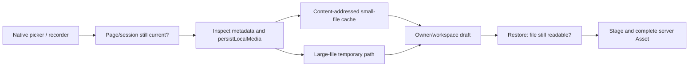

# Trace a User Action Through the Frontend

Pick one recognizable action, then follow its page, action service, repository and transport. Keep account/workspace/project scope and the logical action key alongside the returned task ID. The [full-chain reference](/reference/system-walkthrough) continues into backend transactions, queues, workers and outputs.

## Home → feature → final confirmation

| Step | Code to open | What changes or gets checked |
| --- | --- | --- |
| Open Home | `pages/home/index.vue` | Load content, Feature availability and CDN artwork independently |
| Enter AI design/creation | `services/featureGroups.ts` | Derive group contents and breadcrumbs; design now branches into lightweight/professional |
| Select a business action | `services/useFeatureLauncher.ts` | Availability, login/entitlement explanation and entry guards |
| Inspect active jobs | `services/homeEntryGuard.ts` | Client limit of five active jobs; not a substitute for server limits |
| Confirm local form | Feature page and `*Submit.ts` | Recheck scope, fields, advertised configuration and materials |
| Submit | `designJobSubmit.ts` or `workflowSubmission.ts` | Exact body/key and product-specific route |

A successful catalog response omitting a product means unavailable. A network failure means discovery failed and must remain retryable. Do not turn it into a successfully empty catalog. A group card can be editorial navigation without granting any Feature.

The professional branch has its own page-local availability loader and [an unresolved backend-version boundary](/frontend/floor-plans). Do not bypass its state by hardcoding an enabled card.

## Registration belongs to the action

Available image forms let a guest make local selections and request registration at final submission. Other API-only flows can need identity earlier. `accountGate` coordinates platform registration, current legal documents, phone authorization and cancellation when a page/action leaves.

The request client and session store handle credentials; the action still needs to verify its original scope. If registration or a workspace change makes the frozen context stale, ask the user to reconfirm the action rather than silently binding it to a different account/project.

## An interior image: identify five boundaries

1. The page records choices and a local image. `standardDesignSubmit.ts` resolves prompts, profile, catalog and project binding.
2. `stageDesignImages` inspects roles and local metadata. `stageOne` creates an upload intent, sends actual bytes with the returned signed form, and completes the Asset. A ready replay can reuse the Asset without uploading again.
3. `submitDesignJob` validates the prepared body, checks current write access and posts with the same `Idempotency-Key`. Current image UI uses `POST /v1/design-jobs`; the backend adapts the request into its unified runtime.
4. `202` establishes a public Job identity. It does not mean the image is finished. Backend input archival, reservation and durable submission are explained in [the admission chain](/reference/flows/design-job-lifecycle).
5. Result pages poll authoritative state, validate typed output and materialize an authorized URL. A preview URL is not an Asset ID; an expired preview is not proof the persisted result disappeared.

Try the same exercise for furniture: identify image/mask/reference roles, then compare its submit service with standard design. The transport stays shared while the local material contract changes.

## Recording, video and local file lifetime

Recording summary accepts up to three MP 3/WAV/AAC/M 4 A files, with file-signature/metadata checks, per-file 25,000,000-byte and 120-minute limits. Native per-take capture has its own shorter limit. A summary result renders sanitized Markdown and switches original-audio playback by Asset; leaving pauses/releases audio resources.

Video now has script, system same-style and uploaded-reference same-style paths. [Workflows](/frontend/workflows) specifies their different required materials, template fields and replacement instructions. Importing a completed short-video script only fills the video draft; it never submits or pays automatically.

Local material recovery follows this chain:

The cache's 50 MiB budget,5 MiB persistence threshold and 10-minute reclamation age are independent of upload API limits. Reopening a draft must revalidate each local file, not merely trust a saved path. Picker results arriving after a page/session change must be released instead of saved into the new draft. See [Architecture](/frontend/architecture).

## Plans → result → retry, delete or move

Plans/result routing distinguishes images, Markdown/audio, video, reports and professional-floor-plan metadata. Workspace/project filters and counts are scoped; account switching invalidates pending operations.

A supported retry uses the existing server task and advertised eligibility. A local timeout must not mark a task failed. Delete/move require fresh write access and invalidate affected counts. Current-member read-only views retain result reads/polling but omit retry, delete, move, source-copy and new submission. See [Projects](/frontend/projects).

## Purchase → native bridge → server evidence

Store/subscription pages obtain price and allowed Features from the backend. Creating an order is idempotent. WeChat invokes JSAPI payment; Douyin invokes the industry SDK. Native success, cancellation or uncertainty is then reconciled against server order evidence. Payment history is the recovery entry; client grouping or a demo entitlement switch does not create a purchase.

Active subscriptions show manual-renewal guidance; the current UI does not promise automatic charging or early renewal. For local WeChat mock settlement, follow [Quick Start](/get-started/quickstart); setting a mock mode does not magically replace a native payment invocation.

## Source evidence

Verified 2026-10-28: [Home](https://github.com/Orientation-CD/wechat_mini_program/blob/21db6d824a7b32417bda88e7e31d3f0b91dfa51c/src/pages/home/index.vue) · [Entry guard](https://github.com/Orientation-CD/wechat_mini_program/blob/21db6d824a7b32417bda88e7e31d3f0b91dfa51c/src/services/homeEntryGuard.ts#L9) · [Image submit](https://github.com/Orientation-CD/wechat_mini_program/blob/21db6d824a7b32417bda88e7e31d3f0b91dfa51c/src/pkg-features/services/standardDesignSubmit.ts) · [Asset staging](https://github.com/Orientation-CD/wechat_mini_program/blob/21db6d824a7b32417bda88e7e31d3f0b91dfa51c/src/pkg-features/repositories/designAssets.ts#L156) · [Submission](https://github.com/Orientation-CD/wechat_mini_program/blob/21db6d824a7b32417bda88e7e31d3f0b91dfa51c/src/pkg-features/repositories/designJobSubmit.ts#L204) · [Media cache](https://github.com/Orientation-CD/wechat_mini_program/blob/21db6d824a7b32417bda88e7e31d3f0b91dfa51c/src/pkg-features/services/localMediaStore.ts) · [Audio validation](https://github.com/Orientation-CD/wechat_mini_program/blob/21db6d824a7b32417bda88e7e31d3f0b91dfa51c/src/pkg-features/services/voiceAudioFiles.ts) · [Payment bridge](https://github.com/Orientation-CD/wechat_mini_program/blob/21db6d824a7b32417bda88e7e31d3f0b91dfa51c/src/pkg-account/services/payment.ts).
