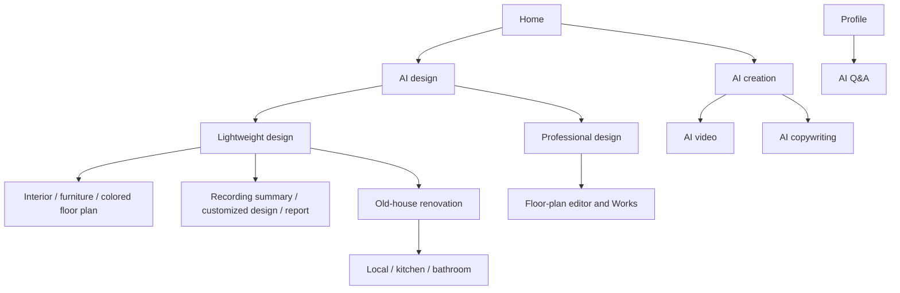

# Frontend Overview

The audited frontend is `ui-integration@3662578`; the backend is `main@e59716c8`. This guide describes those source versions, with full commit pins in [Source versions](/reference/source-revisions). A frontend screen or committed API fixture does not establish that the audited backend implements its contract.

The mini program uses uni-app, Vue 3 and TypeScript, with project-owned shared components and native uni-app controls. Its toolchain is **Node 22 and pnpm 9.15.9**. Shared session/theme modules use Vue state; there is no Pinia dependency. Build settings choose real APIs, frontend Mock, platform adapters and project capabilities before the package is produced.

## Find a feature from the actual navigation

Home also has a hero carousel, shortcut strip, quick actions and store cards. `homeEntries.ts` supplies presentation metadata; `featureGroups.ts` supplies the membership tree and breadcrumbs. `useFeatureLauncher` intersects the displayed entries with discovery and eligibility. A visible card, a displayed price and permission to submit are different facts.

**Professional floor plans require separate integration attention:** this frontend contains their screens and repositories, but the audited backend `main` has no corresponding routes. Read [Floor-plan integration boundaries](/frontend/floor-plans) before trying that path. It is independent of the existing colored-floor-plan image feature.

| Product | Start reading here | Result or boundary |
| --- | --- | --- |
| Standard images and renovations | `pkg-features/components/StandardFeaturePage.vue` | Image task, role-based uploads and prompt selections |
| Furniture and customized design | Their pages plus `*DesignSubmit.ts` services | Mask/reference material or editable template fields |
| Recording summary | `pages/voice_summary` and `voiceSummarySubmit.ts` | Markdown and original recordings |
| AI video | `pages/video_generation` and `videoGenerationSubmit.ts` | Script, system same-style or uploaded-reference same-style |
| Copywriting and AI Q&A | `services/copywriting.ts`, `copywritingSubmit.ts` | Eight distinct text-only Workflow products |
| Design report | `reportBlueprint.ts`, `workflowSubmission.ts` | Blueprint-driven HTML and supported PPTX outputs |
| Professional floor plans | `useFloorPlanAvailability`, `floorPlanRepository` | Implemented frontend; audited backend integration absent |

## Main package, subpackages and shared modules

| Location | Responsibility | Typical first question |
| --- | --- | --- |
| `src/pages` | Startup, Home, Contact, Projects, Plans, Profile and diagnostics | Which button opens the next page? |
| `src/pkg-features` | Forms, feature-specific upload/submission orchestration | What becomes the request body? |
| `src/pkg-plans` | Image, Markdown/audio, video, report and panorama viewers | How is progress refreshed and output rendered? |
| `src/pkg-projects` | Project editor, current-member read-only view and activity | Whose workspace/project is being read? |
| `src/pkg-account` | Login, legal consent, orders, subscription, organization and drafts | Which account action grants or confirms access? |
| `src/repositories`, `src/api/dto` | Requests and runtime response validation | Which endpoint is called, and what JSON is accepted? |
| `src/services`, `src/stores`, `src/domain` | Orchestration, credentials/theme, shared guards and pure rules | Which state must survive, expire or be invalidated? |
| `config`, `scripts`, `tests` | Build profiles, generated assets, contracts and artifact gates | What does the actual target package contain? |

`VITE_ENABLE_PRIVATE_PROJECTS=true` compiles the Project tab, project subpackage and related implementations. Otherwise the tab is absent, with Home, Contact, Plans and Profile remaining. The explicit WeChat Mock build forces projects off; other commands have their own assignments. See [Build modes](/frontend/data-source-modes).

## Read one complete action

Start with an interior-image action. Follow the page's submit handler into `standardDesignSubmit.ts`, then `stageDesignImages`, then `submitDesignJob` and the request client. Keep the logical action key, accepted Job ID, workspace and project visible while following the result page. The frontend currently sends that action through `POST /v1/design-jobs`; the backend adapts it into its unified execution engine. New API integrations should use the canonical [Workflow contract](/backend/workflows).

The [architecture guide](/frontend/architecture) explains shared boundaries. [Workflows](/frontend/workflows) records the actual payload families and video modes. [Projects](/frontend/projects) explains member dashboards and read-only access. The [full-chain reference](/reference/system-walkthrough) continues from frontend requests into database, object storage, queues and workers.

## Source evidence

Verified 2026-10-28: [Navigation tree](https://github.com/Orientation-CD/wechat_mini_program/blob/3662578b384fd5b0fbe7509229b2a08a6fe44ab9/src/services/featureGroups.ts#L23) · [Home composition](https://github.com/Orientation-CD/wechat_mini_program/blob/3662578b384fd5b0fbe7509229b2a08a6fe44ab9/src/pages/home/index.vue) · [Page registration](https://github.com/Orientation-CD/wechat_mini_program/blob/3662578b384fd5b0fbe7509229b2a08a6fe44ab9/src/pages.json) · [Actual submit transport](https://github.com/Orientation-CD/wechat_mini_program/blob/3662578b384fd5b0fbe7509229b2a08a6fe44ab9/src/pkg-features/repositories/designJobSubmit.ts#L182) · [Toolchain](https://github.com/Orientation-CD/wechat_mini_program/blob/3662578b384fd5b0fbe7509229b2a08a6fe44ab9/package.json).
