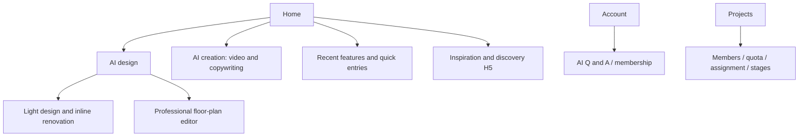

# Frontend overview

The uni-app application builds WeChat and Douyin mini programs from Vue 3 and TypeScript. Use **Node 22 and pnpm 9.15.9** for this application; the documentation repository has its own pnpm version. Vue modules own session/theme state; the application does not depend on Pinia or uView.

## Start from a visible action

`featureGroups.ts` defines design/creation membership and breadcrumbs. Voice summaries and reports are quick/recent entries, outside the light-design membership tree. `useFeatureLauncher` checks discovery and entitlement; a card being visible does not grant execution. Recent features retain a bounded 30-day local history, rank by frequency then recency and show up to three entries; they are not server project activity.

Professional design now has matching backend implementation. Start with [the floor-plan client](/frontend/floor-plans), then follow the H5 gateway and SDK execution. The colored-floor-plan image Feature is a separate standard image action. Inspiration/creation H5 entries use scoped server-prepared URLs rather than opening arbitrary supplier pages.

## Code map

| Source area | First question |
| --- | --- |
| `src/pages` | Which Home, Plans, Projects or Account event triggered navigation? |
| `src/pkg-features` | How are image/voice/video inputs staged and the action body frozen? |
| `src/pkg-features/pages/floor_plan_editor` and `floor_plan_works` | Which original H5/editor handoff or native Works page is opened? |
| `src/pkg-plans` | How do image, audio/Markdown, video, report and panorama results refresh? |
| `src/pkg-projects` | Who is the current assignee, and which member/quota/stage operation is permitted? |
| `src/pkg-account` | Which authenticated membership, invitation, order or legal action occurs? |
| `src/repositories`, `src/api/dto` | Which endpoint is sent and which runtime response shape is accepted? |
| `src/services`, `src/stores` | Which session, scope, uncertain-action or deletion guard must survive navigation? |

Source folders and emitted packages differ: `vite.config.ts` generates virtual floor-plan/professional-design component/service sources, while the WeChat build merges their pages into the feature subpackage to preserve package headroom. Inspect the target artifact and [package gates](/frontend/testing), rather than assuming each emitted package is a source directory. `VITE_ENABLE_PRIVATE_PROJECTS` selects the project implementation at build time; development wrappers have their own explicit assignments.

## Follow one complete task

For an interior image, follow the form into `standardDesignSubmit.ts`, role-bound uploads and `submitDesignJob`. The current wrapper sends `POST /v1/design-jobs`; the backend adapts it into the unified runtime. Keep the action key/body, workspace/project and accepted Job ID through polling and result reads. New integrations use canonical [Workflows](/backend/workflows).

Enterprise read-only detail can expose authorized inputs while denying mutation. The response's permissions and current assignment are authoritative. A deleting result is a placeholder with media cleared; a stale response must not restore the old preview. See [history](/reference/flows/workflow-history-flow) and [projects](/frontend/projects).

Sources: [src/services/featureGroups.ts](https://github.com/Orientation-CD/wechat_mini_program/blob/88c75c1f15cd65f45c7fb09d560df80430ddc198/src/services/featureGroups.ts) · [src/services/recentFeatures.ts](https://github.com/Orientation-CD/wechat_mini_program/blob/88c75c1f15cd65f45c7fb09d560df80430ddc198/src/services/recentFeatures.ts) · [src/services/jobDeletionState.ts](https://github.com/Orientation-CD/wechat_mini_program/blob/88c75c1f15cd65f45c7fb09d560df80430ddc198/src/services/jobDeletionState.ts) · [src/pages.json](https://github.com/Orientation-CD/wechat_mini_program/blob/88c75c1f15cd65f45c7fb09d560df80430ddc198/src/pages.json) · [package.json](https://github.com/Orientation-CD/wechat_mini_program/blob/88c75c1f15cd65f45c7fb09d560df80430ddc198/package.json)
