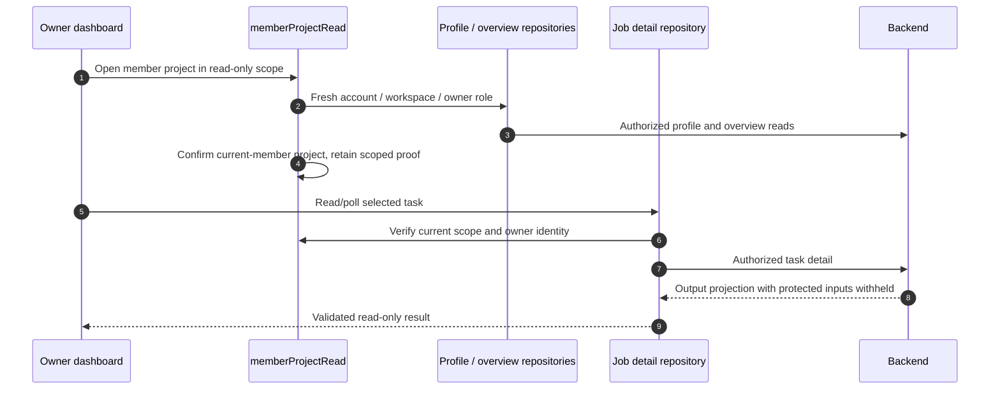

# Projects, Member Dashboards and Read-only Results

The Project experience is compiled with `VITE_ENABLE_PRIVATE_PROJECTS=true`. The server owns membership, project capacity, transitions and write permissions; frontend guards prevent stale UI actions but do not grant access. This page describes the current mini-program UI separately from newer server-only administration capabilities.

## Workspace → selection → accepted binding

An account has a personal workspace and can own/join enterprises. The **current project** is the UI's active selection; the **default project** is a saved preference; the **stage** is a project lifecycle value. None substitutes for another. The temporary `scratch` project is a stable fallback rather than an ordinary deletable customer project.

`projectContextRepository` scopes selection to account/workspace. Home, project pages and submission services share that context. Before preparing a task, binding resolves the accepted project and customer-information snapshot. Changing the picker later must not retarget a frozen/uncertain request. Submission, retry, move and delete invalidate affected project counts.

| Action | Source to follow | State to retain |
| --- | --- | --- |
| Choose/default a project | `repositories/projectContext.ts` | Owner + workspace + selected/default project |
| Submit into it | `services/designProjectBinding.ts` in the feature package | Accepted project + client snapshot + frozen action |
| View project results | `ProjectResults.vue` | Current scoped operation and list filter |
| Move a plan | `PlansJobMove.vue` | Source/target scope; refresh both counts |
| Delete a project | `ProjectDeleteSheet.vue` | Supported server mode and accepted asynchronous state |

## Stages, outcomes and capacity

Authenticated `GET /v1/project-statuses` supplies phases, statuses, selectable flags, outcomes, lost reasons and stale-day rules. The client has a five-minute scoped cache and minimal fallback, rather than treating a hardcoded enum as the complete current catalog.

The UI separates main stages, side states and terminal won/lost outcomes. Historical furthest progress is independent of current stage. Lost metadata can include a required reason and an OTHER note capped at 100 Unicode characters. Restoring follow-up can consume capacity; let the server accept or reject it.

The ordinary-project limit counts 20 in-progress projects, excluding scratch and closed outcomes. Closed projects remain selectable/bindable under the audited contract. Backend `PROJECT_OUTCOMES_ENABLED` and its migration/rollout determine whether outcome writes exist; compiling the frontend does not enable that server behavior.

Project deletion supports the server's move-jobs-to-scratch or delete-jobs mode. A 202 is acceptance, not completed cleanup. The temporary project cannot be deleted as an ordinary project.

## What the current member dashboard computes

Owners open the enterprise overview. `loadProjectOverview` validates `GET /v1/workspaces/{workspace_id}/overview`; the dashboard consumes **current members**. Former-member records may exist in server contracts, but the current component intentionally hides that section.

| Display | Actual computation / guard |
| --- | --- |
| Search and filters | Current member names, server-derived stage/phase/outcome codes; unknown statuses stay visible as other |
| Attention | Count of projects matching server catalog stale-day rules; inactivity only when activity data is supported and Beijing-day difference is greater than 7 |
| Stage distribution | Nonterminal projects; group main statuses by phase when the catalog has more than 4 main statuses |
| Won and conversion | Successful outcome totals and successful/closed ratio; no denominator displays a dash |
| This month's wins | Successful projects with valid closure date in the same Beijing calendar month |
| Sorting | Attention, filtered project count, won count or last activity, with stable name/ID tie-breaks |
| Open member project | Enabled only with the required plan-count capability present; missing is not zero |

`memberProjectDashboard.ts` supplies reusable computations; `EnterpriseProjectOverview.vue` combines them with reactive filters and interaction guards. Beijing time is a display/grouping choice, not a second server write or a polling request per project.

## Follow an owner read from card to output

`createMemberReadView` records session generation, workspace and project. `verifyMemberReadAccess` refreshes profile/owner context on reads and uses a proof whose lifetime is the current scope object. Resume, session changes and membership/project events invalidate that proof; late responses cannot restore it.

The repository first uses the task-detail route. Current backend `main` explicitly supports the authorized owner read-only projection. The frontend retains a narrowly gated workspace-list fallback for specific 404 not-found responses, not a general permission bypass. It never substitutes arbitrary member-private endpoints or cached signed URLs.

The member result pages cover image, Markdown summaries (original recordings withheld), video and report reads without submit, continuation, input-source copy, retry, delete or move. Account/workspace/owner-role loss clears the view and returns to an authorized entry. URL query markers alone are not authority.

## Membership and server-only quota controls

Owners manage enterprise name, seats, invitations and removal; members can leave. Seat capacity includes the owner, pending invites do not reserve seats, and there is no arbitrary member-role editor. Native invitations carry a single-use invite; acceptance rechecks seats and membership on the server.

The latest backend also enforces member monthly Token limits, but this frontend has no member quota editor. Documenting those APIs does not imply the mini program already exposes their administration. Read the [workspace chain](/reference/flows/workspace-membership-flow) for the server's quota/permission rules and preserve inputs when it rejects admission.

## Source evidence

Verified 2026-10-28: [Project context](https://github.com/Orientation-CD/wechat_mini_program/blob/21db6d824a7b32417bda88e7e31d3f0b91dfa51c/src/repositories/projectContext.ts) · [Overview](https://github.com/Orientation-CD/wechat_mini_program/blob/21db6d824a7b32417bda88e7e31d3f0b91dfa51c/src/repositories/projectOverview.ts#L88) · [Dashboard calculations](https://github.com/Orientation-CD/wechat_mini_program/blob/21db6d824a7b32417bda88e7e31d3f0b91dfa51c/src/services/memberProjectDashboard.ts#L9) · [Dashboard UI](https://github.com/Orientation-CD/wechat_mini_program/blob/21db6d824a7b32417bda88e7e31d3f0b91dfa51c/src/components/projects/EnterpriseProjectOverview.vue) · [Read scope](https://github.com/Orientation-CD/wechat_mini_program/blob/21db6d824a7b32417bda88e7e31d3f0b91dfa51c/src/services/memberProjectRead.ts#L52) · [Detail projection](https://github.com/Orientation-CD/wechat_mini_program/blob/21db6d824a7b32417bda88e7e31d3f0b91dfa51c/src/repositories/designJobDetail.ts#L190) · [Backend workspace authorization](https://github.com/Orientation-CD/YuanZhu-AI/blob/e59716c83e087deda8477da5ea7b327a40cf65c5/app/workspaces/workspace_api.py).
