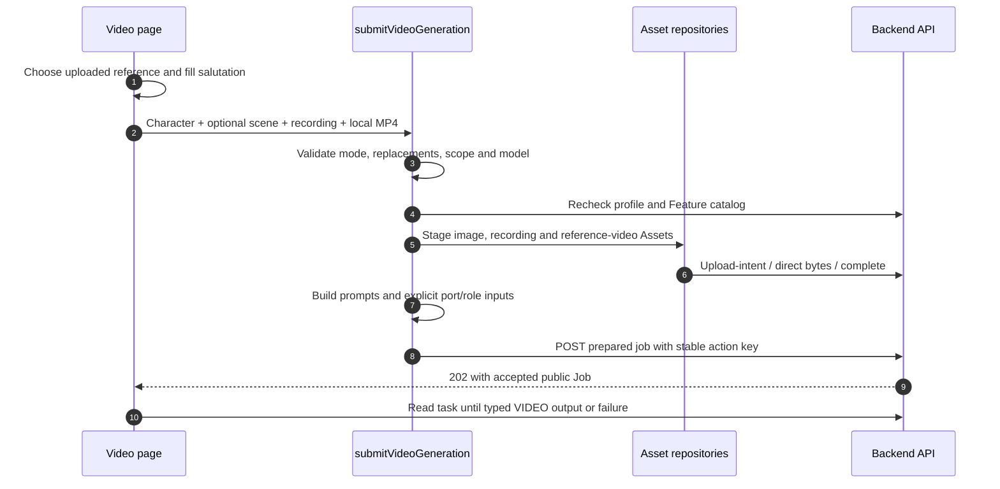

# Frontend Workflow Payloads and Product Paths

A Feature is a discoverable business capability; a Workflow is the backend execution graph; a public Job ID identifies what the UI reads. The current mini program uses two transport families. This page records what its code actually sends; it does not disguise retained client adapters as a completed migration.

## Actual routes selected by this frontend

| Product | Current creation transport | Body shape and code |
| --- | --- | --- |
| Standard images, furniture, customized design | `POST /v1/design-jobs` | `assets`, selected prompts and optional project/client snapshot; feature-specific submit service |
| Recording summary | `POST /v1/design-jobs` | `type:voice_summary`, ordered verified audio Assets |
| All three AI video modes | `POST /v1/design-jobs` | `type:video_generation`, explicit `inputs`, script **or** prompts |
| Eight copywriting/Q&A products | `POST /v1/workflows` | Exact product key, prompts and `inputs:[]`; `prepareCopywriting` then shared submit repository |
| New design reports | `POST /v1/workflows` | `design_report_9/13/17` and structured inputs; `prepareProjectWorkflow` → `postWorkflow` |

`postPrepared` chooses the route for the first four rows; report creation uses `workflowsRepository.submit`. New API consumers should start with [canonical Workflows](/backend/workflows). Existing HTML-report code is not the schema or recommended entry for new reports. Professional floor-plan screens have [a separate candidate-contract boundary](/frontend/floor-plans), rather than an implemented backend path in this audited pair.

## Shared preparation and acceptance

1. Validate local fields and inspect the latest profile/catalog/template data.
2. Confirm workspace, subscription/Feature access and displayed Token balance. These are prechecks; backend admission is final authority, including current member quotas.
3. Bind the project before freezing the request. Stage needed Assets with upload intent → signed form → completion.
4. Keep one logical action's exact body and `Idempotency-Key` while acceptance is uncertain. Changing content creates a new action only through the supported UI path.
5. Accept a validated pending task from 202, then read status/output through its public identity. Retry eligibility and charging follow server evidence, not a local clock.

The backend's durable input archival is separate from local media saving and Asset upload completion. Read [Admission and workers](/reference/flows/design-job-lifecycle) for that transaction/queue chain.

## Video has three modes

| UI mode | Script/template selection | Reference video | Required voice/materials |
| --- | --- | --- | --- |
| Write/import script | `script`, UI max 1000 characters | None | One character composite and exactly one scene image; recording optional |
| System same-style example | One `prompts` selection from `purpose=same_style_video` | Bound to the backend template; preview URL refreshed from catalog | One portrait photo, recording strictly>5 seconds; scene optional |
| Upload reference for same-style | Reserved prompt name `__user_reference__` | One completed VIDEO Asset with `reference_video` port/role | One portrait photo, recording strictly>5 seconds; scene optional |

`script` and `prompts` are mutually exclusive. Same-style template fields must be **exactly `称呼`**, with the page enforcing its 24-character limit. The reserved custom name is not a template for a user to create in the admin editor. A system selection carries the actual template name, not its display label or preview URL.

The page requests authenticated `GET /v1/prompt-templates?purpose=same_style_video`. `mapEditablePromptTemplates` validates names, field metadata, display name and optional preview/poster URLs. Preview URLs are ephemeral; fetching a fresh catalog renews access without changing a submitted task's frozen template/reference identity.

### Keep four kinds of limit separate

| Concern | Current mini-program form | Public schema / admitted mode |
| --- | --- | --- |
| Character image | Script: one three-view composite; same-style: one portrait photo | Exactly one `character_image/primary` |
| Scene images | Script: exactly 1; same-style:0–1 | General schema:0–12; same-style admission further caps 0–1 |
| Script text | Script path 1–1000 characters | Public request model max 20000; not sent with same-style prompts |
| Recording | Same-style required; UI recorder captures up to 120 seconds | At most 1; same-style requires audio/mpeg with duration_ms>5000 |
| Custom reference video | One MP4, at most 100 MiB (104857600 bytes) | Validated VIDEO/reference_video Asset and mode-specific admission |
| Dialogue replacement list | At most 10 pairs, each side at most 200 characters | Same-style only; forwarded as instructions to rendering |

An accepted generic schema inventory is not proof that the integrated supplier supports every combination. Script creation currently needs a scene for its upstream background path. Same-style uses the remake path and allows an empty scene list. Do not “fix” UI validation by copying the general API maximum.

### Trace one custom same-style submit



`stageVideoImageAssets` maps task role `primary/reference` to upload role `image/reference_image`. `stageReferenceVideoAsset` sets `type:VIDEO`, upload role `reference_video`, and returns a typed input with matching port/role. A display URL, a local path and an Asset UUID cannot be substituted for one another.

The same-style selection fragment below is inserted into the otherwise complete prepared body; staging supplies the Asset IDs:

```json
{
  "prompts": {"prompts": [{"name": "__user_reference__", "fields": [{"name": "称呼", "value": "设计顾问"}]}]},
  "replacements": [{"from": "原台词", "to": "新台词"}],
  "replace_scope": "dialogue"
}
```

`replacements` and `replace_scope` are top-level peers of `prompts`. With no nonempty replacement pairs the client omits both; it does not send an empty scope or null. `dialogue` requests shot-plan dialogue replacement; absent scope follows backend `all`. The backend freezes and forwards the instruction; it does not locally rewrite the script. Identical or half-filled pairs are invalid.

Model choices/prices come from the catalog when enabled. The frontend's model whitelist and baseline display are not server pricing authority. Importing a completed copywriting short-video script only fills the script form, asks before replacing differing text, and never submits a new video automatically.

## Copywriting and AI Q&A remain eight products

| Product key | Current title | Group |
| --- | --- | --- |
| `copywriting_short_video` | 短视频脚本 | Creative |
| `copywriting_xiaohongshu` | 小红书笔记 | Creative |
| `copywriting_moments` | 朋友圈文案 | Creative |
| `copywriting_titles` | 标题金句 | Creative |
| `copywriting_shooting` | 拍摄建议 | Creative |
| `copywriting_knowledge` | 装修知识 | Q&A |
| `copywriting_pitfalls` | 避坑指南 | Q&A |
| `copywriting_operations_experience` | 运营经验 | Q&A |

`prepareCopywriting` validates the complete advertised `feature_copywriting_*` template field set, sends every field once in its declared order, uses literal `未提供` for UI-optional blanks and caps field text at 4000 characters. Required text is trimmed/nonempty. There is no generic `ai_copywriting` request or media upload for these products. Shooting suggestions produce text, not footage. Safe Markdown rendering supports inline text even if optional file metadata is absent.

## New report preparation follows the blueprint

The form's 8/12/16 content pages produce 9/13/17 total pages and exact product keys `design_report_9/13/17`. `buildReportWorkflowRequest` builds the request from project/client data, completed recording summaries, original/generated colored-floor-plan Assets and interior results from distinct spaces.

Blueprint source declarations can refer to existing Assets, selected generated child content or configured Gallery content. These are distinct shapes; do not copy a preview URL into an Asset field or create extra frontend child submissions/charges. The current interior page limit is three images. Changing report size may require reselecting sources.

An optional attachment is `.pptx`, at most 100 MiB/104857600 bytes, staged and verified before the request. A saved draft rechecks attachment availability. `prepareProjectWorkflow` binds project, deep-freezes the body and creates its action/key; `restoreWorkflowAttempt` recovers the original body/key instead of regenerating one. `postWorkflow` uses the canonical route.

The HTML viewer requires fresh authorized access. Supported PPTX artifacts are consumed as typed outputs; a backend artifact does not imply every page has a separate export action. For child execution, durable state and output publication, continue with [the report chain](/reference/flows/report-view-flow).

## Source evidence

Verified 2026-10-28: [Actual route choice](https://github.com/Orientation-CD/wechat_mini_program/blob/3662578b384fd5b0fbe7509229b2a08a6fe44ab9/src/pkg-features/repositories/designJobSubmit.ts#L182) · [Video orchestration](https://github.com/Orientation-CD/wechat_mini_program/blob/3662578b384fd5b0fbe7509229b2a08a6fe44ab9/src/pkg-features/services/videoGenerationSubmit.ts#L69) · [Same-style fields](https://github.com/Orientation-CD/wechat_mini_program/blob/3662578b384fd5b0fbe7509229b2a08a6fe44ab9/src/pkg-features/services/sameStyleVideo.ts#L10) · [Video staging/limits](https://github.com/Orientation-CD/wechat_mini_program/blob/3662578b384fd5b0fbe7509229b2a08a6fe44ab9/src/pkg-features/repositories/videoAssets.ts#L25) · [Catalog selection](https://github.com/Orientation-CD/wechat_mini_program/blob/3662578b384fd5b0fbe7509229b2a08a6fe44ab9/src/pkg-features/repositories/promptCatalog.ts#L198) · [Report builder](https://github.com/Orientation-CD/wechat_mini_program/blob/3662578b384fd5b0fbe7509229b2a08a6fe44ab9/src/pkg-features/services/reportBlueprint.ts#L65) · [Report action freezing](https://github.com/Orientation-CD/wechat_mini_program/blob/3662578b384fd5b0fbe7509229b2a08a6fe44ab9/src/pkg-features/services/workflowSubmission.ts) · [Backend video mode limits](https://github.com/Orientation-CD/YuanZhu-AI/blob/e59716c83e087deda8477da5ea7b327a40cf65c5/app/workflows/workflow_admission.py#L1279).
