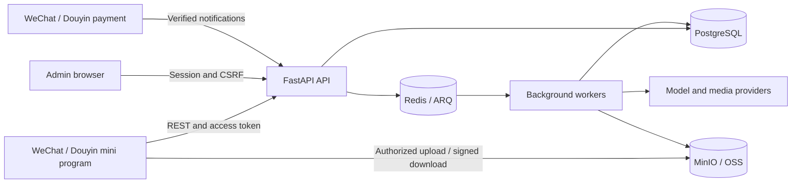

# System Architecture

The mini programs provide the user interface. The backend owns accounts, prices, permissions, persistent jobs and settlement. PostgreSQL records durable business state; Redis coordinates background work; object storage holds uploaded and generated files.

## Request addresses

Public product routes use **`/v1`**, for example `/v1/me`, `/v1/billing/features` and `/v1/workflows`. Health routes such as `/health/ready`, Admin under `/admin`, and development-only `/mock` routes have separate prefixes. Do not add an `/api` prefix merely because the server is an API.

The frontend appends each route to `VITE_API_BASE_URL`. For a local stack on port 8080, the base is `http://127.0.0.1:8080`, and the complete profile URL is `http://127.0.0.1:8080/v1/me`.

## A generation request

1. The app discovers available Features, prices and applicable permissions. Authenticated template discovery supplies editable fields.
2. Files use role-bound upload intents, direct object-storage upload and server completion verification. Text-only copywriting needs no file upload. Some recording-entry flows also use dedicated upload-session APIs.
3. The app submits an idempotent request to `/v1/workflows` or a supported legacy `/v1/design-jobs` route. A `202` means accepted, not finished.
4. The server checks the account, workspace/project, entitlement, concurrent-job limit and balances. Workers execute the configured Workflow operations and persist their results.
5. The app reads status with server-provided poll timing. It displays an image, Markdown, video or report when the server reports completion.

Canonical Workflows and legacy design-job compatibility are explained in [Frontend workflows](/frontend/workflows) and [API reference](/reference/rest-api). Operation execution can involve image generation, speech/text processing, report assembly, local media work or export; it is not always a single external image-model request.

## Identity, money and collaboration

WeChat and Douyin exchange platform login/phone credentials through the backend. The app receives an access/refresh token pair; the request client shares refresh work across concurrent requests. AppSecrets and provider credentials belong on the server.

Subscriptions grant permissions and allowances. Token balances fund generation. The server selects prices and performs reservations, settlement or release; a client precheck is only an early explanation. A native payment success callback alone does not establish paid status: the app confirms the server order.

Each account has a personal workspace and may own or join enterprises. A submission names its workspace explicitly. Projects organize a user's work within that workspace; the current/default project and enterprise read-only member views have different purposes. See [Projects and collaboration](/frontend/projects).

## Local and cloud environments

A local Docker stack contains the API, workers, PostgreSQL, Redis, MinIO and selected provider mocks. It still needs valid legal/product configuration. Cloud deployment uses separately configured services and persistent storage. Private video dependencies are built into the server image, so even a local image build requires authorized source access.

Follow [Quick Start](/get-started/quickstart) for a local acceptance loop and [Cloud architecture](/deploy/cloud-architecture) for deployment details.

## Source evidence

Documented against frontend `eca0a5f` and backend `b13cc56` (2026-10-20). [Frontend request client](https://github.com/Orientation-CD/wechat_mini_program/blob/eca0a5f9e0a2aa1cb3fd4f9714114bb3db7fae5f/src/services/request.ts) · [Backend application assembly](https://github.com/Orientation-CD/YuanZhu-AI/blob/b13cc5668920620a274cb91a3393ed9fadac72ae/app/main.py) · [Backend local runbook](https://github.com/Orientation-CD/YuanZhu-AI/blob/b13cc5668920620a274cb91a3393ed9fadac72ae/scripts/runbook.md).
