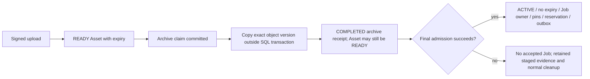

# Data model: identity, durable inputs and accounting

This is a relationship guide to the current ORM, not replacement DDL. Follow the pinned model and packaged forward migrations for columns, indexes and constraints. Public Workflow identity is `design_jobs.id`; a WorkflowRun, OperationRun, submission generation and provider task have different identities.

## Domain map

| Domain | Current records | Invariant |
| --- | --- | --- |
| Identity/consent | `users`, `auth_sessions`, `legal_documents`, `legal_document_acceptances` | Revocable sessions and immutable accepted document IDs |
| Asset hierarchy | `assets`, `images`, `audio_assets`, `documents`, `video_assets` | Verified content, type, hash, size and exact object version agree |
| Upload/copy | `asset_upload_intents`, `asset_copy_intents` | Owner/role/limits and action identity are immutable |
| Input archival | `asset_input_archives` | Asset-owned relocation receipt, exact source/destination versions, copy lease and acknowledgement survive recovery |
| Workspaces | `workspaces`, `personal_workspaces`, `enterprises`, membership/history | Wallet owner and current permission differ from past membership |
| Member quotas | `enterprise_member_token_limits`, `enterprise_member_token_limit_audits`, enterprise default columns | Durable custom configuration and immutable configuration audit; financial usage comes from the ledger |
| Projects | `projects`, `project_preferences`, `project_activity_state` | Creator-private management, durable default and trusted activity epoch |
| Runtime | `design_jobs`, `workflow_runs`, `operation_runs`, input/dependency/output rows | Frozen execution graph and physical input pins |
| Attempts/scheduling | `design_job_submissions`, `operation_provider_calls`, retry receipts, `workflow_outbox_events` | Generation-fenced attempts and transactional handoff |
| Publication | `design_job_outputs`, `workflow_generated_sources` | Typed immutable outputs, retained dependencies and exact publication identity |
| Local conversion | PPTX/video attempts and reservations | Bounded resources and recoverable staging/publication |
| Configuration | Features, Workflow/Operation definitions, node configurations, provider connections/models, prompt templates | Price/access, graph/model binding and prompt purpose/reference media are distinct |
| Billing | `token_ledger_entries`, plans, subscriptions, packages, payment/refund orders | Durable financial evidence, not a UI balance calculation |
| Collaboration/marketing | enterprise/share/referral invitations, rewards, finance cost records | Joining a workspace, referral attribution and reward fulfillment are separate protocols |

## Upload completion is not input activation

The Asset UUID and bytes do not change during relocation. The locator moves to durable input storage. A `COMPLETED` archive receipt is not an accepted Job; admission can still reject entitlement, workspace funds or member quota. Final activation rechecks locked evidence and commits ownership, pins and financial/scheduling state together. Borrowed ACTIVE dependencies keep their original ownership. See [Asset lifecycle](/reference/flows/asset-upload-flow).

Archive `id` is stable; its nullable Asset FK can become null after deletion. The retained tombstone still owns a late copy acknowledgement. Deleting the receipt to “clear a stuck upload” can orphan an object or lose recovery authority.

## Monthly quota is not a second wallet

The enterprise's `remaining_tokens - reserved_tokens` is spendable shared balance. Per-member `used_tokens` includes committed reservations and consumption once; `reserved_tokens` is its pending subset, so adding them double-counts. Release contributes zero. A reservation's Asia/Shanghai month remains its accounting month even if settlement crosses a month boundary. Consumption with no reservation history uses settlement month.

A missing override inherits the enterprise default; a stored null override is explicitly unlimited; a stored zero pauses that member. Global defaults cannot be zero. Configuration audit rows do not create financial ledger entries. Owner exemption, former-member history and global-save override reset are explained in [quota](/reference/flows/member-quota-flow).

## Permission and state are separate dimensions

Project management remains creator-private. A current enterprise owner has explicitly scoped read-only task/project projections; another member's task detail returns `inputs: []` and does not grant retry, move, deletion or source-copy rights.

Job status (`pending/running/completed/failed`), financial status (`unreserved/reserved/settled/released`), submission certainty, Asset state and archive receipt state are different state machines. An expiring URL is a capability, not durable Asset identity. Performance histories in Redis are bounded observations, not replacements for the SQL financial/runtime record.

Read [recovery](/deploy/production) before selecting a rollback image: application rollback preserves forward schema and cannot recreate removed tables or reverse compatibility boundaries.

Source: [app/persistence/db_models.py](https://github.com/Orientation-CD/YuanZhu-AI/blob/e59716c83e087deda8477da5ea7b327a40cf65c5/app/persistence/db_models.py) · [app/assets/asset_input_archival.py](https://github.com/Orientation-CD/YuanZhu-AI/blob/e59716c83e087deda8477da5ea7b327a40cf65c5/app/assets/asset_input_archival.py) · [app/billing/member_token_quotas.py](https://github.com/Orientation-CD/YuanZhu-AI/blob/e59716c83e087deda8477da5ea7b327a40cf65c5/app/billing/member_token_quotas.py) · [app/core/models.py](https://github.com/Orientation-CD/YuanZhu-AI/blob/e59716c83e087deda8477da5ea7b327a40cf65c5/app/core/models.py)
