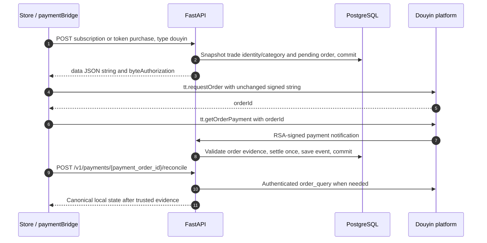
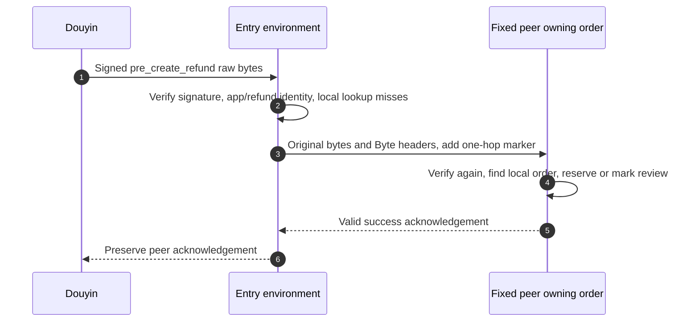

# Douyin trade: checkout, RSA notifications and compensation

The shared [purchase chain](/reference/flows/payment-flow) explains pricing, JWT, idempotency and token settlement. This chapter follows the places where Douyin differs: the application signs **client order data**, the client creates the platform order, server queries use a Redis-shared client token, callbacks use the platform RSA public key, and platform after-sales may originate outside the mini program.

Keep three identities separate: local `PaymentOrder.id` (UUID), merchant `out_trade_no` sent as `outOrderNo/out_order_no`, and platform `provider_order_id` returned as `orderId/order_id`. The order entry `pages/payment_order/index` redirects to Payment records with the local UUID; it is not a second settlement endpoint.

## 1. A concrete Douyin checkout {#douyin-checkout}

| Step | Source location | Data and behavior |
| --- | --- | --- |
| 1 | `store/index.vue` → [runCheckout](https://github.com/Orientation-CD/wechat_mini_program/blob/3662578b384fd5b0fbe7509229b2a08a6fe44ab9/src/pkg-account/pages/store/index.vue#L212); [currentPaymentType](https://github.com/Orientation-CD/wechat_mini_program/blob/3662578b384fd5b0fbe7509229b2a08a6fe44ab9/src/pkg-account/services/paymentPlatform.ts#L3); [create_subscription](https://github.com/Orientation-CD/YuanZhu-AI/blob/e59716c83e087deda8477da5ea7b327a40cf65c5/app/billing/billing_api.py#L430) / [create_token_purchase](https://github.com/Orientation-CD/YuanZhu-AI/blob/e59716c83e087deda8477da5ea7b327a40cf65c5/app/billing/billing_api.py#L573) | Build target selects `douyin`; server obtains payer identity from authenticated account, not a supplied OpenID. |
| 2 | [snapshot_checkout](https://github.com/Orientation-CD/YuanZhu-AI/blob/e59716c83e087deda8477da5ea7b327a40cf65c5/app/billing/douyin_pay.py#L123) | Read `DouyinTradeConfiguration` for purchase kind; store AppID/merchant, SKU/title, HTTPS image, goods/tag group, configuration version, and local order-entry schema. Snapshot precedes commit. |
| 3 | [create_checkout](https://github.com/Orientation-CD/YuanZhu-AI/blob/e59716c83e087deda8477da5ea7b327a40cf65c5/app/billing/douyin_pay.py#L214) → [signed_checkout](https://github.com/Orientation-CD/YuanZhu-AI/blob/e59716c83e087deda8477da5ea7b327a40cf65c5/app/billing/douyin_pay.py#L87) | For a new provider order, check current tags/expiry and return one exact JSON string plus RSA authorization. Saved provider id instead yields `action:"get_order_payment"`. |
| 4 | [requestDouyinPayment](https://github.com/Orientation-CD/wechat_mini_program/blob/3662578b384fd5b0fbe7509229b2a08a6fe44ab9/src/pkg-account/services/payment.ts#L119) | `action:"request_order"` calls `tt.requestOrder` with the unchanged string/signature. The client must not parse/reformat JSON before signing use. |
| 5 | Same bridge success/error handlers | Validate returned `orderId`. Error `21016` can mean the original order exists; reconcile the local order and recover `provider_order_id` instead of creating another purchase. |
| 6 | `requestDouyinPayment()` → `tt.getOrderPayment` | Opens cashier. Error 4 maps to cancellation; error 9 proceeds to server confirmation. A bridge result does not credit tokens. |
| 7 | [douyin_notification](https://github.com/Orientation-CD/YuanZhu-AI/blob/e59716c83e087deda8477da5ea7b327a40cf65c5/app/billing/douyin_api.py#L463) → [verified_notification](https://github.com/Orientation-CD/YuanZhu-AI/blob/e59716c83e087deda8477da5ea7b327a40cf65c5/app/billing/douyin_pay.py#L100) | Verify platform signature over raw bytes, then verify envelope/order identity and event type. |
| 8 | [validate_order_evidence](https://github.com/Orientation-CD/YuanZhu-AI/blob/e59716c83e087deda8477da5ea7b327a40cf65c5/app/billing/douyin_pay.py#L365) → [complete_payment_order](https://github.com/Orientation-CD/YuanZhu-AI/blob/e59716c83e087deda8477da5ea7b327a40cf65c5/app/billing/billing.py#L750) | Application/merchant/order/currency/amount checks precede atomic shared settlement; event SHA-256 and per-order advisory lock protect replay/concurrency. |
| 9 | [paymentReconciliationRepository](https://github.com/Orientation-CD/wechat_mini_program/blob/3662578b384fd5b0fbe7509229b2a08a6fe44ab9/src/pkg-account/repositories/paymentReconciliation.ts#L47) → [reconcile_payment](https://github.com/Orientation-CD/YuanZhu-AI/blob/e59716c83e087deda8477da5ea7b327a40cf65c5/app/billing/douyin_api.py#L257) | Douyin polls by POST, unlike WeChat's local-only GET. |
| 10 | [reconcile_order](https://github.com/Orientation-CD/YuanZhu-AI/blob/e59716c83e087deda8477da5ea7b327a40cf65c5/app/billing/douyin_api.py#L70) → [query_order](https://github.com/Orientation-CD/YuanZhu-AI/blob/e59716c83e087deda8477da5ea7b327a40cf65c5/app/billing/douyin_pay.py#L271) → [call](https://github.com/Orientation-CD/YuanZhu-AI/blob/e59716c83e087deda8477da5ea7b327a40cf65c5/app/billing/douyin_pay.py#L179) | Query with server client token, validate evidence and repair missing callback; a live paid order can also discover refunds. |
| 11 | `payment_response()` → `mapPaymentReconciliation()` → `applyOrder()` | UI trusts returned local paid/closed/refunded status and refreshes profile after paid. |

### What is frozen, and what is checked again {#trade-snapshot}

`snapshot_checkout()` rejects missing trade configuration, a mock tag in live mode, non-702 goods type, invalid/oversized HTTPS image and amount over 50,000 fen (the pinned category's ¥500 per-order bound). This describes the current implemented category, not a universal Douyin limit. `require_mode()` rejects switching an existing order from mock to live or changing its snapshot AppID/merchant. Fresh checkout also checks tag membership and remaining expiry, so an old snapshot does not bypass current platform validation.

The backend's new-order response contains `mode`, `action`, local id, `data` and `byteAuthorization`; `data` contains `skuList`, `outOrderNo`, `totalAmount`, `currency`, `payExpireSeconds`, notification URL and order-entry schema. A resumed platform order instead carries `orderId`. Neither object is a token ledger credit.

## 2. Three different cryptographic/credential directions {#douyin-signatures}

| Direction | Input / credential | Function to read |
| --- | --- | --- |
| Application → client `tt.requestOrder` | Application RSA-2048 private key signs `POST\n/requestOrder\n<timestamp>\n<nonce>\n<data>\n` with PKCS#1 v1.5 / SHA-256; authorization includes AppID and key version | [signed_checkout](https://github.com/Orientation-CD/YuanZhu-AI/blob/e59716c83e087deda8477da5ea7b327a40cf65c5/app/billing/douyin_pay.py#L87), [application_private_key](https://github.com/Orientation-CD/YuanZhu-AI/blob/e59716c83e087deda8477da5ea7b327a40cf65c5/app/identity/douyin_keys.py#L9) |
| Server → trade query/refund APIs | `access-token` from the server-only client-token flow; not the user's JWT and not the checkout signature | [call](https://github.com/Orientation-CD/YuanZhu-AI/blob/e59716c83e087deda8477da5ea7b327a40cf65c5/app/billing/douyin_pay.py#L179), [_client_token](https://github.com/Orientation-CD/YuanZhu-AI/blob/e59716c83e087deda8477da5ea7b327a40cf65c5/app/identity/douyin_auth.py#L243) |
| Platform → server notification | Platform RSA public key verifies `<timestamp>\n<nonce>\n<raw body>\n` using Byte signature headers | [verified_notification](https://github.com/Orientation-CD/YuanZhu-AI/blob/e59716c83e087deda8477da5ea7b327a40cf65c5/app/billing/douyin_pay.py#L100) |

`_client_token()` caches by application in Redis and uses a lease/single-flight lock across replicas; `call()` invalidates only the matching stale token on a known invalid-token response, then retries once. Network calls use configured timeout and no redirects. Mock mode forbids trade-network calls, rather than silently trying a live endpoint.

For notifications, preserve the original JSON bytes. Verification checks `byte-timestamp`, nonempty `byte-nonce-str`, base64 `byte-signature`, a 1,800-second freshness window (to allow the platform retry window), RSA signature, then parses the envelope and its `msg` (JSON string or object). Reformatting the body before verification changes the signed bytes. This is not the retired SHA1/token protocol, and the platform verification key is not the application's uploaded public key.

## 3. Every public Douyin entry point {#douyin-apis}

### POST /v1/payments/{payment_order_id}/reconcile {#payment-reconcile}

**UI:** Store confirmation, Payment records poller, and the `tt.requestOrder` duplicate-order error branch use this path through `paymentReconciliationRepository.get()`/`requestDouyinPayment()`. JWT identifies the owner. No client-paid flag is accepted.

**Processing:** [reconcile_payment](https://github.com/Orientation-CD/YuanZhu-AI/blob/e59716c83e087deda8477da5ea7b327a40cf65c5/app/billing/douyin_api.py#L257) → `owned_order()` → `reconcile_order()`. Non-Douyin → `409 PAYMENT_TYPE_MISMATCH`; unknown/foreign order → `404 PAYMENT_ORDER_NOT_FOUND`. Pending/closed orders release the DB transaction, query canonical platform state, take the `douyin-order` advisory lock and refresh state after I/O. `SUCCESS` runs shared settlement (including a previously closed Douyin order); `FAIL/TIMEOUT` closes it; `PROCESS` preserves pending and can save provider id. A provider “not created” result closes pending only after stored safe-close time; before that it remains unresolved. Unverifiable identity/amount/network failure → `503` safe error, not guessed closure.

**Return and further work:** `200 PaymentOrderResponse`, possibly still pending. Already paid in live mode calls `discover_refunds()` to recover missed after-sales evidence; already refunded returns. There is no generic WeChat implementation behind this path. Do not replace WeChat GET with this POST.

### POST /v1/webhooks/douyin/payment {#douyin-payment-webhook}

**Caller:** platform server only; no page HTTP caller/JWT. `douyin_notification()` accepts callbacks only in live mode (`404` in mock), verifies bytes, requires envelope version `3.0` and a supported type. It locates payment by merchant `out_order_no` and requires a local live Douyin order. Snapshot AppID/platform order id, merchant on success, exact integer amount, merchant number and CNY currency are validated before money effects.

**Processing:** SHA-256 of original body identifies `DouyinPaymentEvent`; acquire the per-order advisory lock, refresh order and recheck identity. A new/unprocessed `payment` event with `status:SUCCESS` calls `complete_payment_order()`. `status:CANCEL` only records provider id then queries canonical payment state—cashier cancellation is not proof of a closed platform order. Unsupported state → invalid callback. Mark processed, commit, then respond `200 {err_no:0,err_tips:"success"}`. Duplicate processed payment events skip repeat settlement; order guards also prevent double grants. Validation/channel evidence errors roll back and return `400` with a safe code; do not acknowledge forged/mismatched payment.

### POST /v1/webhooks/douyin/refund {#douyin-refund-webhook}

**Caller:** platform result notification, no mini-program HTTP caller. The same `douyin_notification()` verifies live mode/RSA/envelope, locates local order by platform `order_id`, validates snapshot identity, amount greater than zero and no more than original payment, and locks by order.

**Processing:** `apply_platform_refund()` creates/resolves eligible reservation or review-required evidence, preserving replacement proof if relevant. The handler commits, then calls `reconcile_refund()` to query provider truth before recording terminal outcome. A signed notification alone does not bypass canonical refund-query validation. Record event error/processed time and commit acknowledgement. A delayed archived replacement result can be acknowledged without another financial action.

**Result/recovery:** success acknowledgement is `200 {err_no:0,err_tips:"success"}`. Bad signature/identity/amount → `400`; a query/processing error does not claim success, allowing delivery retry. The periodic reconciler and paid-order discovery repair lost notifications. [Refund helper details](/reference/flows/refund-flow#refund-settlement) explain reserve/reclaim/release and the `DOUYIN_REFUND_REVIEW_REQUIRED` branch.

### POST /v1/webhooks/douyin/refund-application {#douyin-refund-application-webhook}

FastAPI entry: [app/billing/douyin_api.py → douyin_notification](https://github.com/Orientation-CD/YuanZhu-AI/blob/e59716c83e087deda8477da5ea7b327a40cf65c5/app/billing/douyin_api.py#L463)。

**Caller:** platform extension `pre_create_refund`; no current mini-program Apply UI. It uses the same verified dispatcher. For a local paid/refunded order, `apply_platform_refund(application=True)` attempts full unused-batch reservation; otherwise records a review-required application without imaginary Token reservation. When audit is required it saves `AUDIT_AGREE` for eligible or `AUDIT_DENY` for ineligible intent, then commits before replying.

**Response:** `200 {err_no:0,err_tips:"success",data:{out_refund_no,order_entry_schema,notify_url}}`. This acknowledges the application and supplies the result route; it does not mark refund succeeded. Reconciliation later submits the saved audit intent via `refund_audit_callback` and checks fresh query evidence before clearing intent/settling. Wrong signature/application/order/refund identity or invalid amount fails validation; already archived evidence can return success without a new action.

The three webhook paths use one dispatcher and branch primarily on the verified **envelope type** (`payment`, `refund`, `pre_create_refund`). The refund-application path has an extra explicit local-miss routing rule, described next. Do not equate a URL alone with a verified event kind.

## 4. When one AppID serves two environments {#callback-routing}

Payment order data can specify `payNotifyUrl`, and refund creation/application responses specify a result `notify_url`. The initial refund-application extension URL is platform configuration; it may first reach an environment that does not own the order. An AppID does not automatically select an Alibaba namespace.

| Step | Code | Boundary |
| --- | --- | --- |
| 1 | `douyin_notification()` | Only live, verified refund applications are eligible for relay. |
| 2 | Local-miss branch in [douyin_notification](https://github.com/Orientation-CD/YuanZhu-AI/blob/e59716c83e087deda8477da5ea7b327a40cf65c5/app/billing/douyin_api.py#L463) | Requires exact application path, correct AppID, bounded nonempty order/refund ids and positive integer refund amount. Release read transaction. |
| 3 | [forward_refund_application](https://github.com/Orientation-CD/YuanZhu-AI/blob/e59716c83e087deda8477da5ea7b327a40cf65c5/app/billing/douyin_callback_routing.py#L18) | Only explicit enabled fixed HTTPS peer, no existing forward marker, original signature/body; 1.25-second budget, no redirects and no environment proxy trust. Marker limits hops, never grants trust. |
| 4 | Same dispatcher at peer | Verify platform signature/identity again; only owning environment writes reservation/refund state. |
| 5 | `forward_refund_application()` response checks | Require HTTP 200, integer `err_no:0` and `err_tips:"success"`; preserve valid peer data or archived acknowledgement. |
| 6 | Entry handler return | Entry does not create local financial records for peer order. Peer error/timeout becomes `503 DOUYIN_REFUND_APPLICATION_FORWARD_FAILED`, so platform may retry. |

Existing local orders never take this fallback. It applies neither to arbitrary payment/result callbacks nor user-provided destinations. The forwarding switch defaults off; ordinary mock tests leave it off.

## 5. Configuration and background repairs {#douyin-configuration}

| Configuration | What to trace |
| --- | --- |
| `DOUYIN_PAY_MODE` | `mock/live`; order stores mode, `require_mode()` rejects an accidental switch |
| `DOUYIN_APP_ID`, `DOUYIN_MINI_PROGRAM_APP_SECRET` | Application identity and server client token |
| `DOUYIN_PAY_MERCHANT_ID`, `DOUYIN_APP_KEY_VERSION` | Snapshot merchant and registered checkout key version |
| `DOUYIN_APP_PRIVATE_KEY` / `_FILE` | Unencrypted RSA-2048 key shared by phone decryption and checkout signing; inline PEM takes precedence |
| `DOUYIN_PLATFORM_PUBLIC_KEY` / `_FILE` | Platform notification verification key |
| `DOUYIN_PAYMENT_NOTIFY_URL`, `DOUYIN_REFUND_NOTIFY_URL` | Public HTTPS payment/refund result routes |
| `DOUYIN_REFUND_APPLICATION_FORWARD_ENABLED`, `DOUYIN_REFUND_APPLICATION_FALLBACK_URL` | Explicit local-miss relay to one fixed other origin |

[validate_live_credentials](https://github.com/Orientation-CD/YuanZhu-AI/blob/e59716c83e087deda8477da5ea7b327a40cf65c5/app/billing/douyin_pay.py#L46) validates live prerequisites and peer-origin rules; secrets belong in protected mounts/ignored files, not committed examples or logs. Use the shared application-key variable names, not removed phone-only names. Check the [configuration reference](/reference/configuration) for audited defaults.

[reconcile_douyin_payments](https://github.com/Orientation-CD/YuanZhu-AI/blob/e59716c83e087deda8477da5ea7b327a40cf65c5/app/workflows/maintenance_jobs.py#L386) selects at most 500 pending/paid/closed live orders (mock selects pending) plus up to 500 pending refunds per pass, matching stored mode. It queries orders/refunds sequentially with fresh sessions; `updated_at` rotation prevents old rows monopolizing bounded batches. The ARQ poll worker schedules it every minute at second 10 and at startup. Paid-order `discover_refunds()` repairs missing applications/results, and saved audit intent survives a transient platform failure. These maintenance tasks do not require a mini-program page to stay open.

## 6. Learn and validate without claiming platform acceptance {#douyin-debugging}

1. Read `snapshot_checkout()` and list each immutable identity/category field. Follow one returned `data` string into `signed_checkout()` and the client bridge; find why serializing it again breaks the signature. Do not print private keys or full authorization headers.
2. In local API + mock provider mode, `requestDouyinPayment()` opens scenario menus: success/cancel/fail/timeout and delayed/lost/duplicate notification. [mock_payment_scenario](https://github.com/Orientation-CD/YuanZhu-AI/blob/e59716c83e087deda8477da5ea7b327a40cf65c5/app/billing/douyin_api.py#L298) records simulated provider state; success/duplicate/timeout reconcile immediately, delayed/lost wait for a later query. Cancellation/failure only close the fake cashier, not necessarily the provider order. Observe the same local order across retry and reconciliation.
3. Find `reconcile_order()`'s closed→paid exception and `reconcile_refund()`'s saved-audit/missing-refund guards. Trace a lost callback using source or mock, never by inventing live platform evidence.
4. For production review, record build/API SHA, published domains/callbacks, actual device/OS and each outcome separately. The Douyin build declares `industrySDK: true`; category/product permissions are external prerequisites. The pinned payment specification records CNY checkout without a client iOS block, while noting the platform protocol's iOS DIAMOND requirement and possible CNY rejection. Source availability/mock success cannot prove universal iOS cash support.

Authoritative versioned implementation notes: [Douyin payment protocol and acceptance record](https://github.com/Orientation-CD/YuanZhu-AI/blob/e59716c83e087deda8477da5ea7b327a40cf65c5/documents/DOUYIN_PAYMENT.md), [non-payment production acceptance](https://github.com/Orientation-CD/YuanZhu-AI/blob/e59716c83e087deda8477da5ea7b327a40cf65c5/documents/DOUYIN_PRODUCTION_ACCEPTANCE.md). Real payment/refund acceptance is a separately authorized operational procedure; docs/source checks do not execute it.
