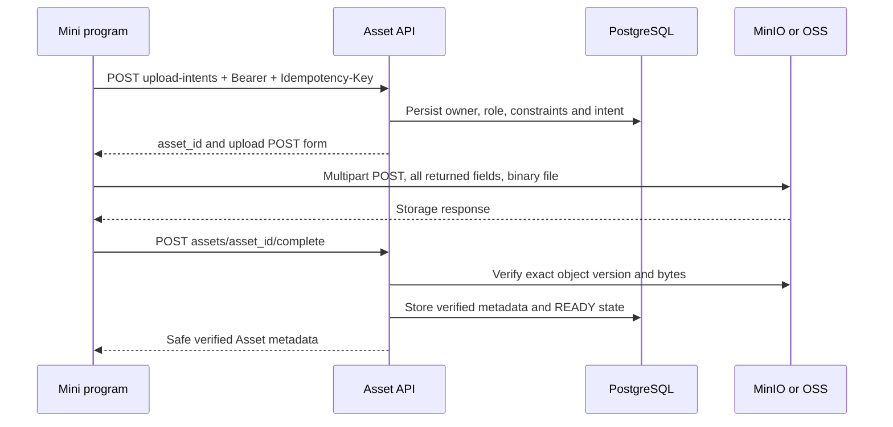

# Asset Upload Flow

The client uploads bytes directly to object storage through a constrained signed **multipart POST**. The API admits and later verifies the object; it does not accept a base64 image or a caller-selected object URL as a Workflow input.

## 1. Declare one immutable upload intent

Send `type`, `purpose`, `role`, `original_filename`, actual `content_type` and `size_bytes` to `POST /v1/assets/upload-intents`. Use one durable key per binary/role. The first successful intent returns `201`; an identical replay returns `200`. Its `upload` may be absent when no new storage transfer is needed; honor the returned Asset state.

For ordinary image input use `type: "IMAGE"`, `purpose: "DESIGN_JOB_INPUT"` and upload role `image`, `masked_image` or `reference_image`. Audio uses the allowed recording role; PPTX uses document/attachment under its authorized flow. Admin image and legal-document purposes have separate privilege/type rules. Changing JSON at Workflow submission cannot reclassify an upload.

The form has `method: "POST"`, `url`, `fields` and `expires_at`. Treat every returned field as opaque signing material. Never derive a new endpoint/key, convert it to PUT, or omit policy/signature fields.

## 2. Transfer the file

Use the platform's multipart upload facility with all form fields and the binary `file` part. Do not send the API Bearer credential to OSS/MinIO. Respect form expiry, storage size/type constraints and the required public endpoint. A real phone must reach that host; an internal Compose/VPC address is not a public upload target.

Several required image roles can upload independently in parallel. Persist each role's Asset ID and original intent key. If one fails, retain successful roles and retry only the failed chain; do not create a second job or reupload everything automatically.

## 3. Complete and verify

After storage success call `POST /v1/assets/{asset_id}/complete` with API authentication. Completion verifies object identity/version, length and actual content, records content hash/ETag and subtype metadata, and publishes `READY`. A successful storage HTTP status alone does not make an Asset valid for submission.

`ASSET_UPLOAD_INCOMPLETE`, `ASSET_STATE_CONFLICT` and temporary protections can require a bounded later retry with `Retry-After`. Changed/expired objects, unsupported content and ownership failures require their documented corrective action. Do not mutate the same object after it is admitted.

## 4. Bind Assets to a Workflow

`POST /v1/workflows` receives typed Asset IDs with canonical roles `primary`, `mask`, `reference` for image inputs; the API verifies their upload-intent roles, ownership, readiness and role inventory. A result-to-input copy endpoint creates an independent verified input instead of reusing a result URL.

Store Asset identity and immutable metadata. Refresh expiring preview/download URLs from authorized API responses. Deletion and retention are guarded by active pins/references; deleting a Job or leaving a workspace does not authorize arbitrary object deletion.

The voice browser handoff reuses intent/completion verification through restricted cookie/Origin/CSRF routes. It does not put a general application token in the browser or replace the underlying direct-upload protocol.

## Source evidence

Verified against the [documented source revisions](/reference/source-revisions).

- [Asset API and successful/replay statuses](https://github.com/Orientation-CD/YuanZhu-AI/blob/b13cc5668920620a274cb91a3393ed9fadac72ae/app/assets/asset_api.py)
- [Intent policy and signing](https://github.com/Orientation-CD/YuanZhu-AI/blob/b13cc5668920620a274cb91a3393ed9fadac72ae/app/assets/assets.py)
- [Exact-object completion verification](https://github.com/Orientation-CD/YuanZhu-AI/blob/b13cc5668920620a274cb91a3393ed9fadac72ae/app/assets/asset_completion.py)
- [Storage implementation](https://github.com/Orientation-CD/YuanZhu-AI/blob/b13cc5668920620a274cb91a3393ed9fadac72ae/app/assets/storage.py)
