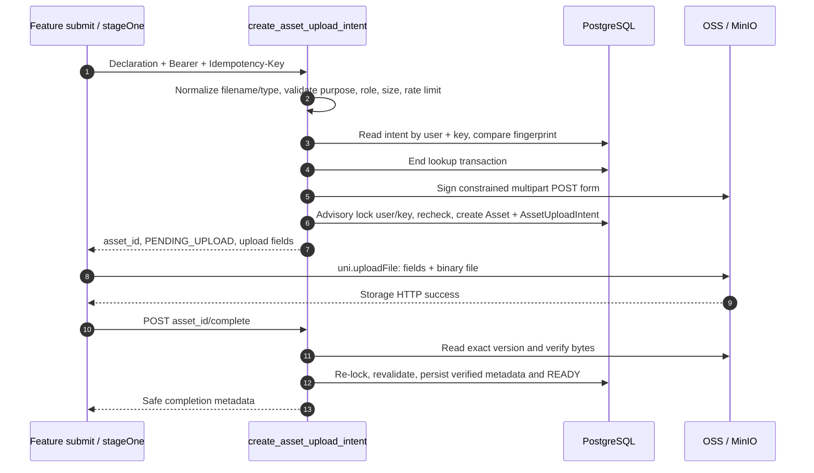
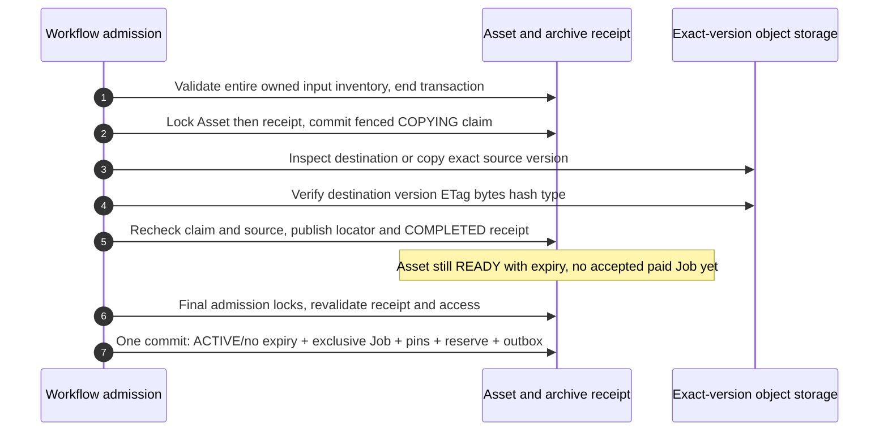
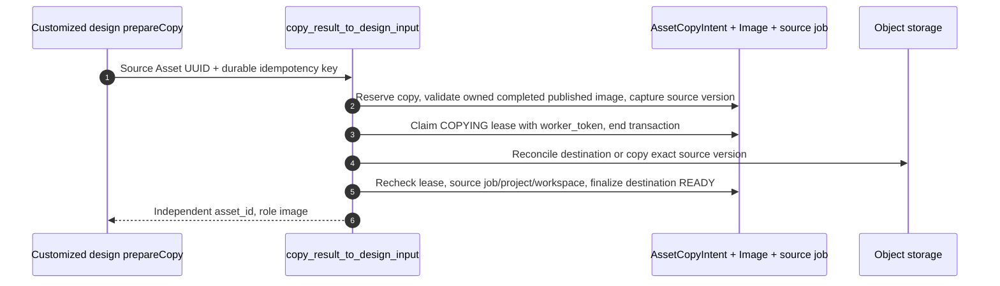

# Asset upload: from a chosen file to a verified Workflow input

A file selected on a phone is only a local path. A storage upload is only bytes. A Workflow accepts an **Asset ID whose ownership, declared role and actual bytes have been verified**. This chapter follows those boundaries and the associated read/copy/delete endpoints. Code links use the [audited revisions](/reference/source-revisions).

## Locate the UI and understand the two vocabularies {#asset-entry}

The standard image feature component's submit handler calls [`submitStandardDesign`](https://github.com/Orientation-CD/wechat_mini_program/blob/21db6d824a7b32417bda88e7e31d3f0b91dfa51c/src/pkg-features/services/standardDesignSubmit.ts#L51). It loads profile, Feature and prompt availability, checks eligibility, binds project context when enabled, then calls `stageDesignImages` before `submitDesignJob`. Furniture uses [`submit`](https://github.com/Orientation-CD/wechat_mini_program/blob/21db6d824a7b32417bda88e7e31d3f0b91dfa51c/src/pkg-features/pages/furniture/index.vue#L608) → [`submitFurnitureDesign`](https://github.com/Orientation-CD/wechat_mini_program/blob/21db6d824a7b32417bda88e7e31d3f0b91dfa51c/src/pkg-features/services/furnitureDesignSubmit.ts#L51) to stage the scene, mask and optional reference roles needed by its Feature.

| Boundary | Image role names | Why the names differ |
| --- | --- | --- |
| Upload declaration | `image`, `masked_image`, `reference_image` | Describes the file admitted by the upload policy. |
| Canonical Workflow input | `primary`, `mask`, `reference` | Describes an operation's use of an already verified file. |
| Other upload subtypes | AUDIO `recording`; PPTX DOCUMENT `attachment`; VIDEO `reference_video` | They have different validators and purpose/type constraints. |

These strings are a contract, not interchangeable labels. The backend checks compatibility when binding inputs; editing a Workflow payload cannot turn an unrelated Asset into an authorized input.

## Create an intent: declare one file, do not send its bytes {#upload-intent}

**Endpoint: `POST /v1/assets/upload-intents`.** The frontend [`stageOne`](https://github.com/Orientation-CD/wechat_mini_program/blob/21db6d824a7b32417bda88e7e31d3f0b91dfa51c/src/pkg-features/repositories/designAssets.ts#L156) derives a stable key from owner, role and logical file ID. It sends the declaration below, with Bearer authentication and an `Idempotency-Key` of 8–128 characters.

```json
{
  "type": "IMAGE",
  "purpose": "DESIGN_JOB_INPUT",
  "role": "image",
  "original_filename": "living-room.jpg",
  "content_type": "image/jpeg",
  "size_bytes": 483102
}
```

`type` selects a persisted subtype; `purpose` selects its policy; `role` declares its intended input role. Filename is display metadata, not an arbitrary storage key. Content type and size describe the selected binary; completion will independently measure content. `483102` is an example byte count, not a limit. Obtain effective limits from the server/Feature contract rather than inferring them from this example.



| Steps | Code to open | What to inspect |
| --- | --- | --- |
| 1 | [`stageOne`](https://github.com/Orientation-CD/wechat_mini_program/blob/21db6d824a7b32417bda88e7e31d3f0b91dfa51c/src/pkg-features/repositories/designAssets.ts#L156) | The persistent idempotency key belongs to one logical file/role. Response validation checks type, purpose and role, not only the UUID. |
| 2–3 | [`create_asset_upload_intent`](https://github.com/Orientation-CD/YuanZhu-AI/blob/e59716c83e087deda8477da5ea7b327a40cf65c5/app/assets/asset_api.py#L402), [`create_upload_intent`](https://github.com/Orientation-CD/YuanZhu-AI/blob/e59716c83e087deda8477da5ea7b327a40cf65c5/app/assets/assets.py#L290) | `_normalize_request`, `_validate_policy`, Redis rate limit, and fingerprint comparison happen before publishing a new intent. |
| 4–6 | [`create_upload_intent`](https://github.com/Orientation-CD/YuanZhu-AI/blob/e59716c83e087deda8477da5ea7b327a40cf65c5/app/assets/assets.py#L290), [`S3Storage.create_upload_form`](https://github.com/Orientation-CD/YuanZhu-AI/blob/e59716c83e087deda8477da5ea7b327a40cf65c5/app/assets/storage.py#L922) | Signing may involve external credentials, so it runs outside the short SQL publication lock. After signing the code rechecks for a concurrent same-key intent. |
| 7–9 | [`directUpload`](https://github.com/Orientation-CD/wechat_mini_program/blob/21db6d824a7b32417bda88e7e31d3f0b91dfa51c/src/pkg-features/repositories/designAssets.ts#L127) | POST multipart form, `name: "file"`, every signed `form.fields` value; no API Authorization header goes to storage. |
| 10–13 | [`complete_asset_upload_route`](https://github.com/Orientation-CD/YuanZhu-AI/blob/e59716c83e087deda8477da5ea7b327a40cf65c5/app/assets/asset_api.py#L519), [`complete_asset_upload`](https://github.com/Orientation-CD/YuanZhu-AI/blob/e59716c83e087deda8477da5ea7b327a40cf65c5/app/assets/asset_completion.py#L261) | See the verification algorithm below. Storage success is not admission success. |

First successful intent returns `201`; identical replay returns `200` and the same identity. Same key with different normalized declaration is `IDEMPOTENCY_KEY_REUSED`. A replay that is already verified or accepted can have `upload: null`; `stageOne` returns its ID rather than sending the file again. A pending replay can receive a refreshed signed form after expiry checks. Keep the key with the draft; generating a new key on every retry discards this protection.

The server creates an `Image`, `Audio`, `Document` or `Video` row with `PENDING_UPLOAD` and an `AssetUploadIntent` containing owner/key fingerprint, purpose, role and form expiry. Temporary object keys are server-generated under `temp/assets/...`; caller-provided URLs are not accepted as input identity.

### Transfer is a separate HTTP request

`upload.method` must be `POST`. `upload.url`, `fields` and `expires_at` come from the server; treat fields as opaque signature/policy values. `directUpload` uses `uni.uploadFile`, not the JSON `request` wrapper. This is why an API domain working in the developer tools does not prove that a phone can reach the object-store domain. Check signed-form expiry, HTTPS/LAN test settings and the platform upload-domain configuration at this boundary.

## Complete: bytes → exact object identity → READY {#asset-complete}

FastAPI entry: [app/assets/asset_api.py → complete_asset_upload_route](https://github.com/Orientation-CD/YuanZhu-AI/blob/e59716c83e087deda8477da5ea7b327a40cf65c5/app/assets/asset_api.py#L519)。

**Endpoint: `POST /v1/assets/{asset_id}/complete`.** The request has API Bearer authentication and no caller-supplied metadata body. [`complete_asset_upload`](https://github.com/Orientation-CD/YuanZhu-AI/blob/e59716c83e087deda8477da5ea7b327a40cf65c5/app/assets/asset_completion.py#L261) performs this algorithm:

1. Rate-limit completion, load Asset + upload intent + subtype, check owner/admin and temporary expiry. End the lookup transaction before object-store reads and parsing.
2. If already completed, HEAD the object and compare stored identity; return existing safe metadata only if unchanged. A completed row does not authorize replacing its bytes.
3. For pending data, HEAD the exact object, require nonempty bytes within policy, then read the captured version. Compute SHA-256, compare byte count and any storage SHA checksum.
4. Validate by subtype: image bytes and dimensions via the image validator; audio container and measured duration via [`validate_audio`](https://github.com/Orientation-CD/YuanZhu-AI/blob/e59716c83e087deda8477da5ea7b327a40cf65c5/app/assets/audio_validation.py#L53); PPTX package via its validator; Video via bounded MIME/container/duration validation; legal text as bounded UTF-8 without NULs. An extension/MIME declaration alone cannot pass this stage.
5. HEAD again and require matching ETag, version ID and size. This detects replacement during verification. For admin images/legal text, copy the exact verified version to its final path; ordinary design inputs remain READY until admission preflight archives their exact versions.
6. Acquire `asset-upload-completion` advisory lock, reload the row, recheck object key/status/expiry, write content type, size, SHA-256, ETag/version and verified time, plus width/height or duration. Design inputs become READY; admin/legal purposes follow their ACTIVE/finalized policy. The route commits before returning.

Do not interpret audio validation as complete audio decoding: it validates bounded containers and measures duration using the parser. Current audio code permits the supported types up to 25,000,000 bytes and 7,200 seconds; the browser handoff returns these limits explicitly. PPTX is not accepted merely because a file was renamed `.pptx`.

| Failure | Where it arises | What to preserve / retry |
| --- | --- | --- |
| `ASSET_UPLOAD_INCOMPLETE` | Object absent/empty at HEAD | Keep Asset ID/key; confirm the storage request finished. A bounded later complete may succeed. |
| `ASSET_CONTENT_CHANGED` | Version/ETag/size/checksum mismatch | Stop using the overwritten object. Re-select/redeclare through the intended recovery flow. |
| `INVALID_IMAGE`, `INVALID_AUDIO`, `INVALID_DOCUMENT`, `INVALID_VIDEO` | Actual-byte validator | Correct the file; uploading identical invalid bytes again cannot fix it. |
| `ASSET_STATE_CONFLICT` | Recheck after concurrent state change | Honor route `Retry-After` where returned; do not guess READY locally. |
| Storage/protection unavailable | S3/Redis boundary | Keep the logical action; retry within the application's bounded policy. |

The frontend wraps intent, transfer and completion as `asset-intent`, `asset-upload`, `asset-complete` stages. These labels identify **which boundary failed**. Parallel image roles use `Promise.all`; each role keeps its own persistent idempotency key, so a retry can reuse already admitted roles rather than changing their identity.

## Prepare durable input before paid admission {#input-archive}

Completion READY proves a verified temporary upload. It does not yet prove durable, exclusive task ownership. The current admission path archives direct owned image/mask/reference, recording, Video and append-PPTX inputs before freezing their physical pins. The Asset UUID and content stay the same; the canonical destination is private `design-jobs/inputs/{asset_id}/…`.



| Message | Exact code | Invariant |
| --- | --- | --- |
|1|[app/workflows/workflow_admission.py → _archive_request_inputs](https://github.com/Orientation-CD/YuanZhu-AI/blob/e59716c83e087deda8477da5ea7b327a40cf65c5/app/workflows/workflow_admission.py#L1995)|Validate the whole inventory before copies, commit outside the final admission locks.|
|2|[app/assets/asset_input_archival.py → _claim_archive](https://github.com/Orientation-CD/YuanZhu-AI/blob/e59716c83e087deda8477da5ea7b327a40cf65c5/app/assets/asset_input_archival.py#L359)|Asset→receipt lock order; source identity, worker token and bounded lease become durable first.|
|3–4|[app/assets/asset_input_archival.py → _prepare_object](https://github.com/Orientation-CD/YuanZhu-AI/blob/e59716c83e087deda8477da5ea7b327a40cf65c5/app/assets/asset_input_archival.py#L465)|Storage I/O and SHA verification hold no DB connection/lock; a lost copy acknowledgement is reconciled at the recorded destination.|
|5|[app/assets/asset_input_archival.py → _publish_archive](https://github.com/Orientation-CD/YuanZhu-AI/blob/e59716c83e087deda8477da5ea7b327a40cf65c5/app/assets/asset_input_archival.py#L498)|Token/source recheck fences stale writers; move the same Asset locator and mark receipt COMPLETED.|
|6–7|[app/workflows/workflow_admission.py → _activate_archived_inputs](https://github.com/Orientation-CD/YuanZhu-AI/blob/e59716c83e087deda8477da5ea7b327a40cf65c5/app/workflows/workflow_admission.py#L2074)|Final Asset locks recheck receipt proof; ACTIVE/no expiry and all acceptance effects commit together.|

If later entitlement/funds/quota/configuration checks reject the request, READY can remain expiring with a reusable completed receipt. This is not a charge and not an accepted Job. Exact accepted create replay returns the Job before re-archiving. Borrowed ACTIVE sources and already executed pins are never relocated or re-owned by this path.

| Error | Meaning | Client/operator action |
| --- | --- | --- |
|409 `ASSET_ARCHIVE_IN_PROGRESS`|A fenced copy is already in progress|Honor bounded Retry-After and preserve the same input/action identity.|
|503 `ASSET_STORAGE_UNAVAILABLE`|Copy/read/identity proof unavailable|Restore storage then retry the same logical request; do not delete receipt/lease.|
|`ASSET_CONTENT_CHANGED`|Recorded source/destination content cannot be proved|Restore the exact version or upload a new input, never guess that the latest version is equivalent.|

Archive tombstones preserve cleanup authority even if the Asset is detached/deleted. Result-copy cleanup retains actual source key/version pairs, not a new relocated version joined to an old key. Historical completed-input repair is explicit and dry-run-first in [Assets and storage](/backend/assets-storage); it does not rewrite executed pins, charges or Job status.

## Read one Asset: restore and recheck a report attachment {#asset-get}

**Endpoint: `GET /v1/assets/{asset_id}`.** A concrete mini-program caller is [`verifyReportAttachment`](https://github.com/Orientation-CD/wechat_mini_program/blob/21db6d824a7b32417bda88e7e31d3f0b91dfa51c/src/pkg-features/repositories/reportAttachment.ts#L42) during PPTX attachment reuse/restoration. It checks the same UUID, READY, DOCUMENT, DESIGN_JOB_INPUT, `attachment` and unexpired time before submission.

[`get_asset_route`](https://github.com/Orientation-CD/YuanZhu-AI/blob/e59716c83e087deda8477da5ea7b327a40cf65c5/app/assets/asset_api.py#L618) → [`get_asset`](https://github.com/Orientation-CD/YuanZhu-AI/blob/e59716c83e087deda8477da5ea7b327a40cf65c5/app/assets/asset_management.py#L234) loads metadata and subtype, then allows the owner or an administrator. Unknown and foreign IDs both become unavailable, avoiding ownership leaks. Removed-enterprise outputs are hidden from ordinary users; preview URLs are suppressed for deleting projects/removed outputs. Response construction may sign an authorized preview URL; it never exposes a raw storage key as general authority.

The [`_view`](https://github.com/Orientation-CD/YuanZhu-AI/blob/e59716c83e087deda8477da5ea7b327a40cf65c5/app/assets/asset_management.py#L199) projection returns ordinary owners verification metadata; `preview_url`, owner identity and administrative title are restricted to the administrator view, with additional preview suppression above. Do not assume that an owner metadata GET returns a downloadable URL.

An Asset metadata GET is not a storage GET, and a preview URL is not a permanent identifier. Keep `asset_id`; renew expiring URLs through the appropriate authorized API.

## List Assets: administrator API, not a personal gallery {#asset-list}

**Endpoint: `GET /v1/assets`.** The audited mini program has no caller. This is an administrator/integration surface. [`list_assets_route`](https://github.com/Orientation-CD/YuanZhu-AI/blob/e59716c83e087deda8477da5ea7b327a40cf65c5/app/assets/asset_api.py#L573) → [`list_assets`](https://github.com/Orientation-CD/YuanZhu-AI/blob/e59716c83e087deda8477da5ea7b327a40cf65c5/app/assets/asset_management.py#L259) rejects non-admin users, applies `type`, `status`, `q`, `page` and `page_size`, counts and returns a stable `(created_at DESC, id DESC)` page. `page_size` is 1–100.

The search covers original filename, display title and associated job/Asset identities; each item uses the same safe-view rules. A project being deleted or a removed enterprise can suppress preview signing. This path reads SQL and signs previews; it does not enqueue a generation job. An ordinary Bearer user receiving `403 ASSET_ADMIN_REQUIRED` is a permission result, not a broken upload.

## Reuse a generated image: create an independent input copy {#asset-copy}

**Endpoint: `POST /v1/assets/{source_asset_id}/design-input-copies`.** The FastAPI entry is `copy_design_result_to_input_route`, which calls `copy_result_to_design_input` below. A generated result used for customized design enters [`prepareCopy`](https://github.com/Orientation-CD/wechat_mini_program/blob/21db6d824a7b32417bda88e7e31d3f0b91dfa51c/src/pkg-features/pages/customized_design/index.vue#L201) → [`copyResultInput`](https://github.com/Orientation-CD/wechat_mini_program/blob/21db6d824a7b32417bda88e7e31d3f0b91dfa51c/src/pkg-features/repositories/customizedDesign.ts#L53). The stable key combines owner, logical copy ID and source Asset ID. It does not submit a public result URL.



| Steps | Source | Decision |
| --- | --- | --- |
| 1 | [`copyResultInput`](https://github.com/Orientation-CD/wechat_mini_program/blob/21db6d824a7b32417bda88e7e31d3f0b91dfa51c/src/pkg-features/repositories/customizedDesign.ts#L53) | Retry only bounded `ASSET_COPY_IN_PROGRESS` / storage-unavailable cases; retain the same key. |
| 2–3 | [`_reserve_copy`](https://github.com/Orientation-CD/YuanZhu-AI/blob/e59716c83e087deda8477da5ea7b327a40cf65c5/app/assets/asset_copies.py#L157), [`_claim_copy`](https://github.com/Orientation-CD/YuanZhu-AI/blob/e59716c83e087deda8477da5ea7b327a40cf65c5/app/assets/asset_copies.py#L314) | Persist intent and destination identity before slow I/O; a lease token owns finalization. |
| 4 | [`copy_result_to_design_input`](https://github.com/Orientation-CD/YuanZhu-AI/blob/e59716c83e087deda8477da5ea7b327a40cf65c5/app/assets/asset_copies.py#L611) | HEAD destination before copying; reconcile ambiguous storage failure so a completed copy need not be duplicated. |
| 5–6 | [`_finalize_copy`](https://github.com/Orientation-CD/YuanZhu-AI/blob/e59716c83e087deda8477da5ea7b327a40cf65c5/app/assets/asset_copies.py#L462) | Recheck completed source job, live project/workspace and lease; write verified destination and COMPLETED intent, commit. |

Success is `201`, completed replay `200`. The returned Asset ID must differ from the source. The name `worker_token` here is a copy lease, not a queued submit-worker job. Loss of access or source deletion while the object-store copy runs must prevent unsafe finalization.

## Delete: administrator permission plus reference checks {#asset-delete}

**Endpoint: `DELETE /v1/assets/{asset_id}`.** No current mini-program caller; this is an administrator API. [`delete_asset_route`](https://github.com/Orientation-CD/YuanZhu-AI/blob/e59716c83e087deda8477da5ea7b327a40cf65c5/app/assets/asset_api.py#L654) → [`delete_asset`](https://github.com/Orientation-CD/YuanZhu-AI/blob/e59716c83e087deda8477da5ea7b327a40cf65c5/app/assets/asset_management.py#L385) locks relevant copy/Asset records, rejects prepared/copying destinations, RESERVED state, job inputs/outputs, operation inputs, PPTX/video reservations, archive receipts, template reference clips and linked legal versions. Legal text must be removed through its dedicated service because current pointers and acceptance evidence matter.

For an unused object, delete all versions and remove the Asset row. A missing row is an idempotent `204`. Copy destinations have a special committed detachment path that preserves copy evidence before deleting storage versions. SQL integrity races roll back and return `409 ASSET_STATE_CONFLICT` with `Retry-After: 1`; storage deletion failure maps to `503`. A database transaction cannot atomically roll back S3, which is why version identity and durable copy evidence matter.

## Guided read: prove the file has crossed each boundary {#asset-debug}

Use a disposable local file in the authorized local storage setup:

1. Open `stageOne`, set a breakpoint before the intent request and write down only the logical key/role and file metadata. Expected: changing the logical file should change the action identity; retrying the same file should not.
2. In Network, separate the JSON intent, multipart storage POST and JSON complete. Expected: one Asset UUID appears in intent and completion; API Bearer goes only to the API. A 2xx from storage alone leaves the verification step outstanding.
3. Open `complete_asset_upload` and find the two HEAD calls with the version read between them. Read the later advisory-lock section. Expected: slow storage/parsing happens outside the first SQL transaction, then server state is rechecked before READY.
4. Inspect redacted persisted evidence: `assets`, subtype row, `asset_upload_intents`, SHA-256, version and verified timestamp. Expected: READY has verified metadata. Then follow the returned ID into `/v1/workflows` using the [Workflow chapter](/reference/flows/design-job-lifecycle).
5. Read copy/deletion checks before trying a result reuse. Expected: source and destination IDs differ; deleting a referenced result through the admin endpoint is rejected, rather than silently breaking a workflow.

To debug “upload succeeded but generation cannot start”, first ask which stage succeeded. Distinguish storage2xx, completion READY, archive COMPLETED and final Job acceptance: each has different validation and ownership checks.
