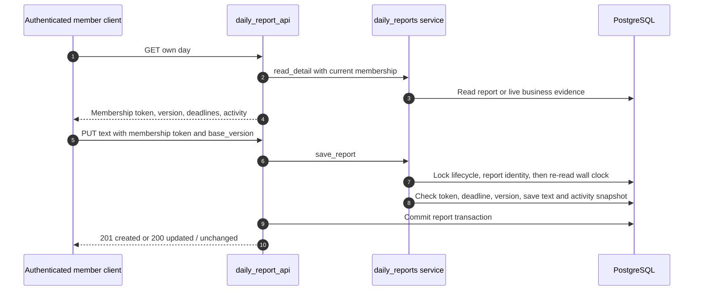

# Enterprise daily reports: membership segment, deadlines and versioned feedback

This pinned backend implements nine daily-report APIs. A search of the pinned mini-program `src/` finds no daily-report route caller: the current entry is an authenticated integration client. The owner overview's `daily_report_today` summary is not evidence of a shipped daily-report editor. Reports do not call an AI provider or enqueue work.

A report is identified by `(workspace_id,user_id,membership_started_at,report_date)`. The join timestamp distinguishes a new membership segment after leave/rejoin. The required first day is the later of the migrated system start day and the current membership's Beijing join day. Owners do not submit member reports, and owner reads only target current nonowner members. A retained old report is not exposed as the new membership's report.

## The clock and data model

All business dates are Beijing dates; response timestamps are UTC. For day D, an on-time report can be edited strictly before D+1 00:00 Beijing. If absent, it may be submitted late strictly before D+1 12:00. A late submission is immediately locked. Existing on-time reports cannot be edited after midnight. The service obtains PostgreSQL `clock_timestamp()` **after waiting for the report lock**, so a transaction started before a deadline cannot extend it.

`DailyReport` stores trimmed text, version, submission/late metadata, frozen activity JSON, owner-read version, comment version and member-seen version. `DailyReportState` stores the migrated start date; missing state is an integrity failure, never permission to silently restart history today. [daily_report_activity](https://github.com/Orientation-CD/YuanZhu-AI/blob/749e82df3a51c441335ba6a4db607a98bacbcf97/app/workspaces/daily_report_activity.py#L49) reads project creations, stage/outcome events and supported successful root schemes in the Beijing day. It uses the actual actor/author and recorded event time; a backdated stage date does not move the operation into an earlier report. Saved reports use a snapshot; an unsaved detail uses live evidence.

| Steps | Source | Checkpoint |
| --- | --- | --- |
| 1–4 | [read_detail](https://github.com/Orientation-CD/YuanZhu-AI/blob/749e82df3a51c441335ba6a4db607a98bacbcf97/app/workspaces/daily_reports.py#L209) and `detail` | A live preview is not yet a persisted report |
| 5–8 | [save_report](https://github.com/Orientation-CD/YuanZhu-AI/blob/749e82df3a51c441335ba6a4db607a98bacbcf97/app/workspaces/daily_reports.py#L250) and `locked_report` | Membership fencing, advisory lock, wall clock and optimistic content version |
| 9–10 | [put_report](https://github.com/Orientation-CD/YuanZhu-AI/blob/749e82df3a51c441335ba6a4db607a98bacbcf97/app/workspaces/daily_report_api.py#L65) | Commit occurs before status 201/200 is returned |

## Read own dashboard status {#daily-report-status}

`GET /v1/workspaces/{workspace_id}/daily-reports/me/status`

Handler `status` calls `member_status`. It checks current member context and one server time, then returns today's submission/read state, yesterday's late availability, unseen comment dates and `primary_action`. An available late submission takes priority over writing today. No report row, receipt or activity is written.

## Read own calendar {#daily-report-calendar}

`GET /v1/workspaces/{workspace_id}/daily-reports/me`

Handler `history` calls `calendar`, which builds every required calendar day, including missing days, rather than listing only rows. `cursor` is an exclusive Beijing `YYYY-MM-DD` date, never a report UUID; limit is 1–100, default 20. Future/malformed cursor is 422 `DAILY_REPORT_DATE_INVALID`. Stop when `next_cursor` is null. Current membership scope remains enforced on every page.

## Read own day {#daily-report-own-detail}

`GET /v1/workspaces/{workspace_id}/daily-reports/me/{date}`

`get_report` calls `read_detail`, validates the date between `required_since` and today and returns `detail`. An absent row is a valid draft/missing detail with `version:null`, blank text and live activity, not 404. Saved text returns snapshot activity and feedback versions. Reads never mark an owner's read or a member's comment-seen state.

## Save or submit late {#daily-report-save}

`PUT /v1/workspaces/{workspace_id}/daily-reports/me/{date}`

`put_report` calls `save_report` and commits. Body requires `membership_started_at`, `base_version` (null for first creation), `today`; optional `next` defaults empty and `needs_support` defaults false. Text is trimmed: today is required and at most 500 Unicode characters; next is at most 500 and required when requesting support. Strict models reject extra fields and coercions.

`locked_report` serializes even first creation using a transaction advisory lock keyed by workspace/user/current membership/day and locks any existing row. A mismatched membership timestamp returns 409 `DAILY_REPORT_CONFLICT` with `reason:membership_changed`; differing stale content version returns the same code with `reason:version_mismatch` and current detail. Closed-window differing content returns `DAILY_REPORT_LOCKED` plus current detail. Preserve the local draft and reconcile; do not overwrite concurrent content blindly. An exact normalized-content replay may return unchanged current detail even after deadline or on a stale base version. During the editable window, changed activity snapshot can advance the report version even with the same text. Newly created returns 201/version 1; updates/no-op return 200. No partial report or separate snapshot commit exists.

## Member acknowledges one comment version {#daily-report-comment-seen}

`POST /v1/workspaces/{workspace_id}/daily-reports/me/{date}/comment-seen`

`see_comment` calls service `see_comment`, uses the membership token and locks the same report identity. A missing saved report is 404 `DAILY_REPORT_NOT_FOUND`. `comment_version` must equal the current nonempty comment version to advance seen state. An old version returns 200 `applied:false` and current version; it cannot hide newly arrived feedback. The handler commits only this acknowledgement.

## Owner reads a day's team list {#daily-report-owner-day}

`GET /v1/workspaces/{workspace_id}/daily-reports`

`get_owner_day` calls `owner_day`. Current active-enterprise owner is required; optional `date` defaults to server today and cannot precede the migrated start or exceed today. `load_report_day` includes eligible current nonowners only and joins reports on each current membership token. `report_day_counts` computes required/submitted/missing/support totals. Submitted rows sort by submission descending with user-ID ties; missing rows prioritize consecutive finalized missed days, then membership start and ID. The still-open late window does not count as a finalized missed day. This list read commits authority but does not mark reports read.

## Owner reads one current member's detail {#daily-report-owner-detail}

`GET /v1/workspaces/{workspace_id}/daily-reports/{user_id}/{date}`

`get_owner_detail` calls `owner_detail` → `owner_target` → `detail`. It proves current owner and current nonowner target, validates the target's own required-date range, and returns the same snapshot/live distinction. Unknown/former/owner target or unauthorized target detail is concealed as 404 `DAILY_REPORT_NOT_FOUND`; reading does not change feedback/read versions.

## Owner marks a specific content version read {#daily-report-read}

`POST /v1/workspaces/{workspace_id}/daily-reports/{user_id}/{date}/read`

`read_owner_report` calls `mark_read` with `membership_started_at` and `version`. It locks authority and report, requires a saved row, and advances `owner_read_version` only if the supplied version is still current. Stale versions return 200 `applied:false` with `current_version`. A later member edit increments content version and makes `owner_read` false again. The handler commits the acknowledgement; fetching detail alone cannot substitute for it.

## Owner saves or clears feedback {#daily-report-comment}

`PUT /v1/workspaces/{workspace_id}/daily-reports/{user_id}/{date}/comment`

`comment_owner_report` calls `save_comment` under owner/target membership fencing and the report lock. Body contains current target `membership_started_at` and `comment`. Trimmed content is at most 200 Unicode characters; blank clears to null. A changed value increments `owner_comment_version` and timestamp; same-value saves do not. There is no content `base_version` or comment compare-and-swap in this API: serialized last changed write wins. The handler commits and returns current comment metadata; saving feedback neither marks the member's comment seen nor marks report content read.

## Failure boundaries and source exercises

Missing/expired Bearer is 401. A member cannot edit another member's report; owner/personal self-submission is 403 `DAILY_REPORT_NOT_REQUIRED`. Nonowner team-day read is 403 `WORKSPACE_OWNER_REQUIRED`; targeted unauthorized probes use 404. Former access is rejected before inactive-space reporting, while an accessible inactive enterprise returns 409 `WORKSPACE_INACTIVE`. Distinguish these from correct empty calendars or absent drafts.

Follow [app/workspaces/daily_report_api.py](https://github.com/Orientation-CD/YuanZhu-AI/blob/749e82df3a51c441335ba6a4db607a98bacbcf97/app/workspaces/daily_report_api.py), [app/workspaces/daily_reports.py](https://github.com/Orientation-CD/YuanZhu-AI/blob/749e82df3a51c441335ba6a4db607a98bacbcf97/app/workspaces/daily_reports.py), [tests/test_daily_report_member_api.py](https://github.com/Orientation-CD/YuanZhu-AI/blob/749e82df3a51c441335ba6a4db607a98bacbcf97/tests/test_daily_report_member_api.py), [tests/test_daily_report_owner_api.py](https://github.com/Orientation-CD/YuanZhu-AI/blob/749e82df3a51c441335ba6a4db607a98bacbcf97/tests/test_daily_report_owner_api.py) and the PostgreSQL variants. An integration exercise should first read a day, copy its membership token/version, save, reread the persisted snapshot, then acknowledge a specific report/comment version. This documents the reproducible sequence; this update does not claim a live application E2E run.
