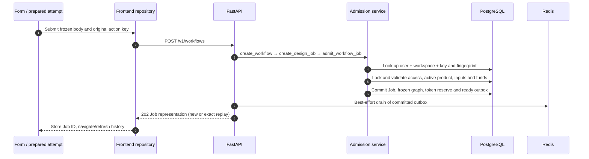
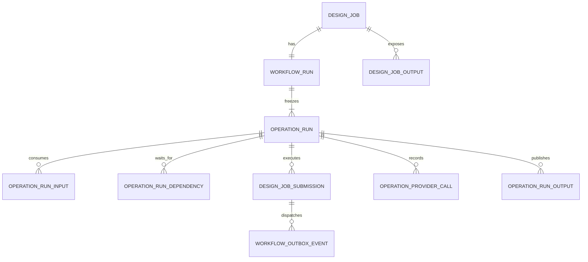
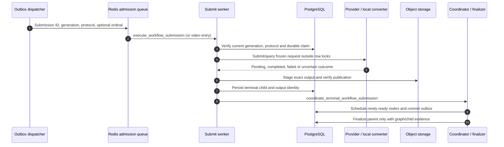

# Workflow admission, workers and durable settlement

Start with a concrete report or copywriting submission. This chapter follows admission into the shared runtime. [Product branches](/reference/flows/workflow-products-flow) explain image/audio/video differences; [history actions](/reference/flows/workflow-history-flow) explain reading, retry and deletion. Public Workflow ID is a Job ID, not an internal run ID.

## From a form button to acceptance {#submit-workflow}

`POST /v1/workflows` accepts a discriminated request body: `type` selects its schema. In the report form, `submit` freezes an attempt; `postWorkflow` forwards it to `workflowsRepository.submit`, which rechecks the owner/workspace, write access and current session generation. It sends Bearer auth and a persisted 8–128-character `Idempotency-Key`. It maps the response back into a history item and invalidates affected project counts.

| Message | Exact code to open | What to inspect |
| --- | --- | --- |
| 1 | [src/pkg-features/services/workflowSubmission.ts → postWorkflow](https://github.com/Orientation-CD/wechat_mini_program/blob/eca0a5f9e0a2aa1cb3fd4f9714114bb3db7fae5f/src/pkg-features/services/workflowSubmission.ts#L61) | `WorkflowAttempt` retains body, owner, action and key; a timeout does not create a new logical action |
| 2 | [src/repositories/workflows.ts → workflowsRepository](https://github.com/Orientation-CD/wechat_mini_program/blob/eca0a5f9e0a2aa1cb3fd4f9714114bb3db7fae5f/src/repositories/workflows.ts#L13) | Local guards and request mapper; these improve UX but do not replace server authorization |
| 3 | [app/workflows/api.py → create_workflow](https://github.com/Orientation-CD/YuanZhu-AI/blob/b13cc5668920620a274cb91a3393ed9fadac72ae/app/workflows/api.py#L1075) → [app/workflows/api.py → create_design_job](https://github.com/Orientation-CD/YuanZhu-AI/blob/b13cc5668920620a274cb91a3393ed9fadac72ae/app/workflows/api.py#L967) | FastAPI dependencies, rate-limit callback, typed-body branch and error translation |
| 4 | [app/workflows/workflow_admission.py → admit_workflow_job](https://github.com/Orientation-CD/YuanZhu-AI/blob/b13cc5668920620a274cb91a3393ed9fadac72ae/app/workflows/workflow_admission.py#L2426) | Replay check validates current workspace access and request fingerprint before returning existing Job |
| 5 | [app/workflows/workflow_admission.py → resolve_workflow](https://github.com/Orientation-CD/YuanZhu-AI/blob/b13cc5668920620a274cb91a3393ed9fadac72ae/app/workflows/workflow_admission.py#L392) → [app/workflows/workflow_admission.py → _reserve_feature_workflow_tokens](https://github.com/Orientation-CD/YuanZhu-AI/blob/b13cc5668920620a274cb91a3393ed9fadac72ae/app/workflows/workflow_admission.py#L1820) | Resolve/freeze graph and model config; validate billed account and subscription |
| 6 | [app/workflows/workflow_admission.py → _persist_workflow_execution](https://github.com/Orientation-CD/YuanZhu-AI/blob/b13cc5668920620a274cb91a3393ed9fadac72ae/app/workflows/workflow_admission.py#L2115) | Write graph/input identities and schedule ready Submission rows in the same admission transaction |
| 7 | [app/workflows/submissions/workflow_submission_dispatch.py → dispatch_workflow_submission_outbox](https://github.com/Orientation-CD/YuanZhu-AI/blob/b13cc5668920620a274cb91a3393ed9fadac72ae/app/workflows/submissions/workflow_submission_dispatch.py#L1285) | Queue writes happen after commit; an enqueue failure is logged and remains recoverable |
| 8–9 | `job_response` in the API file; [src/repositories/workflows.ts → workflowsRepository](https://github.com/Orientation-CD/wechat_mini_program/blob/eca0a5f9e0a2aa1cb3fd4f9714114bb3db7fae5f/src/repositories/workflows.ts#L13) | Public IDs, typed outputs, polling hints and response identity validation |

The response is **202 Accepted**, including exact replays. It does not promise completed generation or an already available output. If the response is lost, repeat the identical body with the original key. Reusing a key with a different fingerprint yields `IDEMPOTENCY_KEY_REUSED`. A changed workspace, disabled feature, outdated prompt, unavailable input, active-job limit or insufficient funds must be handled by its domain error; blindly changing keys can create a second paid action.

### What the admission transaction freezes

`admit_workflow_job` resolves the actual Project (the caller's scratch Project if omitted), active Feature, definition revision, compiled graph, input bindings, provider/model configuration, protocol activation and commercial snapshot. Incoming Asset IDs become pinned object identities: ID plus version/hash/type and position, not an arbitrary URL that a client can replace later. Prompt selections become composed frozen prompts. A later Admin edit changes future admission, not this accepted run's historical meaning.

Personal billing checks an active subscription period and allowed Feature before applying the subscription's discount. Enterprise billing uses the workspace pool with no personal subscription discount. Feature pricing is not the sum of individual node/model prices.

For an illustrative cost `C = 20`, remaining balance `R = 100`, and reserved `V = 10`:

| Checkpoint | Remaining `R` | Reserved `V` | Available `R − V` |
| --- | --- | --- | --- |
| Before admission | 100 | 10 | 90 |
| Reserve this Job | 100 | 30 | 70 |
| Successful settlement | 80 | 10 | 70 |
| Or terminal release instead of success | 100 | 10 | 90 |

Admission tests `R − V >= C`, increments `reserved_tokens`, and records a reserve ledger event. It does **not** subtract `C` from `remaining_tokens` at that moment. Success deducts remaining and releases the reservation; failure releases it. Unique ledger/event keys and state checks guard repeated callbacks or finalizers. The reserve ledger has a negative delta even though stored remaining balance has not yet changed: read the event reason and reserved balance together.

## Why a queue is not the task database {#durable-records}

| SQL record | Its job in the chain | Useful identity/state |
| --- | --- | --- |
| `design_jobs` | Public aggregate, creator/workspace/project, action key and billing state | `id`, `status`, `explicit_retry_count`, `token_state` |
| `workflow_runs` | Frozen graph and execution/commercial provenance | `id`, `design_job_id`, `compiled_graph`, `state` |
| `operation_runs` | Each node's state, lease and frozen node configuration | `id`, `workflow_run_id`, `node_key`, `state` |
| `operation_run_inputs` / dependencies | Ordered scalar/Asset pins and graph edges | operation ID, port, position, upstream identity |
| `design_job_submissions` | One durable attempt owner and provider/local handoff | `id`, operation ID, `attempt_generation`, `dispatch_state` |
| `operation_provider_calls` | Provider request/result checkpoint and staging evidence | operation ID and attempt evidence |
| `operation_run_outputs` / `design_job_outputs` | Verified operation output and public Job binding | Asset identity or scalar output |
| `workflow_outbox_events` | Committed work to dispatch/recover | aggregate ID, deduplication key, `processed_at` |

Redis ARQ holds runnable messages. Deleting a Redis message does not delete its PostgreSQL Job. The dispatcher uses a deterministic Redis job ID derived from the outbox deduplication key; the worker also checks protocol, generation and claims. Deduplication is enforced at multiple boundaries because a crash can occur after enqueue but before acknowledgement.

## Submit worker, Poll worker and provider I/O {#worker-chain}

| Message | Code | Meaning |
| --- | --- | --- |
| 1 | [app/workflows/submissions/workflow_submission_dispatch.py → dispatch_workflow_submission_outbox](https://github.com/Orientation-CD/YuanZhu-AI/blob/b13cc5668920620a274cb91a3393ed9fadac72ae/app/workflows/submissions/workflow_submission_dispatch.py#L1285) | `arq:admission_queue`; durable message arguments are identities, not raw model credentials |
| 2–3 | [app/worker.py → execute_workflow_submission](https://github.com/Orientation-CD/YuanZhu-AI/blob/b13cc5668920620a274cb91a3393ed9fadac72ae/app/worker.py#L203) | Old generation or protocol mismatch cannot publish a new-generation result |
| 4–5 | [app/workflows/submissions/workflow_provider_submission.py → dispatch_workflow_provider_submission](https://github.com/Orientation-CD/YuanZhu-AI/blob/b13cc5668920620a274cb91a3393ed9fadac72ae/app/workflows/submissions/workflow_provider_submission.py#L768) → [app/providers/provider_attempt.py → execute_provider_attempt](https://github.com/Orientation-CD/YuanZhu-AI/blob/b13cc5668920620a274cb91a3393ed9fadac72ae/app/providers/provider_attempt.py#L644) | Choose the frozen provider configuration and dispatch branch; retain request/acceptance evidence |
| 6–7 | Product execution/publication code linked in [product branches](/reference/flows/workflow-products-flow) | A provider response is not sufficient until output bytes and metadata are verified |
| 8–9 | [app/workflows/submissions/workflow_submission_coordinator.py → coordinate_terminal_workflow_submission](https://github.com/Orientation-CD/YuanZhu-AI/blob/b13cc5668920620a274cb91a3393ed9fadac72ae/app/workflows/submissions/workflow_submission_coordinator.py#L139) → [app/workflows/submissions/workflow_submission_scheduler.py → schedule_ready_submissions](https://github.com/Orientation-CD/YuanZhu-AI/blob/b13cc5668920620a274cb91a3393ed9fadac72ae/app/workflows/submissions/workflow_submission_scheduler.py#L225) | Only nodes whose dependencies completed become runnable; ordered outputs become frozen downstream inputs |
| 10 | [app/workflows/submissions/workflow_submission_finalizer.py → finalize_submission_workflow](https://github.com/Orientation-CD/YuanZhu-AI/blob/b13cc5668920620a274cb91a3393ed9fadac72ae/app/workflows/submissions/workflow_submission_finalizer.py#L33) → [app/workflows/workflow_admission.py → complete_workflow_run_in_transaction](https://github.com/Orientation-CD/YuanZhu-AI/blob/b13cc5668920620a274cb91a3393ed9fadac72ae/app/workflows/workflow_admission.py#L3044) / [app/workflows/workflow_admission.py → fail_workflow_run_in_transaction](https://github.com/Orientation-CD/YuanZhu-AI/blob/b13cc5668920620a274cb91a3393ed9fadac72ae/app/workflows/workflow_admission.py#L3124) | Drain active siblings, bind valid outputs, then settle/release once |

`SubmitWorkerSettings` registers generation-fenced provider/PPTX submissions and the dedicated video entry. `PollWorkerSettings` runs reconciliation/maintenance on `arq:poll_queue`. Its `reconcile_workflow_submissions` scans durable rows and creates fresh handoffs; provider query work is handed back to execution. Thus “Poll worker” does not mean every GET status request directly queries the provider. Old operation-only execution entries remain present for compatible recovery; new admission explicitly requests `submission_backed=True`.

A provider can be synchronous or pollable. Synchronous means its HTTP call returns output immediately **inside a worker**; the public API remains asynchronous. Pollable means the provider returns a task ID, then supported `query` calls advance it later. The backend's typed `ModelProvider`/`PollableProvider` capabilities decide that branch, not a client flag.

### The dangerous timeout: did the supplier accept it? {#uncertain-provider}

Submission `status` and `dispatch_state` describe different dimensions. `PREPARED → DISPATCHING → STAGED → TERMINAL` tracks request/output checkpoints; public status remains `pending/running/completed/failed`. Acceptance certainty (`NOT_SENT`, `REJECTED`, `UNKNOWN`) and retry disposition (`SAFE_AUTOMATIC`, `CLIENT_AFTER_CHANGE_OR_DELAY`, `NEVER`) prevent “network error” from becoming permission to repeat a paid POST.

Example: the model accepts the request, but the response connection drops before we persist its ID. `provider_job_id = NULL` does not prove nothing happened. The request count, encrypted envelope, attempt key, staged candidate and uncertainty fields may prove a possible external effect. Recovery must use supported staging/query evidence or surface reconciliation attention; it must not pretend the request was never sent.

| Failure point | Durable evidence to inspect | Expected recovery principle |
| --- | --- | --- |
| API committed but Redis unavailable | Job/run/reservation + unprocessed outbox | Reconciler dispatches original work; client replays original key |
| Queue message duplicated | Dedup key + current generation/claim | Stale/duplicate execution cannot create another publication |
| Provider POST result uncertain | Submission dispatch/acceptance fields + staging | Recover proven evidence; never assume safe resubmit |
| Bytes uploaded but DB publication interrupted | Reserved destination/version/hash and staged evidence | Adopt only the exact authorized object version |
| Child completed but coordinator process died | Terminal child + graph dependencies | Reconciliation schedules/finalizes from SQL state |
| One child failed while a sibling is active | Terminal failure plus active sibling rows | Drain siblings before final parent settlement |

## The client closes the loop {#client-loop}

[src/services/pollScheduler.ts → createPollScheduler](https://github.com/Orientation-CD/wechat_mini_program/blob/eca0a5f9e0a2aa1cb3fd4f9714114bb3db7fae5f/src/services/pollScheduler.ts#L33) maintains one in-flight poll, schedules using server hints, pauses on hide and discards old generations after navigation. The GET handler reads durable Job state and generates fresh authorized artifact links. It does not ask the mobile device to query the model supplier. `outputs` carries typed Artifact/Markdown identities; `result_kind` alone cannot select every output.

Follow [the detail/history chapter](/reference/flows/workflow-history-flow) for endpoint-level authorization and [report publication](/reference/flows/report-view-flow) for signed browser URLs. A displayed 100% estimate is not a completed database state.

## Compatibility submission {#submit-compatibility}

`POST /v1/design-jobs` enters [app/workflows/api.py → create_design_job](https://github.com/Orientation-CD/YuanZhu-AI/blob/b13cc5668920620a274cb91a3393ed9fadac72ae/app/workflows/api.py#L967). Current image/voice/video forms still use this adapter; new integrations should target `/v1/workflows`. Canonical typed bodies enter the same `admit_workflow_job`; older supported image shapes go through `admit_legacy_image_compatibility_job` and then the shared runtime. This is not a second queue/database engine. Request fingerprint kind/version and supported bodies remain server-defined: do not replace the path while leaving an incompatible body.

## Retired quote request {#retired-quote}

`POST /v1/design-job-quotes` reaches [app/workflows/api.py → create_design_job_quote](https://github.com/Orientation-CD/YuanZhu-AI/blob/b13cc5668920620a274cb91a3393ed9fadac72ae/app/workflows/api.py#L954) and returns `409 WORKFLOW_UPDATED` after auth/request validation, before any quote mutation, token reserve or provider call. No current form needs this round trip. Refresh Feature/prompt discovery and construct the current typed request; retrying quotes cannot obtain a valid new admission token.

## Read and verify one task {#exercise}

In a local mock-provider setup, create one task through the UI and record its Job ID. Open the code maps in order; find the **first commit**, the **queue enqueue**, and the **provider I/O**. Explain why that order matters. Use [the read-only SQL join](/reference/flows/runtime-debugging#sql-trace) to identify the run, node and submission. Inspect a completed output and its Asset version/hash. Finally explain, without changing any SQL rows, how the same action key, an explicit retry generation and a brand-new task differ. Explicit retry is implemented by [app/workflows/submissions/workflow_submission_retry.py → retry_workflow_job](https://github.com/Orientation-CD/YuanZhu-AI/blob/b13cc5668920620a274cb91a3393ed9fadac72ae/app/workflows/submissions/workflow_submission_retry.py#L184); its acceptance receipt is documented in [history actions](/reference/flows/workflow-history-flow#retry-workflow).
