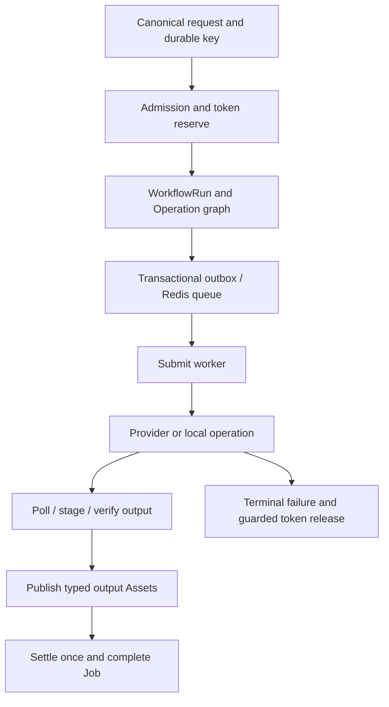

# Workflow and Job Lifecycle

New clients submit `POST /v1/workflows`. A public Job ID identifies the durable aggregate and remains the status/history identity. The old `/v1/design-jobs` request path is a supported compatibility adapter for applicable bodies, not a second independent execution system.

## Discover and freeze

1. Read Features/Workflow discovery, exact prompt templates and current subscription/workspace access. The database decides active graph, node models, price and entitlements.
2. Upload required inputs and complete their verification, or build the selected text/Blueprint request. Keep input ordering and semantic roles.
3. Skip the retired quote round trip: `/v1/design-job-quotes` returns `409 WORKFLOW_UPDATED`. Rebuild any retired request against the current Workflow schema.
4. Persist one action key and submit with the original account/workspace/project identity. Omitted `project_id` resolves to the caller's scratch Project; explicit IDs are checked inside the requested workspace.
5. Admission validates content/roles, configuration, quota, funds and concurrent-job limits, then freezes the request/configuration/price, reserves tokens and writes durable Workflow/Operation scheduling state. New acceptance and exact replay both return `202`.

## Execution and recovery

`workflow_runs` freezes graph/provenance; `operation_runs`, ordered inputs/dependencies/outputs and provider-call/submission records drive each node. Workflow node configuration selects versioned provider models; API callers do not supply raw provider credentials or arbitrary fetch URLs.

Provider `submit` returns a common result; only pollable adapters implement `query`. A synchronous provider call still runs behind the asynchronous Job API. Image, Markdown text, ordered audio summaries, report HTML/PPTX and local video operations have different request shapes. The typed provider interface does not imply every model accepts every modality.

Dispatch records `PREPARED`, `DISPATCHING`, `STAGED`, `TERMINAL` plus acceptance certainty/retry disposition. A timeout after a paid POST may mean the supplier accepted it. Do not retry blindly or assume missing provider ID means nothing happened. Durable snapshots, staging, leases and reconciliation determine permitted recovery; adapters disable unsafe automatic transport POST retries.

## Client polling and output selection

Use returned `status_url` and `poll_after_seconds`/`Retry-After`; do not poll the supplier. Stop at `completed` or `failed`. The four public statuses are `pending`, `running`, `completed`, `failed`; progress/average duration are presentation hints, not a completion promise.

Read typed `outputs`: artifacts carry modality/role/Asset ID and expiring URL metadata; Markdown includes inline content plus its persisted Document Asset identity, metadata and expiring URL; preserve that identity for reusable summaries/copywriting. Design Report may also publish a presentation. `result_kind` is a compatibility hint and cannot replace output selection. Refresh the Job before opening expired URLs.

## Explicit retry, move and deletion

The response exposes `retry_eligible`, `retry_block_code`, retry count/limit and deletion/admin-failure pending states. A permitted `POST /v1/workflows/{design_job_id}/retry` uses a durable retry key and resumes the same Job with an accepted retry receipt; it is not equivalent to recreating an entire paid action. Retry eligibility and frozen cost rules remain server-owned.

Project moves send `expected_source_project_id` plus the target to detect stale writes. Guarded deletion preserves in-flight execution/cleanup boundaries; do not assume a hidden item means the object/provider operation vanished.

## Current video boundary

The API schema permits exactly one character image, 0–12 scene images, at most one recording and a nonblank script up to 20,000 characters. The shipped mini-program UI permits **one scene** and **1,000 script characters**. The installed private `jinqiuai` supplier can impose narrower limits and supported entry signatures; record its resolved commit and validate the rebuilt package. Raising a form/API limit alone does not establish supplier support.

## Source evidence

Verified against the [documented source revisions](/reference/source-revisions).

- [Canonical submission repository](https://github.com/Orientation-CD/wechat_mini_program/blob/eca0a5f9e0a2aa1cb3fd4f9714114bb3db7fae5f/src/repositories/workflows.ts)
- [Workflow admission](https://github.com/Orientation-CD/YuanZhu-AI/blob/b13cc5668920620a274cb91a3393ed9fadac72ae/app/workflows/workflow_admission.py)
- [Workflow execution](https://github.com/Orientation-CD/YuanZhu-AI/blob/b13cc5668920620a274cb91a3393ed9fadac72ae/app/workflows/workflow_execution.py)
- [Typed provider interface](https://github.com/Orientation-CD/YuanZhu-AI/blob/b13cc5668920620a274cb91a3393ed9fadac72ae/app/providers/base.py)
- [Public request/polling schema](https://github.com/Orientation-CD/YuanZhu-AI/blob/b13cc5668920620a274cb91a3393ed9fadac72ae/app/core/models.py)
