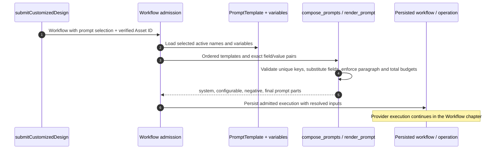
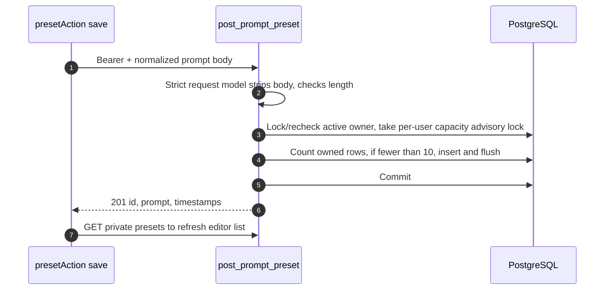

# Prompt discovery and personal presets: UI choices → exact keys → server composition

A choice label such as “现代” is not the text sent to a model. The frontend chooses stable prompt keys and field values; the server owns the authored template paragraphs. A personal “常用要求” preset is a separate, private saved text body. Follow both chains here before continuing to the [Workflow lifecycle](/reference/flows/design-job-lifecycle). All source links use [fixed revisions](/reference/source-revisions).

## Three objects that must not be confused {#prompt-model}

| Object | Controlled by | Database / wire form | What it does |
| --- | --- | --- | --- |
| Prompt template | Administrator | `PromptTemplate`, `PromptVariable`; API exposes metadata | Defines server-authored system/configurable/negative paragraphs and exact required field names. |
| Prompt selection | Caller at workflow admission | `{ prompts: [{ name, fields: [{ name, value }] }] }` | Selects active templates and supplies every required value exactly once. |
| Personal preset | One application user | `PromptPreset { id, prompt, created_at, updated_at }` | Saves a reusable body for the editor; it is not a server template and grants no model permission. |

Both template discovery endpoints require an authenticated account. Neither discovery nor preset CRUD submits a worker task, consumes a model response or generates an image. The model call happens after a separate Workflow submission.

## List active template contracts {#prompt-template-list}

**Endpoint: `GET /v1/prompt-templates`.** Standard design calls [`promptCatalogRepository`](https://github.com/Orientation-CD/wechat_mini_program/blob/21db6d824a7b32417bda88e7e31d3f0b91dfa51c/src/pkg-features/repositories/promptCatalog.ts#L198) `get()` while preparing submit; customized design calls `getEditableTemplates()` from [`loadTemplates`](https://github.com/Orientation-CD/wechat_mini_program/blob/21db6d824a7b32417bda88e7e31d3f0b91dfa51c/src/pkg-features/pages/customized_design/index.vue#L191). The latter requires the exact key `feature_customized_design` with precisely the `user_prompt` field; missing/mismatched configuration blocks the feature rather than guessing another template.

```mermaid
sequenceDiagram
  autonumber
  actor Person
  participant UI as Design editor
  participant Repo as promptCatalogRepository
  participant API as list_prompt_templates
  participant DB as PostgreSQL
  Person->>UI: Select feature or open editable design
  UI->>Repo: get / getEditableTemplates
  Repo->>API: Authenticated GET template catalog
  API->>DB: Active rows filtered by exact purpose or NULL + variables
  DB-->>API: Server-authored definitions
  API-->>Repo: name, fields, prompt-presence flags; scoped short-lived reference previews
  Repo-->>UI: Validate known keys, show choices or unavailable state
```

| Steps | Code | What a beginner should inspect |
| --- | --- | --- |
| 1–2 | [`loadTemplates`](https://github.com/Orientation-CD/wechat_mini_program/blob/21db6d824a7b32417bda88e7e31d3f0b91dfa51c/src/pkg-features/pages/customized_design/index.vue#L191), [`promptCatalogRepository`](https://github.com/Orientation-CD/wechat_mini_program/blob/21db6d824a7b32417bda88e7e31d3f0b91dfa51c/src/pkg-features/repositories/promptCatalog.ts#L198) | A page may request metadata before submit; standard submit also rechecks the active catalog. |
| 3–5 | [`list_prompt_templates`](https://github.com/Orientation-CD/YuanZhu-AI/blob/e59716c83e087deda8477da5ea7b327a40cf65c5/app/prompts/api.py#L72), [`prompt_template_load_options`](https://github.com/Orientation-CD/YuanZhu-AI/blob/e59716c83e087deda8477da5ea7b327a40cf65c5/app/prompts/api.py#L21) | Authentication runs first; the SQL query filters `is_active=True` plus exact purpose (NULL when omitted) and eagerly loads variables to avoid one query per field. |
| 6 | [`prompt_template_response`](https://github.com/Orientation-CD/YuanZhu-AI/blob/e59716c83e087deda8477da5ea7b327a40cf65c5/app/prompts/api.py#L42) | Response deliberately omits `system_prompt`, `template_text`, `negative_prompt` and administrator example values. `has_*` are booleans, not the secret authored text. |
| 7 | [`mapPromptTemplateCatalog`](https://github.com/Orientation-CD/wechat_mini_program/blob/21db6d824a7b32417bda88e7e31d3f0b91dfa51c/src/pkg-features/repositories/promptCatalog.ts#L128), [`mapEditablePromptTemplates`](https://github.com/Orientation-CD/wechat_mini_program/blob/21db6d824a7b32417bda88e7e31d3f0b91dfa51c/src/pkg-features/repositories/promptCatalog.ts#L59) | Check unique exact names, fields and active-known-key inventory. A successful catalog omitting a known key means unavailable. List position has no semantic meaning. |

For standard image features, `featurePromptKeys` maps feature identifiers to keys such as `feature_interior_design`. `buildPromptSelection` validates room/style/project choices, applies a deterministic project order and checks that all chosen keys are active. Those built-in selections require no editable fields, so their `fields` are `[]`. For editable features, `buildEditablePromptSelection` matches the advertised field names and normalizes user text.

Without `purpose`, the backend returns only active templates whose purpose is null. `GET /v1/prompt-templates?purpose=same_style_video` selects the exact same-style set; each frontend mapper validates that set for its UI. For that purpose only, async response projection adds `display_name`, `reference_video_url` and `reference_poster_url`; unavailable storage signing yields null preview fields rather than failing the entire list. Do not derive `name` from a translated label, description or array index; use the exact case-sensitive returned/statically defined contract key.

## Read one template contract {#prompt-template-get}

**Endpoint: `GET /v1/prompt-templates/{prompt_template_name}`.** The audited mini program reads the list and does not call this detail endpoint. Scripts/integrations can inspect one contract through [`get_prompt_template`](https://github.com/Orientation-CD/YuanZhu-AI/blob/e59716c83e087deda8477da5ea7b327a40cf65c5/app/prompts/api.py#L110). It strips the path name, rejects blank/over-160 names as not found, selects that exact active name with its variables and returns the same safe metadata shape. Unknown or inactive → `404 PROMPT_TEMPLATE_NOT_FOUND`.

For a disposable authenticated local test, request `/v1/prompt-templates/feature_customized_design`. Expected metadata includes the actual active `name` and required `fields`; it does not reveal a provider-ready full prompt. If that template is not configured, a 404 is the correct result rather than an instruction to copy a template from another environment.

## Follow a selection into the eventual model prompt {#prompt-composition}

This section explains what the discovery response is **used for**; it is not an additional discovery endpoint. Customized design [`submitCustomizedDesign`](https://github.com/Orientation-CD/wechat_mini_program/blob/21db6d824a7b32417bda88e7e31d3f0b91dfa51c/src/pkg-features/services/customizedDesignSubmit.ts#L20) calls [`buildEditablePromptSelection`](https://github.com/Orientation-CD/wechat_mini_program/blob/21db6d824a7b32417bda88e7e31d3f0b91dfa51c/src/pkg-features/repositories/promptCatalog.ts#L86), uploads/uses a verified image and submits its selected fields with the Workflow.

```json
{
  "prompts": [
    {
      "name": "feature_customized_design",
      "fields": [{ "name": "user_prompt", "value": "Keep the window; use warm wood and softer light." }]
    }
  ]
}
```

This is the **prompt-selection object inside the workflow request**, not a complete `/v1/workflows` body. `name` identifies a configured server template. Field `name` must exactly match the catalog; `value` is the user's text. It is not a prompt-preset ID, model ID or filename.



| Steps | Source | Failure boundary |
| --- | --- | --- |
| 1–2 | [`submitCustomizedDesign`](https://github.com/Orientation-CD/wechat_mini_program/blob/21db6d824a7b32417bda88e7e31d3f0b91dfa51c/src/pkg-features/services/customizedDesignSubmit.ts#L20), [`compose_design_prompt_parts`](https://github.com/Orientation-CD/YuanZhu-AI/blob/e59716c83e087deda8477da5ea7b327a40cf65c5/app/workflows/design_job.py#L837) | The server rechecks current active definitions, rejects duplicate selections and missing/inactive names even if the earlier catalog GET succeeded. |
| 3–4 | [`render_prompt`](https://github.com/Orientation-CD/YuanZhu-AI/blob/e59716c83e087deda8477da5ea7b327a40cf65c5/app/prompts/prompt_templates.py#L283) | Reject repeated/unknown fields; require the set of supplied names to equal referenced placeholders; strip values, reject blanks and over-limit values; format the template text. |
| 4–5 | [`compose_prompts`](https://github.com/Orientation-CD/YuanZhu-AI/blob/e59716c83e087deda8477da5ea7b327a40cf65c5/app/prompts/prompt_templates.py#L331) | At most one selected template may supply a system prompt. Join authored configurable and negative paragraphs with blank lines, not synthetic numbered lists; enforce separate and total text budgets. |
| 6 | [`compose_design_prompt_parts`](https://github.com/Orientation-CD/YuanZhu-AI/blob/e59716c83e087deda8477da5ea7b327a40cf65c5/app/workflows/design_job.py#L837) | Invalid composition maps to `422 PROMPT_COMPOSITION_INVALID`; unavailable name to `404 PROMPT_TEMPLATE_NOT_FOUND`. A catalog success never guarantees a later mutable configuration still matches. |

Read `PromptComposition` and the Workflow/operation chapter to see which parts a particular provider adapter uses. Saving “常用要求” does not bypass any of this validation: selecting a preset copies its text into the editor, and that text becomes a normal field value at submit time.

## List private “常用要求” bodies {#prompt-preset-list}

**Endpoint: `GET /v1/prompt-presets`.** Customized editor `presetAction("list")` calls [`promptPresetRepository`](https://github.com/Orientation-CD/wechat_mini_program/blob/21db6d824a7b32417bda88e7e31d3f0b91dfa51c/src/pkg-features/repositories/customizedDesign.ts#L33) `list()`. [`get_prompt_presets`](https://github.com/Orientation-CD/YuanZhu-AI/blob/e59716c83e087deda8477da5ea7b327a40cf65c5/app/prompts/prompt_preset_api.py#L53) invokes [`list_prompt_presets`](https://github.com/Orientation-CD/YuanZhu-AI/blob/e59716c83e087deda8477da5ea7b327a40cf65c5/app/prompts/prompt_presets.py#L44), commits and serializes safe rows.

The service first takes the active-user admission advisory lock and reloads the account to coordinate with anonymization, then selects only `PromptPreset.user_id == current_user.id`, ordered by `updated_at DESC, id DESC`. The frontend verifies unique IDs, body shape and a maximum of ten items. “Choose preset” copies its body into the current editor; it does not mutate the saved row or submit generation.

## Save a new body, including an intentional duplicate {#prompt-preset-create}

**Endpoint: `POST /v1/prompt-presets`.** “保存常用要求” enters [`presetAction`](https://github.com/Orientation-CD/wechat_mini_program/blob/21db6d824a7b32417bda88e7e31d3f0b91dfa51c/src/pkg-features/pages/customized_design/index.vue#L268) → repository `save(prompt)` → [`post_prompt_preset`](https://github.com/Orientation-CD/YuanZhu-AI/blob/e59716c83e087deda8477da5ea7b327a40cf65c5/app/prompts/prompt_preset_api.py#L72). Body is `{ "prompt": "Keep the window and use warm wood." }`; there are no caller-owned title, user ID, template or pricing fields.



| Steps | Code | Why it exists |
| --- | --- | --- |
| 1–2 | [`normalizedUserPrompt`](https://github.com/Orientation-CD/wechat_mini_program/blob/21db6d824a7b32417bda88e7e31d3f0b91dfa51c/src/pkg-features/repositories/customizedDesign.ts#L15), [`PromptPresetCreateRequest`](https://github.com/Orientation-CD/YuanZhu-AI/blob/e59716c83e087deda8477da5ea7b327a40cf65c5/app/core/models.py#L390) | UI and server strip text and check configured field length. The database also enforces trimmed nonempty bodies within its 12,000-character ceiling. |
| 3–4 | [`create_prompt_preset`](https://github.com/Orientation-CD/YuanZhu-AI/blob/e59716c83e087deda8477da5ea7b327a40cf65c5/app/prompts/prompt_presets.py#L59) | Capacity lock makes count-and-insert one serialized decision; two simultaneous saves cannot both take the tenth slot. `409 PROMPT_PRESET_LIMIT_REACHED` is the stable full response. |
| 5–7 | [`post_prompt_preset`](https://github.com/Orientation-CD/YuanZhu-AI/blob/e59716c83e087deda8477da5ea7b327a40cf65c5/app/prompts/prompt_preset_api.py#L72), [`presetAction`](https://github.com/Orientation-CD/wechat_mini_program/blob/21db6d824a7b32417bda88e7e31d3f0b91dfa51c/src/pkg-features/pages/customized_design/index.vue#L268) | Commit before reporting success, then reload the private list. |

Duplicate bodies are intentionally allowed. POST is not deduplicated by a content hash or idempotency header; blind replay after an ambiguous response can create a second row if capacity allows. Check the list before deciding whether another explicit save is wanted.

## Replace an owned saved body {#prompt-preset-patch}

**Endpoint: `PATCH /v1/prompt-presets/{preset_id}`.** Selecting an existing preset for editing retains its ID; `presetAction("save", id)` uses repository `save(prompt, id)`. [`patch_prompt_preset`](https://github.com/Orientation-CD/YuanZhu-AI/blob/e59716c83e087deda8477da5ea7b327a40cf65c5/app/prompts/prompt_preset_api.py#L88) → [`update_prompt_preset`](https://github.com/Orientation-CD/YuanZhu-AI/blob/e59716c83e087deda8477da5ea7b327a40cf65c5/app/prompts/prompt_presets.py#L103) repeats active-account coordination and selects by **both** UUID and owner under its mutation lock. It replaces only `prompt`, updates `updated_at`, flushes and commits. The frontend checks the returned UUID equals the edited ID, then reloads the list.

Foreign and nonexistent IDs both yield `404 PROMPT_PRESET_NOT_FOUND`, so the endpoint does not reveal another user's preset. PATCH does not consume a new capacity slot, and it does not rewrite already admitted Workflow prompts.

## Delete an owned saved body {#prompt-preset-delete}

**Endpoint: `DELETE /v1/prompt-presets/{preset_id}`.** Editor `deletePreset(id)` asks the person to confirm, then `presetAction("delete", id)` calls repository `remove`. [`remove_prompt_preset`](https://github.com/Orientation-CD/YuanZhu-AI/blob/e59716c83e087deda8477da5ea7b327a40cf65c5/app/prompts/prompt_preset_api.py#L110) → [`delete_prompt_preset`](https://github.com/Orientation-CD/YuanZhu-AI/blob/e59716c83e087deda8477da5ea7b327a40cf65c5/app/prompts/prompt_presets.py#L129) locks/rechecks active owner, selects the owned row with its delete lock, deletes, flushes and commits `204`. Foreign or missing rows return the same `404`.

The UI explanation is literal: deleting a saved requirement does not erase the text already copied into the current editor. Saved bodies are private account data, not workspace-shared configuration. Account anonymization deletes owned presets through lifecycle maintenance.

## Guided read: a missing option and a full preset list {#prompt-debug}

1. Open `prompt_template_response`, then compare a local authenticated GET response to its SQL model. Expected: only names/description/field names/flags/timestamp cross the public boundary, while authored paragraphs remain server-side.
2. Follow `loadTemplates` and find the exact customized-template/field checks. Disable or change a template only in a disposable local test setup. Expected: missing configuration blocks the UI; it does not silently choose the next list item.
3. Read `buildEditablePromptSelection`, `compose_design_prompt_parts` and `render_prompt` in order. Trace `user_prompt` from textbox to substitution. Expected: exact name matching at both client and server; stale/extra/missing fields fail rather than being discarded silently.
4. Trace a preset save through the two advisory-lock namespaces. With the local API test harness, inspect simultaneous saves near ten entries. Expected: capacity is a database decision, not merely a disabled UI button.
5. Select a preset, delete its saved row, then inspect the unsent editor text. Expected: local text remains; generation has not begun until the Workflow submit action. In troubleshooting, separate catalog errors, preset persistence errors and later provider failures.

## Same-style purpose and reference previews

Same-style video templates use `purpose=same_style_video`, distinct from ordinary generation templates. The client exposes only the declared salutation field; a managed template can return short-lived reference-video/poster preview capabilities. Refresh catalog metadata when those URLs expire rather than saving the signed URL as permanent content.

Runtime still validates an active template's purpose, field inventory, rendered text and per-scene character agreement. Admin save success does not prove the template can pass admission. The custom `__user_reference__` branch has a different contract: it uses an uploaded Video Asset, skips backend template lookup/render and does not freeze a competing script. Follow [the full video branch](/backend/video) and [prompt operations](/admin/prompts).
