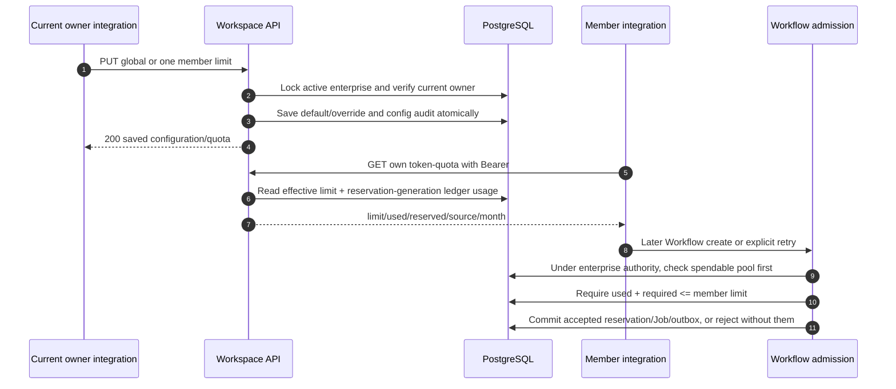

# Member monthly quota: configuration → ledger view → admission

This chapter traces three implemented APIs and the financial check they control. **The audited mini-program has no caller for these three quota APIs.** The entry point is an authenticated integration or operator script, not an invented screen/button. See [integration status](/reference/integration-status) before treating a backend capability as shipped UI.

An enterprise wallet and a member quota are different authorities: the wallet pays; the quota limits how much new work one member may reserve in a calendar month. Neither quota save transfers Tokens, creates a Job or calls Redis/provider execution.



## Save the enterprise default {#workspace-token-limit}

**Endpoint:** `PUT /v1/workspaces/{workspace_id}/member-token-limit`. Bearer authentication and current OWNER membership of an active enterprise are required. The body is an object: `{"limit":50000}` for a finite cap or `{"limit":null}` for unlimited; bare JSON null is invalid. Accepted finite values are strict integers1..10,000,000; zero, missing, string, boolean, float and unknown fields fail422.

1. [app/workspaces/workspace_api.py → update_member_token_default](https://github.com/Orientation-CD/YuanZhu-AI/blob/e59716c83e087deda8477da5ea7b327a40cf65c5/app/workspaces/workspace_api.py#L208) passes the authenticated actor and explicit workspace UUID to `set_enterprise_member_token_limit`; saved selection is not permission.
2. [app/billing/member_token_quotas.py → set_enterprise_member_token_limit](https://github.com/Orientation-CD/YuanZhu-AI/blob/e59716c83e087deda8477da5ea7b327a40cf65c5/app/billing/member_token_quotas.py#L198) calls `_locked_owner_enterprise`, checks accessible active Enterprise/current OWNER and locks enterprise authority before override rows.
3. It counts current nonowners, writes `Enterprise.member_monthly_token_limit`, stamps configured-at and **deletes every override**, including departed members' retained overrides. This happens even for the same value or null.
4. It appends `EnterpriseMemberTokenLimitAudit` with old/new/source, affected count and cleared override count. The route commits configuration+audit together; no financial ledger event is created.
5. Returns **200** with `{"limit":50000,"affected_members":3}`. This count means current nonowners, not deleted override rows. Refresh owner overview after success.

A global save is not a patch that preserves individual exceptions. Integrators must disclose that clearing effect before issuing it. If the response is lost, first read current owner overview; blindly repeating a global save later could clear a newly created override. This PUT does not have the paid-workflow action-key receipt protocol.

## Save one current member's override {#member-token-limit}

**Endpoint:** `PUT /v1/workspaces/{workspace_id}/members/{user_id}/token-limit`. Current OWNER only. The required `limit` is null or strict integer0..10,000,000. Individual0 deliberately pauses new reservations; it is not the global limit's validation range.

1. [app/workspaces/workspace_api.py → update_member_token_limit](https://github.com/Orientation-CD/YuanZhu-AI/blob/e59716c83e087deda8477da5ea7b327a40cf65c5/app/workspaces/workspace_api.py#L225) forwards actor/workspace/target/limit to `set_member_token_limit`.
2. [app/billing/member_token_quotas.py → set_member_token_limit](https://github.com/Orientation-CD/YuanZhu-AI/blob/e59716c83e087deda8477da5ea7b327a40cf65c5/app/billing/member_token_quotas.py#L250) takes current enterprise owner authority, then validates the target's current membership. Missing/former target is404 `MEMBER_NOT_FOUND`; owner target is409 `WORKSPACE_OWNER_TOKEN_LIMIT_FORBIDDEN`.
3. It creates/updates the member's `EnterpriseMemberTokenLimit` row and appends the config audit. Every individual save produces `source:"custom"`, including null or a value equal to global default.
4. It calls `read_member_token_quota`, and the route commits. Example200: `{"limit":0,"used":120,"reserved":20,"source":"custom","month":"2026-11"}`. Refresh the selected quota/overview.

The override survives leaving/rejoining unless a later global save clears it. Zero survives month changes, so waiting for next month does not resume that member. Only an owner limit change can do so. Configuration does not cancel work already accepted; that work still settles/releases normally.

## Read the authenticated member's quota {#me-token-quota}

**Endpoint:** `GET /v1/workspaces/{workspace_id}/me/token-quota`. Current member or owner of an active enterprise; no target-member parameter or request body. This does not change selected workspace.

1. [app/workspaces/workspace_api.py → get_own_member_token_quota](https://github.com/Orientation-CD/YuanZhu-AI/blob/e59716c83e087deda8477da5ea7b327a40cf65c5/app/workspaces/workspace_api.py#L242) resolves current accessible workspace/membership; personal space fails422 `ENTERPRISE_WORKSPACE_REQUIRED`.
2. [app/billing/member_token_quotas.py → read_member_token_quota](https://github.com/Orientation-CD/YuanZhu-AI/blob/e59716c83e087deda8477da5ea7b327a40cf65c5/app/billing/member_token_quotas.py#L157) captures one current clock, loads that member's optional override and calls `enterprise_member_token_usage`.
3. [app/billing/member_token_quotas.py → member_token_quota](https://github.com/Orientation-CD/YuanZhu-AI/blob/e59716c83e087deda8477da5ea7b327a40cf65c5/app/billing/member_token_quotas.py#L140) chooses owner→unlimited/source owner, explicit row→custom, otherwise Enterprise default. Null is unlimited, not zero or a missing value.
4. [app/billing/member_token_quotas.py → enterprise_member_token_usage](https://github.com/Orientation-CD/YuanZhu-AI/blob/e59716c83e087deda8477da5ea7b327a40cf65c5/app/billing/member_token_quotas.py#L57) aggregates immutable ledger generation identities.200 returns `limit`, `used`, `reserved`, `source`, `month`.

| Example field | Meaning |
| --- | --- |
| `limit:50000` | Current effective cap, not remaining wallet balance |
| `used:120` | All accepted/settled usage counted once |
| `reserved:20` | Pending subset of120; do not display140 as used |
| `source:"default"` | No individual override; not an unconfigured error |
| `month:"2026-11"` | Asia/Shanghai calendar month |

Refresh when entering a new month or after configuration changes. A cached quota is display context, never authority to admit a job. Owners still have attributable usage but `limit:null,source:"owner"`.

## Why a cross-month completion is not a second charge

`quota_month` and `beijing_month_utc_window` use Asia/Shanghai boundaries converted to UTC. A reservation belongs to the month in which it was accepted. Settling it in the next month closes that same generation: used stays counted once in the reservation month and reserved becomes0. Release makes that generation contribute0, even when released later. Explicit retry is its own reservation generation, priced from frozen accepted evidence and assigned to its new reservation month.

Ledger idempotency identities survive cleared Job FKs, so Job deletion does not free a consumed quota. Only attributed historical CONSUMED events with no matching recorded reservation use settlement month, with reserved0. Personal/global/unattributed/funding events do not count. Existing enterprise `consumption.current_month` remains a settlement-month report and need not equal the quota view.

## The later create/retry transaction

[app/workflows/workflow_admission.py → _reserve_feature_workflow_tokens](https://github.com/Orientation-CD/YuanZhu-AI/blob/e59716c83e087deda8477da5ea7b327a40cf65c5/app/workflows/workflow_admission.py#L2295) first checks enterprise spendable balance (`remaining_tokens - reserved_tokens`). `TOKEN_SHORTAGE_WORKSPACE` retains priority. With sufficient funds, [app/billing/member_token_quotas.py → member_token_limit_violation](https://github.com/Orientation-CD/YuanZhu-AI/blob/e59716c83e087deda8477da5ea7b327a40cf65c5/app/billing/member_token_quotas.py#L302) reads the current member role/override/ledger under the caller's enterprise account lock and requires `used + required <= limit`. Owner/unlimited bypass this cap.

A failed check is402:

```json
{"detail":{"code":"MEMBER_MONTHLY_TOKEN_LIMIT_REACHED","limit":50000,"used":49980,"required":30}}
```

No new reservation, Job, retry receipt or dispatch outbox is accepted by this rejection. A prepared archive receipt can remain as an expiring input preparation; it is not paid acceptance. Exact replay of an already accepted create never reserves again. Retry rechecks capacity using original frozen price and the new month. A positive-limit member can reduce the request, wait for the next calendar month or ask the owner to adjust; a zero pause needs owner change.

## Errors and a read-only learning exercise

| Boundary | Response | Correct interpretation |
| --- | --- | --- |
| No valid Bearer |401| Authenticate/refresh through the normal session contract |
| Foreign/former caller |403 `WORKSPACE_ACCESS_DENIED`| Selection/cache cannot restore membership |
| Current nonowner writes |403 `WORKSPACE_OWNER_REQUIRED`| A member cannot change their own cap |
| Removed/inactive enterprise |409 `WORKSPACE_INACTIVE`| Do not retry against another payer silently |
| Personal workspace |422 `ENTERPRISE_WORKSPACE_REQUIRED`| This cap is enterprise-only |
| Wrong limit type/range/shape |422| Fix the exact strict body; it changed no configuration |

Without launching paid work, read the three handlers and compare their commit boundaries. In an authorized local environment, inspect one known owner's overview and that same account's self quota, then read the tests in `tests/test_enterprise_member_token_quotas.py` and `tests/test_member_quota_admission.py` for global reset, cross-month closure, Job deletion and explicit retry cases. Explain why quota configuration is audited but has no Token delta.
