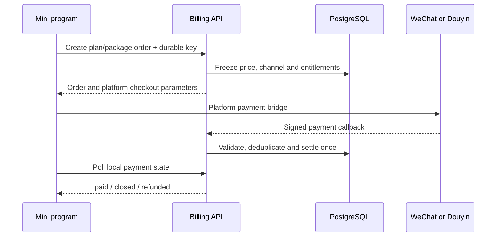

# Payment and Refund Flow

WeChat and Douyin share server-priced orders, token accounting and subscription snapshots. Their platform bridges, keys and signed callbacks differ. The authoritative payment state is the backend record, not the mini-program success callback.

## Checkout and resume

Load returned product codes/prices/benefits from billing discovery. Submit `/v1/subscriptions` or `/v1/token-purchases` with a durable key and platform `type` (`jsapi`/`app` as supported for WeChat, `douyin` for Douyin). The backend snapshots authoritative amount, product grants and channel/mode so later catalog edits cannot rewrite the existing order.

The client uses the matching platform bridge: WeChat payment parameters versus Douyin `tt.requestOrder` followed by `tt.getOrderPayment`. Resume/reacquire valid parameters with `POST /v1/payments/{payment_order_id}/pay`; do not create another order after an uncertain result. A channel/device change must follow the documented server rule rather than rewriting cached signed parameters.

## Settlement and expiry

WeChat callbacks use APIv3 signature verification; Douyin uses RSA over raw request bytes and the Byte signature headers. Verify provider/application/order/amount identity and event idempotency before crediting tokens or activating a fixed-period subscription. A duplicate callback must not credit twice. Reconciliation queries trusted provider evidence through its channel-specific path. The explicit mobile `/reconcile` endpoints are Douyin-specific; do not use them as a generic WeChat manual reconciliation interface.

`expires_at` ends the payable window; `close_after_at` includes the server's 30-second grace. Before expiry a pending order can show Pay/Resume. After expiry, disable payment and show confirming while polling. The backend's expiry/reconciliation task determines closure. Never mark an order `closed` solely because the client clock passed expiry.

Poll while the payment screen is visible and refresh history on entry/resume. Stop at `paid`, `closed` or `refunded`; refreshing every hidden page indefinitely creates unnecessary load. After settlement, refresh account/workspace balances and entitlement snapshots.

## Refund boundary

The API supports guarded full refunds with a distinct durable key, refund reservation, token reclamation and signed/result reconciliation. Refund state is separate from payment state and can remain pending while provider evidence is incomplete. Neither mini program currently exposes a user-facing application entry; existing APIs are not proof that every eligibility/entitlement UX is ready.

Douyin also implements the refund-application extension and explicit fixed-peer routing for a shared AppID. See [Douyin integration](/reference/douyin-payment). Keep channel-specific query/reconciliation limitations visible in acceptance evidence.

## Mock testing

With the appropriate mock mode/`MOCK_PAYMENT_ENDPOINTS_ENABLED`, `/mock/payments/{payment_order_id}/complete` and `/mock/refunds/{refund_order_id}/complete` simulate settlement for the authenticated owner. They are conditional test harnesses, not a production fallback. Do not expose mock completion to real users or use mock success to claim platform payment/refund acceptance.

A local flow also needs legal documents and configured plans/packages/entitlement grants. An empty database or bootstrapped API does not provide a purchasable catalog automatically. Documentation updates do not run real payments or paid acceptance tests.

## Source evidence

Verified against the [documented source revisions](/reference/source-revisions).

- [Platform payment service](https://github.com/Orientation-CD/wechat_mini_program/blob/eca0a5f9e0a2aa1cb3fd4f9714114bb3db7fae5f/src/pkg-account/services/payment.ts)
- [Billing endpoints](https://github.com/Orientation-CD/YuanZhu-AI/blob/b13cc5668920620a274cb91a3393ed9fadac72ae/app/billing/billing_api.py)
- [WeChat APIv3 gateway](https://github.com/Orientation-CD/YuanZhu-AI/blob/b13cc5668920620a274cb91a3393ed9fadac72ae/app/billing/wechat_pay.py)
- [Douyin gateway](https://github.com/Orientation-CD/YuanZhu-AI/blob/b13cc5668920620a274cb91a3393ed9fadac72ae/app/billing/douyin_pay.py)
- [Refund limitations and operation](https://github.com/Orientation-CD/YuanZhu-AI/blob/b13cc5668920620a274cb91a3393ed9fadac72ae/documents/PAYMENT_REFUNDS.md)
