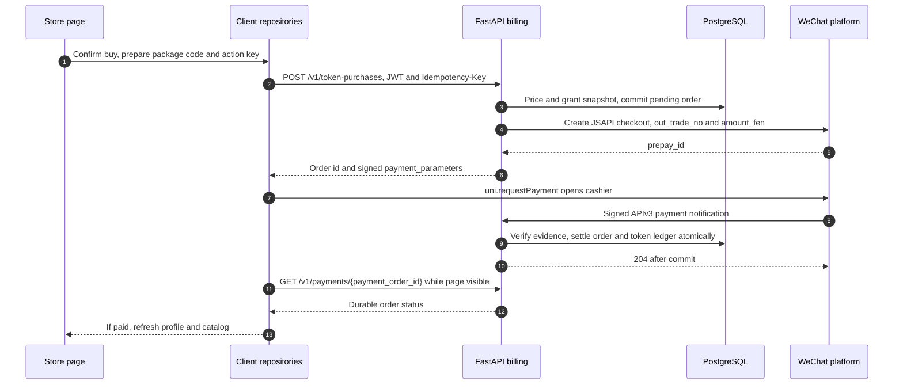
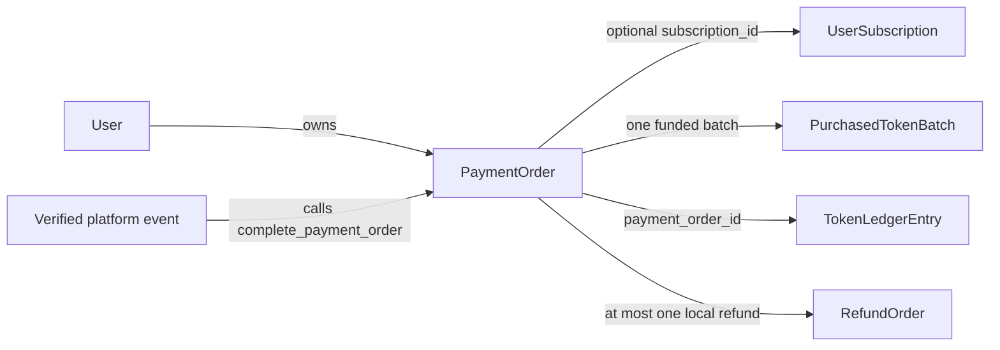
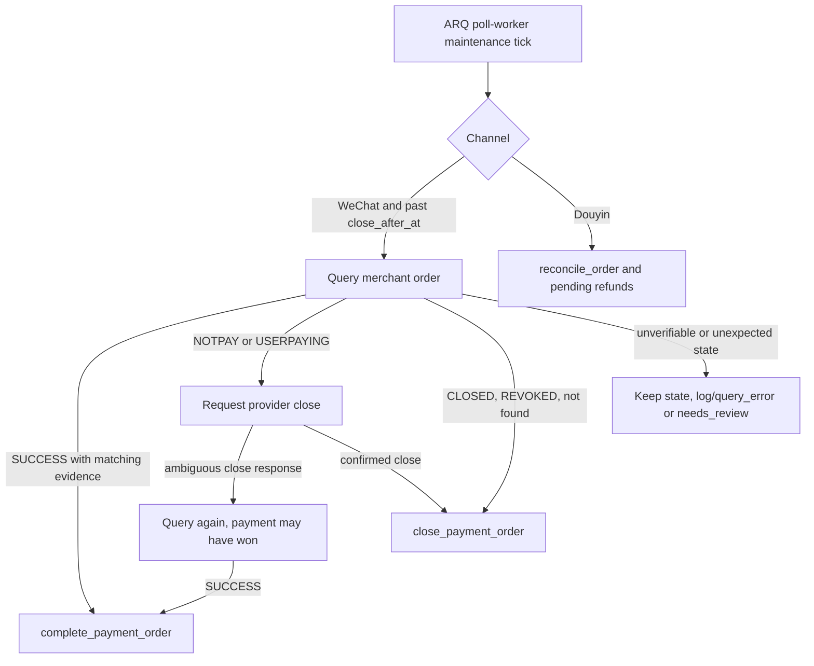

# Payment: from the Buy button to a durable balance

Start with a personal workspace and open **Account → Store**. This chapter follows a Token package purchase through actual functions, then compares subscriptions, order recovery and callbacks. A “call” means one function handing work to another; a “transaction” groups database changes so they either commit together or roll back together. A platform cashier is the payment UI supplied by WeChat/Douyin. None of those concepts requires an AI model.

Read the numbered diagram first. Open its linked functions in a second tab and follow the same numbers. The pinned links below use the [audited revisions](/reference/source-revisions), so file moves in a later release cannot silently change this explanation. The complementary [refund chain](/reference/flows/refund-flow) and [Douyin trade chain](/reference/douyin-payment) expand the branches rather than hiding them behind “the backend handles payment”.

## 1. Recognize the three independent results {#three-results}

| What you observe | What it proves | What it does not prove |
| --- | --- | --- |
| `201` from order creation | A server-priced local order exists and checkout parameters were returned | Money moved or tokens were credited |
| `uni.requestPayment` / `tt.getOrderPayment` success | The platform bridge returned a client result | A verified settlement transaction committed |
| Backend order `status: "paid"` | Trusted callback/query evidence was applied through settlement | A later refund can never occur |

Payment is not submitted to the AI `submit worker` or `poll worker` as a workflow operation. Ordinary creation/callbacks run inside FastAPI. PostgreSQL keeps orders and financial effects. Redis supports ARQ maintenance scheduling and Douyin client-token caching; it is not the financial ledger. A missed callback can be recovered by a provider query, not by trusting a client success flag.

## 2. Buy a Token package: a numbered WeChat chain {#checkout-chain}

The callback (8) and the client's bridge result run independently. Either can arrive first. The diagram shows a successful delivery; [recovery](#recovery) explains delayed notifications and payment/closure races.

| Step | Open this code | Follow the data |
| --- | --- | --- |
| 1 | `src/pkg-account/pages/store/index.vue` → [buy](https://github.com/Orientation-CD/wechat_mini_program/blob/21db6d824a7b32417bda88e7e31d3f0b91dfa51c/src/pkg-account/pages/store/index.vue#L225), [runCheckout](https://github.com/Orientation-CD/wechat_mini_program/blob/21db6d824a7b32417bda88e7e31d3f0b91dfa51c/src/pkg-account/pages/store/index.vue#L212); `purchaseRequest.ts` → [buildTokenPurchaseRequest](https://github.com/Orientation-CD/wechat_mini_program/blob/21db6d824a7b32417bda88e7e31d3f0b91dfa51c/src/pkg-account/repositories/purchaseRequest.ts#L84) | `@tap="buy(item)"` opens confirmation. Confirmation creates `logicalPurchaseId`; package code comes from discovery, never a price typed by the client. |
| 2 | [executePurchaseRequest](https://github.com/Orientation-CD/wechat_mini_program/blob/21db6d824a7b32417bda88e7e31d3f0b91dfa51c/src/pkg-account/repositories/purchaseRequest.ts#L93) → [request](https://github.com/Orientation-CD/wechat_mini_program/blob/21db6d824a7b32417bda88e7e31d3f0b91dfa51c/src/services/request.ts#L369) → [create_token_purchase](https://github.com/Orientation-CD/YuanZhu-AI/blob/e59716c83e087deda8477da5ea7b327a40cf65c5/app/billing/billing_api.py#L573) | `{type:"jsapi", package_code}` becomes JSON; the action key is a header, not the order id. FastAPI obtains the user from JWT. |
| 3 | [serialize_billing_order_creation](https://github.com/Orientation-CD/YuanZhu-AI/blob/e59716c83e087deda8477da5ea7b327a40cf65c5/app/billing/billing_api.py#L196), [new_payment_deadlines](https://github.com/Orientation-CD/YuanZhu-AI/blob/e59716c83e087deda8477da5ea7b327a40cf65c5/app/billing/payment_expiry.py#L19); [PaymentOrder](https://github.com/Orientation-CD/YuanZhu-AI/blob/e59716c83e087deda8477da5ea7b327a40cf65c5/app/persistence/db_models.py#L3025) | Per-user advisory lock; existing-key lookup; active package lookup; pending-order limit; persist authoritative fen, token grant and deadlines. `commit()` precedes provider I/O. |
| 4 | [create_checkout](https://github.com/Orientation-CD/YuanZhu-AI/blob/e59716c83e087deda8477da5ea7b327a40cf65c5/app/billing/wechat_pay.py#L242) | SDK `pay()` receives merchant order number, amount/currency, payer OpenID, expiry, callback URL and `WeChatPayType.JSAPI`. |
| 5 | The return handling inside [create_checkout](https://github.com/Orientation-CD/YuanZhu-AI/blob/e59716c83e087deda8477da5ea7b327a40cf65c5/app/billing/wechat_pay.py#L242) | Missing `prepay_id` is a provider error, not a successful empty response. |
| 6 | [_payment_parameters](https://github.com/Orientation-CD/YuanZhu-AI/blob/e59716c83e087deda8477da5ea7b327a40cf65c5/app/billing/wechat_pay.py#L208) → [refreshed_checkout_response](https://github.com/Orientation-CD/YuanZhu-AI/blob/e59716c83e087deda8477da5ea7b327a40cf65c5/app/billing/billing_api.py#L151) → [mapPaymentOrder](https://github.com/Orientation-CD/wechat_mini_program/blob/21db6d824a7b32417bda88e7e31d3f0b91dfa51c/src/pkg-account/repositories/paymentOrder.ts#L72) | The backend signs timestamp/nonce/package for the client, then re-reads durable state so a concurrent callback cannot expose stale pay parameters. The frontend checks order kind, channel and required fields. |
| 7 | `store/index.vue` → [launch](https://github.com/Orientation-CD/wechat_mini_program/blob/21db6d824a7b32417bda88e7e31d3f0b91dfa51c/src/pkg-account/pages/store/index.vue#L201) → [requestWechatPayment](https://github.com/Orientation-CD/wechat_mini_program/blob/21db6d824a7b32417bda88e7e31d3f0b91dfa51c/src/pkg-account/services/payment.ts#L63) | Validate `timeStamp`, nonce, `prepay_id=…`, RSA and signature before `uni.requestPayment`. Cancellation is mapped to a UI error; it does not close or settle the order. |
| 8 | [wechat_pay_notification](https://github.com/Orientation-CD/YuanZhu-AI/blob/e59716c83e087deda8477da5ea7b327a40cf65c5/app/billing/billing_api.py#L1365) → [receive_wechat_event](https://github.com/Orientation-CD/YuanZhu-AI/blob/e59716c83e087deda8477da5ea7b327a40cf65c5/app/billing/billing_api.py#L1188) → [callback](https://github.com/Orientation-CD/YuanZhu-AI/blob/e59716c83e087deda8477da5ea7b327a40cf65c5/app/billing/wechat_pay.py#L354) | Read raw bytes, verify/decrypt with APIv3 SDK, then validate application, merchant, amount, currency, transaction id and event type. |
| 9 | [complete_payment_order](https://github.com/Orientation-CD/YuanZhu-AI/blob/e59716c83e087deda8477da5ea7b327a40cf65c5/app/billing/billing.py#L750) | Lock the account/order; set `paid`; add a paid token batch and ledger credit; activate subscription if present. Save the notification event in the same request transaction. |
| 10 | End of [receive_wechat_event](https://github.com/Orientation-CD/YuanZhu-AI/blob/e59716c83e087deda8477da5ea7b327a40cf65c5/app/billing/billing_api.py#L1188) | Commit then acknowledge. A retry with a saved event id returns `204`; a concurrent duplicate commit conflict is left for provider retry. |
| 11 | [createPaymentReconciliationPoller](https://github.com/Orientation-CD/wechat_mini_program/blob/21db6d824a7b32417bda88e7e31d3f0b91dfa51c/src/pkg-account/repositories/paymentReconciliation.ts#L57) → [paymentReconciliationRepository](https://github.com/Orientation-CD/wechat_mini_program/blob/21db6d824a7b32417bda88e7e31d3f0b91dfa51c/src/pkg-account/repositories/paymentReconciliation.ts#L47) → [payment_detail](https://github.com/Orientation-CD/YuanZhu-AI/blob/e59716c83e087deda8477da5ea7b327a40cf65c5/app/billing/billing_api.py#L725) | For WeChat this is an owned local-order read, not a request to WeChat every five seconds. |
| 12 | [payment_response](https://github.com/Orientation-CD/YuanZhu-AI/blob/e59716c83e087deda8477da5ea7b327a40cf65c5/app/billing/billing_api.py#L119) → [mapPaymentReconciliation](https://github.com/Orientation-CD/wechat_mini_program/blob/21db6d824a7b32417bda88e7e31d3f0b91dfa51c/src/pkg-account/repositories/paymentReconciliation.ts#L31) | `status !== "pending"` is terminal for this poller. All returned money values are integer fen; `100` fen = ¥1. |
| 13 | `store/index.vue` → [applyOrder](https://github.com/Orientation-CD/wechat_mini_program/blob/21db6d824a7b32417bda88e7e31d3f0b91dfa51c/src/pkg-account/pages/store/index.vue#L184), [initialize](https://github.com/Orientation-CD/wechat_mini_program/blob/21db6d824a7b32417bda88e7e31d3f0b91dfa51c/src/pkg-account/pages/store/index.vue#L257) | Only `paid` shows success and reloads profile/catalog. `closed`/`refunded` have their own messages. |

### 2.1 What the request wrapper contributes {#request-auth}

[performRequest](https://github.com/Orientation-CD/wechat_mini_program/blob/21db6d824a7b32417bda88e7e31d3f0b91dfa51c/src/services/request.ts#L211) builds the base URL, JSON headers, `X-Request-ID` and `Authorization: Bearer …`, calls `uni.request`, and maps HTTP/network failures to `ApiRequestError`. [requestWithAuth](https://github.com/Orientation-CD/wechat_mini_program/blob/21db6d824a7b32417bda88e7e31d3f0b91dfa51c/src/services/request.ts#L341) shares refresh work for an expired access token and replays at most once with the same prepared body/header. It does not replace an uncertain purchase with a different idempotency key.

On the server, [get_current_user](https://github.com/Orientation-CD/YuanZhu-AI/blob/e59716c83e087deda8477da5ea7b327a40cf65c5/app/identity/auth.py#L162) decodes an **access** JWT, loads an active `User` and finishes the authentication read transaction. The purchase route derives payer OpenID using [checkout_openid](https://github.com/Orientation-CD/YuanZhu-AI/blob/e59716c83e087deda8477da5ea7b327a40cf65c5/app/billing/billing_api.py#L237) from that account: WeChat requires `wechat_openid`; Douyin requires `douyin_openid`; an arbitrary client-supplied OpenID is not accepted. Missing/invalid login is an authentication error before an order is created.

### 2.2 How retry avoids a second order {#idempotency}

[getOrCreateIdempotencyKey](https://github.com/Orientation-CD/wechat_mini_program/blob/21db6d824a7b32417bda88e7e31d3f0b91dfa51c/src/pkg-account/services/idempotency.ts#L71) stores a key under `(scope, ownerId, actionId)` in local storage. `prepare()` uses scope `purchase` and a subscription/package-specific action id. A failed or lost request leaves that key available for retry. After a validated creation response, `executePurchaseRequest()` resolves the local action key: this means **order creation was resolved**, even if its payment remains pending. Resume then uses the existing order id.

On the backend, both creation routes serialize order creation for one user, then query `(user_id, idempotency_key)`; the database also has a unique constraint. The same key and same product/kind/channel return the same order (refreshing checkout parameters only if pending). The same key with a changed product or `type` returns `409 PAYMENT_IDEMPOTENCY_KEY_REUSED`. A new key is a new logical purchase; it is not a network retry strategy.

## 3. Discovery: why a product or Feature is visible {#discovery}

### GET /v1/billing/features {#billing-features}

**Trigger:** opening Store runs `initialize()` and [billingCatalogRepository](https://github.com/Orientation-CD/wechat_mini_program/blob/21db6d824a7b32417bda88e7e31d3f0b91dfa51c/src/pkg-account/repositories/billingCatalog.ts#L142). This public read uses `publicRequestWithResponse()`, with no JWT required. Store loads profile separately to determine personal/organization context; the current organization UI offers offline administrator grants, not online checkout.

**Server:** [billing_catalog](https://github.com/Orientation-CD/YuanZhu-AI/blob/e59716c83e087deda8477da5ea7b327a40cf65c5/app/billing/billing_api.py#L287) loads active, non-removed `Feature`, `SubscriptionPlan` and `TokenPackage` rows. For each Feature it calls `resolve_workflow()` and `workflow_discovery_item()`; an admission failure omits that Feature. It derives image mask/reference requirements and report/video result kinds from resolved workflow ports, filters plan `allowed_features` to visible Features, and preserves the legacy image-only `allowed_catalogs` representation. Optional video-model prices appear only when model selection is enabled.

**Return and recovery:** `200 BillingCatalogResponse` contains `design_job_types`, `subscription_plans`, `token_packages`. Price fields are integer fen. `billing_catalog_etag()` hashes the complete sorted representation; `If-None-Match` can produce `304` with no body. Cache-Control is `public, max-age=30, stale-while-revalidate=30`. The current store repository requests the canonical path and maps/validates products; it does not implement an ETag cache itself. If a Feature disappears, inspect workflow admission/configuration as well as its active flag. An empty catalog does not create seeded sellable products.

### GET /v1/billing/catalog {#legacy-catalog}

**Compatibility alias:** it has no current Store caller. The decorator reaches the exact same `billing_catalog()` function, database queries, ETag, `200/304` response and admission filtering described above. It is deprecated in the REST schema. Existing integrations can still read it; new code should use `/v1/billing/features`. A `304` still requires the caller to retain its previous representation; parsing its empty body as fresh JSON is incorrect.

### GET /v1/design-workflows {#legacy-design-workflows}

**Compatibility alias:** also no current Store caller, also deprecated, also `billing_catalog()` and the same public read contract. The historical name does not mean it starts a design or returns the unified Workflow execution state. It reads discovery/products and makes no ledger or job writes. Execution starts through the unified workflow API described in the [workflow chain](/reference/flows/design-job-lifecycle).

## 4. Two order creation endpoints {#create-orders}

### POST /v1/subscriptions {#create-subscription}

**UI and input:** `buy()` → `runCheckout()` → [buildSubscriptionPurchaseRequest](https://github.com/Orientation-CD/wechat_mini_program/blob/21db6d824a7b32417bda88e7e31d3f0b91dfa51c/src/pkg-account/repositories/purchaseRequest.ts#L75) → `executePurchaseRequest()` sends `{ "type": "jsapi", "plan_code": "<returned code>" }` (Douyin builds send `douyin`) and `Idempotency-Key` of 8–128 characters. These are strict request models: the client sends no amount or token grant.

**Server steps:** [create_subscription](https://github.com/Orientation-CD/YuanZhu-AI/blob/e59716c83e087deda8477da5ea7b327a40cf65c5/app/billing/billing_api.py#L430) checks payment mode/payer, takes the per-user creation lock, expires due subscriptions, then handles the idempotency branch before loading the selected active plan. It rejects another pending or active subscription (`409 SUBSCRIPTION_ALREADY_EXISTS`). Otherwise it creates a **pending `UserSubscription`** snapshot (plan name/code, interval, token grant, discount and benefit items), links a pending `PaymentOrder`, snapshots Douyin trade configuration if applicable, and commits. It then calls the selected provider and re-reads the order using `refreshed_checkout_response()`.

**Result and failure:** `201 PaymentOrderResponse` carries the order id, `kind:"subscription"`, server prices/deadlines, and checkout parameters while pending. Unknown/removed plan → `404 SUBSCRIPTION_PLAN_NOT_FOUND`; changed key intent → `409`; disabled/unavailable provider → `503`. A provider timeout can occur **after** local commit. Retry the same key or find the existing pending order and resume; do not assume no record exists. The subscription interval starts when trusted payment settles, not when creation returned. It is a fixed period, without automatic recurring debit.

### POST /v1/token-purchases {#create-token-purchase}

**UI and input:** `buy()` → `runCheckout()` → `buildTokenPurchaseRequest()` sends `{ "type": "jsapi", "package_code": "<returned code>" }` with the same key discipline. The store's Token cards call this branch; subscription cards use the previous one.

**Server steps:** [create_token_purchase](https://github.com/Orientation-CD/YuanZhu-AI/blob/e59716c83e087deda8477da5ea7b327a40cf65c5/app/billing/billing_api.py#L573) checks mode/payer, serializes creation and reuses an existing matching key. It looks up an active, non-removed package and calls `pending_token_purchase_count()`; reaching the configured pending limit returns `409 PENDING_PAYMENT_LIMIT_REACHED`. The order snapshots `price_fen`, `list_price_fen`, `tokens_granted=total_token_amount` and `bonus_tokens_granted`; bonus is already part of total, so settlement does not add it twice. There is no new `UserSubscription`. Snapshot/commit/provider/re-read follow the same transaction boundary as subscriptions.

**Result and failure:** `201` with `kind:"token_purchase"`; unknown package → `404 TOKEN_PACKAGE_NOT_FOUND`; missing linked platform identity → `409`; provider errors → `503`. Query the user's payment history if the response was lost. Waiting/closing an existing order is the recovery for the pending limit; repeatedly generating new keys is not.

## 5. What settlement persists {#settlement}

Open [complete_payment_order](https://github.com/Orientation-CD/YuanZhu-AI/blob/e59716c83e087deda8477da5ea7b327a40cf65c5/app/billing/billing.py#L750) next to these record definitions: [PaymentOrder](https://github.com/Orientation-CD/YuanZhu-AI/blob/e59716c83e087deda8477da5ea7b327a40cf65c5/app/persistence/db_models.py#L3025), [PurchasedTokenBatch](https://github.com/Orientation-CD/YuanZhu-AI/blob/e59716c83e087deda8477da5ea7b327a40cf65c5/app/persistence/db_models.py#L3133), [TokenLedgerEntry](https://github.com/Orientation-CD/YuanZhu-AI/blob/e59716c83e087deda8477da5ea7b327a40cf65c5/app/persistence/db_models.py#L1895), [UserSubscription](https://github.com/Orientation-CD/YuanZhu-AI/blob/e59716c83e087deda8477da5ea7b327a40cf65c5/app/persistence/db_models.py#L2970). The helper locks account then order and returns early for already paid/refunded orders. That state guard complements event-id deduplication: a different delivery of the same real payment still cannot grant a second batch.

For a trusted pending payment it sets `paid_at`, clears `closed_at`, stores the channel transaction/order id, increments `User.remaining_tokens`, inserts a `PurchasedTokenBatch` with original/remaining grant, and adds a positive ledger entry keyed `payment:<order UUID>:user:grant`. A linked subscription becomes active and its current period is calculated from settlement time. Non-mock settlement can also create a referral reward candidate. The caller commits all those changes; a callback acknowledgement must follow the commit.

A Douyin closed order has an explicit exception allowing later trusted success to settle it. Ordinary WeChat `closed` is not reopened by this helper. Treat provider evidence and channel rules as part of state transitions; do not copy a generic state diagram into code.

### POST /v1/webhooks/wechat/payments {#wechat-payment-webhook}

**Trigger:** WeChat's server posts APIv3 notification bytes. There is no mini-program HTTP caller or JWT; trust comes from platform verification. [wechat_pay_notification](https://github.com/Orientation-CD/YuanZhu-AI/blob/e59716c83e087deda8477da5ea7b327a40cf65c5/app/billing/billing_api.py#L1365) delegates to `receive_wechat_event()` (the refund path uses the same dispatcher).

1. `callback()` rejects a timestamp more than 300 seconds from server time; the SDK verifies the platform signature and decrypts the encrypted resource. A JSON parse alone is not verification.
2. Require notification id; a saved `WeChatPaymentEvent` returns `204`. Verify `mchid`; find local order by `out_trade_no`; match AppID for its channel, `amount.total`, currency, `TRANSACTION.SUCCESS`, `trade_state:SUCCESS`, and nonempty transaction id.
3. Run `complete_payment_order()`, add `WeChatPaymentEvent` with raw envelope and `processed_at`, commit and return `204 No Content`. APP payer identity can be digested for referral checks; it is not accepted from the purchase body.
4. Invalid signature/decryption → `401 WECHAT_PAY_CALLBACK_INVALID`; bad identity/amount/state → `400`; absent order → `404`. Invalid evidence produces no financial settlement. A concurrent duplicate can fail the commit; WeChat retries and then hits durable event lookup. No success acknowledgement is fabricated after a failed commit.

WeChat **APIv3** describes the server protocol/signature/encrypted callback. `type:"jsapi"` describes the checkout surface; the mini-program bridge is `uni.requestPayment`. Server `app` checkout is a different native-app surface and is not invoked by the current mini program. The separate WeChat virtual-goods `requestVirtualPayment` bridge is not implemented by this code.

## 6. Read, resume, close and recover {#recovery}

### GET /v1/payments {#payment-history}

**UI:** opening **Payment records** calls [load](https://github.com/Orientation-CD/wechat_mini_program/blob/21db6d824a7b32417bda88e7e31d3f0b91dfa51c/src/pkg-account/pages/orders/index.vue#L48) → [paymentHistoryRepository](https://github.com/Orientation-CD/wechat_mini_program/blob/21db6d824a7b32417bda88e7e31d3f0b91dfa51c/src/pkg-account/repositories/paymentHistory.ts#L26). It supplies `?type=jsapi` or `?type=douyin`, not a user id. [payment_history](https://github.com/Orientation-CD/YuanZhu-AI/blob/e59716c83e087deda8477da5ea7b327a40cf65c5/app/billing/billing_api.py#L865) filters by JWT owner and requested channel, orders newest first, and returns at most 250 orders in `{items:[…]}`. This is a local database read with no provider request, no settlement and no per-order checkout parameter generation. Missing/invalid `type` is request validation; an empty list is a valid `200` response. The UI's load-more expands the already fetched list, not a server cursor.

### GET /v1/payments/{payment_order_id} {#payment-detail}

**UI:** WeChat poller and selected-order deep link call this path. [payment_detail](https://github.com/Orientation-CD/YuanZhu-AI/blob/e59716c83e087deda8477da5ea7b327a40cf65c5/app/billing/billing_api.py#L725) reads only `(id,current_user.id)` and serializes timestamps/state through `payment_response()`. `200` contains no refreshed `payment_parameters`; unknown/other-owner order → `404 PAYMENT_ORDER_NOT_FOUND`. Douyin can use it for a local view too, but its confirmation poller instead uses [POST reconcile](/reference/douyin-payment#payment-reconcile). An unchanged local `pending` is not proof that the provider has not received money.

### POST /v1/payments/{payment_order_id}/pay {#payment-resume}

**UI:** Payment records **Pay/Continue** → [resumePayment](https://github.com/Orientation-CD/wechat_mini_program/blob/21db6d824a7b32417bda88e7e31d3f0b91dfa51c/src/pkg-account/pages/orders/index.vue#L176) → [paymentResumeRepository](https://github.com/Orientation-CD/wechat_mini_program/blob/21db6d824a7b32417bda88e7e31d3f0b91dfa51c/src/pkg-account/repositories/paymentResume.ts#L35). Send `{type:<current channel>}`; reuse the order UUID. [resume_owned_payment](https://github.com/Orientation-CD/YuanZhu-AI/blob/e59716c83e087deda8477da5ea7b327a40cf65c5/app/billing/billing_api.py#L750) requires owner **and original channel**, returns final orders unchanged, rejects a pending order at/after stored `expires_at` with `409 PAYMENT_ORDER_EXPIRED`, checks its subscription/package relation, commits the read transaction, and obtains fresh provider parameters. It then re-reads state to avoid returning stale parameters after a concurrent callback.

`200` either supplies pending checkout data or a final status without it. Different channel/owner → `404`; broken purchase relation → `409`; provider failure → `503`. The frontend also guards expiry/channel before sending. Douyin's saved platform id selects `get_order_payment`; missing id selects signed `request_order`. Do not edit an old signature or change an order's channel to resume on another device/platform.

### POST /v1/payments/{payment_order_id}/close {#payment-close}

**UI:** Payment records **Close order** → confirmation → [executeClose](https://github.com/Orientation-CD/wechat_mini_program/blob/21db6d824a7b32417bda88e7e31d3f0b91dfa51c/src/pkg-account/pages/orders/index.vue#L198) → [paymentCloseRepository](https://github.com/Orientation-CD/wechat_mini_program/blob/21db6d824a7b32417bda88e7e31d3f0b91dfa51c/src/pkg-account/repositories/paymentClose.ts#L30). [close_owned_payment](https://github.com/Orientation-CD/YuanZhu-AI/blob/e59716c83e087deda8477da5ea7b327a40cf65c5/app/billing/billing_api.py#L827) finds the owned order, checks payment mode, rejects all Douyin orders before checking final status with `409 DOUYIN_ACTIVE_CLOSE_UNSUPPORTED`. Final WeChat orders return unchanged. For pending WeChat it releases the read transaction, awaits `close_checkout()`, then calls [close_payment_order](https://github.com/Orientation-CD/YuanZhu-AI/blob/e59716c83e087deda8477da5ea7b327a40cf65c5/app/billing/billing.py#L852) and commits. The locked close helper leaves paid/refunded orders intact and closes a linked pending subscription.

`200` returns the canonical state. Provider ambiguity/failure → `503`, so the UI refreshes instead of locally declaring `closed`. Current mini-program close UI is restricted to WeChat JSAPI; the general server route also handles its supported WeChat order surface. No refund occurs: closing an unpaid order and refunding a paid order are different operations.

### Deadlines and the ARQ maintenance path {#expiry-reconciliation}

`expires_at` is the payable deadline; `close_after_at` is the later safe-close time. [new_payment_deadlines](https://github.com/Orientation-CD/YuanZhu-AI/blob/e59716c83e087deda8477da5ea7b327a40cf65c5/app/billing/payment_expiry.py#L19) snapshots both on creation using configured expiry and grace. [payment_deadlines](https://github.com/Orientation-CD/YuanZhu-AI/blob/e59716c83e087deda8477da5ea7b327a40cf65c5/app/billing/payment_expiry.py#L31) has a fallback for older rows without stored timestamps. Never calculate a fixed grace on the client. At/after expiry the UI disables payment and shows confirmation, but only trusted server processing changes the durable status.

[PollWorkerSettings](https://github.com/Orientation-CD/YuanZhu-AI/blob/e59716c83e087deda8477da5ea7b327a40cf65c5/app/worker.py#L921) registers WeChat reconciliation at second 20 and Douyin at second 10 of each minute, both also at startup; this is a schedule, not a guaranteed completion deadline. [reconcile_old_pending_payments](https://github.com/Orientation-CD/YuanZhu-AI/blob/e59716c83e087deda8477da5ea7b327a40cf65c5/app/workflows/maintenance_jobs.py#L236) keyset-pages eligible expired pending WeChat orders, queries sequentially, and reports bounded progress in Redis for Admin. [_reconcile_pending_payment](https://github.com/Orientation-CD/YuanZhu-AI/blob/e59716c83e087deda8477da5ea7b327a40cf65c5/app/workflows/maintenance_jobs.py#L113) validates query evidence, settles success, closes confirmed unpaid/closed/not-found orders, and re-queries an ambiguous close result to protect a concurrent payment. `REFUND`/unexpected state needs review rather than guessing refund completion. [reconcile_douyin_payments](https://github.com/Orientation-CD/YuanZhu-AI/blob/e59716c83e087deda8477da5ea7b327a40cf65c5/app/workflows/maintenance_jobs.py#L386) is independent of WeChat availability; see the Douyin chapter for its discovery/refund branches.

## 7. Why the UI stops polling {#polling}

[createPollScheduler](https://github.com/Orientation-CD/wechat_mini_program/blob/21db6d824a7b32417bda88e7e31d3f0b91dfa51c/src/services/pollScheduler.ts#L33) immediately polls when visible, normally repeats every five seconds, prevents overlapping requests, backs off network/503 failures up to its configured bound and respects 429 retry hints. `setVisible(false)` clears timers and invalidates a late response; `dispose()` ends the lifecycle. Store wires `onShow`, `onHide`, `onUnmounted`; Payment records maintains a poller per pending order. Terminal means `paid`, `closed` or `refunded` **for the current UI poll cycle**, not that a future platform refund can never update the record.

If a user sees a bridge success but no balance, first capture order UUID and request id. Verify local status, callback/event evidence and maintenance logs; refresh profile after a verified `paid` result. Restarting the cashier or manually adding tokens can hide the original failure and create a second inconsistency.

## 8. A source-guided exercise without spending money {#debugging-exercise}

Use the [local setup](/get-started/quickstart) and its configured test accounts/catalog. This exercise is for a disposable local database with mock provider settings; it does not call a live payment gateway.

1. In the frontend source directory, open `store/index.vue` and find `@tap.stop="buy(item)"`, `buy`, `runCheckout`, `launch`. Write down which function has the product code, which creates the key, and which opens the cashier. In frontend Mock mode, `runStoreDemoCheckout` uses local demo repositories and never proves FastAPI settlement.
2. For local real API + mock WeChat provider, inspect `PaymentOrder` after creation: expect pending, authoritative amount/grant, stored deadlines, and no settlement ledger credit. For the conditional `/mock/payments/{payment_order_id}/complete` harness, [mock_complete_payment](https://github.com/Orientation-CD/YuanZhu-AI/blob/e59716c83e087deda8477da5ea7b327a40cf65c5/app/billing/billing_api.py#L691) authenticates owner, requires WeChat mock mode and excludes Douyin before invoking the same settlement helper. Mounting requires `MOCK_PAYMENT_ENDPOINTS_ENABLED`, which production configuration forbids. Do not substitute this endpoint for the platform bridge in production.
3. Follow `complete_payment_order` line by line and compare `User.remaining_tokens`, one paid batch and the `payment:…:grant` entry after completion. Completing the same test payment again must not produce a second credit. The difference between original and remaining batch values becomes important in refunds.
4. Pause at `create_checkout` in the source and locate the preceding `commit()`. Explain why a lost provider response leaves a durable pending order, then find its idempotent-retry/resume path. This can be learned by source inspection without inducing a live timeout.
5. Trace an expired pending order through `_reconcile_pending_payment`; identify success, provider-not-found, close-race and unverifiable branches. Record which branch writes state and which only logs/retries. Never use fabricated success callbacks or SQL status edits on a real account.

For field-by-field request/response validation, continue to the [API index](/reference/rest-api), the [pinned source contract](/reference/source-revisions), and the linked route/model definitions above.
