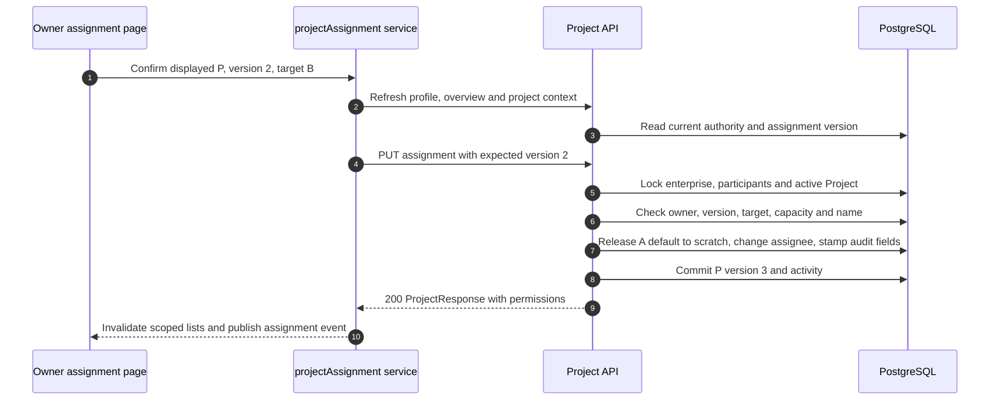

# Project assignment: responsibility changes, history retains its author

An enterprise owner opens a project, chooses **Assign / Reassign**, and selects a current member. The project keeps its ID, creator, existing tasks and floor-plan Works; `assignee_user_id` changes who can advance it. `creator_user_id` is historical authorship, not the current responsibility check. The owner can also create directly for a member or keep an own project `awaiting_assignment`; personal and scratch projects cannot be handed off.

For example, owner O transfers project P from member A to B using displayed assignment version 2. A's accepted task J stays authored by A and charged to its original reservation. New tasks submitted by B use B's monthly quota. The transfer does not restart J, move its artifacts, change workspace payer or grant B permission to reuse A's inputs.

| Diagram steps | Source | Read for |
| --- | --- | --- |
| 1–4 | [assignProject](https://github.com/Orientation-CD/wechat_mini_program/blob/7f1a3169338c10bd4139c24318f7a35caf86310c/src/pkg-projects/services/projectAssignment.ts#L40) and `assignmentSnapshot` | Refresh authority without silently replacing the displayed optimistic version |
| 5–8 | [assign_project](https://github.com/Orientation-CD/YuanZhu-AI/blob/f34b8a4d6307c83c6f7bbc905485a4f586d59a99/app/workspaces/project_api.py#L634) | Workspace/participant locks, membership, nested transaction and atomic preference repair |
| 9–10 | [projectContextRepository](https://github.com/Orientation-CD/wechat_mini_program/blob/7f1a3169338c10bd4139c24318f7a35caf86310c/src/repositories/projectContext.ts#L203) | Assignment-version fencing prevents late responses from restoring an old assignee |

## Assign or reassign {#assign-project}

`PUT /v1/workspaces/{workspace_id}/projects/{project_id}/assignment`

`assign_project` requires an active enterprise's current owner. Body: `{"assignee_user_id":"<member UUID>","expected_assignment_version":2}`; optional `name` resolves a target-name collision only during a transfer. It locks workspace authority and participants before the active Project, rejects scratch, compares the exact version and verifies a current active target through `_require_assignee`. An owner can recover a project whose previous assignee has departed; current membership of that previous assignee is deliberately unnecessary.

Capacity and casefolded-name uniqueness are scoped to the **target assignee and workspace**. A transfer of an in-progress project checks the target's 20-project capacity; closed outcomes do not consume that slot when outcomes are enabled. A same-assignee request with `name` is 422 `PROJECT_ASSIGNMENT_RENAME_REQUIRES_TRANSFER`.

Within a nested transaction, if A's server default points to P, it first changes that preference to A's permanent scratch and flushes the immediate foreign key. A real transfer then updates assignee/name, increments `assignment_version`, resets `assignment_seen_version` and records assigning actor, previous assignee and timestamp. It clears `awaiting_assignment`, stamps project/member activity and commits before returning 200. Clearing awaiting status for the same assignee does not manufacture another transfer version. Neither a no-op nor acknowledgement consumes Tokens or dispatches work.

409 `PROJECT_ASSIGNMENT_STALE` means reload and let the user choose again; do not substitute the new version automatically. `PROJECT_ASSIGNEE_UNAVAILABLE`, `PROJECT_LIMIT_REACHED` and `PROJECT_NAME_CONFLICT` require target/state reconciliation. A transport failure can follow commit: the page offers **Refresh to verify**, not automatic replay. `assignProject` publishes scope invalidation even after an uncertain result.

## Acknowledge the assignment shown to the new assignee {#assignment-seen}

`PUT /v1/workspaces/{workspace_id}/projects/{project_id}/assignment/seen`

The detail page's [acknowledgeAssignment](https://github.com/Orientation-CD/wechat_mini_program/blob/7f1a3169338c10bd4139c24318f7a35caf86310c/src/pkg-projects/services/projectAssignment.ts#L59) sends `expected_assignment_version` only when the current account is the displayed assignee and has not seen it. `acknowledge_assignment` locks active enterprise context and calls [require_assignee_project](https://github.com/Orientation-CD/YuanZhu-AI/blob/f34b8a4d6307c83c6f7bbc905485a4f586d59a99/app/workspaces/project_jobs.py#L81) (imported as `_owned_project`), then checks the version again. It updates only the seen version and commits the projected response; `updated_at` and activity are deliberately unchanged. Repeating the same current acknowledgement is harmless. A late acknowledgement of version 2 cannot acknowledge a new version 3 and returns 409 stale.

## Read and mutation boundaries after handoff

[readable_design_job](https://github.com/Orientation-CD/YuanZhu-AI/blob/f34b8a4d6307c83c6f7bbc905485a4f586d59a99/app/workflows/read_access.py#L79) permits the original task author, current enterprise owner, or current project assignee to read eligible history. Project navigation separately needs current responsibility or bounded enterprise-owner authority. Thus A may keep an own historical result entry while losing permission to open P itself. Read responses carry real submitter, current project assignee and explicit operation permissions.

New assignee B reads A's results without becoming their author. `finalize_workflow_reads` recomputes permissions after external signing: mutations require original author **and** current assignee in the active scope. Source reuse has its own Asset authority; a visible result or signed URL does not authorize it. Current frontend [verifyAssignmentRead](https://github.com/Orientation-CD/wechat_mini_program/blob/7f1a3169338c10bd4139c24318f7a35caf86310c/src/services/assignmentReadAccess.ts#L7) fences reads/downloads against changed session, workspace or responsibility.

Already accepted work continues using [active_task_project](https://github.com/Orientation-CD/YuanZhu-AI/blob/f34b8a4d6307c83c6f7bbc905485a4f586d59a99/app/workspaces/project_jobs.py#L138); assignment is not cancellation and does not reprice existing reservations. A's fresh original-author mutations fail `PROJECT_NOT_ASSIGNEE` after handoff. Whole-project deletion examines both Jobs and zero-job floor-plan Works: when content belongs to a previous assignee, only the owner can authorize cleanup (`PROJECT_OWNER_REQUIRED_FOR_FOREIGN_CONTENT`). `move_to_scratch` preserves each content author's own scratch destination rather than assigning all history to B.

Read [tests/test_project_assignment.py](https://github.com/Orientation-CD/YuanZhu-AI/blob/f34b8a4d6307c83c6f7bbc905485a4f586d59a99/tests/test_project_assignment.py) and [tests/test_project_assignment_deletion.py](https://github.com/Orientation-CD/YuanZhu-AI/blob/f34b8a4d6307c83c6f7bbc905485a4f586d59a99/tests/test_project_assignment_deletion.py) alongside the handlers. This is a source walkthrough; it does not assert that a device or production environment passed acceptance.
