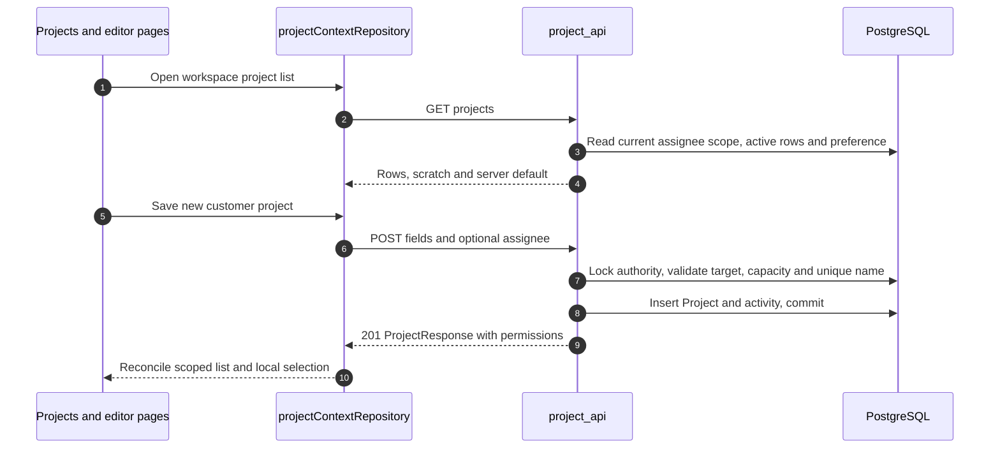

# Projects: selection, current responsibility, execution and cleanup

A Project groups Workflows and floor-plan Works in one workspace. Its creator is immutable provenance; its current assignee controls new work and management. Enterprise owners have additional bounded read, assignment, stage and cleanup authority. Follow [assignment](/reference/flows/project-assignment-flow) before assuming the original creator still manages a transferred project.

The device's current selection, the server's default preference and the project's sales progress are different records. Changing selection does not move history. Scratch is a permanent per-user/workspace fallback, not an ordinary customer project. Requests still name workspace/project explicitly and recheck current access.

| Steps | Source | What to verify |
| --- | --- | --- |
| 1–4 | [fetchList](https://github.com/Orientation-CD/wechat_mini_program/blob/88c75c1f15cd65f45c7fb09d560df80430ddc198/src/repositories/projectContext.ts#L114) → [list_projects](https://github.com/Orientation-CD/YuanZhu-AI/blob/749e82df3a51c441335ba6a4db607a98bacbcf97/app/workspaces/project_api.py#L373) | The list filters `assignee_user_id`, not historical creator |
| 5–8 | [save](https://github.com/Orientation-CD/wechat_mini_program/blob/88c75c1f15cd65f45c7fb09d560df80430ddc198/src/pkg-projects/pages/editor/index.vue#L145) → [create_project](https://github.com/Orientation-CD/YuanZhu-AI/blob/749e82df3a51c441335ba6a4db607a98bacbcf97/app/workspaces/project_api.py#L414) | Required fields, delegated creation, target-scoped capacity/name and commit |
| 9–10 | [_project_responses](https://github.com/Orientation-CD/YuanZhu-AI/blob/749e82df3a51c441335ba6a4db607a98bacbcf97/app/workspaces/project_api.py#L238) | Creator, assignee, assignment version, stage facts and per-action permissions accompany the row |

## Load the code-owned status catalog {#project-status-catalog}

`GET /v1/project-statuses`

`get_project_statuses` authenticates without requiring a selected workspace. `visible_project_statuses` chooses base, outcomes or sales mode from backend flags. It returns code-owned labels/order, phases, stale thresholds and capability fields with private five-minute caching; [projectStatusCatalogRepository](https://github.com/Orientation-CD/wechat_mini_program/blob/88c75c1f15cd65f45c7fb09d560df80430ddc198/src/repositories/projectStatusCatalog.ts#L92) validates them. Sales mode publishes independent lightable stages and outcomes; an older enum cannot prove a stage was completed. See [sales stages](/reference/flows/project-stages-flow). This read changes no state or provider work.

## Read the assignee list, scratch and default {#list-projects}

`GET /v1/workspaces/{workspace_id}/projects`

`loadProjects` enters the account/workspace context and `fetchList` calls `list_projects`. The handler takes read authority, filters `assignee_user_id=user.id`, requested workspace and ACTIVE lifecycle, and uses `_project_responses` for trusted activity, assignment and stage projections. Owner status does not turn this list into the entire enterprise. Owner cross-member inspection uses overview/detail with its own authorization.

It reads the caller's scratch and ProjectPreference, commits the read authority and returns IDs separately from rows. Missing scratch/preference is 404 `PROJECT_UNAVAILABLE`; missing activity trust is not an empty list. DELETING projects are absent. Local cache generations and known assignment versions reject late stale reads.

## Create an ordinary project, including delegated creation {#create-project}

`POST /v1/workspaces/{workspace_id}/projects`

Editor `save` passes name/customer_name/address plus optional description, integer floor_area and home_layout through `projectContextRepository`. `create_project` strips required text, bounds name/customer/address at 80/40/200 characters, reserves the scratch name and validates the target. An ordinary member creates for self. In an enterprise, only the owner may supply another current `assignee_user_id` or set own `awaiting_assignment:true`; awaiting with a different assignee is invalid, and personal workspaces reject delegation.

It locks accessible workspace/participants and creator scratch, calls `_check_project_capacity` for the **assignee**, checks trusted activity state, and inserts NEW/ACTIVE Project. Casefolded uniqueness is by assignee/workspace. Delegated creation initializes assignment version 1 and assigning metadata; self creation starts version 0. `stamp_member_activity` records the actual creating actor. The transaction commits before 201. It changes neither device current selection nor server default by itself; UI selects only after validating the accepted result.

The capacity is 20 ordinary projects per assignee/workspace, excluding closed outcomes when outcomes are enabled; a deleting project can still occupy a slot during cleanup. No action-key receipt exists for create: a timeout is uncertain and the editor refreshes before another creation. 409 name/capacity conflicts include the target assignee, enabling correct target-specific feedback.

## Set the server default {#set-default-project}

`PUT /v1/workspaces/{workspace_id}/projects/default`

`set_default_project` accepts `{"project_id":"<UUID>"}`, locks accessible workspace and validates the active assignee-owned target through [require_assignee_project](https://github.com/Orientation-CD/YuanZhu-AI/blob/749e82df3a51c441335ba6a4db607a98bacbcf97/app/workspaces/project_jobs.py#L81) (imported as `_owned_project`). It updates only the caller's preference and commits 200 with the echoed default ID. Scratch is allowed. A former assignee cannot keep a handed-off project as their server default; assignment repairs that preference atomically. Device current selection remains separate, and no historical task moves.

## Open a current project detail {#get-project}

`GET /v1/workspaces/{workspace_id}/projects/{project_id}`

`get_project` rechecks accessible workspace and allows the current assignee or current enterprise owner reading an ordinary project. `_project_responses` supplies creator/assignee identities, last assignment, explicit permissions and current stage evidence. It commits read authority. A missing/ineligible project is 404 with the caller scratch ID; having created or authored a past result does not by itself grant project navigation. The client `detail` rejects responses older than known assignment state.

## Change fields, outcomes and legacy status {#update-project}

`PATCH /v1/workspaces/{workspace_id}/projects/{project_id}`

`update_project` routes sales mode to `_update_sales_project`; otherwise it retains the older selectable-status/outcome implementation. Required fields/status cannot be null, absent fields remain unchanged, lost_note requires OTHER, and scratch rejects changes. Actual changes stamp `maximum_activity_time` and `stamp_member_activity` and commit together; a no-op does not invent activity.

In sales mode the assignee edits customer fields; an enterprise owner inspecting another ordinary project may change stages/outcomes only. WON requires MEASURED or STORE_VISITED evidence. Reopening checks assignee capacity and preserves source evidence, projecting its highest remaining stage. In the older mode, forward stage moves update trusted furthest progress; backward moves preserve that maximum and outcome reopening follows the older cycle rules. Do not apply the older reset explanation to sales mode. `changeProjectStatus` and dedicated sales controls invalidate/reconcile uncertain responses rather than replacing authority with cached state.

## Delete a whole project or return content to scratch {#delete-project}

`POST /v1/workspaces/{workspace_id}/projects/{project_id}/delete`

`ProjectDeleteSheet` → `remove` → `projectContextRepository` sends explicit mode `delete_jobs` or `move_to_scratch`. `delete_project` delegates to [delete_project_group](https://github.com/Orientation-CD/YuanZhu-AI/blob/749e82df3a51c441335ba6a4db607a98bacbcf97/app/workspaces/project_deletion.py#L147), which probes current authority, snapshots all Jobs and nondeleted floor-plan Works, locks participating authors' admission authorities in order, locks Jobs/workspace/Projects/Works and rechecks the whole set. Changed snapshots retry at most three times. Scratch, active/deleting/submitting work and retained external dependencies are blockers; deletion is never authorized by the sheet's preview.

Assignees cannot destroy a project containing previous authors' Jobs or zero-job Works: `PROJECT_OWNER_REQUIRED_FOR_FOREIGN_CONTENT` requires the owner. `move_to_scratch` returns each author's content to that author's permanent scratch, updates the current assignee's default if needed and atomically returns 204. Empty cleanup also returns 204. Nonempty `delete_jobs` saves DELETING state and durable child deletion claims, commits and returns 202.

`reconcile_claimed_design_job_deletions` and `delete_design_job_task` deliver/recover asynchronous cleanup through Redis; `delete_terminal_design_job` removes eligible DB/storage artifacts. Floor-plan group deletion has its own durable supplier cleanup/recovery. The project tombstone remains until its full cleanup is done. A 202 means accepted, not physically removed. The frontend refreshes the list after acknowledgement and retries failed reads rather than repeating destructive writes. 409 blocked/dependency errors require explanation, not a new project/URL to bypass them.

## Read the authorization as a concrete condition

`require_assignee_project` refreshes the Project under full workspace/ACTIVE identity, then compares `assignee_user_id` to the caller. An original creator/author who lost responsibility receives 409 `PROJECT_NOT_ASSIGNEE`; unrelated callers get unavailable 404. Accepted execution uses a separate `active_task_project` check, so a handoff is not cancellation. These distinct helpers explain why historical reading, new submissions and already-running work have different boundaries.

For a first exercise, list one workspace, create a self-assigned ordinary project and verify 201/detail/default remain distinct. Then trace an owner transfer and confirm the old default becomes scratch while old task authorship stays fixed. For sales mode, inspect stage evidence and event records before/after a manual point. No live app E2E is claimed by this documentation audit.

Source tests: [tests/test_project_assignment.py](https://github.com/Orientation-CD/YuanZhu-AI/blob/749e82df3a51c441335ba6a4db607a98bacbcf97/tests/test_project_assignment.py) · [tests/test_project_assignment_deletion.py](https://github.com/Orientation-CD/YuanZhu-AI/blob/749e82df3a51c441335ba6a4db607a98bacbcf97/tests/test_project_assignment_deletion.py) · [tests/test_project_sales_stage_api.py](https://github.com/Orientation-CD/YuanZhu-AI/blob/749e82df3a51c441335ba6a4db607a98bacbcf97/tests/test_project_sales_stage_api.py).
