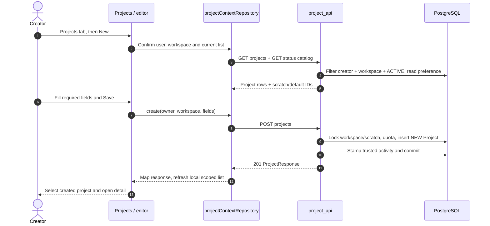
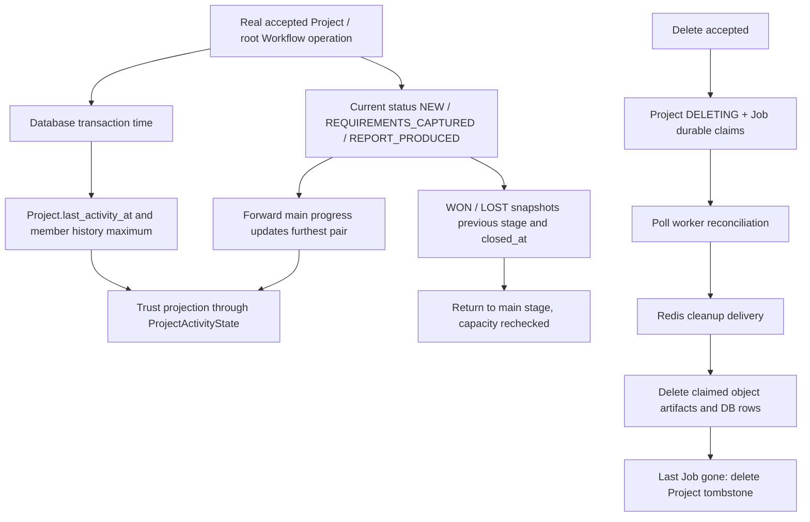

# Projects: create, change stage, observe activity, delete

A Project is a creator-private grouping of design history within one workspace. The workspace owner has a separate read-only overview; the owner does not become the creator of every member Project. This chapter follows a first Project from the Projects tab into PostgreSQL, then traces stage/outcome changes and physical cleanup.

The frontend capability `VITE_ENABLE_PRIVATE_PROJECTS` and backend `PROJECT_OUTCOMES_ENABLED` control different things. The latter determines the published status vocabulary and whether WON/LOST can be selected. Always read the returned status catalog instead of inventing new status codes.



## Numbered source reading map

| Stops | Source | Checkpoint |
| --- | --- | --- |
| 1–4 | [`loadProjects` · `src/pages/projects/index.vue:246`](https://github.com/Orientation-CD/wechat_mini_program/blob/3662578b384fd5b0fbe7509229b2a08a6fe44ab9/src/pages/projects/index.vue#L246) → [`projectContextRepository` · `src/repositories/projectContext.ts:181`](https://github.com/Orientation-CD/wechat_mini_program/blob/3662578b384fd5b0fbe7509229b2a08a6fe44ab9/src/repositories/projectContext.ts#L181) → [`list_projects` · `app/workspaces/project_api.py:216`](https://github.com/Orientation-CD/YuanZhu-AI/blob/e59716c83e087deda8477da5ea7b327a40cf65c5/app/workspaces/project_api.py#L216) | Local selection and server default are different. List scope is `(creator, workspace)`. |
| 5–8 | [`save` · `src/pkg-projects/pages/editor/index.vue:104`](https://github.com/Orientation-CD/wechat_mini_program/blob/3662578b384fd5b0fbe7509229b2a08a6fe44ab9/src/pkg-projects/pages/editor/index.vue#L104) → [`create_project` · `app/workspaces/project_api.py:254`](https://github.com/Orientation-CD/YuanZhu-AI/blob/e59716c83e087deda8477da5ea7b327a40cf65c5/app/workspaces/project_api.py#L254) → [`lock_accessible_workspace` · `app/workspaces/workspaces.py:251`](https://github.com/Orientation-CD/YuanZhu-AI/blob/e59716c83e087deda8477da5ea7b327a40cf65c5/app/workspaces/workspaces.py#L251) | Form validation gives early feedback; server locks and validation remain authoritative. |
| 9–12 | [`activity_transaction_time` · `app/workspaces/project_activity.py:43`](https://github.com/Orientation-CD/YuanZhu-AI/blob/e59716c83e087deda8477da5ea7b327a40cf65c5/app/workspaces/project_activity.py#L43) → [`Project` · `app/persistence/db_models.py:1083`](https://github.com/Orientation-CD/YuanZhu-AI/blob/e59716c83e087deda8477da5ea7b327a40cf65c5/app/persistence/db_models.py#L1083) | Activity uses database transaction time and a trust epoch; a successful response is committed state. |

The diagrams cover the normal path; endpoint sections below explain the different reads/writes and errors.

## Load the code-owned status catalog {#project-status-catalog}

`GET /v1/project-statuses`

**UI / entry:** Project status preload / Projects and detail screens use `projectStatusCatalogRepository`.

**Follow the request:**

1. Authentication is required, but no workspace ID or membership is required for this global catalog.

2. The handler reads the code-owned phase/status definitions. `outcomes_enabled()` chooses base or outcomes version; base excludes outcome definitions, enabled response also includes `lost_reasons`.

3. Return `Cache-Control: private, max-age=300`; frontend validates/version-maps labels, order, kind, terminal/tone/selectable and stale thresholds.

**Response and failure path:** No database mutation, Redis task or model call. Unknown status received from a newer server must be displayed safely; do not overwrite it with NEW merely because the client enum is older.

**Source stops:** [`projectStatusCatalogRepository` · `src/repositories/projectStatusCatalog.ts:83`](https://github.com/Orientation-CD/wechat_mini_program/blob/3662578b384fd5b0fbe7509229b2a08a6fe44ab9/src/repositories/projectStatusCatalog.ts#L83) → [`get_project_statuses` · `app/workspaces/project_status_api.py:19`](https://github.com/Orientation-CD/YuanZhu-AI/blob/e59716c83e087deda8477da5ea7b327a40cf65c5/app/workspaces/project_status_api.py#L19) → [`visible_project_statuses` · `app/workspaces/project_statuses.py:108`](https://github.com/Orientation-CD/YuanZhu-AI/blob/e59716c83e087deda8477da5ea7b327a40cf65c5/app/workspaces/project_statuses.py#L108)

## Read the creator list, scratch and default {#list-projects}

`GET /v1/workspaces/{workspace_id}/projects`

**UI / entry:** Projects tab `loadProjects()` → context enter/refresh → `fetchList`.

**Follow the request:**

1. Check current workspace access, then select only `creator_user_id=user.id`, requested workspace and ACTIVE lifecycle. Owner status does not remove that creator filter.

2. `_project_responses` anchors the SQL projection on ProjectActivityState and projects trusted furthest-stage pairs; a missing trust singleton cannot be hidden by an empty list.

3. Find the scratch row and ProjectPreference for `(user,workspace)`; return list plus `scratch_project_id` and `default_project_id`. The frontend chooses local current project separately and fences stale account/session/cache revisions.

**Response and failure path:** Missing scratch/preference is 404 `PROJECT_UNAVAILABLE`; trust-state failure is 503. These indicate incomplete state, not a valid “no projects” list. A deleting tombstone is excluded from active results.

**Source stops:** [`loadProjects` · `src/pages/projects/index.vue:246`](https://github.com/Orientation-CD/wechat_mini_program/blob/3662578b384fd5b0fbe7509229b2a08a6fe44ab9/src/pages/projects/index.vue#L246) → [`fetchList` · `src/repositories/projectContext.ts:97`](https://github.com/Orientation-CD/wechat_mini_program/blob/3662578b384fd5b0fbe7509229b2a08a6fe44ab9/src/repositories/projectContext.ts#L97) → [`list_projects` · `app/workspaces/project_api.py:216`](https://github.com/Orientation-CD/YuanZhu-AI/blob/e59716c83e087deda8477da5ea7b327a40cf65c5/app/workspaces/project_api.py#L216) → [`_project_responses` · `app/workspaces/project_api.py:185`](https://github.com/Orientation-CD/YuanZhu-AI/blob/e59716c83e087deda8477da5ea7b327a40cf65c5/app/workspaces/project_api.py#L185)

## Create the first ordinary Project {#create-project}

`POST /v1/workspaces/{workspace_id}/projects`

**UI / entry:** Projects → + New → editor Save (`save`).

**Follow the request:**

1. Payload requires name/customer_name/address; description, integer floor_area and home_layout are optional. Server strips required text, limits name/customer/address to 80/40/200 and reserves the scratch name.

2. Lock accessible workspace and creator scratch row, check capacity (20 ordinary rows; outcome-enabled checks exclude WON/LOST), require activity state and take database transaction time.

3. Insert ordinary ACTIVE Project in NEW with initial furthest NEW/activity. Casefolded name uniqueness is scoped by creator and workspace; nested transaction translates duplicate to `PROJECT_NAME_CONFLICT`.

4. If enterprise, stamp that member’s activity history. Commit and return 201. The UI explicitly selects the returned project; creation does not alter server default.

**Response and failure path:** No idempotency-key contract: editor marks uncertain creation and refreshes to reconcile before allowing another create. Validation/quota/name errors are definite 4xx; network timeout does not prove rollback.

**Source stops:** [`save` · `src/pkg-projects/pages/editor/index.vue:104`](https://github.com/Orientation-CD/wechat_mini_program/blob/3662578b384fd5b0fbe7509229b2a08a6fe44ab9/src/pkg-projects/pages/editor/index.vue#L104) → [`projectContextRepository` · `src/repositories/projectContext.ts:181`](https://github.com/Orientation-CD/wechat_mini_program/blob/3662578b384fd5b0fbe7509229b2a08a6fe44ab9/src/repositories/projectContext.ts#L181) → [`create_project` · `app/workspaces/project_api.py:254`](https://github.com/Orientation-CD/YuanZhu-AI/blob/e59716c83e087deda8477da5ea7b327a40cf65c5/app/workspaces/project_api.py#L254) → [`_check_project_capacity` · `app/workspaces/project_api.py:241`](https://github.com/Orientation-CD/YuanZhu-AI/blob/e59716c83e087deda8477da5ea7b327a40cf65c5/app/workspaces/project_api.py#L241) → [`stamp_member_activity` · `app/workspaces/project_activity.py:80`](https://github.com/Orientation-CD/YuanZhu-AI/blob/e59716c83e087deda8477da5ea7b327a40cf65c5/app/workspaces/project_activity.py#L80)

## Set the server default without switching every device {#set-default-project}

`PUT /v1/workspaces/{workspace_id}/projects/default`

**UI / entry:** Project detail → more actions → Set default; repository `setDefault`.

**Follow the request:**

1. PUT `{ "project_id": "<UUID>" }`; lock accessible workspace, locate scratch and require the target ACTIVE Project belongs to this creator and workspace.

2. Update only ProjectPreference.default_project_id and commit; scratch is a valid default, whereas another creator’s project is not.

3. The frontend validates the echoed ID and updates default in the scoped list. It keeps the device-local `currentProjectId` distinct.

**Response and failure path:** 200 echoes `default_project_id`. Unavailable target/preference is 404. Entering a workspace can choose its default; merely changing default does not move historical Jobs.

**Source stops:** [`projectContextRepository` · `src/repositories/projectContext.ts:181`](https://github.com/Orientation-CD/wechat_mini_program/blob/3662578b384fd5b0fbe7509229b2a08a6fe44ab9/src/repositories/projectContext.ts#L181) → [`set_default_project` · `app/workspaces/project_api.py:304`](https://github.com/Orientation-CD/YuanZhu-AI/blob/e59716c83e087deda8477da5ea7b327a40cf65c5/app/workspaces/project_api.py#L304) → [`_owned_project` · `app/workspaces/project_api.py:162`](https://github.com/Orientation-CD/YuanZhu-AI/blob/e59716c83e087deda8477da5ea7b327a40cf65c5/app/workspaces/project_api.py#L162)

## Open a creator-owned detail {#get-project}

`GET /v1/workspaces/{workspace_id}/projects/{project_id}`

**UI / entry:** Project row → detail or editor load → repository `detail`.

**Follow the request:**

1. Prove current workspace access and locate caller scratch; query exact Project ID with creator/workspace/ACTIVE filters.

2. Project the same trusted progress pairs as list, keeping outcome state and trusted historical maximum separate.

3. The frontend validates ID/workspace and only merges a detail into cache if the cache revision and timestamp still allow it; delayed reads must not overwrite newer writes.

**Response and failure path:** 404 `PROJECT_UNAVAILABLE` includes `scratch_project_id` so UI can recover selection. This creator route is not the owner overview; an OWNER cannot use it to open/edit another member’s private row.

**Source stops:** [`projectContextRepository` · `src/repositories/projectContext.ts:181`](https://github.com/Orientation-CD/wechat_mini_program/blob/3662578b384fd5b0fbe7509229b2a08a6fe44ab9/src/repositories/projectContext.ts#L181) → [`get_project` · `app/workspaces/project_api.py:322`](https://github.com/Orientation-CD/YuanZhu-AI/blob/e59716c83e087deda8477da5ea7b327a40cf65c5/app/workspaces/project_api.py#L322) → [`_project_responses` · `app/workspaces/project_api.py:185`](https://github.com/Orientation-CD/YuanZhu-AI/blob/e59716c83e087deda8477da5ea7b327a40cf65c5/app/workspaces/project_api.py#L185)

## Change fields, stage, WON/LOST and activity {#update-project}

`PATCH /v1/workspaces/{workspace_id}/projects/{project_id}`

**UI / entry:** Editor Save; detail stage buttons; Mark won/lost sheet → `changeProjectStatus`.

**Follow the request:**

1. Lock workspace and owned ACTIVE Project; scratch rejects writes. Use `exclude_unset=True` to distinguish omitted fields from null; required text/status cannot be set null.

2. Validate target against current selectable catalog. Entering an outcome snapshots `outcome_from_status` and `closed_at`; WON clears loss fields, LOST permits lost_note only for OTHER. Reopening clears outcome fields and rechecks 20-project capacity.

3. Only actual changes stamp activity with database transaction time. A forward main-stage move advances `furthest_status/furthest_reached_at`; a backward move does not erase that historical maximum. Reopening from an outcome can establish the new main-stage high-water pair.

4. Use null-aware maximum for activity timestamps, stamp enterprise member activity, return projected response and commit. UI maps outcome fields and invalidates/reconciles uncertain writes.

**Response and failure path:** 409 scratch/quota/name conflicts differ from 422 invalid fields. `furthest_*` is not a free-form client field; clients cannot manufacture activity dates. A no-op PATCH does not fabricate activity.

**Source stops:** [`changeProjectStatus` · `src/pkg-projects/pages/detail/index.vue:172`](https://github.com/Orientation-CD/wechat_mini_program/blob/3662578b384fd5b0fbe7509229b2a08a6fe44ab9/src/pkg-projects/pages/detail/index.vue#L172) → [`projectContextRepository` · `src/repositories/projectContext.ts:181`](https://github.com/Orientation-CD/wechat_mini_program/blob/3662578b384fd5b0fbe7509229b2a08a6fe44ab9/src/repositories/projectContext.ts#L181) → [`update_project` · `app/workspaces/project_api.py:343`](https://github.com/Orientation-CD/YuanZhu-AI/blob/e59716c83e087deda8477da5ea7b327a40cf65c5/app/workspaces/project_api.py#L343) → [`maximum_activity_time` · `app/workspaces/project_activity.py:51`](https://github.com/Orientation-CD/YuanZhu-AI/blob/e59716c83e087deda8477da5ea7b327a40cf65c5/app/workspaces/project_activity.py#L51) → [`stamp_member_activity` · `app/workspaces/project_activity.py:80`](https://github.com/Orientation-CD/YuanZhu-AI/blob/e59716c83e087deda8477da5ea7b327a40cf65c5/app/workspaces/project_activity.py#L80)

## Delete the whole group or move its Jobs to scratch {#delete-project}

`POST /v1/workspaces/{workspace_id}/projects/{project_id}/delete`

**UI / entry:** Projects swipe Delete / detail more Delete → ProjectDeleteSheet → `remove(mode)`.

**Follow the request:**

1. The sheet first inspects detail and unfiltered job existence to choose confirmation copy, then sends `{ "mode": "delete_jobs" }` or `{ "mode": "move_to_scratch" }`. That inspection is not a deletion authorization.

2. `delete_project_group` acquires the creator admission lock, snapshots/locks all Jobs, locks workspace and source/scratch Projects, then rechecks the whole Job set. It retries changed snapshots up to three times. Scratch, nonterminal/pending-submission/deleting Jobs and wrong scope block either mode; reserved accounting additionally blocks `delete_jobs`.

3. For `delete_jobs`, `_outside_reference_exists` checks generated-workflow consumers, input/output assets and PPTX reservations outside the group. If a default is being removed, first repoint preference to scratch.

4. `move_to_scratch` atomically changes every contained Job.project_id and deletes Project, returning 204; an empty Project also finishes with 204. For nonempty `delete_jobs`, mark lifecycle DELETING and every Job.deletion_requested_at, commit durable claims and return 202.

5. The poll-worker reconciliation reads committed claims, orders cleanup around internal consumer references and enqueues `delete_design_job_task` in Redis. The task verifies generation/terminal/claim, cleans object-storage artifacts and DB rows through `delete_terminal_design_job`, then deletes the Project tombstone after the final Job is gone.

6. The repository treats 202 as accepted, invalidates list and performs GET refresh. If refresh fails after acknowledged deletion, the UI retries the read rather than sending a second destructive POST.

**Response and failure path:** 202 is not physical completion; deleting Projects disappear from the active list while cleanup continues. 409 `PROJECT_DELETE_BLOCKED` differs from `PROJECT_DELETE_CONFLICT`. External references may permit move-to-scratch even when deleting the referenced results is blocked. Redis delivery is recoverable from durable DB claims.

**Source stops:** [`remove` · `src/components/projects/ProjectDeleteSheet.vue:47`](https://github.com/Orientation-CD/wechat_mini_program/blob/3662578b384fd5b0fbe7509229b2a08a6fe44ab9/src/components/projects/ProjectDeleteSheet.vue#L47) → [`projectContextRepository` · `src/repositories/projectContext.ts:181`](https://github.com/Orientation-CD/wechat_mini_program/blob/3662578b384fd5b0fbe7509229b2a08a6fe44ab9/src/repositories/projectContext.ts#L181) → [`delete_project` · `app/workspaces/project_api.py:449`](https://github.com/Orientation-CD/YuanZhu-AI/blob/e59716c83e087deda8477da5ea7b327a40cf65c5/app/workspaces/project_api.py#L449) → [`delete_project_group` · `app/workspaces/project_deletion.py:138`](https://github.com/Orientation-CD/YuanZhu-AI/blob/e59716c83e087deda8477da5ea7b327a40cf65c5/app/workspaces/project_deletion.py#L138) → [`reconcile_claimed_design_job_deletions` · `app/workflows/design_job.py:708`](https://github.com/Orientation-CD/YuanZhu-AI/blob/e59716c83e087deda8477da5ea7b327a40cf65c5/app/workflows/design_job.py#L708) → [`delete_design_job_task` · `app/worker.py:538`](https://github.com/Orientation-CD/YuanZhu-AI/blob/e59716c83e087deda8477da5ea7b327a40cf65c5/app/worker.py#L538) → [`delete_terminal_design_job` · `app/workflows/design_job.py:165`](https://github.com/Orientation-CD/YuanZhu-AI/blob/e59716c83e087deda8477da5ea7b327a40cf65c5/app/workflows/design_job.py#L165)

## Stage history, activity and cleanup are three different clocks



`updated_at`, `last_activity_at`, `furthest_reached_at` and `closed_at` answer different questions. An actor can move backwards without erasing a trusted historical maximum. The activity service takes a null-aware maximum so a late transaction cannot move the clock backwards. `ProjectActivityState` establishes which old timestamps are trusted after an incident; absent/invalid state raises `PROJECT_ACTIVITY_STATE_UNAVAILABLE`, not a guessed “just active” date. Follow [`trusted_project_progress` · `app/workspaces/project_activity.py:64`](https://github.com/Orientation-CD/YuanZhu-AI/blob/e59716c83e087deda8477da5ea7b327a40cf65c5/app/workspaces/project_activity.py#L64) and the frontend [`activityTitle` · `src/pkg-projects/services/projectActivityTimeline.ts:4`](https://github.com/Orientation-CD/wechat_mini_program/blob/3662578b384fd5b0fbe7509229b2a08a6fe44ab9/src/pkg-projects/services/projectActivityTimeline.ts#L4).

A Project does not invoke the model by itself. A root Workflow is bound to `workspace_id/project_id`; accepted operations may stamp project/member activity through [`stamp_root_workflow_activity` · `app/workspaces/project_activity.py:170`](https://github.com/Orientation-CD/YuanZhu-AI/blob/e59716c83e087deda8477da5ea7b327a40cf65c5/app/workspaces/project_activity.py#L170). Moving or deleting is a group identity operation, not a provider retry. See [workflow execution](/reference/flows/design-job-lifecycle) for submission and [workspace membership](/reference/flows/workspace-membership-flow) for access after departure.

## First read-through exercise

1. Open editor `save`, then repository `create`, then `create_project`. For `{ "name": "Apartment A", "customer_name": "Test customer", "address": "Test address" }`, identify exactly where the UI validates and where the backend trims/checks and inserts. Record returned `id`, `workspace_id`, `status`, `created_at`; never infer them from display name.
2. Reload list and compare `currentProjectId` (frontend selection) with `default_project_id` (database preference). Set default; show that existing Job.project_id values do not change.
3. With outcomes enabled in the local environment, progress NEW → REQUIREMENTS_CAPTURED → REPORT_PRODUCED, then move backward. Compare current status and trusted furthest pair. Mark LOST with OTHER and note; reopen and inspect cleared outcome fields.
4. Make one completed local/mock-provider result in the Project. Inspect deletion first. Compare move-to-scratch 204 with delete-jobs 202 and follow the durable claim through worker reconciliation. Use only disposable local test data; these operations really delete the chosen results.
5. After a 202 refresh failure, locate `removeAndRefresh` returning `refreshed:false`; explain why the safe recovery is a list GET, not a repeated POST.

The code behind each step is pinned to the audited revisions, so line links remain useful when main moves.

## Inspect the HTTP boundary without reading all of Vue

The repository calls [`request` · `src/services/request.ts:369`](https://github.com/Orientation-CD/wechat_mini_program/blob/3662578b384fd5b0fbe7509229b2a08a6fe44ab9/src/services/request.ts#L369) with a route and `{ auth:true, method, data }`. The shared transport builds the configured API URL, adds bearer authentication and request observability, serializes JSON through the platform request API, and normalizes non-2xx detail into ApiRequestError (`statusCode`, `code`, `message`, `requestId`). A repository mapper then converts snake_case contract fields into UI values and rejects a response from the wrong account/workspace/project. To learn one action, put a breakpoint in its page handler, repository and transport; inspect `data`, URL, response and normalized error in that order. Do not paste bearer tokens into documentation or issue screenshots.

At FastAPI, [`get_current_user` · `app/identity/auth.py:162`](https://github.com/Orientation-CD/YuanZhu-AI/blob/e59716c83e087deda8477da5ea7b327a40cf65c5/app/identity/auth.py#L162) validates the bearer and active account, while [`get_db` · `app/core/database.py:86`](https://github.com/Orientation-CD/YuanZhu-AI/blob/e59716c83e087deda8477da5ea7b327a40cf65c5/app/core/database.py#L86) provides the AsyncSession. The endpoint-specific service then proves the workspace/project/reward boundary. Authentication answers “who is calling”; it never replaces resource authorization. The chapter's source links pin the frontend and backend versions rather than following a moving main branch.

## Read the query that enforces privacy

`_owned_project` uses a SQLAlchemy query whose key predicates are:

```py
select(Project).where(
    Project.id == project_id,
    Project.creator_user_id == user_id,
    Project.workspace_id == workspace_id,
    Project.lifecycle == ProjectLifecycle.ACTIVE,
)
```

`select(Project)` asks the database for a Project row; every `.where` condition must hold. Knowing a UUID is insufficient: the caller must be the creator, use the original workspace, and target an active row. Before this query the route also proves current workspace access. The owner role does not appear as an override. Compare this exact query with `enterprise_overview`, which deliberately queries multiple creators for a read-only management projection.

For an ordinary create, the minimal JSON body is:

```json
{
  "name": "Apartment A",
  "customer_name": "Test customer",
  "address": "Test address"
}
```

The server returns the new Project object, including its generated ID and initial NEW status. Do not send `creator_user_id`, lifecycle or activity timestamps: those come from the authenticated request and server transaction. A later PATCH includes only changed fields; omitted fields keep their values, whereas explicit null has field-specific validation.
