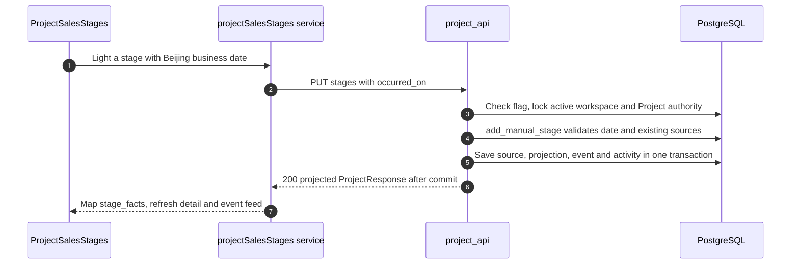

# Sales stages: independent evidence and cohort metrics

When `PROJECT_SALES_STAGES_ENABLED` is true, the status catalog advertises sales mode. It supersedes the old single-stage progression model: seven stages can be lit independently, with gaps. `status` is the highest lit stage unless WON/LOST closes the project. The flag defaults off; compiling the current frontend does not activate it. `outcomes_enabled()` is true in sales mode even when the older outcomes flag is false.

| Stage code | Meaning | Evidence |
| --- | --- | --- |
| `MEASURED` | Measurement | Manual / migrated |
| `REQUIREMENTS_CAPTURED` | Requirements collected | Manual or successful supported voice work |
| `IMAGE_PRODUCED` | Image produced | Manual or successful eligible image work |
| `REPORT_PRODUCED` | PPT produced | Manual or successful supported report/PPT work |
| `STORE_VISITED` | Store visit | Manual / migrated |
| `SECOND_VISIT` | Second visit | Manual / migrated |
| `MULTIPLE_VISITS` | Multiple visits | Manual / migrated |

[app/workflows/project_stage_completion.py](https://github.com/Orientation-CD/YuanZhu-AI/blob/f34b8a4d6307c83c6f7bbc905485a4f586d59a99/app/workflows/project_stage_completion.py) selects automatic completion evidence; child/unsupported results do not become generic human stage writes. `ProjectStageSource` stores each source identity, business date and source snapshot; `ProjectStageEvent` records the change. `stage_facts` groups sources by stage, uses the earliest known effective date and derives cancellability. A historical migrated unknown date stays unknown rather than becoming today.

| Steps | Source | Why |
| --- | --- | --- |
| 1–2 | [writeSalesStage](https://github.com/Orientation-CD/wechat_mini_program/blob/7f1a3169338c10bd4139c24318f7a35caf86310c/src/pkg-projects/services/projectSalesStages.ts#L27) | Check returned per-stage permissions, encode scope and retain session generation |
| 3–5 | [put_project_stage](https://github.com/Orientation-CD/YuanZhu-AI/blob/f34b8a4d6307c83c6f7bbc905485a4f586d59a99/app/workspaces/project_api.py#L884) and [add_manual_stage](https://github.com/Orientation-CD/YuanZhu-AI/blob/f34b8a4d6307c83c6f7bbc905485a4f586d59a99/app/workspaces/project_stages.py#L185) | Domain changes share the Project lock and commit with activity |
| 6–7 | [project_stage_projections](https://github.com/Orientation-CD/YuanZhu-AI/blob/f34b8a4d6307c83c6f7bbc905485a4f586d59a99/app/workspaces/project_stage_views.py#L161) | Render evidence and permissions, rather than reconstructing a linear enum |

## Light one stage {#put-project-stage}

`PUT /v1/workspaces/{workspace_id}/projects/{project_id}/stages/{stage}`

`put_project_stage` requires sales mode plus current assignee or current enterprise owner authority over an ordinary active project; scratch is rejected. Body `{"occurred_on":"2026-11-09"}` uses canonical `YYYY-MM-DD`, from the project's Beijing creation day through server today. `add_manual_stage` inserts source key `manual` and a LIT event; it updates the projection and activity before commit. Existing identical manual date is a no-op; another manual date returns 409 `STAGE_ALREADY_LIT` with `current_stage`. Existing automatic evidence is not overwritten by a manual call. Bad stage/date is 422; flag off is 409 `PROJECT_SALES_STAGES_DISABLED`.

## Cancel cancellable evidence {#delete-project-stage}

`DELETE /v1/workspaces/{workspace_id}/projects/{project_id}/stages/{stage}`

`delete_project_stage` uses the same authority and lock, then `cancel_stage` removes manual/migration-stage sources and records UNLIT with retained source snapshots. An unlit stage is an idempotent no-op. Any automatic or migrated-job evidence makes the whole stage noncancellable: 409 `STAGE_NOT_CANCELLABLE`, with current evidence. WON must retain at least one MEASURED or STORE_VISITED qualification; deleting the last one returns `PROJECT_WON_STAGE_REQUIRED`. A failed activity check rolls back the evidence, event and projection together.

Closing with WON/LOST still uses the existing Project PATCH. WON requires measurement or store-visit evidence, not all intermediate stages. Reopening checks assignee capacity, clears the outcome and projects existing sources again; **it does not erase stage evidence or start an empty cycle**. Owners can change stages/outcomes of another assignee's ordinary project but cannot use that authority to edit customer fields.

## Read the event feed {#project-stage-events}

`GET /v1/workspaces/{workspace_id}/projects/{project_id}/stage-events`

`get_project_stage_events` authorizes before inspecting cursors, reads events by `(recorded_at,id)` descending and returns `next_cursor` for 1–100 items (default 20). `readSalesEvents` drives the UI timeline. The default excludes SOURCE_ADDED before applying the limit; `include_source_added=true` exposes these additional audit events for integrations. A foreign/unknown cursor is 422 `PROJECT_STAGE_CURSOR_INVALID`. `stage_event_responses` preserves snapshots but current task links remain authorization checked. `occurred_on` is the business date; `recorded_at` is when the change was recorded, so a backfill must not masquerade as a current-day visit.

## Read owner sales conversion metrics {#enterprise-sales-metrics}

`GET /v1/workspaces/{workspace_id}/sales-metrics`

Owner dashboard [loadSalesMetrics](https://github.com/Orientation-CD/wechat_mini_program/blob/7f1a3169338c10bd4139c24318f7a35caf86310c/src/repositories/projectSalesMetrics.ts#L35) sends `period=YYYY-MM` or `all`. `get_enterprise_sales_metrics` requires current active-enterprise owner and sales mode, defaults to the current Beijing month, calls [enterprise_sales_metrics](https://github.com/Orientation-CD/YuanZhu-AI/blob/f34b8a4d6307c83c6f7bbc905485a4f586d59a99/app/admin/enterprise_sales_metrics.py#L56), commits its read authority and returns 200 with `Cache-Control: private, no-store`.

The query counts current members' active ordinary projects under their **current assignee**. Each project counts once despite multiple evidence sources. Measurement-to-store uses projects whose earliest measurement date is in the period as denominator and which also have store evidence as numerator. Store-to-WON uses the store-date cohort and current WON status. WON count separately uses current WON and `closed_at` in the period. Therefore these are current-state cohort conversions, not an immutable historical funnel. Reassignment or outcome changes can change them. Team ratios sum raw numerators/denominators; they are not an average of member percentages. A zero denominator yields `ratio:null`; UI displays a dash, not zero. Membership mismatches, unavailable data and malformed responses remain unavailable rather than fabricated zeros.

Read [tests/test_project_sales_stage_api.py](https://github.com/Orientation-CD/YuanZhu-AI/blob/f34b8a4d6307c83c6f7bbc905485a4f586d59a99/tests/test_project_sales_stage_api.py), [tests/test_project_sales_stage_completion.py](https://github.com/Orientation-CD/YuanZhu-AI/blob/f34b8a4d6307c83c6f7bbc905485a4f586d59a99/tests/test_project_sales_stage_completion.py) and [tests/test_enterprise_sales_metrics.py](https://github.com/Orientation-CD/YuanZhu-AI/blob/f34b8a4d6307c83c6f7bbc905485a4f586d59a99/tests/test_enterprise_sales_metrics.py) for gaps, concurrency, generated evidence, filtered cursor ties and cohort boundaries. Release/migration must be coordinated before enabling the flag; consult [SAE deployment](/deploy/sae-deployment).
