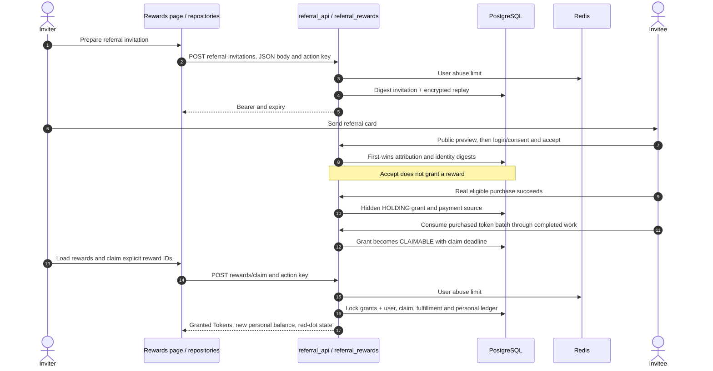
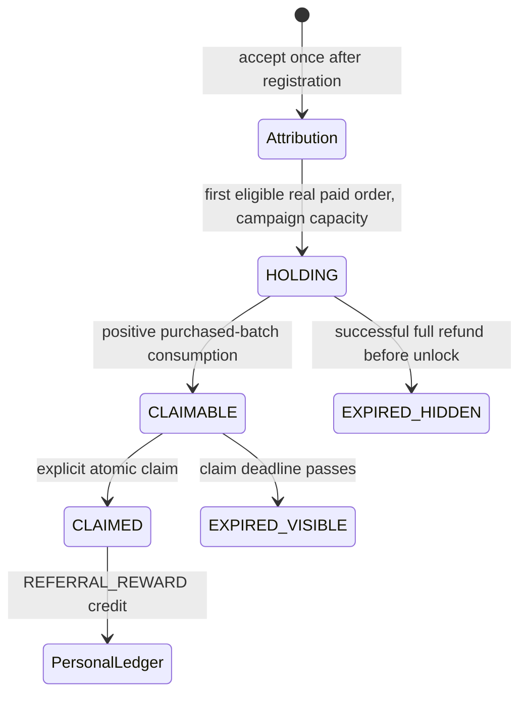

# Referral rewards: from a share card to a personal ledger credit

A referral invitation records who introduced a new user. It does not join an enterprise, reserve a seat, or immediately give the inviter Tokens. The reward path crosses registration, a real eligible payment, purchase-batch consumption, explicit claim, and the personal token ledger. Follow those transitions instead of treating “invitation accepted” as “reward paid”.



## Map each transition to a source stop

| Diagram | Source | Database invariant |
| --- | --- | --- |
| 1–5 | [`prepareInvitation` · `src/pkg-account/pages/rewards/index.vue:122`](https://github.com/Orientation-CD/wechat_mini_program/blob/21db6d824a7b32417bda88e7e31d3f0b91dfa51c/src/pkg-account/pages/rewards/index.vue#L122) → [`create_referral_invitation` · `app/marketing/referral_rewards.py:156`](https://github.com/Orientation-CD/YuanZhu-AI/blob/e59716c83e087deda8477da5ea7b327a40cf65c5/app/marketing/referral_rewards.py#L156) | Plaintext bearer is returned to the creator, stored as keyed digest; exact replay is encrypted. |
| 6–8 | [`acceptInvitation` · `src/pkg-account/pages/rewards/index.vue:145`](https://github.com/Orientation-CD/wechat_mini_program/blob/21db6d824a7b32417bda88e7e31d3f0b91dfa51c/src/pkg-account/pages/rewards/index.vue#L145) → [`accept_referral_invitation` · `app/marketing/referral_rewards.py:672`](https://github.com/Orientation-CD/YuanZhu-AI/blob/e59716c83e087deda8477da5ea7b327a40cf65c5/app/marketing/referral_rewards.py#L672) | One invitation is used once, one invitee attribution wins, identity reuse is checked. |
| 9–12 | [`complete_payment_order` · `app/billing/billing.py:750`](https://github.com/Orientation-CD/YuanZhu-AI/blob/e59716c83e087deda8477da5ea7b327a40cf65c5/app/billing/billing.py#L750) → [`create_referral_reward_for_payment` · `app/marketing/referral_rewards.py:220`](https://github.com/Orientation-CD/YuanZhu-AI/blob/e59716c83e087deda8477da5ea7b327a40cf65c5/app/marketing/referral_rewards.py#L220) → [`settle_design_tokens` · `app/billing/billing.py:413`](https://github.com/Orientation-CD/YuanZhu-AI/blob/e59716c83e087deda8477da5ea7b327a40cf65c5/app/billing/billing.py#L413) → [`make_referral_rewards_claimable` · `app/marketing/referral_rewards.py:313`](https://github.com/Orientation-CD/YuanZhu-AI/blob/e59716c83e087deda8477da5ea7b327a40cf65c5/app/marketing/referral_rewards.py#L313) | Real eligible payment creates HOLDING; purchased-batch consumption unlocks, refund retires holding. |
| 13–17 | [`claimRewards` · `src/pkg-account/pages/rewards/index.vue:92`](https://github.com/Orientation-CD/wechat_mini_program/blob/21db6d824a7b32417bda88e7e31d3f0b91dfa51c/src/pkg-account/pages/rewards/index.vue#L92) → [`claim_referral_rewards` · `app/marketing/referral_rewards.py:488`](https://github.com/Orientation-CD/YuanZhu-AI/blob/e59716c83e087deda8477da5ea7b327a40cf65c5/app/marketing/referral_rewards.py#L488) | Explicit snapshot is all-or-nothing; balances, fulfillment, ledger and replay commit together. |

Data models: [`ReferralAttribution` · `app/persistence/db_models.py:1309`](https://github.com/Orientation-CD/YuanZhu-AI/blob/e59716c83e087deda8477da5ea7b327a40cf65c5/app/persistence/db_models.py#L1309). Redis limits requests, it does not own attribution or reward balances. These reward endpoints do not invoke an AI provider or submit a worker. Workflow completion can indirectly make a reward claimable through token settlement.

## Prepare the referral card {#create-referral-invitation}

`POST /v1/referral-invitations`

**UI / entry:** Rewards → prepare/send invitation → `prepareInvitation()`.

**Follow the request:**

1. The frontend creates one logical action ID; repository supplies required `{}` and Idempotency-Key. API requires authentication and applies Redis `referral-invitation-create-user` abuse limit.

2. Service transaction-advisory-locks `(user,key)`, checks fingerprint/replay, creates random bearer and ReferralInvitation with keyed token_digest and configured lifetime.

3. Encrypted response replay lets an uncertain retry return the same ID/bearer/expiry rather than minting another invitation; handler commits before 201.

**Response and failure path:** Response is a marketing invitation, not an enterprise invitation. Keep bearer out of logs/analytics. Redis protection unavailable is 503; action-key fingerprint conflict cannot be solved by silently changing payload under the same key.

**Source stops:** [`prepareInvitation` · `src/pkg-account/pages/rewards/index.vue:122`](https://github.com/Orientation-CD/wechat_mini_program/blob/21db6d824a7b32417bda88e7e31d3f0b91dfa51c/src/pkg-account/pages/rewards/index.vue#L122) → [`referralInvitationRepository` · `src/pkg-account/repositories/referralInvitations.ts:58`](https://github.com/Orientation-CD/wechat_mini_program/blob/21db6d824a7b32417bda88e7e31d3f0b91dfa51c/src/pkg-account/repositories/referralInvitations.ts#L58) → [`create_user_referral_invitation` · `app/marketing/referral_api.py:52`](https://github.com/Orientation-CD/YuanZhu-AI/blob/e59716c83e087deda8477da5ea7b327a40cf65c5/app/marketing/referral_api.py#L52) → [`create_referral_invitation` · `app/marketing/referral_rewards.py:156`](https://github.com/Orientation-CD/YuanZhu-AI/blob/e59716c83e087deda8477da5ea7b327a40cf65c5/app/marketing/referral_rewards.py#L156)

## Preview the referral before registration {#preview-referral-invitation}

`POST /v1/referral-invitations/preview`

**UI / entry:** Open referral card → rewards landing `loadPreview()`.

**Follow the request:**

1. Public POST submits token in JSON; Redis `referral-invitation-preview-ip` limits the verified client address.

2. Hash token with referral-specific purpose, join invitation to inviter display name, compare digest; query attribution to see whether that invitation was already used.

3. Return pending/used/revoked/expired, inviter display name, expiry and `can_accept`; do not disclose invitee identities or create attribution.

**Response and failure path:** Unknown token is 404. A known unavailable token is valid presentation data with `can_accept=false`. Preview success says nothing about whether the eventual authenticated user qualifies as new or reuses an identity.

**Source stops:** [`loadPreview` · `src/pkg-account/pages/rewards/index.vue:138`](https://github.com/Orientation-CD/wechat_mini_program/blob/21db6d824a7b32417bda88e7e31d3f0b91dfa51c/src/pkg-account/pages/rewards/index.vue#L138) → [`referralInvitationRepository` · `src/pkg-account/repositories/referralInvitations.ts:58`](https://github.com/Orientation-CD/wechat_mini_program/blob/21db6d824a7b32417bda88e7e31d3f0b91dfa51c/src/pkg-account/repositories/referralInvitations.ts#L58) → [`preview_user_referral_invitation` · `app/marketing/referral_api.py:131`](https://github.com/Orientation-CD/YuanZhu-AI/blob/e59716c83e087deda8477da5ea7b327a40cf65c5/app/marketing/referral_api.py#L131) → [`preview_referral_invitation` · `app/marketing/referral_rewards.py:631`](https://github.com/Orientation-CD/YuanZhu-AI/blob/e59716c83e087deda8477da5ea7b327a40cf65c5/app/marketing/referral_rewards.py#L631)

## Commit first-wins new-user attribution {#accept-referral-invitation}

`POST /v1/referral-invitations/accept`

**UI / entry:** Referral landing → registration/login consent → `acceptInvitation()`.

**Follow the request:**

1. The repository binds action to user, sends token and required Idempotency-Key. API authenticates and Redis-limits `referral-invitation-accept-user`.

2. Service locks action replay, then invitation and invitee User; rejects self, revoked/expired/used invitation, preexisting invitee attribution and, when configured, registration not newer than invitation creation.

3. For phone, WeChat openid and Douyin openid, compute purpose-specific identity digests, remove expired claims and reject retained reuse. Insert immutable ReferralAttribution and retention-bounded ReferralIdentityClaim records.

4. Store exact replay, commit and return `attribution_status=attributed` with `referral_id`. No EnterpriseMembership, RewardGrant or TokenLedgerEntry is created by this accept.

**Response and failure path:** 410 means bearer no longer usable; 409 includes `SELF_REFERRAL_FORBIDDEN`, `ATTRIBUTION_ALREADY_SET`, `INVITEE_NOT_NEW`, `REFERRAL_IDENTITY_REUSED`. Repeating the same successful action/key replays; creating a new key does not replace attribution.

**Source stops:** [`acceptInvitation` · `src/pkg-account/pages/rewards/index.vue:145`](https://github.com/Orientation-CD/wechat_mini_program/blob/21db6d824a7b32417bda88e7e31d3f0b91dfa51c/src/pkg-account/pages/rewards/index.vue#L145) → [`referralInvitationRepository` · `src/pkg-account/repositories/referralInvitations.ts:58`](https://github.com/Orientation-CD/wechat_mini_program/blob/21db6d824a7b32417bda88e7e31d3f0b91dfa51c/src/pkg-account/repositories/referralInvitations.ts#L58) → [`accept_user_referral_invitation` · `app/marketing/referral_api.py:157`](https://github.com/Orientation-CD/YuanZhu-AI/blob/e59716c83e087deda8477da5ea7b327a40cf65c5/app/marketing/referral_api.py#L157) → [`accept_referral_invitation` · `app/marketing/referral_rewards.py:672`](https://github.com/Orientation-CD/YuanZhu-AI/blob/e59716c83e087deda8477da5ea7b327a40cf65c5/app/marketing/referral_rewards.py#L672)

## List visible rewards and expire stale claim windows {#list-rewards}

`GET /v1/rewards`

**UI / entry:** Rewards page load / Load more → `loadRewards` and `loadMore`.

**Follow the request:**

1. Authenticate user; validate limit 1–100 (default20) and optional cursor UUID. `has_claimable_rewards` lazily changes expired claimable grants to EXPIRED.

2. Query only that beneficiary’s CLAIMABLE/CLAIMED/EXPIRED grants whose `claimable_at` is nonnull. Hidden HOLDING grants and refunds expired before ever claimable are not exposed.

3. Validate cursor ownership/public history, paginate `(created_at,id)` descending with limit+1, sum token items and return next_cursor; handler commits lazy expiry. Repository resets first page when a stale cursor is rejected.

**Response and failure path:** GET can commit expiry lifecycle, though it never credits Tokens. Missing/foreign cursor is 422 `REWARD_CURSOR_INVALID`. An empty list after accept/payment can be correct while the candidate remains HOLDING.

**Source stops:** [`loadRewards` · `src/pkg-account/pages/rewards/index.vue:70`](https://github.com/Orientation-CD/wechat_mini_program/blob/21db6d824a7b32417bda88e7e31d3f0b91dfa51c/src/pkg-account/pages/rewards/index.vue#L70) → [`rewardRepository` · `src/pkg-account/repositories/rewards.ts:84`](https://github.com/Orientation-CD/wechat_mini_program/blob/21db6d824a7b32417bda88e7e31d3f0b91dfa51c/src/pkg-account/repositories/rewards.ts#L84) → [`list_user_rewards` · `app/marketing/referral_api.py:80`](https://github.com/Orientation-CD/YuanZhu-AI/blob/e59716c83e087deda8477da5ea7b327a40cf65c5/app/marketing/referral_api.py#L80) → [`list_referral_rewards` · `app/marketing/referral_rewards.py:417`](https://github.com/Orientation-CD/YuanZhu-AI/blob/e59716c83e087deda8477da5ea7b327a40cf65c5/app/marketing/referral_rewards.py#L417) → [`has_claimable_rewards` · `app/marketing/referral_rewards.py:377`](https://github.com/Orientation-CD/YuanZhu-AI/blob/e59716c83e087deda8477da5ea7b327a40cf65c5/app/marketing/referral_rewards.py#L377)

## Credit an explicit reward snapshot exactly once {#claim-rewards}

`POST /v1/rewards/claim`

**UI / entry:** Rewards → Claim → `claimRewards()` snapshots at most100 current claimable IDs.

**Follow the request:**

1. Submit `{ "reward_ids": ["<UUID>"] }` with action key; API uses Redis `reward-claim-user`. Service requires 1–100 unique IDs, sorts them for canonical request fingerprint and acquires action lock/replay.

2. Lock User then requested grants in ID order; require exact count, beneficiary ownership, all still CLAIMABLE/unexpired and supported positive token-only items. Any failure aborts the whole selected snapshot; it does not partially claim the rest.

3. Insert RewardClaim; per grant add personal User.remaining_tokens, mark CLAIMED, add RewardFulfillment and TokenLedgerEntry with reason REFERRAL_REWARD and stable `reward:<id>:credit` accounting key.

4. Recalculate red-dot state, store encrypted response replay and commit. Return exact claimed IDs, tokens_granted, personal_remaining_tokens and rewards_summary. UI updates personal balance/red dot and refreshes the list.

**Response and failure path:** 404 hides absent/foreign grants; 409 rejects already claimed, expired, unsupported or inconsistent content. Same key+same IDs replays without double credit. The destination is personal Tokens even while an enterprise is selected; it does not increase enterprise remaining_tokens.

**Source stops:** [`claimRewards` · `src/pkg-account/pages/rewards/index.vue:92`](https://github.com/Orientation-CD/wechat_mini_program/blob/21db6d824a7b32417bda88e7e31d3f0b91dfa51c/src/pkg-account/pages/rewards/index.vue#L92) → [`rewardRepository` · `src/pkg-account/repositories/rewards.ts:84`](https://github.com/Orientation-CD/wechat_mini_program/blob/21db6d824a7b32417bda88e7e31d3f0b91dfa51c/src/pkg-account/repositories/rewards.ts#L84) → [`claim_user_rewards` · `app/marketing/referral_api.py:99`](https://github.com/Orientation-CD/YuanZhu-AI/blob/e59716c83e087deda8477da5ea7b327a40cf65c5/app/marketing/referral_api.py#L99) → [`claim_referral_rewards` · `app/marketing/referral_rewards.py:488`](https://github.com/Orientation-CD/YuanZhu-AI/blob/e59716c83e087deda8477da5ea7b327a40cf65c5/app/marketing/referral_rewards.py#L488) → [`TokenLedgerEntry` · `app/persistence/db_models.py:1895`](https://github.com/Orientation-CD/YuanZhu-AI/blob/e59716c83e087deda8477da5ea7b327a40cf65c5/app/persistence/db_models.py#L1895)

## The hidden middle: why an accepted referral has no visible reward yet



The transition is a business transaction, not an invitation-page timer:

1. `complete_payment_order` calls `create_referral_reward_for_payment`. The latter requires PAID, a nonnull **`payment.wechat_transaction_id`** not starting `MOCK`, amount at least the configured minimum and an existing attribution. It excludes a payment when an earlier eligible real paid order exists, reuses an existing payment source, serializes campaign-cap counting, and snapshots the effective campaign token amount into RewardGrantItem. RewardGrant starts HOLDING and ReferralRewardSource ties it to attribution and payment.
2. `settle_design_tokens` calls [`consume_purchased_tokens` · `app/billing/finance.py:244`](https://github.com/Orientation-CD/YuanZhu-AI/blob/e59716c83e087deda8477da5ea7b327a40cf65c5/app/billing/finance.py#L244) for a personal-account job. Free/admin untracked tokens are consumed first; then purchased batches in oldest-first order. **Any positive consumption from the referred paid batch** places that payment ID in the unlock set; full batch exhaustion is not required. `make_referral_rewards_claimable` changes the matching holding grant to CLAIMABLE, records `nonrefundable_at`, and starts the configured claim window. Simply reserving Tokens or completing a job paid entirely from untracked Tokens does not unlock that batch.
3. A successful full refund uses [`complete_refund_order` · `app/billing/finance.py:374`](https://github.com/Orientation-CD/YuanZhu-AI/blob/e59716c83e087deda8477da5ea7b327a40cf65c5/app/billing/finance.py#L374) and `expire_referral_reward_for_refund` to mark a still-hidden grant EXPIRED with PAYMENT_REFUNDED. Such a never-claimable record stays hidden from the user list. Do not confuse this with a visible claimable reward whose claim window later expires.
4. A list/profile read can expire stale claimable grants and calculate the authoritative red dot. A claim makes an independent personal-token credit linked by reward_grant_id; enterprise pool selection is irrelevant to its destination.

At this audited revision, Douyin settlement writes `provider_order_id` rather than `wechat_transaction_id`, so even a real Douyin payment does **not** create this referral reward candidate. Cross-platform identity attribution does not imply both payment channels participate in reward creation.

The exact configuration and amount are source-driven, not promises hardcoded into this tutorial. Follow the settings reference and source revisions when a campaign changes.

## Follow one reward with identifiers

| ID | Join you can inspect in a local test database |
| --- | --- |
| `ReferralInvitation.id` | Bearer digest row; do not search logs by raw bearer. |
| `referral_id` / ReferralAttribution.id | Inviter → invitee first attribution, with invitation_id. |
| `PaymentOrder.id` | ReferralRewardSource.payment_order_id links the eligible purchase to its candidate grant. |
| `RewardGrant.id` | Beneficiary/status; items snapshot the grant content; source identifies the purchase. |
| `RewardClaim.id` | One submitted snapshot. RewardFulfillment joins each grant to this claim. |
| `TokenLedgerEntry.reward_grant_id` | Actual REFERRAL_REWARD personal credit with stable per-grant accounting key. |

## Guided code exercise

Use only a disposable local environment and configured test doubles; do not make a real purchase to learn this code. First follow the HTTP calls in the devtools, then read the payment/settlement functions or their existing tests for the internal transitions. Mock payment is deliberately excluded from production reward eligibility, so pressing a mock “paid” control alone is not evidence of a reward.

1. Create a referral and retry its same key; compare ID/expiry. Open preview anonymously and list the fields that are intentionally absent (invitee identity, membership, reward amount).
2. Accept under a new test account. Read the transaction until it returns `referral_id`; confirm that neither membership nor token ledger was inserted by accept. Attempt a different attribution and explain first-wins failure.
3. Trace the eligibility predicates in `create_referral_reward_for_payment` and the free/admin-before-paid order in `consume_purchased_tokens`. Explain which completed job can unlock the candidate and which cannot.
4. At `claimRewards`, record the explicit reward_ids snapshot. Follow all rows written by the claim; add the deltas and reconcile `tokens_granted` with the returned personal balance. Replay the same key/IDs and verify there is only one ledger credit per grant.
5. Change one grant’s lifecycle through an existing local test fixture before claim; verify whole-snapshot rejection and list refresh, rather than silently claiming a subset.

Continue with [payments](/reference/flows/payment-flow), [workspace membership](/reference/flows/workspace-membership-flow) and [workflow execution](/reference/flows/design-job-lifecycle).

## Inspect the HTTP boundary without reading all of Vue

The repository calls [`request` · `src/services/request.ts:369`](https://github.com/Orientation-CD/wechat_mini_program/blob/21db6d824a7b32417bda88e7e31d3f0b91dfa51c/src/services/request.ts#L369) with a route and `{ auth:true, method, data }`. The shared transport builds the configured API URL, adds bearer authentication and request observability, serializes JSON through the platform request API, and normalizes non-2xx detail into ApiRequestError (`statusCode`, `code`, `message`, `requestId`). A repository mapper then converts snake_case contract fields into UI values and rejects a response from the wrong account/workspace/project. To learn one action, put a breakpoint in its page handler, repository and transport; inspect `data`, URL, response and normalized error in that order. Do not paste bearer tokens into documentation or issue screenshots.

At FastAPI, [`get_current_user` · `app/identity/auth.py:162`](https://github.com/Orientation-CD/YuanZhu-AI/blob/e59716c83e087deda8477da5ea7b327a40cf65c5/app/identity/auth.py#L162) validates the bearer and active account, while [`get_db` · `app/core/database.py:86`](https://github.com/Orientation-CD/YuanZhu-AI/blob/e59716c83e087deda8477da5ea7b327a40cf65c5/app/core/database.py#L86) provides the AsyncSession. The endpoint-specific service then proves the workspace/project/reward boundary. Authentication answers “who is calling”; it never replaces resource authorization. The chapter's source links pin the frontend and backend versions rather than following a moving main branch.

## Read the accounting row, not just the toast

The claim service writes this ledger payload (excerpt):

```py
TokenLedgerEntry(
    scope="user",
    user_id=locked_user.id,
    reward_grant_id=grant.id,
    delta=value,
    balance_after=locked_user.remaining_tokens,
    reason=TokenDetailType.REFERRAL_REWARD,
    idempotency_key=f"reward:{grant.id}:credit",
)
```

`scope="user"` identifies the personal wallet; `reward_grant_id` gives the business source; `delta` is the credited amount; `balance_after` is the resulting personal balance. The per-grant accounting key is distinct from the HTTP Idempotency-Key: the HTTP key identifies the submitted multi-reward action, while the ledger key identifies a single economic credit. Both belong in the same transaction as grant state and fulfillment. A success toast is only the final UI reflection of those committed records.
