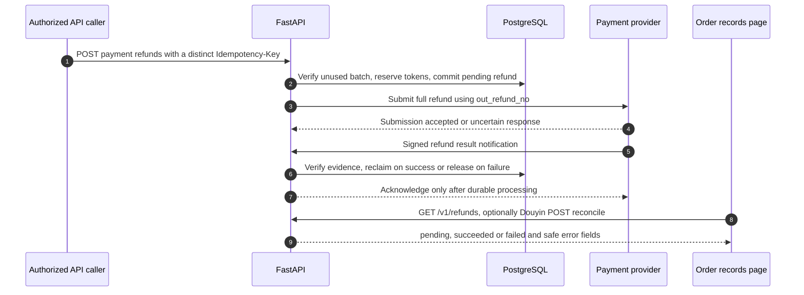
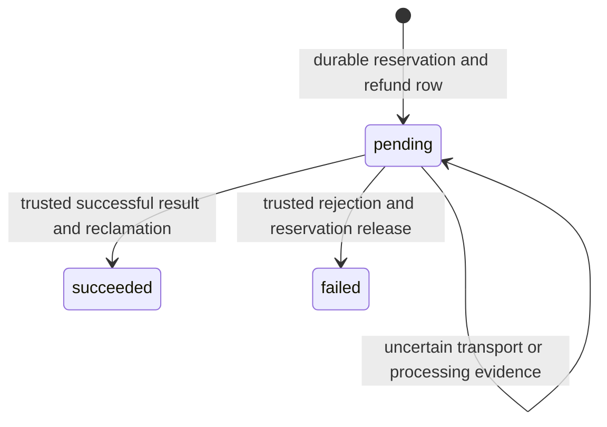

# Refunds: reserve, submit, verify, reclaim or release

A refund reverses a paid purchase; it does not close an unpaid order. It has its own `RefundOrder`, state, idempotency key and provider evidence. Read the [purchase chain](/reference/flows/payment-flow) first, especially how `PurchasedTokenBatch` links a payment to its granted tokens.

The current mini program shows refund status and **Refresh progress** for an existing refund in the Douyin order list. It does **not** have a user-facing Apply for refund button. `paymentRefundRepository.create()` exists in code, but no current page invokes it; do not infer a UI from a repository method. A refund may originate from an authorized API caller or Douyin platform after-sales. A source walkthrough/test harness is not authorization to initiate a real refund.

## 1. The local record and the external transfer {#refund-chain}

| Step | Open this function | What changes / why |
| --- | --- | --- |
| 1 | [request_payment_refund](https://github.com/Orientation-CD/YuanZhu-AI/blob/e59716c83e087deda8477da5ea7b327a40cf65c5/app/billing/billing_api.py#L892) | Authenticate owner; use a refund-specific key, not the purchase key. There is no page-level Apply button. |
| 2 | [create_refund_order](https://github.com/Orientation-CD/YuanZhu-AI/blob/e59716c83e087deda8477da5ea7b327a40cf65c5/app/billing/finance.py#L282) | Lock User → PaymentOrder → paid batch. Verify a completely unused purchase and sufficient unreserved balance. Reserve before contacting the provider. |
| 3 | [create_refund](https://github.com/Orientation-CD/YuanZhu-AI/blob/e59716c83e087deda8477da5ea7b327a40cf65c5/app/billing/wechat_pay.py#L336) or [create_refund](https://github.com/Orientation-CD/YuanZhu-AI/blob/e59716c83e087deda8477da5ea7b327a40cf65c5/app/billing/douyin_pay.py#L295) | Reuse durable merchant refund number across uncertain submissions. The external request runs after DB commit, without holding a transaction over network I/O. |
| 4 | `request_payment_refund()` return/catch | Accepted submission still means pending; a `503` does not prove the platform rejected it or that no local refund exists. |
| 5 | [receive_wechat_event](https://github.com/Orientation-CD/YuanZhu-AI/blob/e59716c83e087deda8477da5ea7b327a40cf65c5/app/billing/billing_api.py#L1188) or [douyin_notification](https://github.com/Orientation-CD/YuanZhu-AI/blob/e59716c83e087deda8477da5ea7b327a40cf65c5/app/billing/douyin_api.py#L463) | WeChat verifies/decrypts APIv3 resource; Douyin verifies RSA bytes and queries canonical refund evidence before final settlement. |
| 6 | [complete_refund_order](https://github.com/Orientation-CD/YuanZhu-AI/blob/e59716c83e087deda8477da5ea7b327a40cf65c5/app/billing/finance.py#L374), [fail_refund_order](https://github.com/Orientation-CD/YuanZhu-AI/blob/e59716c83e087deda8477da5ea7b327a40cf65c5/app/billing/finance.py#L472) | Success deducts reserved grant and adds negative ledger; failure releases reservation without deducting balance. |
| 7 | End of callback dispatcher | WeChat `204`; Douyin `200 {err_no:0,err_tips:"success"}`. Failed validation/processing must not acknowledge success. |
| 8 | [load](https://github.com/Orientation-CD/wechat_mini_program/blob/3662578b384fd5b0fbe7509229b2a08a6fe44ab9/src/pkg-account/pages/orders/index.vue#L48), [checkRefund](https://github.com/Orientation-CD/wechat_mini_program/blob/3662578b384fd5b0fbe7509229b2a08a6fe44ab9/src/pkg-account/pages/orders/index.vue#L215) → [paymentRefundRepository](https://github.com/Orientation-CD/wechat_mini_program/blob/3662578b384fd5b0fbe7509229b2a08a6fe44ab9/src/pkg-account/repositories/paymentRefund.ts#L16) | Current Douyin page loads refund list; Refresh progress reconciles one pending refund and refreshes payment status. |
| 9 | [refund_response](https://github.com/Orientation-CD/YuanZhu-AI/blob/e59716c83e087deda8477da5ea7b327a40cf65c5/app/billing/billing_api.py#L178) → frontend `mapRefund()` | UI maps `pending/succeeded/failed`, amount/currency and safe errors. It does not calculate whether a bank transfer occurred. |

## 2. Reservation is not deduction {#refund-accounting}

Consider a test purchase that grants 100 tokens, with no prior balance or other reservations. The following values illustrate the implemented arithmetic, not a real product price.

| Moment | `User.remaining_tokens` | `User.reserved_tokens` | Batch remaining / reserved refund / refunded | Ledger |
| --- | --- | --- | --- | --- |
| Payment settled | 100 | 0 | 100 / 0 / 0 | `+100` purchase |
| Refund created | 100 | 100 | 100 / 100 / 0 | No refund deduction yet |
| Verified success | 0 | 0 | 0 / 0 / 100 | `-100` refund deduction |
| Instead: verified failure | 100 | 0 | 100 / 0 / 0 | No deduction |

The reservation makes the refundable grant unavailable for another workflow while money is being returned. A refund cannot simply decrement current balance on the first request: the provider may fail or the response may be lost. The batch tracks **which purchase** funded those tokens, so unrelated free/admin tokens cannot substitute for an already consumed paid batch.

[consume_purchased_tokens](https://github.com/Orientation-CD/YuanZhu-AI/blob/e59716c83e087deda8477da5ea7b327a40cf65c5/app/billing/finance.py#L244) consumes free/admin balance first, then paid batches oldest first while excluding `reserved_refund_tokens`. [create_refund_order](https://github.com/Orientation-CD/YuanZhu-AI/blob/e59716c83e087deda8477da5ea7b327a40cf65c5/app/billing/finance.py#L282) requires the original payment to be paid, no existing local refund, a batch whose remaining equals the whole original grant, no reserved/refunded batch amount, and enough `remaining_tokens - reserved_tokens`. Partial refunds and spent-batch refunds are not the ordinary API contract.

A successful refund re-entering `complete_refund_order()` returns without a second deduction. A failed refund is not blindly retried as a new local refund: the ordinary unique-per-payment and idempotency guards remain. Douyin platform replacement/forced-refund evidence has a separate explicit recovery branch described [below](#platform-refunds).

## 3. API entry points and exact recovery rules {#refund-apis}

### POST /v1/payments/{payment_order_id}/refunds {#request-refund}

**Trigger and input:** there is no current UI caller. An authenticated authorized caller sends the owned payment UUID and a distinct `Idempotency-Key` (8–128 characters); no body with a client-chosen refund amount is accepted. The frontend's unused `paymentRefundRepository.create()` would restrict itself to paid Douyin orders and send `douyin-refund:<order UUID>` if wired later. That helper is not evidence of a completed refund UX.

**Route to service:** [request_payment_refund](https://github.com/Orientation-CD/YuanZhu-AI/blob/e59716c83e087deda8477da5ea7b327a40cf65c5/app/billing/billing_api.py#L892) looks up the owner's payment, checks channel mode, and for Douyin verifies the stored/live mode with `require_mode()`. It invokes `create_refund_order()`, commits the reservation, reads the parent order and releases that read transaction, then submits `create_refund()` through the appropriate adapter. Douyin's returned provider refund id is saved; WeChat's final identity is confirmed by notification. The durable `out_refund_no` is generated once.

**Response/effects:** `201 RefundOrderResponse` usually remains `pending`. It returns `id`, `payment_order_id`, `out_refund_no`, full amount/currency, `tokens_reclaimed`, timestamps and safe errors. Creation has reserved tokens, not written a negative ledger or declared money returned. An identical key for the same payment returns the existing refund and can resubmit using the same number; the same key for another payment returns `409 REFUND_IDEMPOTENCY_KEY_REUSED`.

**Failure/recovery:** absent/other-owner order → `404 PAYMENT_ORDER_NOT_FOUND`; not paid → `409 PAYMENT_NOT_REFUNDABLE`; another refund → `409 REFUND_ALREADY_EXISTS`; batch consumed/ineligible → `409 PAYMENT_TOKENS_ALREADY_USED`; insufficient available balance → `409 REFUND_TOKENS_UNAVAILABLE`; provider failure → `503`. A provider error occurs after reservation commit and must not release tokens on a guess. Inspect refund history, retry the **same** key/number where appropriate, and wait for trusted result/query. There is no public WeChat mobile reconciliation endpoint equivalent to the Douyin one.

### GET /v1/refunds {#refund-history}

**UI:** Douyin Payment records `load()` → `paymentRefundRepository.list()`. Current WeChat page does not load this list, although the authenticated server API can return the caller's refunds across channels.

**Processing:** [refund_history](https://github.com/Orientation-CD/YuanZhu-AI/blob/e59716c83e087deda8477da5ea7b327a40cf65c5/app/billing/billing_api.py#L943) selects `(RefundOrder.user_id == current_user.id)`, newest first, at most 250 rows, and serializes with `refund_response()`. It has no provider call or settlement writes. **Return:** `200` JSON array (not `{items:…}`); empty is valid. **Recovery:** a pending entry says local work remains unresolved, not that money has definitely not moved. Match it to `payment_order_id` and query/review through the correct channel path. No arbitrary user id or foreign refund record can be selected via this route.

### POST /v1/refunds/{refund_order_id}/reconcile {#refund-reconcile}

**UI:** an existing pending refund's **Refresh progress** → `checkRefund()` → `paymentRefundRepository.reconcile()`. It sends the refund UUID, JWT, no client-provided final status.

**Processing:** [reconcile_owned_refund](https://github.com/Orientation-CD/YuanZhu-AI/blob/e59716c83e087deda8477da5ea7b327a40cf65c5/app/billing/douyin_api.py#L273) loads the owned refund, then its owned payment; a non-Douyin payment returns `409 PAYMENT_TYPE_MISMATCH`. [reconcile_refund](https://github.com/Orientation-CD/YuanZhu-AI/blob/e59716c83e087deda8477da5ea7b327a40cf65c5/app/billing/douyin_api.py#L113) returns terminal refunds unchanged; for pending it releases DB transaction before provider calls. Saved `AUDIT_AGREE/AUDIT_DENY` intent is submitted to `refund_audit_callback`, then it queries fresh canonical evidence. It checks integer full amount, merchant refund number, platform payment id and refund id before calling shared complete/fail helpers.

**Return/recovery:** `200 RefundOrderResponse`; it may still be pending because `PROCESSING` is not success. Unknown/foreign refund → `404 REFUND_NOT_FOUND`; provider error → `503` with a safe channel code. If an authenticated `refund_query` reports no refund, there is no saved provider id, and at least 30 seconds have passed since refund creation, the function first re-queries payment and requires `SUCCESS`, then resubmits **the same** durable refund number. This 30-second branch is a refund propagation guard; it is unrelated to configurable payment closing grace. An audit API acknowledgement does not clear saved audit intent until a fresh query shows it has progressed.

### POST /v1/webhooks/wechat/refunds {#wechat-refund-webhook}

**Trigger:** WeChat's platform server; no mini-program caller and no JWT. This decorator and the payment decorator both enter `wechat_pay_notification()` → `receive_wechat_event()`, dispatching according to decrypted `out_refund_no`/`out_trade_no`, not by guessing from the URL. `create_refund()` uses the configured common notification URL.

**Verification and records:** APIv3 SDK verifies/decrypts raw bytes and timestamp freshness; require notification id and merchant identity. Find refund by `out_refund_no` joined to its parent payment. Validate optional AppID when present, `amount.refund`, parent `amount.total`, currency, and the pair of `refund_status`/event type: `SUCCESS/REFUND.SUCCESS`, `ABNORMAL/REFUND.ABNORMAL`, `CLOSED/REFUND.CLOSED`. Success additionally requires `refund_id` and calls `complete_refund_order()`; abnormal/closed call `fail_refund_order()` with bounded safe error fields. Store `WeChatPaymentEvent`, commit, then return `204`.

**Failure/recovery:** invalid signature/decryption → `401`; wrong identity/amount/event pair → `400`; absent refund → `404`. Existing event ids are acknowledged without repeated effects; concurrent duplicate commits use platform retry. A WeChat payment query reporting `REFUND` is not sufficient to invent a completed refund: this path needs the separate validated refund evidence. The pinned backend has no analogous public WeChat refund-query reconcile route, and its maintenance payment query marks such cases `needs_review`.

## 4. Exactly what success/failure helpers do {#refund-settlement}

Read [complete_refund_order](https://github.com/Orientation-CD/YuanZhu-AI/blob/e59716c83e087deda8477da5ea7b327a40cf65c5/app/billing/finance.py#L374) next to [RefundOrder](https://github.com/Orientation-CD/YuanZhu-AI/blob/e59716c83e087deda8477da5ea7b327a40cf65c5/app/persistence/db_models.py#L3182) and [PurchasedTokenBatch](https://github.com/Orientation-CD/YuanZhu-AI/blob/e59716c83e087deda8477da5ea7b327a40cf65c5/app/persistence/db_models.py#L3133). Lock order is account → payment → batch → refund (with a linked Douyin subscription locked before the batch). It validates that every reservation still matches, reduces both user remaining/reserved balances, reduces batch remaining/reserved amounts, increases batch refunded amount, sets payment `refunded` and refund `succeeded`, records provider refund id/completion time, and writes the negative `REFUND_DEDUCTION` ledger with `refund:<refund UUID>:user:reclaim`. It also expires any associated referral reward.

There is a channel-specific detail worth finding in the code: the `provider_refund_id` branch used by Douyin explicitly expires the linked subscription. The WeChat `wechat_refund_id` branch does **not** perform that same subscription status assignment. Do not describe all channel entitlement rollback as identical; inspect the actual subscription snapshot when reviewing refund results. Documentation does not modify this application behavior.

[fail_refund_order](https://github.com/Orientation-CD/YuanZhu-AI/blob/e59716c83e087deda8477da5ea7b327a40cf65c5/app/billing/finance.py#L472) releases reserved user/batch tokens, keeps total remaining balance, sets failed/error/completion fields and writes no refund deduction. Network errors cannot safely invoke this helper: only a trusted terminal provider rejection means the reservation may be released.

## 5. Douyin applications, discovery and forced refunds {#platform-refunds}

For the full RSA/callback routing steps see [Douyin callbacks](/reference/douyin-payment#douyin-refund-application-webhook). Three paths converge on the same functions:

- Platform application (`pre_create_refund`) calls [apply_platform_refund](https://github.com/Orientation-CD/YuanZhu-AI/blob/e59716c83e087deda8477da5ea7b327a40cf65c5/app/billing/douyin_api.py#L376), creating an eligible full-refund reservation or a review-required record; it saves `AUDIT_AGREE/AUDIT_DENY` intent when audit is needed. The acknowledgement supplies local refund number, order-entry schema and the result callback URL. It does not mean money was returned.
- Refund-result notification is verified, then [reconcile_refund](https://github.com/Orientation-CD/YuanZhu-AI/blob/e59716c83e087deda8477da5ea7b327a40cf65c5/app/billing/douyin_api.py#L113) queries the canonical provider state before completing. A transient provider failure prevents successful acknowledgement so delivery can retry.
- A live paid order's reconcile invokes [discover_refunds](https://github.com/Orientation-CD/YuanZhu-AI/blob/e59716c83e087deda8477da5ea7b327a40cf65c5/app/billing/douyin_api.py#L225), querying the platform refund list. It validates each identity/amount, recreates missed applications/results and enters the same reconciliation path. Poll-worker maintenance calls it even when the app is not open.

If eligibility fails (tokens used, partial platform refund, or an explicit replacement after an earlier refusal), `DOUYIN_REFUND_REVIEW_REQUIRED` preserves the provider's financial outcome without inventing a Token reservation. A verified forced success can mark refund succeeded/payment refunded with `tokens_reclaimed=0`; it does not deduct unrelated/consumed tokens. A different platform refund id after a failed refund archives immutable previous proof as a `refund_replacement` event; delayed old evidence is recognized and ignored. Those cases require manual finance/entitlement review, not a second automatic deduction.

## 6. Source exercises and safe local checks {#refund-debugging}

These exercises use a disposable local database and mock providers only. Never trigger real payment/refund calls just to validate documentation.

1. Starting at `create_refund_order()`, annotate each `409` guard and the exact field it compares. Explain why a user with 100 free tokens cannot refund a purchased batch that has already been spent. Locate the unique-per-payment constraint in `RefundOrder`.
2. Trace the 100-token example above in the shared helpers. Verify that a pending refund has a reservation but no negative ledger; success creates exactly one deduction; failure restores availability without increasing total balance.
3. WeChat's conditional `/mock/refunds/{refund_order_id}/complete` calls [mock_complete_refund](https://github.com/Orientation-CD/YuanZhu-AI/blob/e59716c83e087deda8477da5ea7b327a40cf65c5/app/billing/billing_api.py#L964): owned refund, WeChat mock mode, no Douyin, then the production settlement helper. Douyin's `/mock/douyin/refunds/{refund_order_id}/scenario` calls [mock_refund_scenario](https://github.com/Orientation-CD/YuanZhu-AI/blob/e59716c83e087deda8477da5ea7b327a40cf65c5/app/billing/douyin_api.py#L332) for `success/fail/pending` and reuses `reconcile_refund()`. The WeChat completion routes mount only with `MOCK_PAYMENT_ENDPOINTS_ENABLED`; Douyin scenarios mount only outside production with `DOUYIN_PAY_MODE=mock`. Production validation rejects WeChat mock mode/completion exposure; neither harness is a production fallback.
4. In source, stop after the reservation `commit()` and follow the exception path around external submission. Find how the same key and `out_refund_no` remain available after response loss. On Douyin, distinguish the 30-second missing-refund retry guard from payment expiry grace.
5. For a stuck real incident, collect local payment/refund ids, merchant numbers, channel, mode, status, provider ids and safe error code. Inspect callback event and maintenance logs; do not paste keys/full signed bodies in tickets. Verify provider evidence through authorized operations before releasing reservations or reclaiming tokens.
