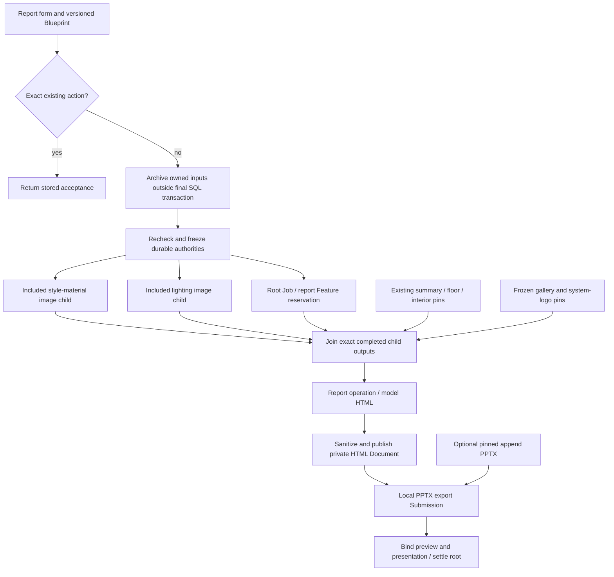
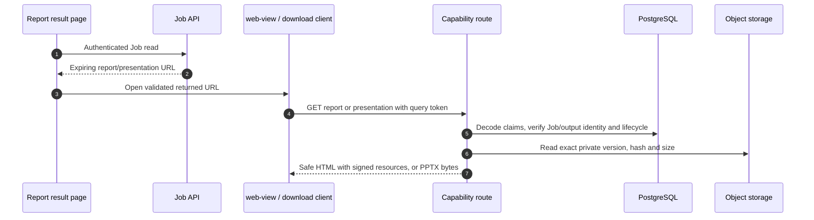

# Report Blueprint, generated designs, HTML and PPTX

A current design report is a **graph of immutable sources and two output products**, not a saved HTML template. This chapter connects the form, included image generation, model composition, sanitized publication, local conversion and the final browser/download APIs. Start with [the shared lifecycle](/reference/flows/design-job-lifecycle) if Job/run/Submission are unfamiliar.

## 1. The form prepares a Blueprint {#blueprint}

From the design-report form's submit button, open [src/pkg-features/pages/design_report/index.vue → submit](https://github.com/Orientation-CD/wechat_mini_program/blob/21db6d824a7b32417bda88e7e31d3f0b91dfa51c/src/pkg-features/pages/design_report/index.vue#L577) then [src/pkg-features/services/reportBlueprint.ts → buildReportWorkflowRequest](https://github.com/Orientation-CD/wechat_mini_program/blob/21db6d824a7b32417bda88e7e31d3f0b91dfa51c/src/pkg-features/services/reportBlueprint.ts#L65). The user selects a completed consultation summary, colored floor plan and interior designs, enters project/customer facts, selects content-page count and can append an existing PPTX. The builder resolves actual output Asset IDs (including original floor-plan input), verifies source roles/room information and creates ordered page declarations.

Current UI content counts **8 / 12 / 16** map to public products `design_report_9 / design_report_13 / design_report_17`, whose full page inventories have **9 / 13 / 17** pages. Do not replace current page plans with the historical fixed S01 `page_count: 8` request. Product key, page template order and source inventory must agree with the active protocol. The contract accepts exactly one `kind: "json", role: "blueprint"` input plus at most one supported append-PPTX input; it does not accept caller-supplied generated HTML.

| Blueprint source | Where it comes from | What the backend freezes |
| --- | --- | --- |
| Existing `asset_id` | Completed Job result/source, selected in the form | Authorized identity; owned inputs freeze the post-archive locator/hash/version/type |
| Generated source declaration | Builder requests included `style_material_board` / `lighting_design` | Child Feature/model/prompt/input authority and stable filename binding |
| `gallery_path` declaration | Builder selects configured smart-home gallery | Allowed gallery object selection, exact version/hash and alias |
| Project/customer facts | Bounded form fields | Versioned normalized project data and ordered page contract |
| Optional append PPTX | Completed validated document upload | Post-archive package identity and conversion pins |

These are distinct source types. A filename such as a Blueprint alias is an internal logical reference, not permission for the model to fetch any URL. Duplicate independent source selections (apart from the prescribed cover reuse of one interior image), missing room role, unavailable original floor plan, incompatible page inventory or changed source evidence fails before generation.

For this report request, directly owned archival targets the optional newly uploaded append PPTX. Selected ACTIVE outputs and existing executed source pins are borrowed references: they are not relocated or reassigned to the report. Final admission rechecks each category before freezing its appropriate identity.

## 2. Parent and included-child execution {#report-graph}

| Transition | Concrete function to follow | SQL / output effect |
| --- | --- | --- |
| Form → root admission | [src/pkg-features/pages/design_report/index.vue → submit](https://github.com/Orientation-CD/wechat_mini_program/blob/21db6d824a7b32417bda88e7e31d3f0b91dfa51c/src/pkg-features/pages/design_report/index.vue#L577) → `admit_workflow_job` | Replay first; archive owned inputs; lock and freeze Blueprint/product/durable pins |
| Prepare included children | [app/workflows/workflow_report_children.py → prepare_report_children](https://github.com/Orientation-CD/YuanZhu-AI/blob/e59716c83e087deda8477da5ea7b327a40cf65c5/app/workflows/workflow_report_children.py#L94) | Lock relevant feature/definition/model/source authorities in stable order |
| Persist root + children | [app/workflows/workflow_report_children.py → persist_report_children](https://github.com/Orientation-CD/YuanZhu-AI/blob/e59716c83e087deda8477da5ea7b327a40cf65c5/app/workflows/workflow_report_children.py#L262) | `workflow_generated_sources` binds filename to existing child run; child `parent_workflow_id` points to root |
| Child terminal → parent ready | [app/workflows/workflow_report_dependencies.py → reconcile_report_dependencies](https://github.com/Orientation-CD/YuanZhu-AI/blob/e59716c83e087deda8477da5ea7b327a40cf65c5/app/workflows/workflow_report_dependencies.py#L152) | Join only valid completed outputs from the expected child and generation; stage parent pins |
| Compose model input | [app/workflows/operations/design_report/design_report_composer.py → compose_blueprint_design_report](https://github.com/Orientation-CD/YuanZhu-AI/blob/e59716c83e087deda8477da5ea7b327a40cf65c5/app/workflows/operations/design_report/design_report_composer.py#L546) | Read pinned Markdown and construct typed report document/image aliases and instructions |
| HTML output → private Document | [app/workflows/operations/design_report/workflow_report_publication.py → publish_workflow_report](https://github.com/Orientation-CD/YuanZhu-AI/blob/e59716c83e087deda8477da5ea7b327a40cf65c5/app/workflows/operations/design_report/workflow_report_publication.py#L913) | Sanitize, reserve, write/recover exact object, then associate output |
| Ready export → PPTX | [app/workflows/submissions/workflow_local_pptx_submission.py → execute_local_pptx_submission](https://github.com/Orientation-CD/YuanZhu-AI/blob/e59716c83e087deda8477da5ea7b327a40cf65c5/app/workflows/submissions/workflow_local_pptx_submission.py#L1022) | Consume pinned HTML/images/append input, stage conversion evidence, publish PPTX |
| Both outputs → public completion | `finalize_submission_workflow` from [lifecycle](/reference/flows/design-job-lifecycle#worker-chain) | Bind `preview` and `presentation`, settle root once and advance Project report state |

The root pays the report Feature's frozen price. Included children have `token_cost=0` and `report_included_v1` provenance; they are not independent paid image actions and are excluded from normal creator root history. Retrying an included child directly is blocked; the parent controls recovery. The child bindings persist across retry so a new parent attempt does not silently substitute a different generated source.

Root admission defers the report Submission until required generated children are joined. If an included child is incomplete, parent composition waits. If a child fails, failure/active-sibling evidence determines parent failure and guarded release. A local failure can therefore mean no model HTML was ever requested: inspect the dependency rows before blaming the report provider.

## 3. Model HTML is staged, validated and published {#html-publication}

A supplier's HTML is untrusted design material. [app/workflows/operations/design_report/workflow_report_publication.py → publish_workflow_report](https://github.com/Orientation-CD/YuanZhu-AI/blob/e59716c83e087deda8477da5ea7b327a40cf65c5/app/workflows/operations/design_report/workflow_report_publication.py#L913) loads a staged locator and reads the exact version/ETag/hash/byte count. [app/workflows/operations/design_report/workflow_report_html.py → sanitize_design_report_html](https://github.com/Orientation-CD/YuanZhu-AI/blob/e59716c83e087deda8477da5ea7b327a40cf65c5/app/workflows/operations/design_report/workflow_report_html.py#L439) parses/repairs bounded markup, validates allowed structure/CSS/resources and the page contract, removes active execution and requires declared image aliases. It preserves inert design layout within those constraints instead of executing arbitrary scripts or fetching arbitrary model URLs.

Publication has deliberate checkpoints:

1. Load authorized source/attempt and read exact staged bytes without holding DB locks over storage I/O.
2. Derive aliases from the frozen Blueprint and input pins; validate customer/project and page inventory.
3. Sanitize and hash canonical content; derive a publication fingerprint/destination.
4. Reserve the private Document in SQL. An already proven canonical result can be reused.
5. Write or recover the exact storage object version; compare identity/size/hash.
6. Finalize Document plus `operation_run_outputs` under current authority and clean noncanonical versions through guarded logic.

A successful provider response is not `completed` until this evidence exists. Raw candidate HTML, sanitized stored HTML and dynamically rendered browser HTML have different roles. The stored sanitized document retains logical image references; view time signs/replaces only approved pinned resources. This lets the same immutable document be viewed later without embedding permanently expired storage URLs.

## 4. Export is a local operation, not another LLM request {#pptx-execution}

`convert_design_report_to_pptx` runs after report output is ready. [app/workflows/submissions/workflow_local_pptx_submission.py → execute_local_pptx_submission](https://github.com/Orientation-CD/YuanZhu-AI/blob/e59716c83e087deda8477da5ea7b327a40cf65c5/app/workflows/submissions/workflow_local_pptx_submission.py#L1022) claims a generation, builds an exact input bundle from stored HTML and image/system-resource pins, and invokes [app/conversion/pptx_subprocess.py → SubprocessPptxClient](https://github.com/Orientation-CD/YuanZhu-AI/blob/e59716c83e087deda8477da5ea7b327a40cf65c5/app/conversion/pptx_subprocess.py#L166). The bounded child process runs [app/conversion/pptx_converter.py → convert_design_report_html](https://github.com/Orientation-CD/YuanZhu-AI/blob/e59716c83e087deda8477da5ea7b327a40cf65c5/app/conversion/pptx_converter.py#L456) using a sandboxed Chromium layout/conversion path, then validates package structure/page measurements, content hash and result manifest. Optional append input uses the validated native append flow; its identity and package limits are checked separately.

The worker receives a candidate PPTX, stages manifest/size/digest, uploads an exact private object version and associates a Document plus `presentation` output. It never trusts an unverified converter success message alone. Recovery of a staged output/upload can continue without repeating model generation. Conversion is serialized by the worker's export lock and has explicit timeout/memory/runtime requirements; macOS source browsing is not evidence that the Linux deployment has a usable Chromium/converter runtime.

The current report pipeline exposes both HTML preview and PPTX from the same root. A standalone `type: "design_report_pptx"` create schema still exists for compatibility, but fresh admission rejects it as `WORKFLOW_UNAVAILABLE`; do not teach it as the current export button's successful POST API. Old stored exports can still have a download/read path.

## 5. Open the report with a fresh capability {#report}

`GET /v1/workflows/{design_job_id}/report` takes a **query `token`**, not a general Bearer header. The normal UI first uses an authenticated Job read to obtain a fresh link. [src/pkg-plans/pages/report/index.vue → load](https://github.com/Orientation-CD/wechat_mini_program/blob/21db6d824a7b32417bda88e7e31d3f0b91dfa51c/src/pkg-plans/pages/report/index.vue#L22) calls [src/services/reportCapability.ts → getFreshReportCapability](https://github.com/Orientation-CD/wechat_mini_program/blob/21db6d824a7b32417bda88e7e31d3f0b91dfa51c/src/services/reportCapability.ts#L15), validates configured origin/expiry/scope and assigns the returned URL to the platform `web-view`. Closing/reopening the page renews the capability instead of regenerating or charging again.

| Message | Code |
| --- | --- |
| 1–2 | `job_response` / `workflow_preview_response` / `workflow_presentation_response` → [app/workflows/operations/design_report/workflow_report_publication.py → create_workflow_report_view_token](https://github.com/Orientation-CD/YuanZhu-AI/blob/e59716c83e087deda8477da5ea7b327a40cf65c5/app/workflows/operations/design_report/workflow_report_publication.py#L1002) |
| 3 | [src/services/reportCapability.ts → getFreshReportCapability](https://github.com/Orientation-CD/wechat_mini_program/blob/21db6d824a7b32417bda88e7e31d3f0b91dfa51c/src/services/reportCapability.ts#L15) / [src/services/workflowDownload.ts → openWorkflowPresentation](https://github.com/Orientation-CD/wechat_mini_program/blob/21db6d824a7b32417bda88e7e31d3f0b91dfa51c/src/services/workflowDownload.ts#L6) |
| 4 | [app/workflows/api.py → view_design_report](https://github.com/Orientation-CD/YuanZhu-AI/blob/e59716c83e087deda8477da5ea7b327a40cf65c5/app/workflows/api.py#L1297) / [app/workflows/api.py → download_design_presentation](https://github.com/Orientation-CD/YuanZhu-AI/blob/e59716c83e087deda8477da5ea7b327a40cf65c5/app/workflows/api.py#L1258) |
| 5 | [app/workflows/operations/design_report/workflow_report_publication.py → decode_workflow_report_view_token](https://github.com/Orientation-CD/YuanZhu-AI/blob/e59716c83e087deda8477da5ea7b327a40cf65c5/app/workflows/operations/design_report/workflow_report_publication.py#L1036) → [app/workflows/operations/design_report/workflow_report_publication.py → render_published_workflow_report](https://github.com/Orientation-CD/YuanZhu-AI/blob/e59716c83e087deda8477da5ea7b327a40cf65c5/app/workflows/operations/design_report/workflow_report_publication.py#L1060) or [app/workflows/operations/design_report/workflow_pptx_download.py → download_presentation](https://github.com/Orientation-CD/YuanZhu-AI/blob/e59716c83e087deda8477da5ea7b327a40cf65c5/app/workflows/operations/design_report/workflow_pptx_download.py#L36) |
| 6–7 | `render_sanitized_report_html` and exact-read logic in those functions |

The signed claims bind Job ID, workspace ID, Asset ID, content hash, token type and expiry. A login JWT is not interchangeable with this token. [app/workflows/operations/design_report/workflow_report_publication.py → render_published_workflow_report](https://github.com/Orientation-CD/YuanZhu-AI/blob/e59716c83e087deda8477da5ea7b327a40cf65c5/app/workflows/operations/design_report/workflow_report_publication.py#L1060) rechecks Job/run/operation completion, deletion/removal state, public/operation output agreement, private active Document and exact hash/version/ETag before reading storage. A valid signature alone does not let an old token bypass a deleted/replaced output.

Invalid/expired tokens lead to `401 REPORT_VIEW_TOKEN_INVALID`; unavailable/mismatched identities are mapped to the route's non-disclosing unavailable errors; a real storage outage can be `503 REPORT_STORAGE_UNAVAILABLE`. Refresh through the authorized Job API rather than persist a query-token URL as permanent identity. Do not put signed report links in diagnostic logs or replace their origin by hand.

## 6. Download the PowerPoint {#presentation}

`GET /v1/workflows/{design_job_id}/presentation` enters [app/workflows/api.py → download_design_presentation](https://github.com/Orientation-CD/YuanZhu-AI/blob/e59716c83e087deda8477da5ea7b327a40cf65c5/app/workflows/api.py#L1258) and [app/workflows/operations/design_report/workflow_pptx_download.py → download_presentation](https://github.com/Orientation-CD/YuanZhu-AI/blob/e59716c83e087deda8477da5ea7b327a40cf65c5/app/workflows/operations/design_report/workflow_pptx_download.py#L36) with the same capability type and exact output checks. It specifically requires the `convert_design_report_to_pptx` operation, `presentation` public/operation bindings and PPTX MIME/owner/hash/version agreement. It exact-reads bytes and returns an attachment with `Cache-Control: no-store`, `Referrer-Policy: no-referrer` and `X-Content-Type-Options: nosniff`.

The UI action [src/services/reportPresentation.ts → openReportPresentation](https://github.com/Orientation-CD/wechat_mini_program/blob/21db6d824a7b32417bda88e7e31d3f0b91dfa51c/src/services/reportPresentation.ts#L8) refreshes the Job and requires a completed report plus presentation Artifact before calling [src/services/workflowDownload.ts → openWorkflowPresentation](https://github.com/Orientation-CD/wechat_mini_program/blob/21db6d824a7b32417bda88e7e31d3f0b91dfa51c/src/services/workflowDownload.ts#L6). The latter checks URL/expiry/MIME, downloads into a platform temporary file and invokes `uni.openDocument(...fileType: "pptx", showMenu: true)`. A failed phone open can be a platform/domain/runtime problem after a successful export; it is not permission to regenerate the report.

## Compatibility view routes

### Historical HTML route {#report-compatibility}

`GET /v1/design-jobs/{design_job_id}/report` binds the same `view_design_report` handler, query token decoder and exact publication checks. Stored legacy links can point here. It does not resurrect the deleted report-template editor or accept a template ID; the HTTP response is authorized published HTML.

### Historical PPTX route {#presentation-compatibility}

`GET /v1/design-jobs/{design_job_id}/presentation` binds the same `download_design_presentation` / `download_presentation` path. Canonical/compatibility naming changes neither the output identity nor token boundary. The current presentation client opens the URL returned by the server instead of manually selecting an alias.

## Read a report through its checkpoints {#exercise}

Use an existing local mock report, not a paid generation. In the form builder, match the selected content count to product and ordered template list. Trace one generated filename to `workflow_generated_sources`, its child Job/run, completed image output and joined parent pin. Find `report` and `export` nodes in the root `operation_runs`; explain why a candidate HTML can exist before the public root becomes completed. Finally open the capability code: identify the hash in the claims, the same hash in the Document/output and the exact version read. An expired browser link should require a fresh Job read, not a new POST.

## Owned append input and execution preparation

An owned append PPTX now follows [archive-before-admission](/reference/flows/asset-upload-flow): the accepted task freezes the durable object locator, not a temporary READY upload. Already executed input pins stay immutable. The conversion path separates bounded input preparation and external storage/conversion work from publication transactions; performance phase timings identify that work without treating overlapping cumulative durations as CPU usage. An optional existing-input repair must preserve execution/financial identity; see [targeted recovery](/deploy/production#input-recovery).
