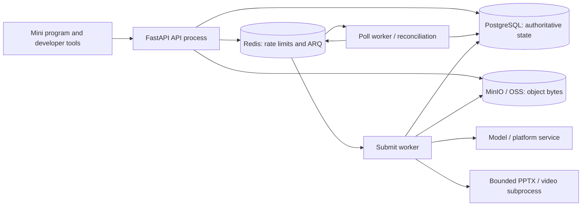
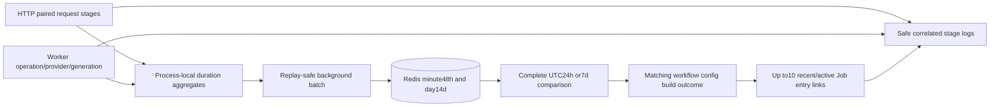

# Follow one request across HTTP, SQL, Redis and workers

A useful diagnosis names the last **proven checkpoint**. “The frontend is spinning” does not tell us whether authentication failed, admission committed, the queue delivered, the supplier accepted, or output publication finished. This page teaches read-only tracing of a local task, not database surgery.

## First identify the process boundaries {#process-map}



Open [app/worker.py → SubmitWorkerSettings](https://github.com/Orientation-CD/YuanZhu-AI/blob/e59716c83e087deda8477da5ea7b327a40cf65c5/app/worker.py#L887) and [app/worker.py → PollWorkerSettings](https://github.com/Orientation-CD/YuanZhu-AI/blob/e59716c83e087deda8477da5ea7b327a40cf65c5/app/worker.py#L921) side by side. Both worker processes share SQL/storage/settings, but consume different ARQ queues and register different jobs/cron functions. A healthy HTTP server does not prove either worker is running. Redis being reachable does not prove an admission message was consumed. A provider task existing does not prove its output was verified into our storage.

When reading Python, distinguish `request.app.state` (resources of this API process), worker `ctx` (resources initialized for that worker), and an `AsyncSession` (one SQL session/transaction). They refer to separate process state, not a global JavaScript-style store shared with the phone.

## Two health APIs, two different claims

### Liveness: is this HTTP process responding? {#health-live}

`GET /health/live` has no mobile button or Bearer dependency. Deployment probes/operators invoke [app/core/health_api.py → live](https://github.com/Orientation-CD/YuanZhu-AI/blob/e59716c83e087deda8477da5ea7b327a40cf65c5/app/core/health_api.py#L12), which simply returns `{"status":"ok"}`. It does not query SQL, Redis, model services, object storage or workers. Its lack of dependency I/O is deliberate: a dependency outage should not make the process appear dead and trigger pointless restart loops.

### Readiness: can this API reach Redis and its database? {#health-ready}

`GET /health/ready` is also public and probe/operator-triggered. [app/core/health_api.py → ready](https://github.com/Orientation-CD/YuanZhu-AI/blob/e59716c83e087deda8477da5ea7b327a40cf65c5/app/core/health_api.py#L18) pings `request.app.state.redis`, then opens the configured DB session factory and performs `SELECT count(*) FROM users`. It returns `{"status":"ok"}` on success. Any exception logs request ID, dependency label and exception type, then returns `503 DEPENDENCY_UNAVAILABLE`. The query also helps expose a missing expected schema, not merely a successful TCP connection.

Readiness does not validate a provider's credits, published legal documents, subscription grants, active Feature/model configuration, a phone's upload domain, converter binaries or worker liveness. A newcomer can get 200 here and still legitimately fail the first task. Follow the separate entitlement/upload/worker checks in [onboarding](/get-started/quickstart).

## Collect a small evidence bundle {#evidence}

| At the boundary | Record | Why it connects the next hop |
| --- | --- | --- |
| Frontend | Page/action, real path/method, status and domain error | Distinguishes Mock data from real HTTP, and UI validation from server rejection |
| HTTP | Request ID, authenticated user/workspace, action key, returned Job ID | Locates the admission/replay branch; keep tokens and signed links out of logs |
| Job/run | Job ID, internal run ID, retry generation, graph node keys | Connects public state to the frozen execution |
| Submission/provider | Submission ID, operation ID, dispatch state, certainty, external task ID if any | Separates queued/prepared work from possibly charged external work |
| Output | Public output binding, Asset ID, exact object version/hash | Proves persisted result identity rather than a temporary URL |
| Financial state | Job token state and related ledger reasons | Distinguishes reservation, successful consumption and failure release |

[app/workflows/workflow_diagnostic_execution.py → execution_diagnostics](https://github.com/Orientation-CD/YuanZhu-AI/blob/e59716c83e087deda8477da5ea7b327a40cf65c5/app/workflows/workflow_diagnostic_execution.py#L116) attaches execution identity across workflow phases. Follow its source and the Admin diagnostic page rather than dumping full provider envelopes. Credentials, refresh/access tokens, invitation bearers, signed query URLs and raw private content are not necessary for routine checkpoint comparison.

## Read-only SQL trace from a public Job ID {#sql-trace}

Use a local database or an operator-approved read-only connection. These commands run in **psql**, not your normal terminal and not Python. `\set` is psql's variable command; substitute the actual returned Job UUID. No query below creates, charges, retries or deletes a task.

```sql
\set job_id '00000000-0000-0000-0000-000000000001'
BEGIN READ ONLY;
SELECT j.id AS job_id, j.status AS job_status, j.token_state,
       j.explicit_retry_count, r.id AS run_id, r.state AS run_state,
       o.id AS operation_id, o.node_key, o.state AS operation_state,
       s.id AS submission_id, s.attempt_generation, s.status AS submission_status,
       s.dispatch_state, s.provider_request_count,
       s.provider_outcome_uncertain, s.provider_job_id
FROM design_jobs j
LEFT JOIN workflow_runs r ON r.design_job_id = j.id
LEFT JOIN operation_runs o ON o.workflow_run_id = r.id
LEFT JOIN design_job_submissions s ON s.operation_run_id = o.id
WHERE j.id = :'job_id'::uuid
ORDER BY o.node_key, s.attempt_generation, s.id;

SELECT d.port_name, d.position, a.id AS asset_id, a.status,
       a.object_version, a.content_sha256, a.size_bytes
FROM design_job_outputs d
JOIN assets a ON a.id = d.asset_id
WHERE d.design_job_id = :'job_id'::uuid
ORDER BY d.port_name, d.position;
ROLLBACK;
```

The all-zero-like UUID is a placeholder: no row simply means you did not select an actual local Job. Source definitions: [app/persistence/db_models.py → DesignJob](https://github.com/Orientation-CD/YuanZhu-AI/blob/e59716c83e087deda8477da5ea7b327a40cf65c5/app/persistence/db_models.py#L1962), [app/persistence/db_models.py → WorkflowRun](https://github.com/Orientation-CD/YuanZhu-AI/blob/e59716c83e087deda8477da5ea7b327a40cf65c5/app/persistence/db_models.py#L2154) and [app/persistence/db_models.py → DesignJobSubmission](https://github.com/Orientation-CD/YuanZhu-AI/blob/e59716c83e087deda8477da5ea7b327a40cf65c5/app/persistence/db_models.py#L2606). Asset/typed subclasses and output bindings are in [the data model](/reference/data-model). A run may have multiple operations/submissions; do not assume the first SQL row is the whole report. Report included children are separate Jobs linked by `workflow_generated_sources` and `parent_workflow_id`.

For an unstarted Submission, inspect its committed `workflow_outbox_events` by `aggregate_id = submission_id` and `processed_at`. For an apparently stuck running provider, inspect its current generation and request/acceptance/staged evidence before deciding whether any retry is safe. Do not expose encrypted envelopes or manually edit a lease, status or ledger row to “unstick” the task.

## Follow input preparation before a Job exists {#input-preparation-trace}

A failed create request can have **no Job ID yet**, while a durable archive receipt exists. Start from request ID and selected Asset IDs rather than treating the absence of a queued Job as lost payment evidence. Stages include `input_prepare`, `input_validate`, `input_validation_commit`, `input_archive_claim`, `input_archive_lookup`, `input_archive_lease`, `input_archive_copy`, `input_archive_recover`, `input_archive_verify` and `input_archive_publish`. See [app/core/request_stages.py → request_stage](https://github.com/Orientation-CD/YuanZhu-AI/blob/e59716c83e087deda8477da5ea7b327a40cf65c5/app/core/request_stages.py#L91) and [app/assets/asset_input_archival.py → archive_direct_input](https://github.com/Orientation-CD/YuanZhu-AI/blob/e59716c83e087deda8477da5ea7b327a40cf65c5/app/assets/asset_input_archival.py#L581).

```sql
\set asset_id '00000000-0000-0000-0000-000000000002'
BEGIN READ ONLY;
SELECT a.id, a.status, a.expires_at, a.object_key, a.object_version,
       r.state AS archive_state, r.source_object_key, r.source_object_version,
       r.destination_object_key, r.destination_object_version, r.lease_expires_at
FROM assets a
LEFT JOIN asset_input_archives r ON r.asset_id = a.id
WHERE a.id = :'asset_id'::uuid;
ROLLBACK;
```

READY + COMPLETED receipt is prepared input, not accepted paid work. Final ACTIVE/no-expiry and exclusive Job/pin/ledger/outbox commit occurs later. Preserve source/destination evidence when a copy acknowledgement is unknown; do not remove the receipt or change status. A completed-history repair is a separate explicit dry-run-first command, not a generic fix for failed/running jobs.

## Connect aggregate performance to one safe trace {#performance-trace}



| Source | What to prove |
| --- | --- |
|[app/core/request_stages.py → request_stage](https://github.com/Orientation-CD/YuanZhu-AI/blob/e59716c83e087deda8477da5ea7b327a40cf65c5/app/core/request_stages.py#L91)|Properly paired platform boundaries and safe request→Job correlation, without private payloads.|
|[app/core/execution_performance.py → observe_on_commit](https://github.com/Orientation-CD/YuanZhu-AI/blob/e59716c83e087deda8477da5ea7b327a40cf65c5/app/core/execution_performance.py#L68)|Only committed outcomes contribute; rollback cannot produce successful operation/Job timing.|
|[app/core/performance_history.py → PerformanceHistory](https://github.com/Orientation-CD/YuanZhu-AI/blob/e59716c83e087deda8477da5ea7b327a40cf65c5/app/core/performance_history.py#L375)|Bounded local aggregates, immutable replay-safe batches, producer coverage and gap evidence.|
|[app/core/performance_reports.py → build_history_performance_report](https://github.com/Orientation-CD/YuanZhu-AI/blob/e59716c83e087deda8477da5ea7b327a40cf65c5/app/core/performance_reports.py#L292)|Complete equal UTC windows, no fabricated zero/missing/tail bounds or improvement direction when incomparable.|
|[app/admin/performance.py → _performance_evidence](https://github.com/Orientation-CD/YuanZhu-AI/blob/e59716c83e087deda8477da5ea7b327a40cf65c5/app/admin/performance.py#L172)|Recent Job links match workflow/configuration; they are investigation entries, not exact histogram exemplars.|

The [Performance dashboard](/admin/performance) ranks within one measurement, not a sum of overlapping phases. p95 requires20 samples and p99 requires100. Unique terminal totals retain Job-ID deduplication for25h, while a duration sample represents one generation. Missing/deleted/truncated evidence remains explicitly unavailable. Last start without end is last observed location, never proof a paid request did not execute. No new activation flag is required for these stage logs.

## From a symptom to the next source function {#decision-table}

| Symptom / last evidence | Next source and question |
| --- | --- |
| No request in Network | Was frontend Mock selected? Did form/account/entitlement validation stop before repository HTTP? |
| HTTP 401 or consent error | Follow [identity](/reference/flows/wechat-login-flow); did refresh rotate, is consent current, did the session change? |
| Upload storage success but submission rejects input | Follow [completion verification](/reference/flows/asset-upload-flow); is it READY with matching role/version, is the archive receipt proved, and did final ACTIVE/ownership acceptance commit? |
| POST 202 + Job pending + unprocessed outbox | [app/workflows/submissions/workflow_submission_dispatch.py → dispatch_workflow_submission_outbox](https://github.com/Orientation-CD/YuanZhu-AI/blob/e59716c83e087deda8477da5ea7b327a40cf65c5/app/workflows/submissions/workflow_submission_dispatch.py#L1297); was a deterministic message enqueued and acknowledged? |
| 402 member cap with enough enterprise funds | [Quota chain](/reference/flows/member-quota-flow); compare used + required, not used + reserved + required; preserve the current month and original key. |
| No executable messages after an outage | [app/worker.py → reconcile_workflow_submissions](https://github.com/Orientation-CD/YuanZhu-AI/blob/e59716c83e087deda8477da5ea7b327a40cf65c5/app/worker.py#L513); is Poll worker running recovery with `recover=True`? |
| Submission DISPATCHING, request count positive, no provider ID | [Uncertain provider branch](/reference/flows/design-job-lifecycle#uncertain-provider); missing ID does not prove no charge |
| Child completed, root still running | [Report dependency join](/reference/flows/report-view-flow#report-graph) and finalizer; is a sibling/export/input/output still unproven? |
| Completed Job, blank image/browser failure | Current signed URL, configured origin/domain and [output viewer checks](/reference/flows/workflow-history-flow); not a fresh generation |
| Failed Job, reserved tokens remain unexpectedly | Compare generation, active sibling/drain state and terminal finalizer before any financial repair |

`reconcile_workflow_submissions` calls the durable dispatcher/recovery path. Cron can reconstruct work after queue outages or lost handoffs, but it cannot invent supplier acceptance evidence or safely repeat every paid request. The appropriate remedy can be configuration, recovery, a domain-level explicit retry, or manual reconciliation; the UI spinner alone does not choose among them.

## A guided local reading exercise {#exercise}

1. Run liveness and readiness from the terminal using the local API base configured during onboarding. Explain exactly what each 200 proves.
2. Open an existing local mock Job and copy its public ID. Run the read-only join and map the returned run/node/Submission to the code map.
3. Compare `job_status`, `run_state`, `operation_state`, `submission_status` and `dispatch_state`. Explain their different scopes rather than forcing every field into one status enum.
4. Find the public output's Asset hash/version. Trace the GET serializer that makes a temporary link from that identity.
5. Walk through one hypothetical crash between commit and enqueue using the outbox source. Explain the recovery without changing SQL or calling a paid provider.

The [REST index](/reference/rest-api), [source versions](/reference/source-revisions) and [maintenance guide](/reference/maintenance) define what automated consistency checks prove. They check the audited code revision; they do not claim a running environment's configuration or supplier behavior has been exercised.
