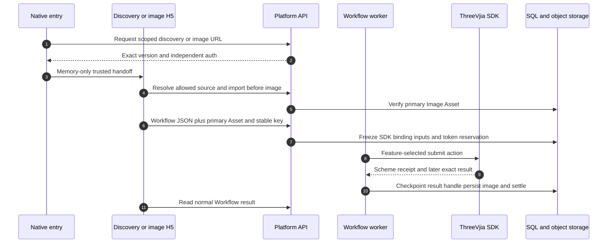

# ThreeVjia image generation and discovery

Ordinary image design reuses platform Workflow accounting and Assets while its H5 form preserves supplier business JSON. It differs from Work-based floor-plan rendering: no FloorPlanWork registration is required for this image family. The seven platform Feature keys are `rough_room_design`, `old_room_renovation`, `finished_room_design`, `furniture_replace`, `furniture_remove`, `furniture_add` and `cabinet_redesign`.

## From a discovery choice to one stored image

| Steps | Source | Why it exists |
| --- | --- | --- |
| 1–3 | [prepareThreeVjiaImage](https://github.com/Orientation-CD/wechat_mini_program/blob/88c75c1f15cd65f45c7fb09d560df80430ddc198/src/repositories/threeVjiaImage.ts#L6) · [prepareThreeVjiaDiscovery](https://github.com/Orientation-CD/wechat_mini_program/blob/88c75c1f15cd65f45c7fb09d560df80430ddc198/src/repositories/threeVjiaDiscovery.ts#L7) · [image_editor_url](https://github.com/Orientation-CD/YuanZhu-AI/blob/749e82df3a51c441335ba6a4db607a98bacbcf97/app/scheme_images/api.py#L104) | Browsing/entry qualification does not create paid execution |
| 4–6 | [submit](https://github.com/Orientation-CD/YuanZhu-AI/blob/749e82df3a51c441335ba6a4db607a98bacbcf97/app/static/3vjia/h5/scheme.js#L85) · [import_before_asset](https://github.com/Orientation-CD/YuanZhu-AI/blob/749e82df3a51c441335ba6a4db607a98bacbcf97/app/floor_plans/before_assets.py#L88) | Durable stable key/body recover an uncertain response; verified primary image is separate from supplier JSON |
| 7–8 | [SchemeImageWorkflowCreate](https://github.com/Orientation-CD/YuanZhu-AI/blob/749e82df3a51c441335ba6a4db607a98bacbcf97/app/core/models.py#L740) · [scheme_submit_action](https://github.com/Orientation-CD/YuanZhu-AI/blob/749e82df3a51c441335ba6a4db607a98bacbcf97/app/scheme_images/family.py#L25) | Platform Feature selects type/bizType and scheme_design_submit versus scheme_change_submit, rather than trusting document routing fields |
| 9–10 | [ThreeVjiaSchemeImageSDK](https://github.com/Orientation-CD/YuanZhu-AI/blob/749e82df3a51c441335ba6a4db607a98bacbcf97/app/three_vjia/scheme_image.py#L50) · [checkpoint_handle](https://github.com/Orientation-CD/YuanZhu-AI/blob/749e82df3a51c441335ba6a4db607a98bacbcf97/app/workflows/operations/image/scheme_image_execution.py#L19) | Original scheme receipt stays stable while first exact record/task/file binding is checkpointed for later polls |
| 11 | [get_workflow](https://github.com/Orientation-CD/YuanZhu-AI/blob/749e82df3a51c441335ba6a4db607a98bacbcf97/app/workflows/api.py#L1484) | Output returns through ordinary authorized Workflow history/result DTOs |

`SchemeImageWorkflowCreate` requires exactly the JSON render_request and primary Image. It normalizes platform-selected supplier type/bizType and single-image quantity rules. The shared `three_vjia_image` Workflow uses `generate_3vjia_image`; it is not a new generic Provider model. Frozen `scheme_submit_action` routes room-design Features to scheme_design_submit and furniture/cabinet changes to scheme_change_submit. The SDK returns a canonical `3vjs1:` routing receipt; later record/task/file evidence cannot silently switch schemes. A query failure or unknown paid outcome must use existing attempt recovery, not create another supplier scheme.

Discovery source handoff permits only bounded known locators/actions: same_case, edit_selected_image or products; native validation limits product count to 50. H5 resolves actual case/file/product data through the selected release before setting form defaults. Browsing itself does not reserve tokens. Source locators, supplier scheme IDs, platform Asset IDs and Workflow IDs are separate objects.

## Bootstrap ordinary-image context {#image-context}

`GET /v1/3vjia-image/context` enters `image_context`. The loaded scheme H5 asks for one of the seven supported Feature keys plus workspace/project. `authenticate_editor_context` establishes current platform authority; this read does not require a selected connection merely to report honest unavailability. The response includes Feature enabled/base token cost and `current_editor_model` release metadata. It does not submit a scheme, reserve tokens or prove that a supplier login probe succeeds. H5 must keep unavailable/removed Feature state distinct from a valid empty form.

Source reading: [image_context](https://github.com/Orientation-CD/YuanZhu-AI/blob/749e82df3a51c441335ba6a4db607a98bacbcf97/app/scheme_images/api.py#L37) · [authenticate_editor_context](https://github.com/Orientation-CD/YuanZhu-AI/blob/749e82df3a51c441335ba6a4db607a98bacbcf97/app/floor_plans/works.py#L90) · [current_editor_model](https://github.com/Orientation-CD/YuanZhu-AI/blob/749e82df3a51c441335ba6a4db607a98bacbcf97/app/floor_plans/editor_entry.py#L37).

## Enter one image Feature {#image-entry}

`POST /v1/3vjia-image/editor-url` enters `image_editor_url`. Native `prepareThreeVjiaImage` sends the Feature, workspace, name, optional project/source and bootstrap_auth. `prepare_editor_entry` rechecks that Feature and requires the Feature-selected submit action plus scheme_design_detail and valid response mappings. It probes login outside transaction locks and rechecks final authority before committing optional platform auth. The resulting scheme-design.html URL carries only bounded source locators (case/file/product IDs and action), never arbitrary trusted supplier response fields. It does not create a paid job; source resolution and primary-image import occur inside H5.

Source reading: [image_editor_url](https://github.com/Orientation-CD/YuanZhu-AI/blob/749e82df3a51c441335ba6a4db607a98bacbcf97/app/scheme_images/api.py#L104) · [prepare_editor_entry](https://github.com/Orientation-CD/YuanZhu-AI/blob/749e82df3a51c441335ba6a4db607a98bacbcf97/app/floor_plans/editor_entry.py#L182).

## Import the ordinary-image primary input {#image-before}

`POST /v1/3vjia-image/before-assets` enters `import_before_image`. scheme.js calls this alias before constructing the platform Workflow body. The exact handler, rate limit and `import_before_asset` mechanism are shared with floor-plan before-assets: stable key/fingerprint, owner/project authority, durable temporary intent before I/O, bounded SDK artifact download, image validation, versioned storage and normal Asset completion. READY/replayed=true is an input receipt, not a generated output or debit. Preserve the key and request when recovering an uncertain import; different source/scope under the key conflicts. Only then freeze the returned asset_id into the paid Workflow body.

Source reading: [import_before_image](https://github.com/Orientation-CD/YuanZhu-AI/blob/749e82df3a51c441335ba6a4db607a98bacbcf97/app/floor_plans/api.py#L255) · [import_before_asset](https://github.com/Orientation-CD/YuanZhu-AI/blob/749e82df3a51c441335ba6a4db607a98bacbcf97/app/floor_plans/before_assets.py#L88).

## Read discovery context {#discovery-context}

`GET /v1/3vjia-discovery/context` enters `discovery_context`. Discovery H5 sends page=idea or shopping, optional shopping_mode=city/selected and workspace/project. `authenticate_editor_context` verifies account and scope and returns current SDK release metadata without requiring a priced Feature. It does not submit a Workflow or charge browsing tokens. These selector values control page context; they do not authorize access to arbitrary supplier accounts, projects or source assets.

Source reading: [discovery_context](https://github.com/Orientation-CD/YuanZhu-AI/blob/749e82df3a51c441335ba6a4db607a98bacbcf97/app/discovery/api.py#L34) · [authenticate_editor_context](https://github.com/Orientation-CD/YuanZhu-AI/blob/749e82df3a51c441335ba6a4db607a98bacbcf97/app/floor_plans/works.py#L90).

## Open inspiration or shopping {#discovery-entry}

`POST /v1/3vjia-discovery/entry-url` enters `discovery_entry`. Native `prepareThreeVjiaDiscovery` requests the selected page/mode with bootstrap_auth. `prepare_editor_entry` uses feature_keys=() but still checks scope, exact release and four required browse operations: content list/detail, product search and store detail. Login probing and final authority checks finish before the optional platform auth commit. discovery.html URL/version enters the same trusted-origin native handoff. Browsing remains unpriced; selecting a case/image/products begins a separate Feature-specific entry and later paid Workflow, not a hidden gateway render.

Source reading: [discovery_entry](https://github.com/Orientation-CD/YuanZhu-AI/blob/749e82df3a51c441335ba6a4db607a98bacbcf97/app/discovery/api.py#L76) · [prepare_editor_entry](https://github.com/Orientation-CD/YuanZhu-AI/blob/749e82df3a51c441335ba6a4db607a98bacbcf97/app/floor_plans/editor_entry.py#L182).
