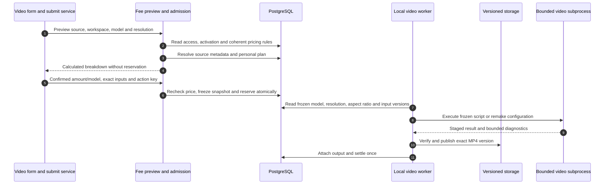

# Video fees: preview, confirm and freeze

A video form can show a price before it creates a task. That preview and the eventual paid acceptance are different boundaries. Follow one example: a user chooses an uploaded reference clip, confirms its model and Tokens, then submits the prepared request. The reference Asset's measured duration is authoritative; a client duration label is presentation.

## Request the authoritative preview {#video-price-preview}

`POST /v1/video-billing/preview` calls `preview_video_billing`. The caller supplies `workspace_id`, optional known `model`, optional `resolution`, and **exactly one** of `script`, `template_name`, or `reference_asset_id`. `VideoBillingPreviewRequest` rejects ambiguous sources and a blank script with 422. The authenticated frontend caller is `previewVideoBilling`; the form refreshes its display after a 400 ms debounce and the submit service obtains a fresh preview before confirmation.

| Message | Pinned source | Read this boundary |
| --- | --- | --- |
|1|[submitVideoGeneration](https://github.com/Orientation-CD/wechat_mini_program/blob/7f1a3169338c10bd4139c24318f7a35caf86310c/src/pkg-features/services/videoGenerationSubmit.ts#L81)|Resolve profile/catalog, stage a custom reference, request the exact current price.|
|2–3|[preview_video_billing](https://github.com/Orientation-CD/YuanZhu-AI/blob/f34b8a4d6307c83c6f7bbc905485a4f586d59a99/app/billing/video_billing_api.py#L131) → [preview_source](https://github.com/Orientation-CD/YuanZhu-AI/blob/f34b8a4d6307c83c6f7bbc905485a4f586d59a99/app/billing/video_billing_api.py#L50) / [preview_discount](https://github.com/Orientation-CD/YuanZhu-AI/blob/f34b8a4d6307c83c6f7bbc905485a4f586d59a99/app/billing/video_billing_api.py#L103)|Authenticate workspace access and executable product, [load_video_pricing](https://github.com/Orientation-CD/YuanZhu-AI/blob/f34b8a4d6307c83c6f7bbc905485a4f586d59a99/app/billing/video_pricing.py#L122), then resolve source and plan; no Job exists.|
|4|[calculate_video_price](https://github.com/Orientation-CD/YuanZhu-AI/blob/f34b8a4d6307c83c6f7bbc905485a4f586d59a99/app/billing/video_pricing.py#L164)|Calculate integer Tokens from that coherent configuration; rollback the read transaction.|
|5|[submitVideoGeneration](https://github.com/Orientation-CD/wechat_mini_program/blob/7f1a3169338c10bd4139c24318f7a35caf86310c/src/pkg-features/services/videoGenerationSubmit.ts#L81)|Confirm the fee, upload remaining materials, then persist resolution, aspect ratio, exact body and action key before sending.|
|6|[video_commercial_snapshot](https://github.com/Orientation-CD/YuanZhu-AI/blob/f34b8a4d6307c83c6f7bbc905485a4f586d59a99/app/billing/video_billing.py#L43) / [admit_workflow_job](https://github.com/Orientation-CD/YuanZhu-AI/blob/f34b8a4d6307c83c6f7bbc905485a4f586d59a99/app/workflows/workflow_admission.py#L3301)|Recalculate under admission authority, compare acknowledgements, then reserve and freeze provenance.|
|7–11|[execute_local_video_submission](https://github.com/Orientation-CD/YuanZhu-AI/blob/f34b8a4d6307c83c6f7bbc905485a4f586d59a99/app/workflows/submissions/workflow_local_video_submission.py#L1164) / [frozen_video_model](https://github.com/Orientation-CD/YuanZhu-AI/blob/f34b8a4d6307c83c6f7bbc905485a4f586d59a99/app/billing/video_billing.py#L105)|Execute the frozen model and publish verified MP4; coordinate exactly-once settlement/release.|

`preview_source` uses the active same-style template's reference Asset, or validates the uploaded reference's owner, upload role, READY state and immutable identity. Both paths run `_validate_reference_video`: 15,000–120,000 ms inclusive, at most 100 MiB, and an actual measured Video. Missing duration is `ASSET_CONTENT_CHANGED`; a short/long clip returns 422 `VIDEO_REFERENCE_INVALID` with `reason: too_short/too_long`.

`accessible_workspace` protects the chosen billing context. `preview_discount` gives enterprises zero personal discount; a personal preview requires a currently active subscription whose plan allows `video_generation`. The route also checks product activation and an executable video contract. It does not test the wallet balance or member monthly capacity, reserve Tokens, create a Job/outbox, upload output, or call the render pipeline. It rolls back its read transaction before returning. A preview is permission to display a price, not an execution receipt.

`VideoBillingPreviewResponse` exposes `effective_model`, `mode`, `configuration_version`, `billing_method`, source count or duration, `billable_seconds`, `tokens_per_second`, `base_token_cost`, `discount_percent` and final `token_cost`. The calculator returns the charged resolution internally. FastAPI's response model filters it out of the successful HTTP response. Keep the requested pair with its quoted amount. When resolution is omitted, the effective model’s first enabled resolution in catalog order is used. The preview schema does not accept `aspect_ratio`. [VideoBillingPreviewResponse](https://github.com/Orientation-CD/YuanZhu-AI/blob/f34b8a4d6307c83c6f7bbc905485a4f586d59a99/app/core/models.py#L1354)

The catalog advertises Tokens per second for each enabled pair. The transitional `model_rates` is derived from enabled `480p` rows, alongside legacy top-level `resolution: "480p"`. For example, `MiniMax-H3 / 768p` and `2k` appear in the nested map while the old projection omits the model. [video_billing_discovery](https://github.com/Orientation-CD/YuanZhu-AI/blob/f34b8a4d6307c83c6f7bbc905485a4f586d59a99/app/billing/video_pricing_catalog.py#L17)

## Calculate billable seconds

| Rule | Count used by `calculate_video_price` |
| --- | --- |
| Script, `per_second` | Ceiling of UTF-16 script length divided by `script_chars_per_second` |
| Either reference mode, `per_second` | Ceiling of persisted `duration_ms / 1000` |
| Any mode, `per_task` | Its configured positive `fixed_seconds` |

Multiply seconds by the selected model and resolution’s **stored integer** Tokens/second. Apply the personal discount with upward rounding and a minimum final charge of 10 Tokens: `max(10, ceil(base × (100 - discount_percent) / 100))`. For example, a 15,001 ms reference, rate 8, and zero discount yields 16 × 8 = 128 Tokens. This example is arithmetic, not a promise of current production prices. JavaScript counts UTF-16 units, so the backend deliberately matches that count for emoji and other supplementary characters.

The versioned `video_billing.model_resolution_rates` map advertises enabled pairs in factory selling order within each model. `effective_video_model` and `effective_resolution` force `Doubao-Seedance-2.0-mini / 480p` when `VIDEO_MODEL_SELECTION_ENABLED=false`. With selection enabled, `_resolve_charged_resolution` chooses the model’s first enabled pair on omission. A named but unavailable pair fails with 422 `WORKFLOW_UNAVAILABLE` before reservation. A valid default pair and the server calculation are the inputs for a quote. [video_billing_discovery](https://github.com/Orientation-CD/YuanZhu-AI/blob/f34b8a4d6307c83c6f7bbc905485a4f586d59a99/app/billing/video_pricing_catalog.py#L17) · [effective_resolution](https://github.com/Orientation-CD/YuanZhu-AI/blob/f34b8a4d6307c83c6f7bbc905485a4f586d59a99/app/billing/video_billing.py#L34) · [_resolve_charged_resolution](https://github.com/Orientation-CD/YuanZhu-AI/blob/f34b8a4d6307c83c6f7bbc905485a4f586d59a99/app/billing/video_pricing.py#L101)

## Confirm, reserve and replay

The submit service asks the user to confirm the server breakdown, then writes `expected_token_cost` and `expected_effective_model` into its prepared request. It stores that body and its logical action key before sending to the current `/v1/design-jobs` compatibility entry. The canonical `/v1/workflows` uses the same video admission. Optional fields in the request schema do not imply successful acceptance without a current acknowledgement: new admission compares both fields to the recomputed price.

`video_commercial_snapshot` runs before wallet reservation. A mismatch returns 409 `VIDEO_PRICE_CHANGED` with `detail.current_price`, including the charged `resolution`, and leaves Job creation and reservation uncommitted. The admission check compares only the confirmed amount and effective model. A configuration version change alone does not require reconfirmation while both values match. The form enters reconfirmation, obtains and confirms a new preview, updates only the acknowledged price/model in the prepared body, persists it, and reuses the logical action. This differs from a transport failure with an unknown receipt: replay the **unchanged** saved body/key and avoid refreshing the price or rotating the key while acceptance is uncertain.

After the match, admission checks wallet spendable balance and enterprise member quota. It freezes `video_time_v1` provenance including rate/configuration version, effective model, charged resolution, rule, count/duration, discount, final price and reference Asset version/hash. The Job, run and operation use this same accepted cost. A repeated accepted key returns its original receipt even if prices or quotas later change; it does not reserve twice.

## Preserve the rendering choices with the action

An explicit `resolution` enters the semantic fingerprint. Omission and `null` retain the historical fingerprint. `aspect_ratio` accepts `9:16`, `16:9`, `3:4`, `4:3` and `21:9` in script and same-style modes. Omission, `null` and `9:16` share one semantic identity. Each other aspect ratio changes the fingerprint. The worker reads the frozen public input and sends it as `video_aspect_ratio`, defaulting to `9:16`. The billing formulas depend on resolution, duration or script length and mode. Changing only the ratio never changes the commercial calculation. [_canonical_video_request_payload](https://github.com/Orientation-CD/YuanZhu-AI/blob/f34b8a4d6307c83c6f7bbc905485a4f586d59a99/app/workflows/workflow_admission.py#L1673) · [_build_render_request](https://github.com/Orientation-CD/YuanZhu-AI/blob/f34b8a4d6307c83c6f7bbc905485a4f586d59a99/app/workflows/submissions/workflow_local_video_submission.py#L617)

## Execution and recovery use the accepted facts

`frozen_video_model` validates identity and integer arithmetic on the accepted `video_time_v1` snapshot. `_snapshot_resolution` reads the charged resolution from that snapshot even if the pair is no longer sold. The worker builds `video_resolution` from this value. Earlier `video_time_v1` snapshots already stored `480p`. For older `feature_v1` or absent commercial snapshots the worker follows the historical path and omits the renderer resolution key. [frozen_video_model](https://github.com/Orientation-CD/YuanZhu-AI/blob/f34b8a4d6307c83c6f7bbc905485a4f586d59a99/app/billing/video_billing.py#L105) · [_snapshot_resolution](https://github.com/Orientation-CD/YuanZhu-AI/blob/f34b8a4d6307c83c6f7bbc905485a4f586d59a99/app/workflows/submissions/workflow_local_video_submission.py#L260)

A failed local render is not automatically purchased again. The shared explicit retry controller requires eligible persisted failure evidence, released accounting and current authority; a proven-not-sent RETRYABLE case can be accepted as a new generation with the original frozen price/model. Ordinary terminal render failure remains blocked. Replaying the retry receipt does not create a second generation. See the [history/retry chain](/reference/flows/workflow-history-flow).

The subprocess records `runtime_version` only when the installed `jinqiu_e2e` package can report it. Missing provenance stays unknown. Preserve backend commit, image digest, private supplier revision and available runtime version when investigating a model/script mismatch. Client diagnostics redact credentials and signed URLs; protected project reads additionally redact customer fields. Bounded file sharing has a copy fallback. Neither export proves whether a supplier accepted a paid call.

## Read the regression evidence

[tests/test_video_billing_admission.py](https://github.com/Orientation-CD/YuanZhu-AI/blob/f34b8a4d6307c83c6f7bbc905485a4f586d59a99/tests/test_video_billing_admission.py) covers acknowledgement changes, atomic rejection and accepted replay; [tests/test_video_billing_retry_integration.py](https://github.com/Orientation-CD/YuanZhu-AI/blob/f34b8a4d6307c83c6f7bbc905485a4f586d59a99/tests/test_video_billing_retry_integration.py) covers frozen retry accounting; [tests/test_video_member_quota_integration.py](https://github.com/Orientation-CD/YuanZhu-AI/blob/f34b8a4d6307c83c6f7bbc905485a4f586d59a99/tests/test_video_member_quota_integration.py) covers member-capacity rejection and accepted replay. These are source evidence for the behavior, not a report that this docs update ran the application or a paid supplier.
