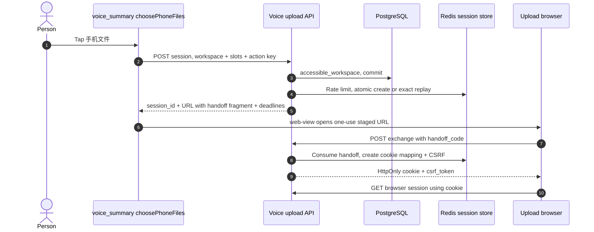
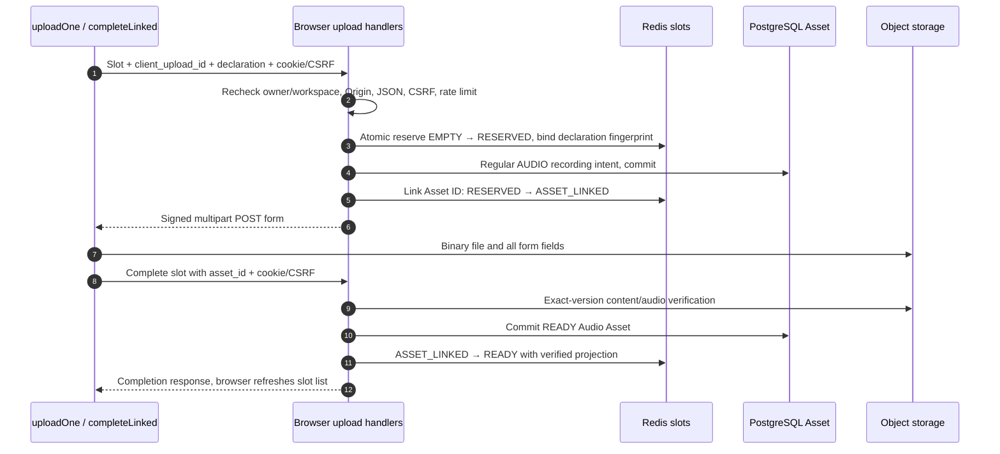

# Phone audio handoff: mini program → browser → verified Asset → mini program

“手机文件” in the voice-summary page opens a restricted upload website. This is a second client with **cookie authority limited to one upload session**, not a browser copy of the mini program's access token. The browser uploads files; returning to the mini program imports verified Asset IDs. Generation begins only when the person later submits the voice Workflow. All code links use the [audited revisions](/reference/source-revisions).

## Three storage layers and three clocks {#voice-model}

| State | Owner / lifetime | Why it is needed |
| --- | --- | --- |
| Mini-program draft and handoff | `pendingPhoneUpload`, local draft; one-use page handoff | Remembers session/workspace and opens the exact server URL without putting it in a navigation query. |
| Redis session and slots | `VoiceUploadSessionStore` with expiry | One-time handoff exchange, cookie lookup, CSRF and atomic per-slot transitions. This Redis data is **not a worker queue**. |
| PostgreSQL Audio Asset + object-store version | Regular upload/completion flow | Durable ownership and verified bytes, independent of temporary browser session UI. |

The response returns `upload_deadline` (upload window), `intent_issuance_expires_at` (earlier cutoff that leaves a minimum signed-form lifetime), and `retrieval_expires_at` (later window for recovering completed files). Read these timestamps; do not hard-code the defaults as client policy. Expiring the upload window does not necessarily expire retrieval. The server validates their configured ordering.

## Create a session from “手机文件” {#voice-session-create}

**Endpoint: `POST /v1/voice-upload-sessions`.** [`choosePhoneFiles`](https://github.com/Orientation-CD/wechat_mini_program/blob/eca0a5f9e0a2aa1cb3fd4f9714114bb3db7fae5f/src/pkg-features/pages/voice_summary/index.vue#L888) authenticates through the account gate, loads the authoritative profile and checks workspace continuity. Available slots are `3 - files.length`. It persists a launch identity before requesting the session, then [`createVoiceUploadSession`](https://github.com/Orientation-CD/wechat_mini_program/blob/eca0a5f9e0a2aa1cb3fd4f9714114bb3db7fae5f/src/pkg-features/repositories/voiceUploadSessions.ts#L82) sends Bearer, a stable `Idempotency-Key` and:

```json
{
  "workspace_id": "11111111-1111-4111-8111-111111111111",
  "available_slots": 2
}
```

The UUID must be a workspace this account can access. `2` means this browser can occupy at most two slots in this session; it is not the audio size/duration or the global per-user upload capacity. The API allows 1–3.



| Steps | Open the code | Boundary to inspect |
| --- | --- | --- |
| 1–2 | [`choosePhoneFiles`](https://github.com/Orientation-CD/wechat_mini_program/blob/eca0a5f9e0a2aa1cb3fd4f9714114bb3db7fae5f/src/pkg-features/pages/voice_summary/index.vue#L888), [`createVoiceUploadSession`](https://github.com/Orientation-CD/wechat_mini_program/blob/eca0a5f9e0a2aa1cb3fd4f9714114bb3db7fae5f/src/pkg-features/repositories/voiceUploadSessions.ts#L82) | Draft survives the login gate; a session cannot silently bind to a newly changed workspace. |
| 3–5 | [`create_voice_upload_session`](https://github.com/Orientation-CD/YuanZhu-AI/blob/b13cc5668920620a274cb91a3393ed9fadac72ae/app/assets/voice_upload_api.py#L421), [`VoiceUploadSessionStore.create`](https://github.com/Orientation-CD/YuanZhu-AI/blob/b13cc5668920620a274cb91a3393ed9fadac72ae/app/assets/voice_upload_sessions.py#L255) | Workspace check ends its read transaction before Redis; Lua publishes session/handoff/idempotency records atomically. |
| 6 | [`stageVoiceUploadHandoff`](https://github.com/Orientation-CD/wechat_mini_program/blob/eca0a5f9e0a2aa1cb3fd4f9714114bb3db7fae5f/src/pkg-features/services/voiceUploadHandoff.ts#L9), [`consumeVoiceUploadHandoff`](https://github.com/Orientation-CD/wechat_mini_program/blob/eca0a5f9e0a2aa1cb3fd4f9714114bb3db7fae5f/src/pkg-features/services/voiceUploadHandoff.ts#L14) | The page consumes staged URL state, then renders a web-view. The URL fragment is a one-use capability. |
| 7–9 | [`bootstrap`](https://github.com/Orientation-CD/YuanZhu-AI/blob/b13cc5668920620a274cb91a3393ed9fadac72ae/app/static/voice-upload.js#L77), [`exchange_voice_upload_handoff`](https://github.com/Orientation-CD/YuanZhu-AI/blob/b13cc5668920620a274cb91a3393ed9fadac72ae/app/assets/voice_upload_api.py#L502) | Browser code exchanges the fragment and removes it with `history.replaceState`; cookie is path-restricted and HttpOnly. |
| 10 | [`get_voice_upload_browser_session`](https://github.com/Orientation-CD/YuanZhu-AI/blob/b13cc5668920620a274cb91a3393ed9fadac72ae/app/assets/voice_upload_api.py#L527) | Subsequent browser requests resolve the cookie; the mini-program Bearer is never transferred. |

Create returns `201`, an identical same-key replay `200` with the **exact stored response**. `VoiceUploadSessionStore.create` fingerprints owner/workspace/slots and encrypts the response kept for replay because it includes the handoff secret. Reusing a key for another declaration returns `409 VOICE_UPLOAD_IDEMPOTENCY_KEY_REUSED`. A consumed handoff is not magically renewed by replaying the same creation action.

## Serve the upload page and its assets {#voice-static}

**Endpoints: `GET /voice-upload`, `GET /voice-upload/app.js`, `GET /voice-upload/validation.js`, `GET /voice-upload/styles.css`.** These are backend-served website resources, not extra mini-program APIs. The route functions [`voice_upload_page`](https://github.com/Orientation-CD/YuanZhu-AI/blob/b13cc5668920620a274cb91a3393ed9fadac72ae/app/assets/voice_upload_api.py#L482), [`voice_upload_script`](https://github.com/Orientation-CD/YuanZhu-AI/blob/b13cc5668920620a274cb91a3393ed9fadac72ae/app/assets/voice_upload_api.py#L487), [`voice_upload_validation_script`](https://github.com/Orientation-CD/YuanZhu-AI/blob/b13cc5668920620a274cb91a3393ed9fadac72ae/app/assets/voice_upload_api.py#L492) and [`voice_upload_styles`](https://github.com/Orientation-CD/YuanZhu-AI/blob/b13cc5668920620a274cb91a3393ed9fadac72ae/app/assets/voice_upload_api.py#L497) return the bundled HTML/JavaScript/CSS via `FileResponse`.

Loading the shell does not authorize file access. `bootstrap` reads `#handoff=...`, exchanges it, then fetches session state; if either fails, it disables the picker and asks the person to return to the mini program. The validation script supports browser feedback; backend validation is still authoritative.

## Exchange one handoff for a restricted cookie {#voice-exchange}

**Endpoint: `POST /voice-upload/exchange`.** Browser `bootstrap` sends JSON `{ "handoff_code": "the-secret-from-fragment" }`. [`exchange_voice_upload_handoff`](https://github.com/Orientation-CD/YuanZhu-AI/blob/b13cc5668920620a274cb91a3393ed9fadac72ae/app/assets/voice_upload_api.py#L502) requires `application/json` and an exact `Origin` matching the configured public API origin, then calls [`VoiceUploadSessionStore.exchange`](https://github.com/Orientation-CD/YuanZhu-AI/blob/b13cc5668920620a274cb91a3393ed9fadac72ae/app/assets/voice_upload_sessions.py#L352). Lua checks the session/upload window, consumes the handoff key, records a new CSRF token and stores a cookie-token mapping.

The response sets an HttpOnly, SameSite=Strict cookie under `/voice-upload`, with Secure controlled by the deployment setting, and returns only `csrf_token` in JSON. Missing/consumed/expired handoff → `410 VOICE_UPLOAD_HANDOFF_UNAVAILABLE`; wrong Origin → `403 VOICE_UPLOAD_ORIGIN_FORBIDDEN`; non-JSON → `415 JSON_CONTENT_TYPE_REQUIRED`. Never copy the handoff URL into public issue text or logs.

## Read browser state and recheck current membership {#voice-browser-session}

**Endpoint: `GET /voice-upload/session`.** Browser `bootstrap`, `uploadOne` and `completeLinked` read this route to render slot progress/recovery. [`_browser_record`](https://github.com/Orientation-CD/YuanZhu-AI/blob/b13cc5668920620a274cb91a3393ed9fadac72ae/app/assets/voice_upload_api.py#L318) resolves the restricted cookie in Redis, reloads the owner from SQL, requires an active/nonremoved user and rechecks `accessible_workspace`. A valid cookie is not enough after account or membership changes.

`get_voice_upload_browser_session` returns state, deadlines, CSRF, `max_files` and ordered slots with filename/Asset ID where present. It does not return general access/refresh tokens. Missing cookie → `401 VOICE_UPLOAD_BROWSER_SESSION_REQUIRED`; retrieval expiry can be `410 VOICE_UPLOAD_RETRIEVAL_EXPIRED`. Refreshing the browser therefore reconstructs server-known slot state; it does not recover the browser's local File bytes.

## Reserve a slot and obtain its Asset upload intent {#voice-file-intent}

**Endpoint: `POST /voice-upload/files/{slot}/upload-intent`.** The browser “上传 N 个录音” listener calls [`uploadOne`](https://github.com/Orientation-CD/YuanZhu-AI/blob/b13cc5668920620a274cb91a3393ed9fadac72ae/app/static/voice-upload.js#L115). It chooses the next EMPTY slot (zero-based), retains a `client_upload_id` UUID for that file, and sends filename, MIME and size with cookie, JSON content type and `X-CSRF-Token`.



| Steps | Source | State / authority |
| --- | --- | --- |
| 1–3 | [`create_voice_upload_file_intent`](https://github.com/Orientation-CD/YuanZhu-AI/blob/b13cc5668920620a274cb91a3393ed9fadac72ae/app/assets/voice_upload_api.py#L564), [`VoiceUploadSessionStore.reserve`](https://github.com/Orientation-CD/YuanZhu-AI/blob/b13cc5668920620a274cb91a3393ed9fadac72ae/app/assets/voice_upload_sessions.py#L421) | Server normalizes the declaration; Lua binds a slot to this UUID/fingerprint. Another file cannot overwrite the same slot. |
| 4–6 | [`derived_asset_idempotency_key`](https://github.com/Orientation-CD/YuanZhu-AI/blob/b13cc5668920620a274cb91a3393ed9fadac72ae/app/assets/voice_upload_sessions.py#L525), [`VoiceUploadSessionStore.link_asset`](https://github.com/Orientation-CD/YuanZhu-AI/blob/b13cc5668920620a274cb91a3393ed9fadac72ae/app/assets/voice_upload_sessions.py#L452) | Derive regular Asset key from session + client UUID; restrict it to AUDIO / DESIGN_JOB_INPUT / recording; commit SQL before linking Redis. |
| 7 | [`uploadForm`](https://github.com/Orientation-CD/YuanZhu-AI/blob/b13cc5668920620a274cb91a3393ed9fadac72ae/app/static/voice-upload.js#L96) | Browser XHR sends FormData to storage. The restricted app cookie is not a general storage credential. |
| 8–10 | [`complete_voice_upload_file`](https://github.com/Orientation-CD/YuanZhu-AI/blob/b13cc5668920620a274cb91a3393ed9fadac72ae/app/assets/voice_upload_api.py#L653), [`complete_asset_upload`](https://github.com/Orientation-CD/YuanZhu-AI/blob/b13cc5668920620a274cb91a3393ed9fadac72ae/app/assets/asset_completion.py#L237) | Check the supplied Asset belongs to this slot; validate actual bytes and measured duration, then commit durable metadata. |
| 11–12 | [`VoiceUploadSessionStore.mark_ready`](https://github.com/Orientation-CD/YuanZhu-AI/blob/b13cc5668920620a274cb91a3393ed9fadac72ae/app/assets/voice_upload_sessions.py#L489), [`render`](https://github.com/Orientation-CD/YuanZhu-AI/blob/b13cc5668920620a274cb91a3393ed9fadac72ae/app/static/voice-upload.js#L25) | Redis READY is published after SQL success; browser shows “上传完成” only after complete succeeds. |

The signed form cannot outlive the session's upload deadline. `intent_issuance_expires_at` is earlier so a new form has at least the minimum useful lifetime. Same slot/client UUID/declaration can replay; a changed declaration or competing slot claim returns `409 VOICE_UPLOAD_SLOT_CONFLICT`. The browser uploads a batch sequentially and stops on a failed file, keeping its selected/uploaded state for retry.

## Complete one slot and recover after a lost response {#voice-file-complete}

**Endpoint: `POST /voice-upload/files/{slot}/complete`.** Body: `{ "asset_id": "the-uuid-returned-by-this-slot-intent" }`. [`complete_voice_upload_file`](https://github.com/Orientation-CD/YuanZhu-AI/blob/b13cc5668920620a274cb91a3393ed9fadac72ae/app/assets/voice_upload_api.py#L653) repeats cookie/owner/workspace and mutation protections, verifies slot bounds and the exact linked UUID, calls the ordinary completion service and commits SQL, then atomically marks the Redis slot READY.

This ordering matters: Redis is not in the SQL transaction. If SQL completion succeeded but Redis publication or the HTTP response failed, the browser can retry the **same completion**. The shared Asset completion checks the already verified object identity. A refreshed browser displays “继续校验” for ASSET_LINKED; [`completeLinked`](https://github.com/Orientation-CD/YuanZhu-AI/blob/b13cc5668920620a274cb91a3393ed9fadac72ae/app/static/voice-upload.js#L177) can finish without reselecting the bytes. A slot only RESERVED cannot recover its local File after a browser restart and may require a new handoff.

The [Asset chapter](/reference/flows/asset-upload-flow#asset-complete) explains exact-version HEAD/read/HEAD, SHA, audio validators and READY persistence. Browser file extension checks do not replace that algorithm.

## Retrieve ready files back in the mini program {#voice-session-get}

**Endpoint: `GET /v1/voice-upload-sessions/{session_id}`.** On return/show or explicit sync, [`syncPhoneUploadSession`](https://github.com/Orientation-CD/wechat_mini_program/blob/eca0a5f9e0a2aa1cb3fd4f9714114bb3db7fae5f/src/pkg-features/pages/voice_summary/index.vue#L835) → [`getVoiceUploadSession`](https://github.com/Orientation-CD/wechat_mini_program/blob/eca0a5f9e0a2aa1cb3fd4f9714114bb3db7fae5f/src/pkg-features/repositories/voiceUploadSessions.ts#L100) sends the mini-program's Bearer. This is deliberately a different auth path from the browser cookie routes.

[`get_voice_upload_session`](https://github.com/Orientation-CD/YuanZhu-AI/blob/b13cc5668920620a274cb91a3393ed9fadac72ae/app/assets/voice_upload_api.py#L453) loads Redis by session ID, compares owner, rechecks accessible workspace and calls [`_ready_assets`](https://github.com/Orientation-CD/YuanZhu-AI/blob/b13cc5668920620a274cb91a3393ed9fadac72ae/app/assets/voice_upload_api.py#L262). That function projects only Redis READY slots through **currently** owned, unexpired READY Audio rows with DESIGN_JOB_INPUT/recording intent and complete verified metadata. An old Redis snapshot alone cannot admit a deleted/expired or differently owned file.

The page rejects a changed workspace, deduplicates known Asset IDs, imports only the remaining capacity up to three, stores filename/type/size/duration/SHA with `status: ready`, updates its draft and clears the pending handoff after synchronization. It can still display “未发现已上传的手机录音” if no completed file is found. Importing the file does not create a generation Workflow; the later submit button consumes these Asset IDs in the normal Workflow path.

## Follow one failed upload without guessing {#voice-debug}

| Observed boundary | Likely evidence to read | Next useful check |
| --- | --- | --- |
| Shell loads but picker says unavailable | `bootstrap` → exchange/session response | One-use handoff, exact Origin, cookie Secure/domain/path and public base URL. |
| No new intent near deadline | Redis reserve / issuance cutoff | Returned cutoff vs server time; do not extend it by changing browser time. |
| Storage progress finishes, not “上传完成” | Complete response, SQL Audio metadata, ASSET_LINKED slot | Actual audio container/type/duration and retry of complete. |
| Browser says complete, mini program imports nothing | Authenticated session GET + `_ready_assets` | Owner/workspace, retrieval window, unexpired READY Audio, existing-ID deduplication. |
| Redis unavailable | `VOICE_UPLOAD_SESSION_STORE_UNAVAILABLE`, `Retry-After: 5` | Session store availability. Restarting a submit worker cannot repair this handoff state. |

Guided exercise in the local test environment:

1. Follow `choosePhoneFiles` and note launch ID, workspace and remaining slots. Open `VoiceUploadSessionStore.create` and find the three Redis keys created together. Expected: session, one-use handoff and idempotency response have distinct purposes.
2. Watch the web-view bootstrap requests, without copying the secret fragment. Expected: exchange, cookie, then browser session; no application Bearer in browser requests.
3. Trace one file's slot through EMPTY → RESERVED → ASSET_LINKED → READY. Compare the same Asset UUID in browser intent, SQL completion and mini-program retrieval.
4. Read the SQL commit before `mark_ready`, then simulate a lost completion response using the local test harness. Expected: retry checks the same durable Asset; it does not generate a new Workflow or a second file identity.
5. Return to the mini program and inspect the imported draft row. Expected: server-measured duration and SHA exist; only a later user submission reaches the generation chain.
