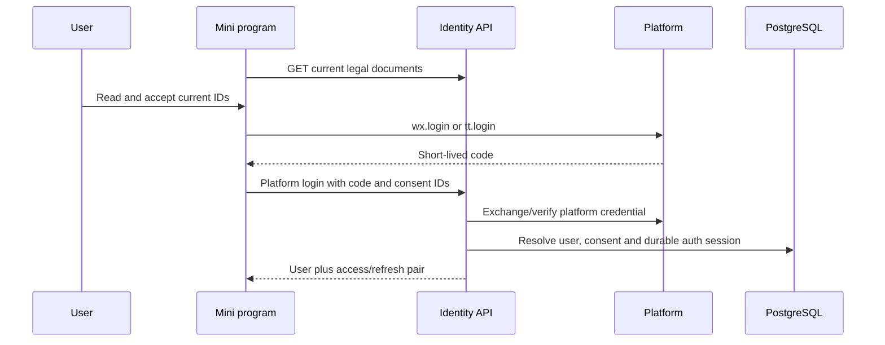

# Platform Login and Consent Flow

WeChat and Douyin exchange platform credentials for the same application account/session model. This route keeps its historical name; both current platform paths belong here.

## Client preparation

`accountGate` coordinates required authentication and continuation. Fetch current legal documents for the display locale, open their returned content and retain immutable IDs the person actually accepted. Mock mode can simulate platform calls, but API mode still needs a correctly configured backend and published legal documents.

Call `/v1/auth/wechat-login` or `/v1/auth/douyin-login` with the fresh code and the required accepted IDs/phone credential fields defined by the contract. Never cache a one-use platform code as a reusable password. Phone authorization is a separate platform-specific proof; do not conflate an OpenID with a verified phone number.

## Backend identity boundary

The identity domain validates the selected platform/mode and resolves the external identity. Phone-linked identities can share an existing application account; account status, binding conflicts and consent requirements remain server checks. The backend records acceptance and creates/rotates a durable `auth_sessions` record before returning JWTs. Starter/campaign rewards, where configured, are ledgered business effects rather than a hard-coded client balance.

If current legal configuration is unavailable (`503 LEGAL_DOCUMENTS_UNAVAILABLE`), stop and retry later. A stale or incomplete acceptance yields `409 LEGAL_ACCEPTANCE_REQUIRED`; display the new required documents and ask for actual renewed consent. Account deactivation/reactivation has dedicated endpoints and must not be bypassed by making another platform identity.

## Refresh and logout

The request layer sends the access token on authenticated API calls. On access expiry, refresh once through `/v1/auth/refresh`, serialize concurrent refreshes and replace **both** returned tokens. A revoked/invalid refresh means clear local credentials and restart login, not an infinite retry loop.

`POST /v1/auth/logout` takes the refresh token and invalidates its durable session. Client caches and pending continuations must remain scoped to the user/session generation so a late response cannot populate another account's state. Token storage is application-local state, not a permission bypass.

## What to verify

Exercise first login with current documents, returning login, stale consent, missing legal configuration, platform-code failure, phone-account reuse, access expiry/refresh rotation, revoked session and account reactivation. Verify platform live behavior separately from mocked identity. See [authentication](/backend/authentication) and [API boundaries](/reference/openapi).

## Source evidence

Verified against the [documented source revisions](/reference/source-revisions).

- [Account gate](https://github.com/Orientation-CD/wechat_mini_program/blob/eca0a5f9e0a2aa1cb3fd4f9714114bb3db7fae5f/src/services/accountGate.ts)
- [Request/refresh coordination](https://github.com/Orientation-CD/wechat_mini_program/blob/eca0a5f9e0a2aa1cb3fd4f9714114bb3db7fae5f/src/services/request.ts)
- [Platform and password identity API](https://github.com/Orientation-CD/YuanZhu-AI/blob/b13cc5668920620a274cb91a3393ed9fadac72ae/app/identity/api.py)
- [Durable authentication sessions](https://github.com/Orientation-CD/YuanZhu-AI/blob/b13cc5668920620a274cb91a3393ed9fadac72ae/app/identity/auth.py)
- [Current legal documents](https://github.com/Orientation-CD/YuanZhu-AI/blob/b13cc5668920620a274cb91a3393ed9fadac72ae/app/identity/legal_api.py)
