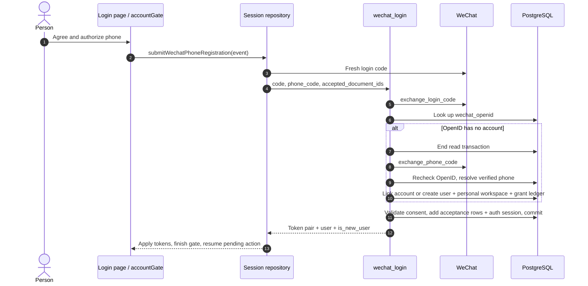
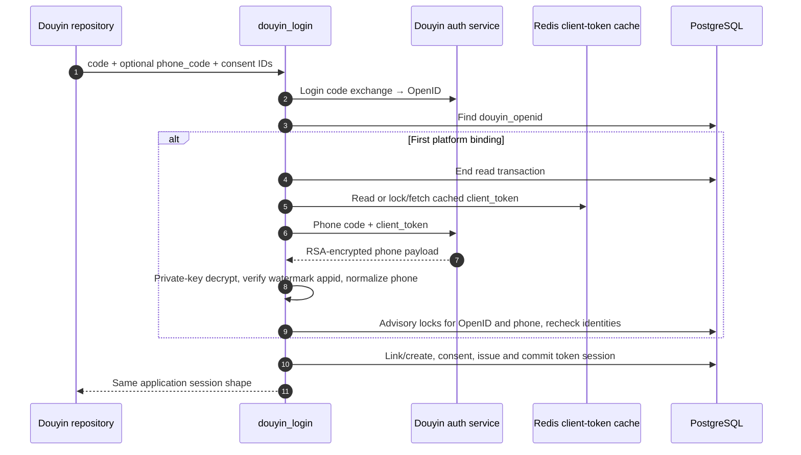
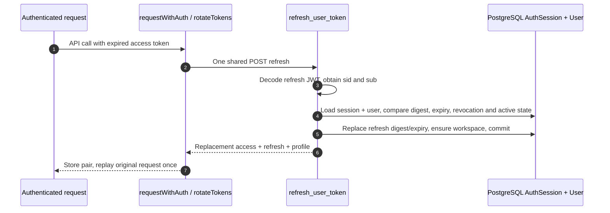

# Login, consent, profile and account lifecycle: follow the code

This chapter follows a person from the login screen to a database account, then follows the same credentials through refresh, profile editing, logout and recovery. The historical URL contains `wechat`; the chapter covers both WeChat and Douyin. Every code link is pinned to the [audited revisions](/reference/source-revisions).

## Start with the four different identities {#identity-map}

| Name | Where it exists | What it proves |
| --- | --- | --- |
| Platform `code` | `uni.login` / `tt.login`, then one API request | A short-lived proof that the platform can exchange for an OpenID. It is not the application token. |
| `phone_code` | Platform phone authorization button | Permission to retrieve a verified phone number. OpenID alone does not prove a phone number. |
| `users.id` | PostgreSQL `User` row | The application's identity. A verified phone can link a platform identity to an existing account. |
| Access / refresh token | Client token store; refresh digest in `AuthSession` | Access authorizes API requests; refresh obtains a replacement pair. The database stores a SHA-256 digest of refresh tokens, not their plaintext. |

Read a sequence diagram from top to bottom. Each arrow is a call or response; the table below identifies the exact function to open. `db.commit()` ends the current database transaction. A row lock coordinates conflicting requests; it is not a permanent user lock.

## WeChat login: button → code → account → resumed action {#wechat-login}

**Endpoint: `POST /v1/auth/wechat-login`.** A feature page asks `requestWechatRegistration` to authorize an action. A returning identity can log in silently. A new identity reaches the login page, checks the agreements and taps “授权手机号并登录”. `authorize(event)` receives the platform's phone code through `@getphonenumber`; it does not read the phone number itself.



| Diagram steps | Exact code to read | Input → output / decision |
| --- | --- | --- |
| 1–2 | [`authorize`](https://github.com/Orientation-CD/wechat_mini_program/blob/eca0a5f9e0a2aa1cb3fd4f9714114bb3db7fae5f/src/pkg-account/pages/login/index.vue#L37), [`submitWechatPhoneRegistration`](https://github.com/Orientation-CD/wechat_mini_program/blob/eca0a5f9e0a2aa1cb3fd4f9714114bb3db7fae5f/src/services/accountGate.ts#L164) | UI event → checked legal versions and platform-specific repository. Canceling resolves the gate without submitting the protected action. |
| 3–4 | [`buildRegistrationWechatLoginRequest`](https://github.com/Orientation-CD/wechat_mini_program/blob/eca0a5f9e0a2aa1cb3fd4f9714114bb3db7fae5f/src/services/wechatAuth.ts#L58), [`wechatSessionRepository`](https://github.com/Orientation-CD/wechat_mini_program/blob/eca0a5f9e0a2aa1cb3fd4f9714114bb3db7fae5f/src/repositories/session.ts#L88) | Fresh login code + fresh phone code + accepted UUIDs → JSON. `acceptSession` validates the response before persisting it. |
| 5–6 | [`wechat_login`](https://github.com/Orientation-CD/YuanZhu-AI/blob/b13cc5668920620a274cb91a3393ed9fadac72ae/app/identity/api.py#L313), [`exchange_login_code`](https://github.com/Orientation-CD/YuanZhu-AI/blob/b13cc5668920620a274cb91a3393ed9fadac72ae/app/identity/wechat_auth.py#L69) | Rate-limit IP in Redis; exchange code; select by `wechat_openid`. Platform rejection is `401`; unavailable upstream is `503`. |
| 7–10 | [`exchange_phone_code`](https://github.com/Orientation-CD/YuanZhu-AI/blob/b13cc5668920620a274cb91a3393ed9fadac72ae/app/identity/wechat_auth.py#L96), [`wechat_login`](https://github.com/Orientation-CD/YuanZhu-AI/blob/b13cc5668920620a274cb91a3393ed9fadac72ae/app/identity/api.py#L313) | Missing phone proof → `428 PHONE_AUTH_REQUIRED`. End the lookup transaction before upstream HTTP; re-read identity afterward. A phone already linked to another OpenID → `409 WECHAT_IDENTITY_MISMATCH`. |
| 11 | [`record_required_acceptances`](https://github.com/Orientation-CD/YuanZhu-AI/blob/b13cc5668920620a274cb91a3393ed9fadac72ae/app/identity/legal_documents.py#L103), [`issue_token_pair`](https://github.com/Orientation-CD/YuanZhu-AI/blob/b13cc5668920620a274cb91a3393ed9fadac72ae/app/identity/api.py#L79) | Check current consent; ensure workspace; persist `AuthSession`; commit before response assembly and network I/O. |
| 12–13 | [`acceptSession`](https://github.com/Orientation-CD/wechat_mini_program/blob/eca0a5f9e0a2aa1cb3fd4f9714114bb3db7fae5f/src/repositories/session.ts#L82), [`finishWechatRegistration`](https://github.com/Orientation-CD/wechat_mini_program/blob/eca0a5f9e0a2aa1cb3fd4f9714114bb3db7fae5f/src/services/accountGate.ts#L217) | Store both tokens; return the user to the pending action. `is_new_user=true` is invalid for a supposedly silent login. |

For a known OpenID, the backend skips phone exchange and account creation. It still checks `is_active`, current agreements and `last_login_at`, then creates a new durable refresh session. For a new account, the initial grant comes from `effective_campaign_token_amount(... NEW_USER_REGISTRATION ...)` with a configured fallback. A positive grant produces a ledger entry in the same admission transaction; the UI does not invent a starter balance.

### Read the request, field by field

```json
{
  "code": "fresh-platform-login-code",
  "phone_code": "fresh-phone-authorization-code",
  "accepted_document_ids": [
    "11111111-1111-4111-8111-111111111111",
    "22222222-2222-4222-8222-222222222222"
  ]
}
```

The code strings above are placeholders, not reusable test credentials. The UUIDs represent the actual `terms` and `privacy` IDs returned by the legal catalog. `phone_code` is needed for first-time binding; returning login normally sends only `code`. If consent changed, the client obtains a fresh code and submits the new document IDs after the person accepts them.

## Douyin login: the extra Redis and RSA path {#douyin-login}

**Endpoint: `POST /v1/auth/douyin-login`.** The same login screen chooses `douyinSessionRepository` when the runtime uses Douyin. `buildRegistrationDouyinLoginRequest` obtains a fresh `tt.login` code and the phone authorization event code. The handler is [`douyin_login`](https://github.com/Orientation-CD/YuanZhu-AI/blob/b13cc5668920620a274cb91a3393ed9fadac72ae/app/identity/api.py#L474); provider functions live in [`exchange_login_code`](https://github.com/Orientation-CD/YuanZhu-AI/blob/b13cc5668920620a274cb91a3393ed9fadac72ae/app/identity/douyin_auth.py#L115) and [`exchange_phone_code`](https://github.com/Orientation-CD/YuanZhu-AI/blob/b13cc5668920620a274cb91a3393ed9fadac72ae/app/identity/douyin_auth.py#L331).



| Steps | Source | Why it exists |
| --- | --- | --- |
| 1 | [`buildRegistrationDouyinLoginRequest`](https://github.com/Orientation-CD/wechat_mini_program/blob/eca0a5f9e0a2aa1cb3fd4f9714114bb3db7fae5f/src/services/douyinAuth.ts#L60), [`douyinSessionRepository`](https://github.com/Orientation-CD/wechat_mini_program/blob/eca0a5f9e0a2aa1cb3fd4f9714114bb3db7fae5f/src/repositories/session.ts#L171) | The runtime chooses Douyin credentials; it does not send a WeChat code to this route. |
| 2–4 | [`douyin_login`](https://github.com/Orientation-CD/YuanZhu-AI/blob/b13cc5668920620a274cb91a3393ed9fadac72ae/app/identity/api.py#L474) | IP protection and OpenID lookup precede phone binding. Known active identities skip the phone branch. |
| 5–6 | [`_client_token`](https://github.com/Orientation-CD/YuanZhu-AI/blob/b13cc5668920620a274cb91a3393ed9fadac72ae/app/identity/douyin_auth.py#L243), [`exchange_phone_code`](https://github.com/Orientation-CD/YuanZhu-AI/blob/b13cc5668920620a274cb91a3393ed9fadac72ae/app/identity/douyin_auth.py#L331) | Redis caches provider `client_token` and coordinates refresh ownership. Invalid provider tokens invalidate their matching cache value. This cache is separate from application refresh sessions. |
| 7–8 | [`_decrypt_phone_payload`](https://github.com/Orientation-CD/YuanZhu-AI/blob/b13cc5668920620a274cb91a3393ed9fadac72ae/app/identity/douyin_auth.py#L295) | RSA PKCS#1 v1.5 private-key decryption; reject a watermark for another app. This path is not WeChat AES/session-key decryption. |
| 9–11 | [`douyin_login`](https://github.com/Orientation-CD/YuanZhu-AI/blob/b13cc5668920620a274cb91a3393ed9fadac72ae/app/identity/api.py#L474), [`issue_token_pair`](https://github.com/Orientation-CD/YuanZhu-AI/blob/b13cc5668920620a274cb91a3393ed9fadac72ae/app/identity/api.py#L79) | Transaction advisory locks serialize first binding for both OpenID and phone. A mismatched existing binding is a conflict, not a second user. |

An invalid login/phone code maps to `401 DOUYIN_LOGIN_CODE_INVALID` / `DOUYIN_PHONE_CODE_INVALID`; provider, Redis token-cache or key/decryption availability maps to the handler's unavailable path. An invalid phone payload maps to `502 DOUYIN_PHONE_INVALID`. Debug these at the provider boundary, before investigating workflow workers: no submit/poll worker participates in login.

## Legal catalog: discover versions before accepting them {#legal-current}

**Endpoint: `GET /v1/legal-documents/current?locale=zh-CN`.** The gate calls [`wechatSessionRepository`](https://github.com/Orientation-CD/wechat_mini_program/blob/eca0a5f9e0a2aa1cb3fd4f9714114bb3db7fae5f/src/repositories/session.ts#L88) `currentLegalDocuments()`. The UI currently requests `zh-CN`; the backend route also accepts a locale query or falls back to its configured locale.

[`get_current_legal_documents`](https://github.com/Orientation-CD/YuanZhu-AI/blob/b13cc5668920620a274cb91a3393ed9fadac72ae/app/identity/legal_api.py#L23) calls [`current_required_documents`](https://github.com/Orientation-CD/YuanZhu-AI/blob/b13cc5668920620a274cb91a3393ed9fadac72ae/app/identity/legal_documents.py#L60). The query joins `CurrentLegalDocument` to immutable `LegalDocument` versions and eagerly loads their document Asset. Exactly one effective required `terms` and `privacy` must be published, plain text, ACTIVE and PUBLIC. Normal runtimes fail closed with `503 LEGAL_DOCUMENTS_UNAVAILABLE` if this is not true.

The handler builds an ETag from versions, ends the SQL transaction, then obtains content URLs from storage (or the content route). `If-None-Match` matching the ETag returns `304`; ordinary responses use `Cache-Control: no-store`. The frontend validates both types and stores metadata locally; a local cache is a display aid, never evidence that new versions were accepted.

### Open one immutable legal text {#legal-content}

**Endpoint: `GET /v1/legal-documents/{document_id}/content`.** “用户协议 / 隐私政策” opens the legal page. Live rendering can use the catalog's public `content_url`; the explicit repository `localLegalDocumentContent()` path is enabled for the local mock/LAN mode.

[`get_current_legal_document_content`](https://github.com/Orientation-CD/YuanZhu-AI/blob/b13cc5668920620a274cb91a3393ed9fadac72ae/app/identity/legal_api.py#L83) selects the UUID, requires `text/plain`, releases the DB transaction and streams bounded bytes from `ObjectStorage.iter_bytes`. It returns a content-SHA ETag, `nosniff` and a one-year immutable cache header. Unknown/non-text IDs return `404 DOCUMENT_NOT_FOUND`. “Current catalog” and “immutable content by ID” therefore have intentionally different cache policies.

Consent is enforced again inside login. `record_required_acceptances` compares submitted IDs to the **current** set and existing acceptance rows. Extra stale IDs or missing new consent produce `409 LEGAL_ACCEPTANCE_REQUIRED`. Only newly accepted current versions add `LegalDocumentAcceptance` rows.

## Password registration: a public contract without a current mini-program button {#password-register}

**Endpoint: `POST /v1/auth/register`.** This is a script/integration entry; the audited mini-program login page does not collect passwords and does not call it. Do not confuse the frontend repository's method named `register()` with this URL: that method uses platform login.

[`register_user`](https://github.com/Orientation-CD/YuanZhu-AI/blob/b13cc5668920620a274cb91a3393ed9fadac72ae/app/identity/api.py#L134) rate-limits the IP, normalizes E.164 phone, rejects blank display name and hashes the password with Argon2 **before acquiring a registration database slot**. The bounded slot prevents password CPU work from consuming the connection pool. The subsequent path checks duplicate phone (`409 PHONE_ALREADY_REGISTERED`), loads current legal documents, determines the campaign grant, creates `User`, grant ledger, personal workspace and acceptance evidence, prepares `AuthSession` and commits them. It returns `201` and the token pair; no model provider is called.

A script sends `phone`, `password`, `display_name`, and `accepted_document_ids`. Obtain the IDs from the legal catalog; a syntactically valid UUID alone is not consent. The password is never stored in plaintext. To inspect hashing, open [`hash_password_async`](https://github.com/Orientation-CD/YuanZhu-AI/blob/b13cc5668920620a274cb91a3393ed9fadac72ae/app/identity/auth.py#L62) and the transaction order in `register_user`.

## Password login: verify outside SQL, then recheck state {#password-login}

**Endpoint: `POST /v1/auth/login`.** Also script/integration-only in the audited mini program. [`login_user`](https://github.com/Orientation-CD/YuanZhu-AI/blob/b13cc5668920620a274cb91a3393ed9fadac72ae/app/identity/api.py#L243) normalizes phone; rate-limits both IP and account in Redis; reads the user; ends the read transaction before Argon2 verification; then locks and reloads the account before issuing a session. This recheck matters if deactivation happened while hashing ran.

Bad phone/password returns the same `401 INVALID_PHONE_OR_PASSWORD`; inactive accounts return `403 ACCOUNT_REMOVED`. Current consent is checked even after a correct password. A successful login updates `last_login_at` and calls `issue_token_pair`. `POST /login` returns `200`; `POST /register` returns `201` because it creates the account.

## Access expiry and refresh: one retry across concurrent requests {#refresh}

**Endpoint: `POST /v1/auth/refresh`.** There is no refresh button. [`requestWithAuth`](https://github.com/Orientation-CD/wechat_mini_program/blob/eca0a5f9e0a2aa1cb3fd4f9714114bb3db7fae5f/src/services/request.ts#L341) handles `401 AUTH_TOKEN_EXPIRED_OR_INVALID` for calls marked `auth: true`. It reuses a newer access token if another request already rotated it; otherwise [`rotateTokens`](https://github.com/Orientation-CD/wechat_mini_program/blob/eca0a5f9e0a2aa1cb3fd4f9714114bb3db7fae5f/src/services/request.ts#L299) shares one `refreshPromise`, posts `{ "refresh_token": "the-current-refresh-token" }`, applies **both** replacements and replays the original request once.



| Steps | Source | Observable boundary |
| --- | --- | --- |
| 1–2 | [`requestWithAuth`](https://github.com/Orientation-CD/wechat_mini_program/blob/eca0a5f9e0a2aa1cb3fd4f9714114bb3db7fae5f/src/services/request.ts#L341), [`rotateTokens`](https://github.com/Orientation-CD/wechat_mini_program/blob/eca0a5f9e0a2aa1cb3fd4f9714114bb3db7fae5f/src/services/request.ts#L299) | Only the specific refreshable error triggers this path; arbitrary `401` is not an infinite login loop. |
| 3–5 | [`refresh_user_token`](https://github.com/Orientation-CD/YuanZhu-AI/blob/b13cc5668920620a274cb91a3393ed9fadac72ae/app/identity/api.py#L650), [`hash_refresh_token`](https://github.com/Orientation-CD/YuanZhu-AI/blob/b13cc5668920620a274cb91a3393ed9fadac72ae/app/identity/auth.py#L91) | `sid` belongs to the refresh JWT. `AuthSession.user_id`, digest, `revoked_at`, expiry and `User.is_active` must all match. Failure → `401 REFRESH_SESSION_UNAVAILABLE`. |
| 6–7 | [`replayOnce`](https://github.com/Orientation-CD/wechat_mini_program/blob/eca0a5f9e0a2aa1cb3fd4f9714114bb3db7fae5f/src/services/request.ts#L332) | Refresh/replay failure clears terminal session state. Watch two concurrent business calls sharing one refresh request. |

The access JWT contains `sub`, `typ`, `iat`, `exp`; the refresh JWT additionally contains `sid` and `jti`. [`get_current_user`](https://github.com/Orientation-CD/YuanZhu-AI/blob/b13cc5668920620a274cb91a3393ed9fadac72ae/app/identity/auth.py#L161) checks the access JWT and active User; it does **not** look up `AuthSession` on each business request. This explains the logout boundary below.

## Logout: revoke refresh authority and clear client state {#logout}

**Endpoint: `POST /v1/auth/logout`.** Profile “退出登录” calls [`logout`](https://github.com/Orientation-CD/wechat_mini_program/blob/eca0a5f9e0a2aa1cb3fd4f9714114bb3db7fae5f/src/pkg-account/pages/profile/index.vue#L84) → repository `logout()` → [`logout_user`](https://github.com/Orientation-CD/YuanZhu-AI/blob/b13cc5668920620a274cb91a3393ed9fadac72ae/app/identity/api.py#L703). The request body contains the refresh token. The handler decodes it, finds the session and marks `revoked_at` only if its digest matches; it returns `204`. The repository's `finally` clears tokens and workspace selection and records manual logout even if the network failed.

This endpoint revokes the durable **refresh** session. An already issued access JWT is not individually revoked by this handler; it remains subject to access expiry and active-account checks. Do not document logout as immediate revocation of every access JWT on every device. Account deactivation additionally makes `get_current_user` reject the inactive user.

## Read the current profile {#profile-get}

**Endpoint: `GET /v1/me`.** Profile page `load()` calls [`currentProfileRepository`](https://github.com/Orientation-CD/wechat_mini_program/blob/eca0a5f9e0a2aa1cb3fd4f9714114bb3db7fae5f/src/repositories/profile.ts#L130). The repository deduplicates the in-flight read and maps the server fields into the UI model. `get_current_user` authenticates first; [`get_user_profile`](https://github.com/Orientation-CD/YuanZhu-AI/blob/b13cc5668920620a274cb91a3393ed9fadac72ae/app/identity/api.py#L731) calls `build_user_response`, commits and returns the authoritative account/workspace/entitlement presentation. A token's existence alone does not produce this profile.

To see where those numbers come from, open [`build_user_response`](https://github.com/Orientation-CD/YuanZhu-AI/blob/b13cc5668920620a274cb91a3393ed9fadac72ae/app/billing/billing.py#L505). It resolves the current workspace and membership; begins with personal remaining/reserved balances; adds enterprise remaining/reserved balances only for a resolved enterprise membership; loads the current personal subscription and effective Feature entitlements; selects live, unaccepted invitations for the verified phone; and computes whether referral rewards are claimable. It returns **both** personal and effective amounts, so summing them again in the UI would double-count the personal balance. It can persist a safe current-workspace fallback if the old selection is no longer available. This GET therefore assembles a view from several tables, not a direct `SELECT * FROM users` serialization.

Follow `load` → repository `get` → `get_user_profile` → response mapping. The UI displays `displayName`, personal/effective Token balances, enterprise and subscription information derived from that response. This route is distinct from `/me/workspaces` and the history/notice routes in the collaboration chapter.

## Edit nickname or verified phone {#profile-patch}

**Endpoint: `PATCH /v1/me`.** Profile “保存” invokes [`save`](https://github.com/Orientation-CD/wechat_mini_program/blob/eca0a5f9e0a2aa1cb3fd4f9714114bb3db7fae5f/src/pkg-account/pages/profile/index.vue#L65) → `currentProfileRepository.updateDisplayName`; WeChat phone authorization invokes `bindPhone` → `updateWechatPhone`.

[`update_user_profile`](https://github.com/Orientation-CD/YuanZhu-AI/blob/b13cc5668920620a274cb91a3393ed9fadac72ae/app/identity/api.py#L742) strips/rejects a blank nickname. A raw `phone` follows phone normalization; a `wechat_phone_code` requires an existing WeChat binding and exchanges fresh platform proof after releasing the auth read transaction. The handler checks whether another user owns the normalized phone (`409 PHONE_ALREADY_LINKED`), mutates the User, flushes/commits, rebuilds the profile and returns it. The page uses that response for its new displayed state. The current UI does not expose the raw-phone setter as a text-input shortcut.

Example: `{ "display_name": "New teammate" }` updates a nickname; `{ "wechat_phone_code": "fresh-authorization-code" }` updates a WeChat-verified phone. They represent different authorization paths, not interchangeable fields.

### The same PATCH also confirms a workspace switch

`{ "current_workspace_id": "an-accessible-workspace-uuid" }` follows a third branch in `update_user_profile`: call [`accessible_workspace`](https://github.com/Orientation-CD/YuanZhu-AI/blob/b13cc5668920620a274cb91a3393ed9fadac72ae/app/workspaces/workspaces.py#L223), then update `User.current_workspace_id`, commit and rebuild the profile. The caller is [`workspaceContextRepository`](https://github.com/Orientation-CD/wechat_mini_program/blob/eca0a5f9e0a2aa1cb3fd4f9714114bb3db7fae5f/src/repositories/workspaces.ts#L9) `select()` → `currentProfileRepository.selectWorkspace()`.

A subtle UI boundary matters: browsing another space in the home sheet can load a **preview** without changing the server workspace. The confirmation path commits it; [`confirmWorkspace`](https://github.com/Orientation-CD/wechat_mini_program/blob/eca0a5f9e0a2aa1cb3fd4f9714114bb3db7fae5f/src/components/home/HomeScopeSwitch.vue#L383) is one concrete path. After PATCH, the repository checks session generation and the returned target workspace before remembering the draft scope and initializing project context. An arbitrary workspace UUID is not enough: membership/active-space checks still run on the server.

## Deactivate an account {#account-deactivate}

**Endpoint: `POST /v1/me/deactivate`.** Contract/script-only: the audited mini-program has logout, but no call to this route. [`deactivate_current_user`](https://github.com/Orientation-CD/YuanZhu-AI/blob/b13cc5668920620a274cb91a3393ed9fadac72ae/app/identity/account_lifecycle_api.py#L67) authenticates the user and calls [`deactivate_user_account`](https://github.com/Orientation-CD/YuanZhu-AI/blob/b13cc5668920620a274cb91a3393ed9fadac72ae/app/billing/billing.py#L1546) with the configured grace days.

The service acquires the shared `active-design-job-admission` transaction lock, rechecks ACTIVE state, rejects active jobs (`ACCOUNT_ACTIVE_JOBS`) and active enterprise ownership (`OWNER_ACTIVE_ENTERPRISE`), changes the account to DEACTIVATED/inactive, sets `deactivated_at` and `anonymize_after`, and revokes all unrevoked refresh sessions. The route commits and returns `204`. This starts reversible grace; it does not immediately erase the database identity or grant a new account.

## Recover with a password {#password-reactivate}

**Endpoint: `POST /v1/auth/reactivate`.** Contract/script-only. [`reactivate_with_password`](https://github.com/Orientation-CD/YuanZhu-AI/blob/b13cc5668920620a274cb91a3393ed9fadac72ae/app/identity/account_lifecycle_api.py#L84) takes `phone` and `password`, rate-limits IP/account, verifies the stored Argon2 hash outside the read transaction, then calls [`reactivate_deactivated_user_account`](https://github.com/Orientation-CD/YuanZhu-AI/blob/b13cc5668920620a274cb91a3393ed9fadac72ae/app/billing/billing.py#L1705). The shared lifecycle lock and eligibility check prevent recovery after the permitted state/window; conflict is `409 ACCOUNT_STATE_CONFLICT`. Success is `204`, **without tokens**: log in again afterward.

## Recover a WeChat-linked account {#wechat-reactivate}

**Endpoint: `POST /v1/auth/wechat-reactivate`.** Contract/script-only in this frontend revision. [`reactivate_with_wechat`](https://github.com/Orientation-CD/YuanZhu-AI/blob/b13cc5668920620a274cb91a3393ed9fadac72ae/app/identity/account_lifecycle_api.py#L129) rate-limits, exchanges a fresh platform code, finds the existing `wechat_openid`, calls the same lifecycle service and commits. Unknown linked identity → `403 ACCOUNT_REACTIVATION_UNAVAILABLE`; provider failures retain WeChat-specific errors. It does not accept an arbitrary user ID or create a new user. Success `204` still requires a new login.

## Recover a Douyin-linked account {#douyin-reactivate}

**Endpoint: `POST /v1/auth/douyin-reactivate`.** This recovery has a current UI: [`offerDouyinReactivation`](https://github.com/Orientation-CD/wechat_mini_program/blob/eca0a5f9e0a2aa1cb3fd4f9714114bb3db7fae5f/src/services/accountGate.ts#L48) offers recovery after a removed-account login response; `douyinSessionRepository.reactivate()` obtains a fresh code. [`reactivate_with_douyin`](https://github.com/Orientation-CD/YuanZhu-AI/blob/b13cc5668920620a274cb91a3393ed9fadac72ae/app/identity/account_lifecycle_api.py#L168) rate-limits, verifies the code, finds `douyin_openid`, invokes the shared lifecycle service and commits `204`. The gate retries login afterward; reactivation itself does not mint credentials.

## Database writes, failure locations and a guided exercise {#identity-debug}

| Evidence | Written/read by | What to compare |
| --- | --- | --- |
| `User` | Platform/password login; profile update; lifecycle service | Application UUID, phone/platform bindings, active/status and timestamps. Never paste phone proofs/tokens into screenshots. |
| `LegalDocumentAcceptance` | `record_required_acceptances` | User + immutable document version. Changing local metadata cannot add server evidence. |
| `AuthSession` | `prepare_token_pair`, refresh, logout/deactivation | Refresh digest, expiry and revocation. There is no plaintext password/token column to recover. |
| `TokenLedgerEntry` + personal workspace rows | First account creation | Grant and initial workspace are committed with registration. Existing phone-account linking is not a new-user reward. |
| Redis | Rate limits; Douyin provider client-token cache | These serve different purposes from PostgreSQL login sessions. No workflow queue is involved. |

Try this in an authorized local mock-identity environment, using disposable accounts:

1. Open the login Vue file and find `@getphonenumber="authorize"`; follow the four source links in the first two rows of the WeChat table. In Network, identify the legal GET and the login POST. Expected: the submitted document IDs equal the displayed versions.
2. Stop at `wechat_login` just after `exchange_login_code`. Follow the known-OpenID branch and then the first-binding branch on paper. Expected: the second path makes a phone HTTP call; the first does not. A `428` means this branch is asking for proof, not that the server crashed.
3. After a successful login, inspect only the redacted shape of the token pair and read `prepare_token_pair`; compare User and AuthSession identity. Expected: one application account and a durable refresh digest.
4. Trigger an expired-access scenario with the project's local auth test setup, then issue two authenticated reads. Expected: one shared refresh, both stored tokens replaced, one replay per request. A repeated `401` should end the session rather than spin.
5. Read logout and deactivation side by side before testing either. Expected: logout revokes one matching refresh session; deactivation also changes user state and checks work/ownership blockers. Do not run lifecycle experiments against a real account.

If the page shows consent failure, investigate current pointers and acceptance IDs first. If platform exchange fails, inspect provider mode/URLs/keys and redacted request IDs. If refresh fails, inspect session digest/expiry/revocation. Submit/poll worker logs cannot diagnose a login transaction that never admitted a workflow.
