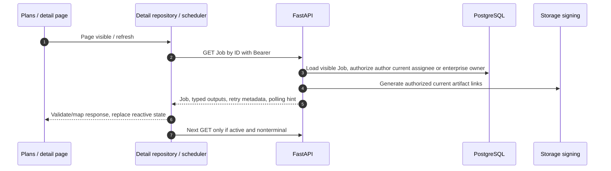
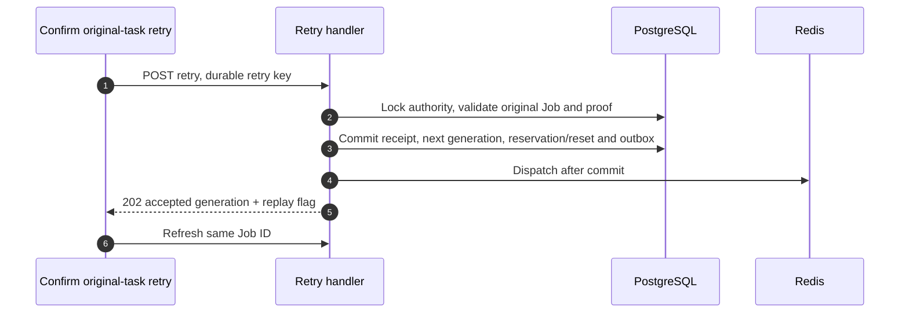

# History, polling, retry, move and deletion

A task outlives the form that submitted it. This chapter follows the read/action APIs from “My plans” and result pages into SQL authorization and durable state. For creation and worker execution, first read [the lifecycle](/reference/flows/design-job-lifecycle).

## One detail refresh, end to end {#detail-chain}

| Message | Code | What the reader should find |
| --- | --- | --- |
| 1 | [src/services/pollScheduler.ts → createPollScheduler](https://github.com/Orientation-CD/wechat_mini_program/blob/88c75c1f15cd65f45c7fb09d560df80430ddc198/src/services/pollScheduler.ts#L33) | Visibility, one in-flight poll, timer and generation guards |
| 2 | [src/repositories/designJobDetail.ts → designJobRepository](https://github.com/Orientation-CD/wechat_mini_program/blob/88c75c1f15cd65f45c7fb09d560df80430ddc198/src/repositories/designJobDetail.ts#L196) | Canonical/compatibility path flag and typed mapping |
| 3 | [_get_design_job_response](https://github.com/Orientation-CD/YuanZhu-AI/blob/749e82df3a51c441335ba6a4db607a98bacbcf97/app/workflows/api.py#L1428) | Visible history and author/assignee/owner authorization; no provider call |
| 4–5 | [app/workflows/api.py → job_response](https://github.com/Orientation-CD/YuanZhu-AI/blob/749e82df3a51c441335ba6a4db607a98bacbcf97/app/workflows/api.py#L810) | Read outputs, generate fresh URLs, expose retry eligibility and `poll_after_seconds` |
| 6–7 | `mapDesignJobDetail` in the repository and the scheduler | Stale responses are discarded; terminal results stop scheduling |

The current backend uses `readable_design_job`: an active original author, a current enterprise owner, or the current project assignee with active enterprise membership may read a visible task by ID. Original authors can retain history after handoff or departure without retaining project navigation or new-action authority. `_get_design_job_response` deliberately uses `expose_private_inputs=True` for authorized by-ID detail, so an owner/assignee can read input Assets; collection projections hide other authors' `inputs`. The response retains real `submitted_by`, adds current `project_assignee` and `permissions`, then `finalize_workflow_reads` rechecks scalar SQL after signing. Reading inputs grants no right to reuse them in a new paid request, continue editing, retry, move or delete someone else's Job. Frontend `readOwnerListJob` still retains a selected-workspace fallback for a specific 404. Its existence no longer means all by-ID reads on current main are creator-only. Do not suppress arbitrary errors or switch workspaces silently.

## List and read endpoints

### Canonical history collection {#list-workflows}

`GET /v1/workflows` is called by [src/repositories/designJobs.ts → personalDesignJobRepository](https://github.com/Orientation-CD/wechat_mini_program/blob/88c75c1f15cd65f45c7fb09d560df80430ddc198/src/repositories/designJobs.ts#L490) from plan/history screens. [app/workflows/api.py → list_design_jobs](https://github.com/Orientation-CD/YuanZhu-AI/blob/749e82df3a51c441335ba6a4db607a98bacbcf97/app/workflows/api.py#L1497) uses `creator_root_history()` and, when no project is supplied, restricts `DesignJob.user_id` to the caller. With a readable `project_id`, it returns that project's root jobs including previous authors, then applies optional workspace, name `q` and status filters. It counts, paginates, loads relationship/output metadata and calls `job_response` per item. A specified Project must satisfy current `readable_project` responsibility/owner rules, be active, and agree with any workspace filter. Non-author rows hide private inputs in this collection; by-ID detail uses its separate input projection. This query does not launch workers or call models. The client merges pages by stable Job ID and invalidates project counts after writes.

### Compatibility personal collection {#list-compatibility}

`GET /v1/design-jobs` binds the same `list_design_jobs` handler and filters as above. It is a deprecated alias, useful when tracing older callers; the current `personalDesignJobRepository.list` uses `/v1/workflows`. The alias is not a separate history table and does not reveal extra jobs.

### Canonical detail/polling {#get-workflow}

`GET /v1/workflows/{workflow_id}` enters `get_workflow` → [_get_design_job_response](https://github.com/Orientation-CD/YuanZhu-AI/blob/749e82df3a51c441335ba6a4db607a98bacbcf97/app/workflows/api.py#L1428). `workflow_id` is the public `design_jobs.id`. The loader filters visible history with `readable_design_job`, allowing the original author, current project assignee with membership, or active enterprise owner; missing, hidden and inaccessible rows return `404 DESIGN_JOB_NOT_FOUND`. It loads report retry dependencies and thumbnails, projects through [job_response](https://github.com/Orientation-CD/YuanZhu-AI/blob/749e82df3a51c441335ba6a4db607a98bacbcf97/app/workflows/api.py#L810), preserves the actual `submitted_by`, and intentionally exposes input Assets to authorized detail readers (`expose_private_inputs=True`). `finalize_workflow_reads` then verifies access again and computes current assignee/action permissions; deletion-pending detail is redacted as described below. `Retry-After`/`poll_after_seconds` and newly signed URLs guide the client. GET neither generates/settles again nor grants write permission.

### Compatibility detail {#get-compatibility}

`GET /v1/design-jobs/{design_job_id}` enters `get_design_job` and the same `_get_design_job_response`. Image/audio/video detail callers can select this route through [src/repositories/designJobDetail.ts → designJobRepository](https://github.com/Orientation-CD/wechat_mini_program/blob/88c75c1f15cd65f45c7fb09d560df80430ddc198/src/repositories/designJobDetail.ts#L196). It has the same author/assignee/owner visibility, authorized input-detail projection and final permission checks. Changing the identifier's variable name in the URL does not change the Job identity.

### Selected-workspace owner collection {#list-owner-workflows}

`GET /v1/workspace/workflows` enters [app/workflows/api.py → list_workspace_design_jobs](https://github.com/Orientation-CD/YuanZhu-AI/blob/749e82df3a51c441335ba6a4db607a98bacbcf97/app/workflows/api.py#L1591). `workspace_id` is required; it must have an active membership with `OWNER` role, otherwise `403 WORKSPACE_OWNER_REQUIRED`. SQL restricts the workspace, visible project lifecycle and root jobs; an optional Project must be an active ordinary Project in that workspace. Serialization uses the original submitter and hides private inputs when the caller is not the creator (`expose_private_inputs=False`). This owner collection is different from listing private Projects. Current owner fallback code still uses its compatibility alias below; new integrations can use this canonical path.

### Compatibility owner collection {#list-owner-compatibility}

`GET /v1/workspace/design-jobs` binds the same `list_workspace_design_jobs`. [src/repositories/designJobDetail.ts → readOwnerListJob](https://github.com/Orientation-CD/wechat_mini_program/blob/88c75c1f15cd65f45c7fb09d560df80430ddc198/src/repositories/designJobDetail.ts#L156) explicitly sends `workspace_id` and, when enabled, the member Project scope. It scans bounded pages, validates each result against the selected member/workspace/project, and fails closed when context changes. It never guesses a global “current enterprise”.

### Read authority and action hints

| Context | Input projection | New action authority |
| --- | --- | --- |
| Original-author history without project filter | Author's own inputs unless deleting | Each action checks present responsibility and its own membership/lifecycle rules |
| Readable project collection / owner collection | Other authors' inputs withheld | Collection visibility does not grant mutations |
| Authorized by-ID detail for author, current assignee or owner | Input Assets exposed unless deleting | Server `permissions` remain decisive; input access is not source-reuse permission |
| Original author after handoff | Historical task remains readable where its workspace/project lifecycle permits | `PROJECT_NOT_ASSIGNEE` blocks new author actions; project navigation may be unavailable |

`finalize_workflow_reads` uses fresh SQL after signing and sets can_open_project, can_move, can_delete, can_retry and can_continue_editing from author identity, current assignee, active scope, terminal/deletion state and retry proof. New move/retry/continue generally require the author to remain responsible and active in the scope. Delete's new-claim responsibility check intentionally does not require membership for retained author history; already claimed cleanup is another case. The frontend combines those hints with fresh profile/workspace membership and session guards, never treats an owner badge as write authority, and can be stricter than the server's retained-history cleanup rule.

Sources: [finalize_workflow_reads](https://github.com/Orientation-CD/YuanZhu-AI/blob/749e82df3a51c441335ba6a4db607a98bacbcf97/app/workflows/read_access.py#L117) · [require_job_assignee](https://github.com/Orientation-CD/YuanZhu-AI/blob/749e82df3a51c441335ba6a4db607a98bacbcf97/app/workspaces/project_jobs.py#L155) · [canReadJob](https://github.com/Orientation-CD/wechat_mini_program/blob/88c75c1f15cd65f45c7fb09d560df80430ddc198/src/services/jobReadAccess.ts#L7) · [canWriteJob](https://github.com/Orientation-CD/wechat_mini_program/blob/88c75c1f15cd65f45c7fb09d560df80430ddc198/src/services/jobWriteAccess.ts#L47).

## Explicit retry is a durable action {#retry-workflow}

`POST /v1/workflows/{design_job_id}/retry` is selected for report/copywriting by [src/services/jobRetry.ts → retryDesignJob](https://github.com/Orientation-CD/wechat_mini_program/blob/88c75c1f15cd65f45c7fb09d560df80430ddc198/src/services/jobRetry.ts#L47). “Retry original task” first refreshes status/write permission and uses a persistent key scoped to Job ID and expected retry count. The route [app/workflows/api.py → retry_failed_design_job](https://github.com/Orientation-CD/YuanZhu-AI/blob/749e82df3a51c441335ba6a4db607a98bacbcf97/app/workflows/api.py#L1264) calls [app/workflows/submissions/workflow_submission_retry.py → retry_workflow_job](https://github.com/Orientation-CD/YuanZhu-AI/blob/749e82df3a51c441335ba6a4db607a98bacbcf97/app/workflows/submissions/workflow_submission_retry.py#L187), then best-effort dispatches committed outbox and returns **202** with `accepted_retry_generation` and `retry_replayed` plus the current Job representation.

The controller locks admission/product/aggregate authority, checks the original creator and current project assignee for a new retry, unchanged execution/commercial evidence, deletion/admin-failure/uncertain-provider conditions and configured retry limit. A child belonging to a parent report requires parent retry (`WORKFLOW_PARENT_RETRY_REQUIRED`). Acceptance persists `design_job_retry_requests`, advances the generation and schedules eligible reset children without creating a new public Job. The original frozen price and server billing rules govern a new reservation; the client must not compute a new node price or manually release the old reservation.

| Message | Code |
| --- | --- |
| 1 and 5–6 | [src/services/jobRetry.ts → retryDesignJob](https://github.com/Orientation-CD/wechat_mini_program/blob/88c75c1f15cd65f45c7fb09d560df80430ddc198/src/services/jobRetry.ts#L47) |
| 2–3 | [app/workflows/submissions/workflow_submission_retry.py → retry_workflow_job](https://github.com/Orientation-CD/YuanZhu-AI/blob/749e82df3a51c441335ba6a4db607a98bacbcf97/app/workflows/submissions/workflow_submission_retry.py#L187) |
| 4 | `dispatch_workflow_submission_outbox` called by [app/workflows/api.py → retry_failed_design_job](https://github.com/Orientation-CD/YuanZhu-AI/blob/749e82df3a51c441335ba6a4db607a98bacbcf97/app/workflows/api.py#L1264) |

If the response is lost, keep the retry key. The durable receipt distinguishes replay from a second attempt, even if the Job advanced meanwhile. A matching accepted retry receipt is checked before new assignee eligibility and creates no new effects; billing-account access is still checked. If `retry_block_code` requests reconciliation, repeatedly pressing the button cannot prove a paid POST absent. The [bounded UNKNOWN recovery](/backend/workflows#unknown-recovery) performs read-only confirmations and never re-POSTs an uncertain paid request. Not every result page's “return and resubmit” button is same-ID retry: the dedicated history action and receipt are the evidence.

### Retry and member quota

Explicit retry reserves the frozen price for a new generation; enterprise funds are checked before the member cap. A new reservation uses the current Beijing month, a released generation counts zero, and cross-month settlement remains in its original reservation month. Reducing a cap does not cancel accepted work; exact idempotent replay does not reserve again. See [quota accounting](/reference/flows/member-quota-flow).

### Compatibility retry {#retry-compatibility}

`POST /v1/design-jobs/{design_job_id}/retry` uses `retry_failed_design_job` too. [src/services/jobRetry.ts → retryDesignJob](https://github.com/Orientation-CD/wechat_mini_program/blob/88c75c1f15cd65f45c7fb09d560df80430ddc198/src/services/jobRetry.ts#L47) selects it for supported non-report/non-copywriting products. It is the same receipt/generation mechanism, not a client rebuild of the form. Key, permission and ambiguous-effect checks are identical.

## Move a terminal Job {#move-workflow}

`POST /v1/workflows/{design_job_id}/move` enters [app/workflows/api.py → move_design_job_route](https://github.com/Orientation-CD/YuanZhu-AI/blob/749e82df3a51c441335ba6a4db607a98bacbcf97/app/workflows/api.py#L1574) → [app/workspaces/project_jobs.py → move_design_job](https://github.com/Orientation-CD/YuanZhu-AI/blob/749e82df3a51c441335ba6a4db607a98bacbcf97/app/workspaces/project_jobs.py#L185). Body fields `expected_source_project_id` and `target_project_id` provide an optimistic concurrency check. The service locks the creator-owned Job, revalidates current workspace access, requires terminal status and no deletion in progress, then locks source/target Projects in stable order. Both Projects must be active, assigned to this original author and in the same workspace; source responsibility mismatch is `PROJECT_NOT_ASSIGNEE`. It updates `job.project_id`, stamps root project activity and commits; response contains the actual Job ID/project ID. Before taking the ordinary Job lock, `group_job_association` detects a linked floor-plan Group and delegates to `move_group`: the Work and all associated executions move together. This prevents one result from breaking Group/project consistency. Neither branch copies output bytes, charges again or moves across workspaces. A stale source returns `409 PROJECT_SOURCE_STALE`; refresh rather than overwrite a newer move.

### Compatibility move used by the UI {#move-compatibility}

`POST /v1/design-jobs/{design_job_id}/move` reaches the same `move_design_job_route`. [src/repositories/projectContext.ts → projectContextRepository](https://github.com/Orientation-CD/wechat_mini_program/blob/88c75c1f15cd65f45c7fb09d560df80430ddc198/src/repositories/projectContext.ts#L203) currently posts this alias from the plans move action, with the selected source/target and session/scope guards. On success it invalidates source/target counts; on stale scope it refuses to apply the late response. The canonical route currently has no distinct frontend call site.

## Delete a terminal Job {#delete-workflow}

`DELETE /v1/workflows/{design_job_id}` reaches [app/workflows/api.py → delete_design_job](https://github.com/Orientation-CD/YuanZhu-AI/blob/749e82df3a51c441335ba6a4db607a98bacbcf97/app/workflows/api.py#L1328) → [app/workflows/design_job.py → delete_terminal_design_job](https://github.com/Orientation-CD/YuanZhu-AI/blob/749e82df3a51c441335ba6a4db607a98bacbcf97/app/workflows/design_job.py#L487). Current `personalDesignJobRepository.remove` selects it for copywriting; other product deletion uses the alias. Only the original author can request deletion, and a new claim additionally requires current project responsibility through `require_job_assignee`. An already durable claim continues its owned cleanup without treating later assignment as cancellation. The service refuses active jobs and referenced outputs, claims deletion, removes exact storage versions and cleans linked SQL state under guarded recovery. It can return `409 DESIGN_JOB_ACTIVE`, `DESIGN_JOB_REFERENCED`, `ASSET_STATE_CONFLICT` or `503 DESIGN_JOB_CLEANUP_UNAVAILABLE` with retry hints. **204** confirms this endpoint's successful deletion, not permission to delete arbitrary Assets.

### Compatibility deletion {#delete-compatibility}

`DELETE /v1/design-jobs/{design_job_id}` binds the same `delete_design_job`. [src/services/jobDeletion.ts → deleteJobWithConflictRetry](https://github.com/Orientation-CD/wechat_mini_program/blob/88c75c1f15cd65f45c7fb09d560df80430ddc198/src/services/jobDeletion.ts#L9) bounds conflict retry and verifies context; [src/repositories/designJobs.ts → personalDesignJobRepository](https://github.com/Orientation-CD/wechat_mini_program/blob/88c75c1f15cd65f45c7fb09d560df80430ddc198/src/repositories/designJobs.ts#L490) invalidates project counts around the call. Do not hide a failed deletion permanently in the UI or edit SQL rows to skip object cleanup. The shared deleting placeholder below preserves the unfinished cleanup across list/detail refreshes. A linked report/source reference may require a deliberate upstream action before deletion can proceed.

### A deleting item is a separate UI state

`job_response` sets `deletion_pending` when either durable deletion timestamp exists. It emits no private inputs, typed outputs, image/video/report/markdown result or new result projection for that item. The original terminal status may remain completed/failed; neither status proves the media is still usable.

The frontend's `mapDeletionPending` accepts this exceptional empty-media shape only for terminal jobs and rejects contradictory nonempty media. `observeJobDeletion`, `redactDeletingJob` and `assertJobResultAvailable` share a session-local map between list/detail pages. A `503 DESIGN_JOB_CLEANUP_UNAVAILABLE` sets pending and a Retry-After cooldown (default five seconds, capped at sixty), keeps a visible deletion placeholder and permits explicit cleanup retry. 204 marks completion. A later 404 is evidence of completion only when there was a known pending deletion, the session/scope is still current, and a fresh profile confirms the original author; another reader's access loss is not deletion proof. Session changes clear this memory map. This state does not bypass the original author's server authority or replay a supplier write.

Sources: [job_response](https://github.com/Orientation-CD/YuanZhu-AI/blob/749e82df3a51c441335ba6a4db607a98bacbcf97/app/workflows/api.py#L810) · [delete_terminal_design_job](https://github.com/Orientation-CD/YuanZhu-AI/blob/749e82df3a51c441335ba6a4db607a98bacbcf97/app/workflows/design_job.py#L487) · [mapDeletionPending](https://github.com/Orientation-CD/wechat_mini_program/blob/88c75c1f15cd65f45c7fb09d560df80430ddc198/src/services/jobDeletionState.ts#L75) · [withJobDeletion](https://github.com/Orientation-CD/wechat_mini_program/blob/88c75c1f15cd65f45c7fb09d560df80430ddc198/src/services/jobDeletionState.ts#L52) · [designJobRepository](https://github.com/Orientation-CD/wechat_mini_program/blob/88c75c1f15cd65f45c7fb09d560df80430ddc198/src/repositories/designJobDetail.ts#L196).

## Download authenticated media {#result-workflow}

`GET /v1/workflows/{design_job_id}/result-file` enters [app/workflows/api.py → download_design_result](https://github.com/Orientation-CD/YuanZhu-AI/blob/749e82df3a51c441335ba6a4db607a98bacbcf97/app/workflows/api.py#L1674). It loads a visible completed Job/media Asset; uses `readable_design_job` for the original author, current project assignee or active enterprise owner; requires object version and ETag. When storage can sign a download, the API returns **307** to that exact object version with private caching/ETag. Before returning a signed redirect or stream, `require_design_job_read_access` rechecks authority after storage work. Otherwise it streams bytes through the backend. A missing/incomplete/inaccessible result returns a non-disclosing 404. No generation or worker enqueue occurs.

### Compatibility media download used by the resolver {#result-compatibility}

`GET /v1/design-jobs/{design_job_id}/result-file` is the same `download_design_result`. The result resolver accepts this exact authenticated API path on the configured API origin and [src/repositories/resultFile.ts → materializeResultFile](https://github.com/Orientation-CD/wechat_mini_program/blob/88c75c1f15cd65f45c7fb09d560df80430ddc198/src/repositories/resultFile.ts#L124) adds Bearer when downloading. Signed storage URLs take a different branch with allowed-origin and expiry checks. The canonical download is available to API clients but the resolver's authenticated fallback is currently this alias. Do not append API credentials to signed object URLs. HTML/PPTX viewing has a different short-lived query-token boundary, explained in [report publication](/reference/flows/report-view-flow).

## Trace it without creating another paid task {#exercise}

In the local environment, open one existing terminal task and record list GET, detail GET and output URL separately. Pause the page: `createPollScheduler` must stop starting requests. Reopen it and explain which URL is refreshed. Read retry code and distinguish its durable receipt from a new create POST; do not click a paid retry to learn that. For a local owned terminal task, inspect the expected source/target payload in the move code and the server's stale-source branch. Explain why an enterprise owner or current assignee can read authorized input/output detail but cannot mutate another author's Job, and why an original author after handoff may retain history without current project access.
