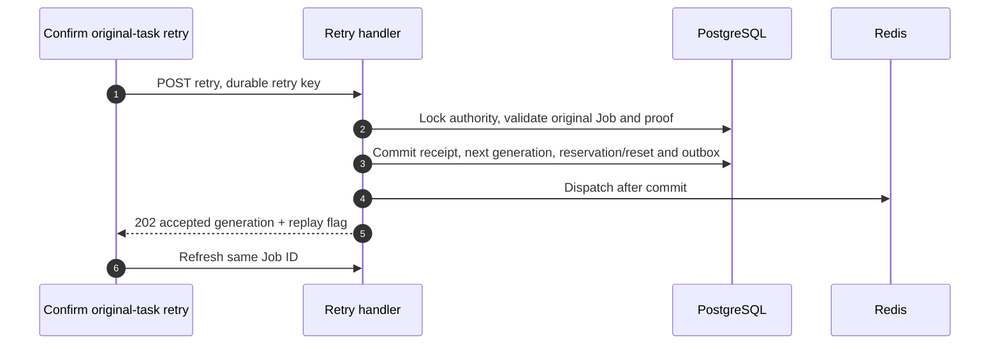

# History, polling, retry, move and deletion

A task outlives the form that submitted it. This chapter follows the read/action APIs from “My plans” and result pages into SQL authorization and durable state. For creation and worker execution, first read [the lifecycle](/reference/flows/design-job-lifecycle).

## One detail refresh, end to end {#detail-chain}

```mermaid
sequenceDiagram
  autonumber
  participant P as Plans / detail page
  participant R as Detail repository / scheduler
  participant A as FastAPI
  participant DB as PostgreSQL
  participant O as Storage signing
  P->>R: Page visible / refresh
  R->>A: GET Job by ID with Bearer
  A->>DB: Load visible Job; authorize creator or current enterprise owner
  A->>O: Generate authorized current artifact links
  A-->>R: Job, typed outputs, retry metadata, polling hint
  R-->>P: Validate/map response, replace reactive state
  R->>A: Next GET only if active and nonterminal
```

| Message | Code | What the reader should find |
| --- | --- | --- |
| 1 | [src/services/pollScheduler.ts → createPollScheduler](https://github.com/Orientation-CD/wechat_mini_program/blob/21db6d824a7b32417bda88e7e31d3f0b91dfa51c/src/services/pollScheduler.ts#L33) | Visibility, one in-flight poll, timer and generation guards |
| 2 | [src/repositories/designJobDetail.ts → designJobRepository](https://github.com/Orientation-CD/wechat_mini_program/blob/21db6d824a7b32417bda88e7e31d3f0b91dfa51c/src/repositories/designJobDetail.ts#L189) | Canonical/compatibility path flag and typed mapping |
| 3 | [_get_design_job_response](https://github.com/Orientation-CD/YuanZhu-AI/blob/e59716c83e087deda8477da5ea7b327a40cf65c5/app/workflows/api.py#L1320) | Visible history and creator/current-owner authorization; no provider call |
| 4–5 | [app/workflows/api.py → job_response](https://github.com/Orientation-CD/YuanZhu-AI/blob/e59716c83e087deda8477da5ea7b327a40cf65c5/app/workflows/api.py#L760) | Read outputs, generate fresh URLs, expose retry eligibility and `poll_after_seconds` |
| 6–7 | `mapDesignJobDetail` in the repository and the scheduler | Stale responses are discarded; terminal results stop scheduling |

The current backend allows the creator or the current owner of the active enterprise to read a visible task by ID. Shared `_get_design_job_response` rechecks active membership. Owner-other detail retains the real submitter and returns `inputs: []`; it grants no retry, move, deletion or source-copy rights. Frontend `readOwnerListJob` still retains a selected-workspace fallback for a specific 404. Its existence no longer means all by-ID reads on current main are creator-only. Do not suppress arbitrary errors or switch workspaces silently.

## List and read endpoints

### Personal canonical collection {#list-workflows}

`GET /v1/workflows` is called by [src/repositories/designJobs.ts → personalDesignJobRepository](https://github.com/Orientation-CD/wechat_mini_program/blob/21db6d824a7b32417bda88e7e31d3f0b91dfa51c/src/repositories/designJobs.ts#L468) from plan/history screens. [app/workflows/api.py → list_design_jobs](https://github.com/Orientation-CD/YuanZhu-AI/blob/e59716c83e087deda8477da5ea7b327a40cf65c5/app/workflows/api.py#L1391) filters `DesignJob.user_id` to the caller and `creator_root_history()`, then optional workspace/project, name `q` and status. It counts, paginates, loads relationship/output metadata and calls `job_response` per item. A specified Project must belong to the caller and be active, and its workspace must agree with any workspace filter. This query does not launch workers or call models. The client merges pages by stable Job ID and invalidates project counts after writes.

### Compatibility personal collection {#list-compatibility}

`GET /v1/design-jobs` binds the same `list_design_jobs` handler and filters as above. It is a deprecated alias, useful when tracing older callers; the current `personalDesignJobRepository.list` uses `/v1/workflows`. The alias is not a separate history table and does not reveal extra jobs.

### Canonical detail/polling {#get-workflow}

`GET /v1/workflows/{workflow_id}` enters `get_workflow` → [_get_design_job_response](https://github.com/Orientation-CD/YuanZhu-AI/blob/e59716c83e087deda8477da5ea7b327a40cf65c5/app/workflows/api.py#L1320). `workflow_id` is the public `design_jobs.id`. The loader filters visible history and authorizes the creator or current owner of the active enterprise; missing, hidden and inaccessible rows return `404 DESIGN_JOB_NOT_FOUND`. It loads report retry dependencies and thumbnails, projects through [job_response](https://github.com/Orientation-CD/YuanZhu-AI/blob/e59716c83e087deda8477da5ea7b327a40cf65c5/app/workflows/api.py#L760), preserves the actual `submitted_by`, and returns `inputs: []` for owner-other reads. `Retry-After`/`poll_after_seconds` and newly signed URLs guide the client. GET neither generates/settles again nor grants write permission.

### Compatibility detail {#get-compatibility}

`GET /v1/design-jobs/{design_job_id}` enters `get_design_job` and the same `_get_design_job_response`. Image/audio/video detail callers can select this route through [src/repositories/designJobDetail.ts → designJobRepository](https://github.com/Orientation-CD/wechat_mini_program/blob/21db6d824a7b32417bda88e7e31d3f0b91dfa51c/src/repositories/designJobDetail.ts#L189). It has the same creator/owner visibility and output projection rules. Changing the identifier's variable name in the URL does not change the Job identity.

### Selected-workspace owner collection {#list-owner-workflows}

`GET /v1/workspace/workflows` enters [app/workflows/api.py → list_workspace_design_jobs](https://github.com/Orientation-CD/YuanZhu-AI/blob/e59716c83e087deda8477da5ea7b327a40cf65c5/app/workflows/api.py#L1481). `workspace_id` is required; it must have an active membership with `OWNER` role, otherwise `403 WORKSPACE_OWNER_REQUIRED`. SQL restricts the workspace, visible project lifecycle and root jobs; an optional Project must be an active ordinary Project in that workspace. Serialization uses the original submitter and hides private inputs when the caller is not the creator (`expose_private_inputs=False`). This owner collection is different from listing private Projects. Current owner fallback code still uses its compatibility alias below; new integrations can use this canonical path.

### Compatibility owner collection {#list-owner-compatibility}

`GET /v1/workspace/design-jobs` binds the same `list_workspace_design_jobs`. [src/repositories/designJobDetail.ts → readOwnerListJob](https://github.com/Orientation-CD/wechat_mini_program/blob/21db6d824a7b32417bda88e7e31d3f0b91dfa51c/src/repositories/designJobDetail.ts#L149) explicitly sends `workspace_id` and, when enabled, the member Project scope. It scans bounded pages, validates each result against the selected member/workspace/project, and fails closed when context changes. It never guesses a global “current enterprise”.

## Explicit retry is a durable action {#retry-workflow}

`POST /v1/workflows/{design_job_id}/retry` is selected for report/copywriting by [src/services/jobRetry.ts → retryDesignJob](https://github.com/Orientation-CD/wechat_mini_program/blob/21db6d824a7b32417bda88e7e31d3f0b91dfa51c/src/services/jobRetry.ts#L45). “Retry original task” first refreshes status/write permission and uses a persistent key scoped to Job ID and expected retry count. The route [app/workflows/api.py → retry_failed_design_job](https://github.com/Orientation-CD/YuanZhu-AI/blob/e59716c83e087deda8477da5ea7b327a40cf65c5/app/workflows/api.py#L1159) calls [app/workflows/submissions/workflow_submission_retry.py → retry_workflow_job](https://github.com/Orientation-CD/YuanZhu-AI/blob/e59716c83e087deda8477da5ea7b327a40cf65c5/app/workflows/submissions/workflow_submission_retry.py#L185), then best-effort dispatches committed outbox and returns **202** with `accepted_retry_generation` and `retry_replayed` plus the current Job representation.

The controller locks admission/product/aggregate authority, checks the original creator, unchanged execution/commercial evidence, deletion/admin-failure/uncertain-provider conditions and configured retry limit. A child belonging to a parent report requires parent retry (`WORKFLOW_PARENT_RETRY_REQUIRED`). Acceptance persists `design_job_retry_requests`, advances the generation and schedules eligible reset children without creating a new public Job. The original frozen price and server billing rules govern a new reservation; the client must not compute a new node price or manually release the old reservation.



| Message | Code |
| --- | --- |
| 1 and 5–6 | [src/services/jobRetry.ts → retryDesignJob](https://github.com/Orientation-CD/wechat_mini_program/blob/21db6d824a7b32417bda88e7e31d3f0b91dfa51c/src/services/jobRetry.ts#L45) |
| 2–3 | [app/workflows/submissions/workflow_submission_retry.py → retry_workflow_job](https://github.com/Orientation-CD/YuanZhu-AI/blob/e59716c83e087deda8477da5ea7b327a40cf65c5/app/workflows/submissions/workflow_submission_retry.py#L185) |
| 4 | `dispatch_workflow_submission_outbox` called by [app/workflows/api.py → retry_failed_design_job](https://github.com/Orientation-CD/YuanZhu-AI/blob/e59716c83e087deda8477da5ea7b327a40cf65c5/app/workflows/api.py#L1159) |

If the response is lost, keep the retry key. The durable receipt distinguishes replay from a second attempt, even if the Job advanced meanwhile. If `retry_block_code` requests reconciliation, repeatedly pressing the button cannot prove a paid POST absent. Not every result page's “return and resubmit” button is same-ID retry: the dedicated history action and receipt are the evidence.

### Retry and member quota

Explicit retry reserves the frozen price for a new generation; enterprise funds are checked before the member cap. A new reservation uses the current Beijing month, a released generation counts zero, and cross-month settlement remains in its original reservation month. Reducing a cap does not cancel accepted work; exact idempotent replay does not reserve again. See [quota accounting](/reference/flows/member-quota-flow).

### Compatibility retry {#retry-compatibility}

`POST /v1/design-jobs/{design_job_id}/retry` uses `retry_failed_design_job` too. [src/services/jobRetry.ts → retryDesignJob](https://github.com/Orientation-CD/wechat_mini_program/blob/21db6d824a7b32417bda88e7e31d3f0b91dfa51c/src/services/jobRetry.ts#L45) selects it for supported non-report/non-copywriting products. It is the same receipt/generation mechanism, not a client rebuild of the form. Key, permission and ambiguous-effect checks are identical.

## Move a terminal Job {#move-workflow}

`POST /v1/workflows/{design_job_id}/move` enters [app/workflows/api.py → move_design_job_route](https://github.com/Orientation-CD/YuanZhu-AI/blob/e59716c83e087deda8477da5ea7b327a40cf65c5/app/workflows/api.py#L1464) → [app/workspaces/project_jobs.py → move_design_job](https://github.com/Orientation-CD/YuanZhu-AI/blob/e59716c83e087deda8477da5ea7b327a40cf65c5/app/workspaces/project_jobs.py#L77). Body fields `expected_source_project_id` and `target_project_id` provide an optimistic concurrency check. The service locks the creator-owned Job, revalidates current workspace access, requires terminal status and no deletion in progress, then locks source/target Projects in stable order. Both Projects must be active, owned by this creator and in the same workspace. It updates `job.project_id`, stamps root project activity and commits; response contains the actual Job ID/project ID. It does not copy output bytes, charge again or move work across workspaces. A stale source returns `409 PROJECT_SOURCE_STALE`; refresh rather than overwrite a newer move.

### Compatibility move used by the UI {#move-compatibility}

`POST /v1/design-jobs/{design_job_id}/move` reaches the same `move_design_job_route`. [src/repositories/projectContext.ts → projectContextRepository](https://github.com/Orientation-CD/wechat_mini_program/blob/21db6d824a7b32417bda88e7e31d3f0b91dfa51c/src/repositories/projectContext.ts#L181) currently posts this alias from the plans move action, with the selected source/target and session/scope guards. On success it invalidates source/target counts; on stale scope it refuses to apply the late response. The canonical route currently has no distinct frontend call site.

## Delete a terminal Job {#delete-workflow}

`DELETE /v1/workflows/{design_job_id}` reaches [app/workflows/api.py → delete_design_job](https://github.com/Orientation-CD/YuanZhu-AI/blob/e59716c83e087deda8477da5ea7b327a40cf65c5/app/workflows/api.py#L1220) → [app/workflows/design_job.py → delete_terminal_design_job](https://github.com/Orientation-CD/YuanZhu-AI/blob/e59716c83e087deda8477da5ea7b327a40cf65c5/app/workflows/design_job.py#L165). Current `personalDesignJobRepository.remove` selects it for copywriting; other product deletion uses the alias. Only the creator-owned visible Job can be deleted. The service refuses active jobs and referenced outputs, claims deletion, removes exact storage versions and cleans linked SQL state under guarded recovery. It can return `409 DESIGN_JOB_ACTIVE`, `DESIGN_JOB_REFERENCED`, `ASSET_STATE_CONFLICT` or `503 DESIGN_JOB_CLEANUP_UNAVAILABLE` with retry hints. **204** confirms this endpoint's successful deletion, not permission to delete arbitrary Assets.

### Compatibility deletion {#delete-compatibility}

`DELETE /v1/design-jobs/{design_job_id}` binds the same `delete_design_job`. [src/services/jobDeletion.ts → deleteJobWithConflictRetry](https://github.com/Orientation-CD/wechat_mini_program/blob/21db6d824a7b32417bda88e7e31d3f0b91dfa51c/src/services/jobDeletion.ts#L9) bounds conflict retry and verifies context; [src/repositories/designJobs.ts → personalDesignJobRepository](https://github.com/Orientation-CD/wechat_mini_program/blob/21db6d824a7b32417bda88e7e31d3f0b91dfa51c/src/repositories/designJobs.ts#L468) invalidates project counts around the call. Do not hide a failed deletion permanently in the UI or edit SQL rows to skip object cleanup. A linked report/source reference may require a deliberate upstream action before deletion can proceed.

## Download authenticated media {#result-workflow}

`GET /v1/workflows/{design_job_id}/result-file` enters [app/workflows/api.py → download_design_result](https://github.com/Orientation-CD/YuanZhu-AI/blob/e59716c83e087deda8477da5ea7b327a40cf65c5/app/workflows/api.py#L1559). It loads a visible completed Job/media Asset; permits its creator or the active workspace owner; requires object version and ETag. When storage can sign a download, the API returns **307** to that exact object version with private caching/ETag. Otherwise it streams bytes through the backend. A missing/incomplete/inaccessible result returns a non-disclosing 404. No generation or worker enqueue occurs.

### Compatibility media download used by the resolver {#result-compatibility}

`GET /v1/design-jobs/{design_job_id}/result-file` is the same `download_design_result`. The result resolver accepts this exact authenticated API path on the configured API origin and [src/repositories/resultFile.ts → materializeResultFile](https://github.com/Orientation-CD/wechat_mini_program/blob/21db6d824a7b32417bda88e7e31d3f0b91dfa51c/src/repositories/resultFile.ts#L124) adds Bearer when downloading. Signed storage URLs take a different branch with allowed-origin and expiry checks. The canonical download is available to API clients but the resolver's authenticated fallback is currently this alias. Do not append API credentials to signed object URLs. HTML/PPTX viewing has a different short-lived query-token boundary, explained in [report publication](/reference/flows/report-view-flow).

## Trace it without creating another paid task {#exercise}

In the local environment, open one existing terminal task and record list GET, detail GET and output URL separately. Pause the page: `createPollScheduler` must stop starting requests. Reopen it and explain which URL is refreshed. Read retry code and distinguish its durable receipt from a new create POST; do not click a paid retry to learn that. For a local owned terminal task, inspect the expected source/target payload in the move code and the server's stale-source branch. Explain why an enterprise owner can read some outputs but cannot mutate another creator's Job.
