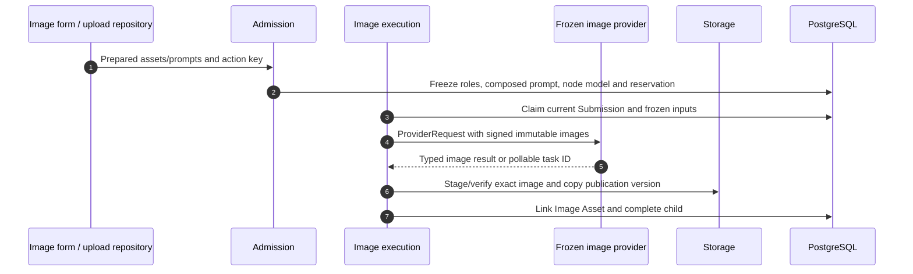
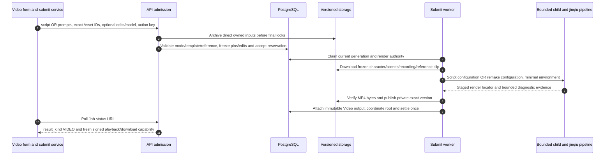

# Product-specific requests and model execution

The shared lifecycle explains persistence and settlement. This chapter answers the next source-reading question: after `type` is selected, which exact inputs, provider branch and output shape run? The same submit endpoint does not make all products interchangeable.

## The shipped frontend's actual route choices {#frontend-routing}

| Page / user action | Preparation and HTTP path | Server branch | Result |
| --- | --- | --- | --- |
| Image/custom-design form: submit | `submitDesignJob` → `postPrepared` → `/v1/design-jobs`; legacy ordered `assets` | Compatibility adapter normalizes required image roles, then image Workflow | Image Asset |
| Voice-summary form: submit recordings | Same compatibility path with ordered recording `assets` | Voice canonical request/admission, shared summary operation | Markdown + Document Asset |
| Eight copywriting forms: generate | `prepareCopywriting` → same repository, but `isCopywritingFeature` selects `/v1/workflows` | Text-only canonical request, shared summary operation | Markdown + Document Asset |
| Video form: generate | `submitVideoGeneration` → typed `inputs`, `script` or `prompts`, optional replacements/scope/model → `/v1/design-jobs` | Typed video admission and local video submission | MP4 Asset |
| Design-report form: submit | `prepareProjectWorkflow` / `postWorkflow` → `workflowsRepository.submit` → `/v1/workflows` | Blueprint-based report graph, included children and local export | HTML preview + PPTX |

Open [src/pkg-features/repositories/designJobSubmit.ts → postPrepared](https://github.com/Orientation-CD/wechat_mini_program/blob/21db6d824a7b32417bda88e7e31d3f0b91dfa51c/src/pkg-features/repositories/designJobSubmit.ts#L182) to see the actual path conditional. A new API client can submit supported typed image/voice/video bodies through `/v1/workflows`; changing a shipped form's path requires its corresponding body/mapper contract, not a documentation-only substitution. An `html_report` legacy branch still visible in old frontend helper code is not evidence that its retired server request is accepted.

Same-style video makes `script` and `prompts` exclusive and freezes reference media, edits and scope. All direct owned image/audio/video inputs now pass [durable archival](/reference/flows/asset-upload-flow#input-archive) before the final acceptance transaction freezes their canonical location. [Integration status](/reference/integration-status) records which shipped forms still select a compatibility adapter.

## Image and customized design {#image-branch}

[app/core/models.py → ImageWorkflowDesignJobCreate](https://github.com/Orientation-CD/YuanZhu-AI/blob/e59716c83e087deda8477da5ea7b327a40cf65c5/app/core/models.py#L694) requires 1–3 role-bearing inputs, one `primary`, at most one each `mask` and `reference`, with the actual inventory constrained by the chosen Feature/graph. Immutable upload roles must agree with these semantic roles. Customized design is an image branch; it does not authorize an arbitrary URL or a free-form provider endpoint.



| Message | Source and what it proves |
| --- | --- |
| 1–2 | [Admission](/reference/flows/design-job-lifecycle#submit-workflow): canonical vs supported legacy normalization happens before a supplier request |
| 3–5 | [app/workflows/operations/image/workflow_image_execution.py → dispatch_image_workflow_submission](https://github.com/Orientation-CD/YuanZhu-AI/blob/e59716c83e087deda8477da5ea7b327a40cf65c5/app/workflows/operations/image/workflow_image_execution.py#L1537) → [app/workflows/operations/image/workflow_image_execution.py → build_image_provider_request](https://github.com/Orientation-CD/YuanZhu-AI/blob/e59716c83e087deda8477da5ea7b327a40cf65c5/app/workflows/operations/image/workflow_image_execution.py#L223): load frozen pins, build instructions/image inputs and validate adapter capabilities |
| 6–7 | [app/workflows/operations/image/workflow_image_execution.py → _publish](https://github.com/Orientation-CD/YuanZhu-AI/blob/e59716c83e087deda8477da5ea7b327a40cf65c5/app/workflows/operations/image/workflow_image_execution.py#L1214): publication intent, lease, exact object version/hash, generation and authority are checked again before association |

A temporary supplier URL is transport evidence, not a permanent result. The executor materializes/verifies/stages it, then publishes an authorized own-storage Asset. A model returning a successful HTTP status with missing/wrong output cannot mark the Job completed. Provider adapters such as GPT image and Seedream implement their own request/response transport; the runtime consumes the typed image output rather than exposing those provider response shapes to the mini program.

## Ordered audio → a persisted Markdown result {#voice-branch}

[app/core/models.py → VoiceWorkflowDesignJobCreate](https://github.com/Orientation-CD/YuanZhu-AI/blob/e59716c83e087deda8477da5ea7b327a40cf65c5/app/core/models.py#L738) accepts **1–3 distinct recordings** under `port: "recordings", role: "recording"`; input order matters. The current frontend compatibility `assets` list is normalized to that order. Browser handoff only prepares the recordings; [its restricted session](/reference/flows/voice-upload-flow) does not itself create the paid summary.

1. Admission archives the completed owned recordings, then rechecks ownership/readiness/receipt proof, activates exclusive inputs and freezes ordered pins and summary instructions in final acceptance.
2. [app/workflows/submissions/workflow_provider_submission.py → dispatch_workflow_provider_submission](https://github.com/Orientation-CD/YuanZhu-AI/blob/e59716c83e087deda8477da5ea7b327a40cf65c5/app/workflows/submissions/workflow_provider_submission.py#L781) chooses the frozen adapter. [app/workflows/operations/summary/summary_execution.py → build_summary_provider_request](https://github.com/Orientation-CD/YuanZhu-AI/blob/e59716c83e087deda8477da5ea7b327a40cf65c5/app/workflows/operations/summary/summary_execution.py#L19) creates ordered `AudioInput` values and requests Markdown text. Capabilities must actually support audio; a text-only adapter is not sufficient.
3. Provider completion text is validated/restored under the same attempt, then [app/workflows/operations/markdown_output_assets.py → materialize_markdown_output](https://github.com/Orientation-CD/YuanZhu-AI/blob/e59716c83e087deda8477da5ea7b327a40cf65c5/app/workflows/operations/markdown_output_assets.py#L407) creates a private versioned Document output with content hash and durable Asset ID.
4. Coordinator/finalizer binds that output to the public Job and settles it. Root voice completion can advance Project status to requirements captured.
5. The Markdown result page reads typed output content and identity. An inline string is convenient for display but does not replace the Document required as a reusable report source.

A canonical body has this shape (replace both UUIDs with returned accessible IDs):

```json
{
  "workspace_id": "22222222-2222-2222-2222-222222222222",
  "type": "voice_summary",
  "name": "Local consultation summary",
  "inputs": [
    {"kind":"asset","port":"recordings","role":"recording","asset_id":"00000000-0000-0000-0000-000000000001"}
  ]
}
```

`workspace_id` identifies the billing/access context; `asset_id` is a completed audio upload, not a file path. Omitted `project_id` uses the server's caller-specific scratch Project. This example is for `/v1/workflows`; the compatibility UI body uses `assets` instead of `inputs`.

## Eight copywriting features share one text engine {#copywriting-branch}

| Feature key | User-facing purpose |
| --- | --- |
| `copywriting_short_video` | Short-video script |
| `copywriting_xiaohongshu` | Xiaohongshu copy |
| `copywriting_moments` | WeChat Moments copy |
| `copywriting_titles` | Title suggestions |
| `copywriting_shooting` | Shooting guidance |
| `copywriting_knowledge` | Knowledge content |
| `copywriting_pitfalls` | Pitfall content |
| `copywriting_operations_experience` | Operations experience |

Follow [src/pkg-features/services/copywritingSubmit.ts → prepareCopywriting](https://github.com/Orientation-CD/wechat_mini_program/blob/21db6d824a7b32417bda88e7e31d3f0b91dfa51c/src/pkg-features/services/copywritingSubmit.ts#L13) from the form's `submit`. It validates the selected feature's fields, loads profile/catalog/templates, checks current context/eligibility, normalizes fields, binds a Project when enabled and creates a persistent logical action key. `inputs` is an empty array: the user's text belongs in the named prompt fields, not fabricated Asset inputs. Exact template names/field names are configuration contracts.

[app/core/models.py → CopywritingWorkflowDesignJobCreate](https://github.com/Orientation-CD/YuanZhu-AI/blob/e59716c83e087deda8477da5ea7b327a40cf65c5/app/core/models.py#L776) rejects nonempty `inputs`. Admission composes configurable prompts and reads the workspace/feature knowledge material through [app/workflows/operations/summary/copywriting_kb.py → read_copywriting_kb](https://github.com/Orientation-CD/YuanZhu-AI/blob/e59716c83e087deda8477da5ea7b327a40cf65c5/app/workflows/operations/summary/copywriting_kb.py#L23). It snapshots the relevant knowledge text/configuration so a later object/config edit does not silently change the accepted execution. A malformed knowledge object fails as `COPYWRITING_KB_INVALID` before model dispatch.

The same summary operation builds a text-only `ProviderRequest`: configurable prompt/knowledge text becomes typed `TextInput`; system and negative instructions remain explicit. It then validates Markdown and materializes the same durable Document output as voice. Reusing the operation does not mean these eight Features share activation, prices, templates or knowledge configuration. Search by the exact feature key through frontend catalog, prompt selection and backend admission to see those differences.

## Video: script or same-style reference, then one local attempt {#video-branch}

The actual form is [src/pkg-features/pages/video_generation/index.vue → submit](https://github.com/Orientation-CD/wechat_mini_program/blob/21db6d824a7b32417bda88e7e31d3f0b91dfa51c/src/pkg-features/pages/video_generation/index.vue#L908). It defaults to same-style mode and offers system example, uploaded reference or script creation. [src/pkg-features/services/videoGenerationSubmit.ts → submitVideoGeneration](https://github.com/Orientation-CD/wechat_mini_program/blob/21db6d824a7b32417bda88e7e31d3f0b91dfa51c/src/pkg-features/services/videoGenerationSubmit.ts#L69) validates mode/edits/context, stages images/recording/custom Video, then `postPrepared` still sends the current video body to `/v1/design-jobs`. The typed canonical API also accepts `/v1/workflows`; shared admission is not proof the shipped UI changed URLs.

| Layer | Script path | Same-style path |
| --- | --- | --- |
| Current UI | Script1..1000 chars; exactly1scene image | System/custom source, salutation, required recording, scene image0..1 |
| Public API | Script≤20,000 chars, scenes0..12, recording0..1 | Exactly one prompts selection, no script, scene0..1, MP3>5s |
| Installed executor | Packaged script parser/media/model capabilities | Reference clip drives remake; scene omission can remove auto-extracted scenes |

All modes need one character sheet. Custom reference is a completed Video Asset<=100 MiB/120s. Both the UI and server reference clip byte limit are100×1024×1024 (104857600); server byte/content verification remains authoritative. [src/pkg-features/services/sameStyleVideo.ts → buildCustomReferenceSelection](https://github.com/Orientation-CD/wechat_mini_program/blob/21db6d824a7b32417bda88e7e31d3f0b91dfa51c/src/pkg-features/services/sameStyleVideo.ts#L69) submits `__user_reference__` plus the single field `称呼`; no backend template lookup or script pin is produced. System selection uses `buildSameStyleSelection`, filters `purpose=same_style_video`, and receives short-lived clip/poster preview URLs. Playback refreshes discovery after expiry and reserves nothing.



| Message | Open this code | Follow this data |
| --- | --- | --- |
|1|[src/pkg-features/services/videoGenerationSubmit.ts → submitVideoGeneration](https://github.com/Orientation-CD/wechat_mini_program/blob/21db6d824a7b32417bda88e7e31d3f0b91dfa51c/src/pkg-features/services/videoGenerationSubmit.ts#L69)|Preparation does not admit paid work; preserve logical key/draft across uncertainty.|
|2–3|[app/workflows/workflow_admission.py → admit_workflow_job](https://github.com/Orientation-CD/YuanZhu-AI/blob/e59716c83e087deda8477da5ea7b327a40cf65c5/app/workflows/workflow_admission.py#L2939), `_video_request_mode`, `_resolve_video_inputs`, `render_video_script`|Script/prompts exclusive; system template owns reference clip; custom requires caller reference; normalize roles/pins then atomic acceptance.|
|4–6|[app/workflows/submissions/workflow_local_video_submission.py → execute_local_video_submission](https://github.com/Orientation-CD/YuanZhu-AI/blob/e59716c83e087deda8477da5ea7b327a40cf65c5/app/workflows/submissions/workflow_local_video_submission.py#L1034) → [app/workflows/submissions/workflow_local_video_submission.py → _build_render_request](https://github.com/Orientation-CD/YuanZhu-AI/blob/e59716c83e087deda8477da5ea7b327a40cf65c5/app/workflows/submissions/workflow_local_video_submission.py#L552)|Lease/generation, exact downloads, frozen model/salutation/replacements/scope.|
|6|[app/conversion/video_jinqiu_adapter.py → build_config](https://github.com/Orientation-CD/YuanZhu-AI/blob/e59716c83e087deda8477da5ea7b327a40cf65c5/app/conversion/video_jinqiu_adapter.py#L224) → `_remake_config` or `_script_config`|Reference clip chooses remake and leaves script_path unset; custom has no fabricated script file.|
|7–9|[app/workflows/submissions/workflow_local_video_submission.py → attach_verified_video_output](https://github.com/Orientation-CD/YuanZhu-AI/blob/e59716c83e087deda8477da5ea7b327a40cf65c5/app/workflows/submissions/workflow_local_video_submission.py#L871)|Staging/publication and authority recheck before binding our own MP4 Asset.|
|10–11|[app/workflows/api.py → workflow_video_response](https://github.com/Orientation-CD/YuanZhu-AI/blob/e59716c83e087deda8477da5ea7b327a40cf65c5/app/workflows/api.py#L606) and `job_response`|Typed output points at own verified content, not a permanent supplier URL.|

Same-style top-level `replacements` freezes trimmed from/to pairs; `replace_scope` is all(default)/dialogue and requires pairs. Backend forwards them to shot planning without substituting itself. Default all preserves canonical fingerprint; dialogue changes identity. Structural blank pairs fail422; wrong body combination is `VIDEO_SCRIPT_CONFLICT`, missing body `VIDEO_SCRIPT_REQUIRED`, invalid selection `VIDEO_PROMPTS_INVALID`, invalid system definition `VIDEO_TEMPLATE_INVALID`, missing/wrong/oversized/long reference `VIDEO_REFERENCE_INVALID` with reason. A scene inventory>1 in prompts mode is `WORKFLOW_INPUT_INVALID/VIDEO_SCENE_COUNT`; missing/non-MP3/≤5s recording has its own reason.

Admin save can accept an empty same-style body while actual admission still validates `render_video_script`; save success is not usable-template proof. See [Prompts](/admin/prompts) and [integration status](/reference/integration-status) for this measured boundary.

“Local” means the worker owns orchestration, not that the pipeline cannot charge remote services. Failed rendering is terminal and never automatically purchased again. Recovering a staged download/upload differs from rerendering. Model activation, runtime media binaries and packaged private supplier revision remain [deployment](/deploy/local-stack) responsibilities; source tests do not prove deferred real-provider/long-duration scenarios.

## Reports combine these branches {#report-branch}

A report Blueprint can reference existing verified image/summary results, frozen gallery objects or included generated designs. Its graph then composes report HTML and exports PPTX. Do not send an HTML string or old `report_items` and assume it is the new contract. Follow [report composition and viewing](/reference/flows/report-view-flow) for parent/child dependencies, page plans, sanitization, conversion and signed access. Direct `design_report_pptx` create requests are currently rejected with `WORKFLOW_UNAVAILABLE`; HTML/PPTX outputs of the active report pipeline are the supported main path.

## Compare two products in the source {#exercise}

Choose voice and copywriting. Starting at their form handlers, identify the different body shapes and the shared summary operation. In the stored `operation_run_inputs`, distinguish ordered audio pins from text instructions/knowledge. Find the shared Document materialization and explain how a report can reuse it later. Then compare video: identify the OS process boundary and the point at which a recoverable download stops being permission to rerun the supplier. Use local mock providers; source reading does not require paid invocation.
