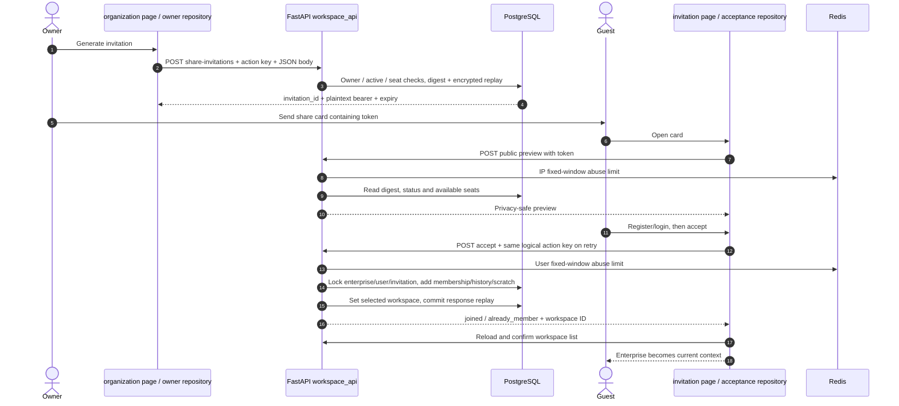

# Workspace membership: from a share card to an access check

This chapter traces the **access boundary**, not just the invitation URL. Start with “My / enterprise space → Generate invitation”, follow a recipient into the enterprise, then remove that member and observe what remains. A workspace selects the billing pool; a membership grants current access; a Project belongs to its creator inside that workspace. Those are three different database relationships.

Read the numbered diagram first. “HTTP” means one request from the mini program to FastAPI; `Depends` makes FastAPI obtain the authenticated user and database session before calling a handler. `flush()` sends changes into the current transaction; `commit()` makes them durable. A successful preview never creates a membership.



## Code map for the numbered journey

| Stops | Open these files | What to look for |
| --- | --- | --- |
| 1–4 | [`invite` · `src/pkg-account/pages/organization/index.vue:305`](https://github.com/Orientation-CD/wechat_mini_program/blob/21db6d824a7b32417bda88e7e31d3f0b91dfa51c/src/pkg-account/pages/organization/index.vue#L307) → [`shareInvitationOwnerRepository` · `src/pkg-account/repositories/shareInvitations.ts:70`](https://github.com/Orientation-CD/wechat_mini_program/blob/21db6d824a7b32417bda88e7e31d3f0b91dfa51c/src/pkg-account/repositories/shareInvitations.ts#L70) → [`create_share_invitation` · `app/workspaces/share_invitations.py:178`](https://github.com/Orientation-CD/YuanZhu-AI/blob/e59716c83e087deda8477da5ea7b327a40cf65c5/app/workspaces/share_invitations.py#L178) | The page retains one logical invitation identity; the repository supplies `Idempotency-Key`; the service stores a digest and encrypted exact replay. |
| 5–9 | [`accept` · `src/pkg-account/pages/invitation/index.vue:99`](https://github.com/Orientation-CD/wechat_mini_program/blob/21db6d824a7b32417bda88e7e31d3f0b91dfa51c/src/pkg-account/pages/invitation/index.vue#L101) → [`shareInvitationPreviewRepository` · `src/pkg-account/repositories/shareInvitationPreview.ts:70`](https://github.com/Orientation-CD/wechat_mini_program/blob/21db6d824a7b32417bda88e7e31d3f0b91dfa51c/src/pkg-account/repositories/shareInvitationPreview.ts#L70) → [`enforce_rate_limit` · `app/core/rate_limit.py:25`](https://github.com/Orientation-CD/YuanZhu-AI/blob/e59716c83e087deda8477da5ea7b327a40cf65c5/app/core/rate_limit.py#L25) | The card supplies a bearer, not an authenticated identity. Redis protects preview; the database still owns state. |
| 10–15 | [`shareInvitationAcceptanceRepository` · `src/pkg-account/repositories/shareInvitationAcceptance.ts:89`](https://github.com/Orientation-CD/wechat_mini_program/blob/21db6d824a7b32417bda88e7e31d3f0b91dfa51c/src/pkg-account/repositories/shareInvitationAcceptance.ts#L89) → [`accept_share_invitation` · `app/workspaces/share_invitations.py:360`](https://github.com/Orientation-CD/YuanZhu-AI/blob/e59716c83e087deda8477da5ea7b327a40cf65c5/app/workspaces/share_invitations.py#L360) → [`accessible_workspace` · `app/workspaces/workspaces.py:223`](https://github.com/Orientation-CD/YuanZhu-AI/blob/e59716c83e087deda8477da5ea7b327a40cf65c5/app/workspaces/workspaces.py#L224) | Registration/consent happens first; acceptance is one transaction; later requests independently prove membership. |

## Data you can follow across boundaries

| Value / record | Meaning and where it lives |
| --- | --- |
| `workspace_id` / `Enterprise.id` | Stable billing/access boundary. Explicit plural routes select this exact ID, independent of a stale current selection. |
| `EnterpriseMembership(enterprise_id, user_id)` | Current role and joined time. Deleting this row revokes current access; it does not reassign Jobs or Projects. |
| `EnterpriseMembershipHistory` | Durable proof of past membership and member activity. Former-member history is a separate, narrower permission. |
| `WorkspaceShareInvitation.id` / `token_hash` | Lifecycle identity / keyed digest. The bearer is returned at creation and encrypted replay only; owner listing cannot recover it. |
| `User.current_workspace_id` | Persisted selected workspace. Removing/leaving may repair it to the personal workspace. |
| `Project` / `ProjectPreference` | Creator-private project rows / default selection. Joining ensures a scratch Project for this `(user, workspace)` pair. |

The model declarations are [`EnterpriseMembership` · `app/persistence/db_models.py:895`](https://github.com/Orientation-CD/YuanZhu-AI/blob/e59716c83e087deda8477da5ea7b327a40cf65c5/app/persistence/db_models.py#L1024) and the access policy is [`accessible_workspace` · `app/workspaces/workspaces.py:223`](https://github.com/Orientation-CD/YuanZhu-AI/blob/e59716c83e087deda8477da5ea7b327a40cf65c5/app/workspaces/workspaces.py#L224). None of the ordinary reads or membership changes submits an AI task or invokes a model provider. Redis appears only where this chapter explicitly shows rate limiting; PostgreSQL owns seats, invitation consumption, idempotency and membership.

## Discover and repair workspace context {#list-workspaces}

`GET /v1/me/workspaces`

**UI / entry:** Opening Projects / enterprise settings or the workspace switcher loads the context.

**Follow the request:**

1. The repository requests the authenticated list and maps API `enterprise` to the UI organization type; this is not a browser-local list of roles.

2. FastAPI registers `get_my_workspaces` in `app/api/__init__.py`. `list_workspace_summaries` ensures a personal workspace and scratch/default records, then selects active, nonremoved enterprise memberships.

3. The service preserves a current selection only if it is still in the returned list. Otherwise `_persist_workspace_fallback` repairs the stale selection to personal without overwriting a concurrent selection.

**Response and failure path:** Returns `current_workspace_id` and `items`; handler commits any repair. The frontend validates identities and publishes the confirmed scope. A cached enterprise name does not override a later 403.

**Source stops:** [`workspaceReadRepository` · `src/repositories/workspaceRead.ts:142`](https://github.com/Orientation-CD/wechat_mini_program/blob/21db6d824a7b32417bda88e7e31d3f0b91dfa51c/src/repositories/workspaceRead.ts#L142) → [`get_my_workspaces` · `app/workspaces/api.py:13`](https://github.com/Orientation-CD/YuanZhu-AI/blob/e59716c83e087deda8477da5ea7b327a40cf65c5/app/workspaces/api.py#L13) → [`list_workspace_summaries` · `app/workspaces/workspaces.py:440`](https://github.com/Orientation-CD/YuanZhu-AI/blob/e59716c83e087deda8477da5ea7b327a40cf65c5/app/workspaces/workspaces.py#L445)

## Create an enterprise and its owner {#create-workspace}

`POST /v1/workspaces`

**UI / entry:** Enterprise page → create enterprise; `createOrganization()` calls `workspaceCreateRepository.create`.

**Follow the request:**

1. The repository snapshots the workspace list, sends name and `member_limit` under a membership write fence, then reloads workspace context to confirm the new ID/name/owner role and selection.

2. The handler locks/reloads User, requires ACTIVE, checks `allowed_workspaces`, strips the name and rejects a duplicate enterprise name.

3. It inserts Enterprise with zero remaining/reserved tokens, an OWNER membership, scratch/default and membership history; it selects the new workspace and commits.

**Response and failure path:** 201 contains member-safe detail, not a paid token grant. `WORKSPACE_LIMIT_REACHED`, `WORKSPACE_NAME_ALREADY_EXISTS` and invalid blank name stop creation. The API has no action-key replay; after an uncertain network outcome reconcile the list before creating again.

**Source stops:** [`createOrganization` · `src/pkg-account/pages/organization/index.vue:202`](https://github.com/Orientation-CD/wechat_mini_program/blob/21db6d824a7b32417bda88e7e31d3f0b91dfa51c/src/pkg-account/pages/organization/index.vue#L204) → [`workspaceCreateRepository` · `src/pkg-account/repositories/workspaceCreate.ts:84`](https://github.com/Orientation-CD/wechat_mini_program/blob/21db6d824a7b32417bda88e7e31d3f0b91dfa51c/src/pkg-account/repositories/workspaceCreate.ts#L84) → [`create_workspace` · `app/workspaces/workspace_api.py:328`](https://github.com/Orientation-CD/YuanZhu-AI/blob/e59716c83e087deda8477da5ea7b327a40cf65c5/app/workspaces/workspace_api.py#L388) → [`ensure_scratch_project` · `app/workspaces/workspaces.py:80`](https://github.com/Orientation-CD/YuanZhu-AI/blob/e59716c83e087deda8477da5ea7b327a40cf65c5/app/workspaces/workspaces.py#L81)

## Read member-safe details {#get-workspace}

`GET /v1/workspaces/{workspace_id}`

**UI / entry:** Enterprise page load / membership reconciliation calls `workspaceDetailRepository.get`.

**Follow the request:**

1. UUID in the URL chooses the exact workspace. `accessible_workspace` proves personal ownership or a current enterprise membership and active enterprise.

2. `workspace_detail` returns personal summary with `members=null`, or enterprise summary plus member user ID, display name, role and joined time.

3. The frontend validates the response belongs to the requested workspace before rendering owner controls.

**Response and failure path:** 200 does not expose member phone identities or creator-private project mutation rights. Missing membership is 403 `WORKSPACE_ACCESS_DENIED`; inactive enterprise is 409 `WORKSPACE_INACTIVE`.

**Source stops:** [`workspaceDetailRepository` · `src/pkg-account/repositories/workspaceDetail.ts:113`](https://github.com/Orientation-CD/wechat_mini_program/blob/21db6d824a7b32417bda88e7e31d3f0b91dfa51c/src/pkg-account/repositories/workspaceDetail.ts#L113) → [`get_workspace` · `app/workspaces/workspace_api.py:161`](https://github.com/Orientation-CD/YuanZhu-AI/blob/e59716c83e087deda8477da5ea7b327a40cf65c5/app/workspaces/workspace_api.py#L170) → [`workspace_detail` · `app/workspaces/workspaces.py:473`](https://github.com/Orientation-CD/YuanZhu-AI/blob/e59716c83e087deda8477da5ea7b327a40cf65c5/app/workspaces/workspaces.py#L480) → [`accessible_workspace` · `app/workspaces/workspaces.py:223`](https://github.com/Orientation-CD/YuanZhu-AI/blob/e59716c83e087deda8477da5ea7b327a40cf65c5/app/workspaces/workspaces.py#L224)

## Rename or adjust seats {#update-workspace}

`PATCH /v1/workspaces/{workspace_id}`

**UI / entry:** Enterprise page → Modify enterprise name / Adjust seats → `applyUpdate`.

**Follow the request:**

1. The repository sends only the selected update, then maps the returned authoritative detail.

2. The handler checks access and OWNER, locks Enterprise, rejects blank/duplicate names and counts memberships when reducing `member_limit`.

3. It changes attributes, commits, and returns fresh member-safe detail. Seat editing does not grant subscription entitlements or credit tokens.

**Response and failure path:** `MEMBER_LIMIT_BELOW_MEMBER_COUNT` protects occupied seats; OWNER is checked server-side even when UI buttons are hidden. The page reloads context after access/role errors.

**Source stops:** [`applyUpdate` · `src/pkg-account/pages/organization/index.vue:230`](https://github.com/Orientation-CD/wechat_mini_program/blob/21db6d824a7b32417bda88e7e31d3f0b91dfa51c/src/pkg-account/pages/organization/index.vue#L232) → [`workspaceDetailRepository` · `src/pkg-account/repositories/workspaceDetail.ts:113`](https://github.com/Orientation-CD/wechat_mini_program/blob/21db6d824a7b32417bda88e7e31d3f0b91dfa51c/src/pkg-account/repositories/workspaceDetail.ts#L113) → [`update_workspace` · `app/workspaces/workspace_api.py:392`](https://github.com/Orientation-CD/YuanZhu-AI/blob/e59716c83e087deda8477da5ea7b327a40cf65c5/app/workspaces/workspace_api.py#L452) → [`require_workspace_owner` · `app/workspaces/workspaces.py:509`](https://github.com/Orientation-CD/YuanZhu-AI/blob/e59716c83e087deda8477da5ea7b327a40cf65c5/app/workspaces/workspaces.py#L516)

## Aggregate the shared pool and owner project view {#workspace-overview}

`GET /v1/workspaces/{workspace_id}/overview`

**UI / entry:** Projects → member-project overview or enterprise token overview.

**Follow the request:**

1. The explicit workspace is checked through `accessible_workspace`; personal workspace returns `ENTERPRISE_WORKSPACE_REQUIRED`.

2. `enterprise_overview` computes settled monthly and all-time spend from ledger data. Every current member receives shared remaining/reserved/available balances and aggregate consumption.

3. Only OWNER continues into current/former people and ordinary active Project rows, trusted activity/progress, root-history plan counts. Thumbnail attachment obtains presentation URLs; this is a read, not a new generated output.

**Response and failure path:** Owner overview is a deliberate read surface; Project mutation routes still filter `creator_user_id`. Former members do not receive this current-member overview. Missing activity trust state fails with 503 rather than inventing activity dates.

**Source stops:** [`projectContextRepository` · `src/repositories/projectContext.ts:181`](https://github.com/Orientation-CD/wechat_mini_program/blob/21db6d824a7b32417bda88e7e31d3f0b91dfa51c/src/repositories/projectContext.ts#L181) → [`loadProjectOverview` · `src/repositories/projectOverview.ts:88`](https://github.com/Orientation-CD/wechat_mini_program/blob/21db6d824a7b32417bda88e7e31d3f0b91dfa51c/src/repositories/projectOverview.ts#L88) → [`get_enterprise_overview` · `app/workspaces/workspace_api.py:175`](https://github.com/Orientation-CD/YuanZhu-AI/blob/e59716c83e087deda8477da5ea7b327a40cf65c5/app/workspaces/workspace_api.py#L184) → [`enterprise_overview` · `app/admin/enterprise_overview.py:52`](https://github.com/Orientation-CD/YuanZhu-AI/blob/e59716c83e087deda8477da5ea7b327a40cf65c5/app/admin/enterprise_overview.py#L58) → [`attach_overview_thumbnails` · `app/workflows/history_thumbnails.py:320`](https://github.com/Orientation-CD/YuanZhu-AI/blob/e59716c83e087deda8477da5ea7b327a40cf65c5/app/workflows/history_thumbnails.py#L320)

## Separate owner inspection, member quota and creator writes {#owner-read-and-quota}

`get_enterprise_overview` still scopes the response to current membership. `enterprise_overview` adds `member_token_limit`, `member_token_limit_configured` and `quota_month` only for current OWNER; each current-member row has `token_quota:{limit,used,reserved,source}`. Former-member rows omit current quota; ordinary-member responses omit these new owner fields and retain null private member/history sections.

[app/admin/enterprise_overview.py → enterprise_overview](https://github.com/Orientation-CD/YuanZhu-AI/blob/e59716c83e087deda8477da5ea7b327a40cf65c5/app/admin/enterprise_overview.py#L58) reads settled `consumption.current_month` separately from [app/billing/member_token_quotas.py → enterprise_member_token_usage](https://github.com/Orientation-CD/YuanZhu-AI/blob/e59716c83e087deda8477da5ea7b327a40cf65c5/app/billing/member_token_quotas.py#L57). Consumption is settlement-month; quota is reservation-month, including pending reservations once. `reserved` is a subset of `used`, not another amount to add. Global quota saves reset all overrides; individual zero is persistent pause. The three implemented APIs have **no current mini-program caller**; their complete integration/service/ledger/acceptance chain is [member quotas](/reference/flows/member-quota-flow).

A current enterprise owner can now follow a visible member task into `GET /v1/workflows/{id}` and poll the returned canonical status URL. [app/workflows/api.py → _get_design_job_response](https://github.com/Orientation-CD/YuanZhu-AI/blob/e59716c83e087deda8477da5ea7b327a40cf65c5/app/workflows/api.py#L1320) rechecks current owner membership and visible enterprise/Project scope on every read. `job_response` identifies the real `submitted_by` and sets another creator's `inputs` to `[]`; it can return the existing authorized output projections. This includes departed members' visible Jobs while the enterprise remains active. It grants no submit/delete/move/retry authority. Other-user/hidden/missing IDs all404, and changing selected workspace cannot make an unauthorized ID readable. [History actions](/reference/flows/workflow-history-flow) traces the creator-only write checks.

## Page through the workspace token ledger {#workspace-token-detail}

`GET /v1/workspaces/{workspace_id}/token-detail`

**UI / entry:** Enterprise/personal token-detail screen uses `workspaceTokenDetailRepository`.

**Follow the request:**

1. After access proof the handler scopes TokenLedgerEntry to the personal user or enterprise.

2. An enterprise nonowner receives only their own origin-member reserve/consume/release events, with purchase/subscription references suppressed; OWNER receives the enterprise scope.

3. The cursor must be an entry inside that same scope. A `(created_at,id)` descending query fetches `limit+1`, joins Job/payment/subscription/package, and returns absolute token amounts with event types.

**Response and failure path:** `limit` is 1–100, default 50; `next_cursor=null` ends pagination. An unrelated cursor is 422 `TOKEN_DETAIL_CURSOR_INVALID`. An event amount alone is not signed balance delta: use its type.

**Source stops:** [`workspaceTokenDetailRepository` · `src/pkg-account/repositories/workspaceTokenDetail.ts:144`](https://github.com/Orientation-CD/wechat_mini_program/blob/21db6d824a7b32417bda88e7e31d3f0b91dfa51c/src/pkg-account/repositories/workspaceTokenDetail.ts#L144) → [`get_workspace_token_detail` · `app/workspaces/workspace_api.py:199`](https://github.com/Orientation-CD/YuanZhu-AI/blob/e59716c83e087deda8477da5ea7b327a40cf65c5/app/workspaces/workspace_api.py#L259)

## Generate the transferable invitation {#create-share-invitation}

`POST /v1/workspaces/{workspace_id}/share-invitations`

**UI / entry:** Enterprise → Generate invitation → `invite()`; the returned token is used in the share card / copy fallback.

**Follow the request:**

1. Send required JSON `{}` and an `Idempotency-Key` of 8–128 characters. The frontend retains the same key for retries of the same logical invitation.

2. The service acquires a transaction advisory lock for `(owner,key)` and looks for an encrypted replay with the same request fingerprint. Otherwise it locks Enterprise and checks OWNER, active/nonremoved state and available member seats.

3. Generate a random bearer, store its keyed digest in WorkspaceShareInvitation with seven-day expiry, and encrypt the response in the idempotency record. Handler commits before returning 201.

**Response and failure path:** Persist `id` for lifecycle tracing, but never log/copy the bearer into analytics. Seats are checked again at acceptance, so creation is not a seat reservation. Key reuse with another fingerprint conflicts; unavailable/decrypt-unavailable replay must be reconciled rather than generating unlimited new invites.

**Source stops:** [`invite` · `src/pkg-account/pages/organization/index.vue:305`](https://github.com/Orientation-CD/wechat_mini_program/blob/21db6d824a7b32417bda88e7e31d3f0b91dfa51c/src/pkg-account/pages/organization/index.vue#L307) → [`shareInvitationOwnerRepository` · `src/pkg-account/repositories/shareInvitations.ts:70`](https://github.com/Orientation-CD/wechat_mini_program/blob/21db6d824a7b32417bda88e7e31d3f0b91dfa51c/src/pkg-account/repositories/shareInvitations.ts#L70) → [`create_workspace_share_invitation` · `app/workspaces/workspace_api.py:489`](https://github.com/Orientation-CD/YuanZhu-AI/blob/e59716c83e087deda8477da5ea7b327a40cf65c5/app/workspaces/workspace_api.py#L549) → [`create_share_invitation` · `app/workspaces/share_invitations.py:178`](https://github.com/Orientation-CD/YuanZhu-AI/blob/e59716c83e087deda8477da5ea7b327a40cf65c5/app/workspaces/share_invitations.py#L178)

## Preview before registration {#preview-share-invitation}

`POST /v1/share-invitations/preview`

**UI / entry:** Open the invitation share card; invitation page `load()` requests preview without authentication.

**Follow the request:**

1. POST `{ "token": "<bearer>" }` in the body. The public handler invokes Redis fixed-window limiting under `share-invitation-preview-ip`, hashing the verified client address into the key.

2. The service computes a digest, reads the invitation plus enterprise/inviter, compares the digest, computes lifecycle and current seat count.

3. It returns only workspace name, inviter display name, expiry, remaining seats and acceptance availability; it never inserts EnterpriseMembership.

**Response and failure path:** Unknown bearer is 404. Known but used/expired/revoked/full/inactive produces presentation state and `can_accept=false`. Redis outage is 503 `REQUEST_PROTECTION_UNAVAILABLE`; rate excess is 429 with `Retry-After`. Preview can become stale before accept.

**Source stops:** [`load` · `src/pkg-account/pages/invitation/index.vue:83`](https://github.com/Orientation-CD/wechat_mini_program/blob/21db6d824a7b32417bda88e7e31d3f0b91dfa51c/src/pkg-account/pages/invitation/index.vue#L85) → [`shareInvitationPreviewRepository` · `src/pkg-account/repositories/shareInvitationPreview.ts:70`](https://github.com/Orientation-CD/wechat_mini_program/blob/21db6d824a7b32417bda88e7e31d3f0b91dfa51c/src/pkg-account/repositories/shareInvitationPreview.ts#L70) → [`preview_workspace_share_invitation` · `app/workspaces/workspace_api.py:522`](https://github.com/Orientation-CD/YuanZhu-AI/blob/e59716c83e087deda8477da5ea7b327a40cf65c5/app/workspaces/workspace_api.py#L582) → [`preview_share_invitation` · `app/workspaces/share_invitations.py:292`](https://github.com/Orientation-CD/YuanZhu-AI/blob/e59716c83e087deda8477da5ea7b327a40cf65c5/app/workspaces/share_invitations.py#L292) → [`enforce_rate_limit` · `app/core/rate_limit.py:25`](https://github.com/Orientation-CD/YuanZhu-AI/blob/e59716c83e087deda8477da5ea7b327a40cf65c5/app/core/rate_limit.py#L25)

## Consume the bearer and join atomically {#accept-share-invitation}

`POST /v1/share-invitations/accept`

**UI / entry:** Invitation → register/login and confirm join → `accept()`. Consent cancellation never calls accept.

**Follow the request:**

1. The repository binds bearer/action key to authenticated owner/session, sends token with `Idempotency-Key`, then confirms the returned workspace by fresh reads.

2. Redis limits the authenticated user. The service advisory-locks `(user,key)`, checks replay, reads the digest hint and locks Enterprise → User → Invitation. It repeats replay/state checks inside the protected transaction.

3. If eligible and not already a member, it creates MEMBER, remembers membership, ensures scratch/default, stamps invitation acceptance and selects the enterprise. An existing member consumes the invitation without adding another seat. The same accepting user can obtain `already_member` for an already accepted invite; another user gets `INVITATION_USED`.

4. The service stores encrypted acceptance replay; handler commits all membership/context/invitation changes together. The frontend already fetched profile before accept, then reloads the workspace list and confirms the returned context before navigation.

**Response and failure path:** Response includes `invitation_id`, `current_workspace_id`, workspace role and `joined/already_member`. 410 marks used/expired/revoked; 409 marks full/inactive/admin-join prohibition. Check current membership on subsequent reads; a replay response is historical evidence, not a permanent permission grant.

**Source stops:** [`accept` · `src/pkg-account/pages/invitation/index.vue:99`](https://github.com/Orientation-CD/wechat_mini_program/blob/21db6d824a7b32417bda88e7e31d3f0b91dfa51c/src/pkg-account/pages/invitation/index.vue#L101) → [`shareInvitationAcceptanceRepository` · `src/pkg-account/repositories/shareInvitationAcceptance.ts:89`](https://github.com/Orientation-CD/wechat_mini_program/blob/21db6d824a7b32417bda88e7e31d3f0b91dfa51c/src/pkg-account/repositories/shareInvitationAcceptance.ts#L89) → [`accept_workspace_share_invitation` · `app/workspaces/workspace_api.py:544`](https://github.com/Orientation-CD/YuanZhu-AI/blob/e59716c83e087deda8477da5ea7b327a40cf65c5/app/workspaces/workspace_api.py#L604) → [`accept_share_invitation` · `app/workspaces/share_invitations.py:360`](https://github.com/Orientation-CD/YuanZhu-AI/blob/e59716c83e087deda8477da5ea7b327a40cf65c5/app/workspaces/share_invitations.py#L360) → [`remember_enterprise_membership` · `app/workspaces/workspaces.py:168`](https://github.com/Orientation-CD/YuanZhu-AI/blob/e59716c83e087deda8477da5ea7b327a40cf65c5/app/workspaces/workspaces.py#L169) → [`ensure_scratch_project` · `app/workspaces/workspaces.py:80`](https://github.com/Orientation-CD/YuanZhu-AI/blob/e59716c83e087deda8477da5ea7b327a40cf65c5/app/workspaces/workspaces.py#L81)

## Inspect invitation lifecycle without bearer recovery {#list-share-invitations}

`GET /v1/workspaces/{workspace_id}/share-invitations`

**UI / entry:** Repository/contract surface `shareInvitationOwnerRepository.list`; the current organization page does not call this list method.

**Follow the request:**

1. Authenticate and prove OWNER on the explicit enterprise; a personal workspace cannot list invitations.

2. Select at most 500 WorkspaceShareInvitation rows in creation-descending order and project each through `owner_item`.

3. Projection computes pending/accepted/expired/revoked and returns IDs plus created/expiry/accepted/revoked timestamps; the frontend mapper validates order and state/time consistency.

**Response and failure path:** No plaintext or digest is returned. 403 `WORKSPACE_OWNER_REQUIRED` blocks member enumeration of invitation metadata.

**Source stops:** [`shareInvitationOwnerRepository` · `src/pkg-account/repositories/shareInvitations.ts:70`](https://github.com/Orientation-CD/wechat_mini_program/blob/21db6d824a7b32417bda88e7e31d3f0b91dfa51c/src/pkg-account/repositories/shareInvitations.ts#L70) → [`list_workspace_share_invitations` · `app/workspaces/workspace_api.py:584`](https://github.com/Orientation-CD/YuanZhu-AI/blob/e59716c83e087deda8477da5ea7b327a40cf65c5/app/workspaces/workspace_api.py#L644) → [`owner_item` · `app/workspaces/share_invitations.py:550`](https://github.com/Orientation-CD/YuanZhu-AI/blob/e59716c83e087deda8477da5ea7b327a40cf65c5/app/workspaces/share_invitations.py#L550)

## Revoke one pending share invitation {#revoke-share-invitation}

`DELETE /v1/workspaces/{workspace_id}/share-invitations/{invitation_id}`

**UI / entry:** Repository/contract-only owner action `shareInvitationOwnerRepository.revoke`; no current page button calls it.

**Follow the request:**

1. Lock Enterprise, prove the caller is its OWNER, then lock the invitation by both invitation ID and enterprise ID.

2. An already revoked record safely returns 204. A pending record receives `revoked_at`; commit makes later preview/accept see revoked.

3. Accepted or expired records are not rewritten to revoked. The URL workspace prevents revoking a similarly identified record in another enterprise.

**Response and failure path:** Missing record is 404; nonpending state is 409 `INVITATION_NOT_PENDING`. This replay-safe DELETE differs from phone invitation revocation, whose second delete sees a nonpending conflict.

**Source stops:** [`shareInvitationOwnerRepository` · `src/pkg-account/repositories/shareInvitations.ts:70`](https://github.com/Orientation-CD/wechat_mini_program/blob/21db6d824a7b32417bda88e7e31d3f0b91dfa51c/src/pkg-account/repositories/shareInvitations.ts#L70) → [`revoke_workspace_share_invitation` · `app/workspaces/workspace_api.py:614`](https://github.com/Orientation-CD/YuanZhu-AI/blob/e59716c83e087deda8477da5ea7b327a40cf65c5/app/workspaces/workspace_api.py#L674)

## Leave without moving history to personal {#leave-workspace}

`DELETE /v1/workspaces/{workspace_id}/membership`

**UI / entry:** Enterprise member → Exit enterprise → `confirmMembership("leave", ...)`; PRIVATE_PROJECTS/API capability gates the current flow.

**Follow the request:**

1. The page captures owner/workspace/member/joined-time proof before confirmation; the repository revalidates it and sends explicit DELETE under a membership write fence.

2. The handler takes the same `active-design-job-admission` advisory lock used to coordinate job admission, then Enterprise/User/Membership locks. OWNER cannot leave; active jobs in this workspace block leaving.

3. It remembers the past relationship, deletes current membership, ensures personal workspace and selects it, then commits. Existing enterprise-funded Jobs and creator Project rows keep their original scope.

**Response and failure path:** 204 means departure acknowledged. On an uncertain response, `reconcile` reads context/detail to decide whether departure completed; it does not blindly resend DELETE. Former members may read permitted creator history but cannot submit new enterprise jobs or manage Projects.

**Source stops:** [`confirmMembership` · `src/pkg-account/pages/organization/index.vue:120`](https://github.com/Orientation-CD/wechat_mini_program/blob/21db6d824a7b32417bda88e7e31d3f0b91dfa51c/src/pkg-account/pages/organization/index.vue#L122) → [`enterpriseMembershipRepository` · `src/pkg-account/repositories/enterpriseMembership.ts:44`](https://github.com/Orientation-CD/wechat_mini_program/blob/21db6d824a7b32417bda88e7e31d3f0b91dfa51c/src/pkg-account/repositories/enterpriseMembership.ts#L44) → [`leave_workspace_membership` · `app/workspaces/workspace_api.py:674`](https://github.com/Orientation-CD/YuanZhu-AI/blob/e59716c83e087deda8477da5ea7b327a40cf65c5/app/workspaces/workspace_api.py#L734) → [`remember_enterprise_membership` · `app/workspaces/workspaces.py:168`](https://github.com/Orientation-CD/YuanZhu-AI/blob/e59716c83e087deda8477da5ea7b327a40cf65c5/app/workspaces/workspaces.py#L169)

## Owner removes one member {#remove-workspace-member}

`DELETE /v1/workspaces/{workspace_id}/members/{member_user_id}`

**UI / entry:** Enterprise → member actions → Remove member → `confirmMembership("remove", member)`.

**Follow the request:**

1. The action preserves the selected enterprise and target membership proof; the repository checks it again before explicit DELETE.

2. `remove_enterprise_member` locks admission for the target user, proves the caller OWNER, then locks Enterprise, target User and target Membership. It rejects removing OWNER or a member with active jobs.

3. It upserts past membership, deletes only current membership and repairs the target selected workspace if stale. Handler commits; frontend reconciles member list/context, preserving original project/job ownership.

**Response and failure path:** 404 `MEMBER_NOT_FOUND` handles changed membership; 409 `WORKSPACE_MEMBER_ACTIVE_JOBS` prevents interrupting accounting. UI confirmation is not authority: stale or replaced membership is checked again.

**Source stops:** [`confirmMembership` · `src/pkg-account/pages/organization/index.vue:120`](https://github.com/Orientation-CD/wechat_mini_program/blob/21db6d824a7b32417bda88e7e31d3f0b91dfa51c/src/pkg-account/pages/organization/index.vue#L122) → [`enterpriseMembershipRepository` · `src/pkg-account/repositories/enterpriseMembership.ts:44`](https://github.com/Orientation-CD/wechat_mini_program/blob/21db6d824a7b32417bda88e7e31d3f0b91dfa51c/src/pkg-account/repositories/enterpriseMembership.ts#L44) → [`remove_workspace_member` · `app/workspaces/workspace_api.py:735`](https://github.com/Orientation-CD/YuanZhu-AI/blob/e59716c83e087deda8477da5ea7b327a40cf65c5/app/workspaces/workspace_api.py#L795) → [`remove_enterprise_member` · `app/billing/billing.py:1229`](https://github.com/Orientation-CD/YuanZhu-AI/blob/e59716c83e087deda8477da5ea7b327a40cf65c5/app/billing/billing.py#L1247)

## Discover departed enterprises for creator history {#history-workspaces}

`GET /v1/me/history-workspaces`

**UI / entry:** Plans/history scope picker reads `historyWorkspaceRepository`; it does not change current workspace.

**Follow the request:**

1. The frontend caches discovery separately from current membership and filters duplicates against the current workspace list.

2. The handler joins EnterpriseMembershipHistory and active/nonremoved Enterprise, excluding an EXISTS current membership for the caller.

3. Response contains only departed enterprise ID/name/kind. Later creator-history reads still call the narrower `accessible_history_workspace`; discovery does not restore membership.

**Response and failure path:** A rejoin removes the enterprise from this departed list; enterprise removal also removes it from discoverable history. No database write or Redis queue is involved.

**Source stops:** [`historyWorkspaceRepository` · `src/repositories/historyWorkspaces.ts:45`](https://github.com/Orientation-CD/wechat_mini_program/blob/21db6d824a7b32417bda88e7e31d3f0b91dfa51c/src/repositories/historyWorkspaces.ts#L45) → [`list_history_workspaces` · `app/workspaces/workspace_api.py:88`](https://github.com/Orientation-CD/YuanZhu-AI/blob/e59716c83e087deda8477da5ea7b327a40cf65c5/app/workspaces/workspace_api.py#L97) → [`accessible_history_workspace` · `app/workspaces/workspaces.py:192`](https://github.com/Orientation-CD/YuanZhu-AI/blob/e59716c83e087deda8477da5ea7b327a40cf65c5/app/workspaces/workspaces.py#L193)

## Show removed-enterprise notices once per device {#workspace-removal-notices}

`GET /v1/me/workspace-removal-notices`

**UI / entry:** Project context invokes `loadWorkspaceRemovalNotices`; UI tracks displayed event IDs locally.

**Follow the request:**

1. The authenticated handler joins membership history to enterprises with nonnull `removed_at`, newest removals first.

2. Each notice uses Enterprise ID as both `event_id` and `workspace_id` and includes name/removal timestamp.

3. The frontend fences by account/session, validates notice data, and stores displayed IDs per device. The endpoint itself does not acknowledge/delete server events.

**Response and failure path:** 200 can legitimately repeat the same event on another device. Distinguish enterprise removal from merely leaving a still-active enterprise: the latter belongs in history discovery.

**Source stops:** [`loadWorkspaceRemovalNotices` · `src/repositories/workspaceRemovalNotices.ts:48`](https://github.com/Orientation-CD/wechat_mini_program/blob/21db6d824a7b32417bda88e7e31d3f0b91dfa51c/src/repositories/workspaceRemovalNotices.ts#L48) → [`list_workspace_removal_notices` · `app/workspaces/workspace_api.py:127`](https://github.com/Orientation-CD/YuanZhu-AI/blob/e59716c83e087deda8477da5ea7b327a40cf65c5/app/workspaces/workspace_api.py#L136)

## Phone-bound invitations and singular routes: a different protocol

These endpoints remain registered and are **not all deprecated**. “Compatibility” here describes the older current-enterprise context and phone-inbox protocol, not a blanket 410 response. `active_membership` prefers a membership matching `User.current_workspace_id`; if none matches, it selects the earliest active membership by joined time. Thus a singular route is not guaranteed to target a currently selected personal workspace or an explicit enterprise. The API-mode frontend in this source revision has no callers for the singular owner/inbox endpoints or the explicit phone-invite creation endpoint below: use authenticated contract requests when learning them. The organization page instead uses share invitations. Do not attach the share-bearer diagram to a phone invitation: the inbox proves the recipient through the signed-in phone number and accepts by a nonsecret invitation ID.

## Create a phone-bound invite in an explicit enterprise {#phone-invite-explicit}

`POST /v1/workspaces/{workspace_id}/invitations`

**UI / entry:** No API-mode mini-program caller in this revision; authenticated REST contract/integration client entry.

**Follow the request:**

1. Normalize `payload.phone` into E.164; `create_enterprise_invitation(..., workspace_id=...)` proves OWNER of this exact enterprise, locks it and checks member capacity.

2. Load a registered active nonadmin target by phone; reject self, existing member or unexpired pending duplicate. Create EnterpriseInvitation with phone, random-token hash, inviter and configured expiry, then commit.

3. Return invitation summary (ID, status, display fields), not a share bearer; the target discovers it through the authenticated inbox.

**Response and failure path:** 201 returns summary. Invalid phone is 422 PHONE_NUMBER_INVALID; unknown registered target is 404 ACTIVE_ACCOUNT_NOT_FOUND; self/member/duplicate/full are distinct 409 conflicts. No action-key replay is defined.

**Source stops:** [`invite_workspace_member` · `app/workspaces/workspace_api.py:457`](https://github.com/Orientation-CD/YuanZhu-AI/blob/e59716c83e087deda8477da5ea7b327a40cf65c5/app/workspaces/workspace_api.py#L517) → [`create_enterprise_invitation` · `app/billing/billing.py:901`](https://github.com/Orientation-CD/YuanZhu-AI/blob/e59716c83e087deda8477da5ea7b327a40cf65c5/app/billing/billing.py#L919)

## Create using the current enterprise {#phone-invite-current}

`POST /v1/workspace/invitations`

**UI / entry:** No API-mode mini-program caller in this revision; authenticated REST contract/integration client entry.

**Follow the request:**

1. The singular handler normalizes the phone and calls the same service without `workspace_id`; `active_membership` prefers the selected enterprise membership and otherwise falls back to the earliest active membership.

2. The same registered-target, active-enterprise, capacity, self/member/duplicate checks and EnterpriseInvitation insert run. Handler commits and serializes `invitation_summary`.

3. Because the request does not select a workspace ID, a current-context change can alter its target enterprise; new integrations should prefer the explicit route.

**Response and failure path:** 201 returns summary. The same phone/target/capacity errors apply as explicit creation, but owner authorization resolves current context. Re-read context after an uncertain response before creating another invitation.

**Source stops:** [`invite_workspace_member` · `app/billing/billing_api.py:995`](https://github.com/Orientation-CD/YuanZhu-AI/blob/e59716c83e087deda8477da5ea7b327a40cf65c5/app/billing/billing_api.py#L998) → [`create_enterprise_invitation` · `app/billing/billing.py:901`](https://github.com/Orientation-CD/YuanZhu-AI/blob/e59716c83e087deda8477da5ea7b327a40cf65c5/app/billing/billing.py#L919)

## Read the phone invitation inbox {#phone-invitation-inbox}

`GET /v1/workspace/invitations`

**UI / entry:** No API-mode mini-program caller in this revision; authenticated REST contract/integration client entry.

**Follow the request:**

1. Use `get_current_user`; select EnterpriseInvitation where `phone_e164 == current_user.phone_e164`, with enterprise and inviter eagerly loaded.

2. Sort newest first and limit to 100, then calculate lifecycle via `invitation_summary`; the list includes terminal state history rather than only pending rows.

3. Polling this inbox is a read. It does not select a workspace or consume a seat.

**Response and failure path:** 200 returns items, including terminal summaries. No action key or cursor is required; empty inbox is valid. Authentication is mandatory and phone filtering is server-side.

**Source stops:** [`received_workspace_invitations` · `app/billing/billing_api.py:1024`](https://github.com/Orientation-CD/YuanZhu-AI/blob/e59716c83e087deda8477da5ea7b327a40cf65c5/app/billing/billing_api.py#L1027) → [`invitation_summary` · `app/billing/billing.py:185`](https://github.com/Orientation-CD/YuanZhu-AI/blob/e59716c83e087deda8477da5ea7b327a40cf65c5/app/billing/billing.py#L185)

## Accept the addressed inbox invitation {#phone-invitation-accept}

`POST /v1/workspace/invitations/{invitation_id}/accept`

**UI / entry:** No API-mode mini-program caller in this revision; authenticated REST contract/integration client entry.

**Follow the request:**

1. `accept_enterprise_invitation_by_id` loads the hint, locks Enterprise then User then Invitation, and validates pending/unexpired/not-revoked plus exact phone match.

2. `_accept_loaded_invitation` rejects admin, existing membership, inactive enterprise and full capacity; writes MEMBER, accepted_at, current workspace, membership history and scratch/default.

3. Handler commits, builds a fresh UserResponse, then commits any profile repair. No bearer from a share card is accepted here.

**Response and failure path:** 200 returns fresh UserResponse. Invalid/consumed/expired/wrong-phone invitation is 400 INVITATION_INVALID; admin/member/full/inactive are 409. This protocol has no acceptance replay key: after success a repeat sees a consumed invitation.

**Source stops:** [`accept_invitation_by_id` · `app/billing/billing_api.py:1051`](https://github.com/Orientation-CD/YuanZhu-AI/blob/e59716c83e087deda8477da5ea7b327a40cf65c5/app/billing/billing_api.py#L1054) → [`accept_enterprise_invitation_by_id` · `app/billing/billing.py:1101`](https://github.com/Orientation-CD/YuanZhu-AI/blob/e59716c83e087deda8477da5ea7b327a40cf65c5/app/billing/billing.py#L1119)

## Decline one addressed invitation {#phone-invitation-decline}

`POST /v1/workspace/invitations/{invitation_id}/decline`

**UI / entry:** No API-mode mini-program caller in this revision; authenticated REST contract/integration client entry.

**Follow the request:**

1. `decline_enterprise_invitation` locks the requested EnterpriseInvitation and `_validate_pending_invitation` proves caller phone, unused state and expiry.

2. Write `declined_at`, commit and return 204; no membership or current-workspace change occurs.

3. Another user cannot decline an invitation by guessing its nonsecret ID; phone match remains mandatory.

**Response and failure path:** 204 has no body. Invalid/consumed/expired/wrong-phone is 400 INVITATION_INVALID, including a repeated decline; the action does not remove an existing membership.

**Source stops:** [`decline_invitation_by_id` · `app/billing/billing_api.py:1073`](https://github.com/Orientation-CD/YuanZhu-AI/blob/e59716c83e087deda8477da5ea7b327a40cf65c5/app/billing/billing_api.py#L1076) → [`decline_enterprise_invitation` · `app/billing/billing.py:1135`](https://github.com/Orientation-CD/YuanZhu-AI/blob/e59716c83e087deda8477da5ea7b327a40cf65c5/app/billing/billing.py#L1153)

## Revoke an outgoing phone invitation {#phone-invitation-revoke}

`DELETE /v1/workspace/invitations/{invitation_id}`

**UI / entry:** No API-mode mini-program caller in this revision; authenticated REST contract/integration client entry.

**Follow the request:**

1. `revoke_enterprise_invitation` resolves the caller’s preferred current-or-earliest active membership and requires OWNER.

2. Lock the invitation only within that owner’s enterprise; missing is 404. Require computed status pending, set `revoked_at`, commit and return 204.

3. A second DELETE is not a successful replay in this protocol: status is no longer pending, so it conflicts.

**Response and failure path:** 204 has no body. Nonowner is 403; missing invitation in the current owner scope is 404; any nonpending state (including repeated revoke) is 409 INVITATION_NOT_PENDING.

**Source stops:** [`revoke_outgoing_invitation` · `app/billing/billing_api.py:1093`](https://github.com/Orientation-CD/YuanZhu-AI/blob/e59716c83e087deda8477da5ea7b327a40cf65c5/app/billing/billing_api.py#L1096) → [`revoke_enterprise_invitation` · `app/billing/billing.py:1155`](https://github.com/Orientation-CD/YuanZhu-AI/blob/e59716c83e087deda8477da5ea7b327a40cf65c5/app/billing/billing.py#L1173)

## Read the older owner management projection {#current-workspace-management}

`GET /v1/workspace`

**UI / entry:** No API-mode mini-program caller in this revision; authenticated REST contract/integration client entry.

**Follow the request:**

1. `active_membership` prefers the selected enterprise membership, otherwise the earliest active membership; a nonowner result gets `WORKSPACE_OWNER_REQUIRED`.

2. Query all memberships with User plus the newest 100 phone invitations with inviter/enterprise.

3. Return pool balances, seat totals, members including phone/user type and invitation summaries. This owner-only projection differs from plural member-safe detail, whose member list omits phones.

**Response and failure path:** 200 returns owner management detail. A nonowner result or no active enterprise membership is 403 WORKSPACE_OWNER_REQUIRED. This is a read and never establishes membership or grants rights from its response cache.

**Source stops:** [`current_workspace_management` · `app/billing/billing_api.py:1110`](https://github.com/Orientation-CD/YuanZhu-AI/blob/e59716c83e087deda8477da5ea7b327a40cf65c5/app/billing/billing_api.py#L1113) → [`active_membership` · `app/billing/billing.py:140`](https://github.com/Orientation-CD/YuanZhu-AI/blob/e59716c83e087deda8477da5ea7b327a40cf65c5/app/billing/billing.py#L140)

## Remove through the older current-workspace context {#current-workspace-remove-member}

`DELETE /v1/workspace/members/{member_user_id}`

**UI / entry:** No API-mode mini-program caller in this revision; authenticated REST contract/integration client entry.

**Follow the request:**

1. The handler calls `remove_enterprise_member` without explicit workspace ID, so the service resolves the preferred current-or-earliest active membership and requires that result to be OWNER.

2. The same target admission lock, owner/member checks, active-job guard, history preservation and target-personal fallback run as in explicit member removal.

3. Handler commits and returns 204. It does not erase Jobs, ledger history or Project ownership; prefer the explicit selected-workspace URL when implementing new UI.

**Response and failure path:** 204 has no body. Nonowner is 403; absent member is 404 MEMBER_NOT_FOUND; removing OWNER or a member with active jobs is 409. Repeated DELETE is not guaranteed 204; reconcile with a read.

**Source stops:** [`remove_member` · `app/billing/billing_api.py:1169`](https://github.com/Orientation-CD/YuanZhu-AI/blob/e59716c83e087deda8477da5ea7b327a40cf65c5/app/billing/billing_api.py#L1172) → [`remove_enterprise_member` · `app/billing/billing.py:1229`](https://github.com/Orientation-CD/YuanZhu-AI/blob/e59716c83e087deda8477da5ea7b327a40cf65c5/app/billing/billing.py#L1247)

## Reproduce and explain the boundary

Use a local development environment with two test accounts. Record workspace ID, owner/member user IDs and invitation ID in a scratch note; do not record bearer plaintext or auth tokens in screenshots/logs. Capture Network entries in the mini-program devtools.

1. Generate once, then retry the same logical request/key: compare invitation ID and expiry. Read the advisory-lock and encrypted replay branches; explain why two HTTP responses need not mean two invitations.
2. Preview before registration. In the JSON, identify the fields that permit display and the **missing** membership row. Accept only after login/consent; locate the inserted membership/history/scratch/default and selected workspace.
3. With a normal member account call plural detail and overview. Compare it with OWNER. Explain why owner overview can show Project summaries while that owner cannot PATCH another creator’s Project.
4. Try to leave while a local test job is active, then after it is terminal. Observe the guard and later 204. Refresh current spaces and departed-history spaces: existing results retain enterprise scope; the personal wallet did not inherit them.
5. Follow `workspaceReadRepository` and `enterpriseMembershipRepository` on an uncertain write. A reconciliation GET answers “did it happen?” without creating another action under a different account/session.

Continue with [Projects, activity and deletion](/reference/flows/project-flow) and [referrals and rewards](/reference/flows/referral-rewards-flow). A referral grants marketing attribution, never a seat.

## Inspect the HTTP boundary without reading all of Vue

The repository calls [`request` · `src/services/request.ts:369`](https://github.com/Orientation-CD/wechat_mini_program/blob/21db6d824a7b32417bda88e7e31d3f0b91dfa51c/src/services/request.ts#L369) with a route and `{ auth:true, method, data }`. The shared transport builds the configured API URL, adds bearer authentication and request observability, serializes JSON through the platform request API, and normalizes non-2xx detail into ApiRequestError (`statusCode`, `code`, `message`, `requestId`). A repository mapper then converts snake_case contract fields into UI values and rejects a response from the wrong account/workspace/project. To learn one action, put a breakpoint in its page handler, repository and transport; inspect `data`, URL, response and normalized error in that order. Do not paste bearer tokens into documentation or issue screenshots.

At FastAPI, [`get_current_user` · `app/identity/auth.py:161`](https://github.com/Orientation-CD/YuanZhu-AI/blob/e59716c83e087deda8477da5ea7b327a40cf65c5/app/identity/auth.py#L162) validates the bearer and active account, while [`get_db` · `app/core/database.py:86`](https://github.com/Orientation-CD/YuanZhu-AI/blob/e59716c83e087deda8477da5ea7b327a40cf65c5/app/core/database.py#L86) provides the AsyncSession. The endpoint-specific service then proves the workspace/project/reward boundary. Authentication answers “who is calling”; it never replaces resource authorization. The chapter's source links pin the frontend and backend versions rather than following a moving main branch.

## Read the actual handoff in a small excerpt

The owner repository contains this request (excerpt; surrounding input checks are omitted):

```ts
return mapShareInvitationSecret(await request<unknown>(
  `/v1/workspaces/${workspaceId}/share-invitations`, { method: "POST", auth: true,
    headers: { "Idempotency-Key": getOrCreateIdempotencyKey(action) }, data: {} },
));
```

Read it left to right: the interpolated `workspaceId` chooses the resource; `POST` requests creation; `auth:true` asks the shared transport to attach login credentials; the header identifies **this logical action**; `{}` is the required JSON body; `mapShareInvitationSecret` checks the returned shape before the UI can use it. The Python handler then calls `create_share_invitation` and commits. The request helper is not where seat capacity or ownership is decided.

Inside acceptance, finding an existing membership and inserting a new one are separate branches. The inserted record has this shape (excerpt):

```py
EnterpriseMembership(
    enterprise_id=enterprise.id,
    user_id=user.id,
    role=EnterpriseRole.MEMBER,
)
```

This row connects a user ID and enterprise ID. It does not contain a project ID or transfer any token balance. That is why accepting an invite grants access but does not make the owner the creator of the recipient's Projects.
