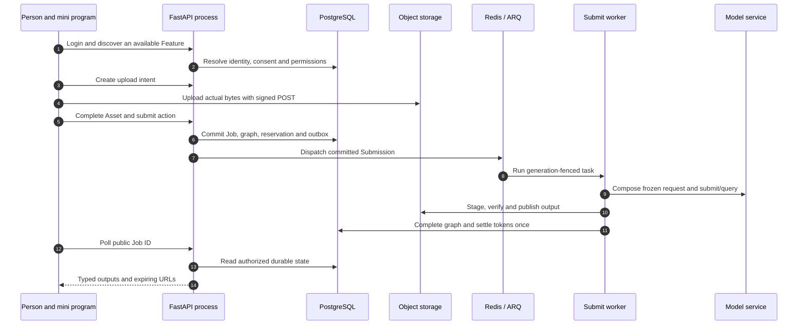
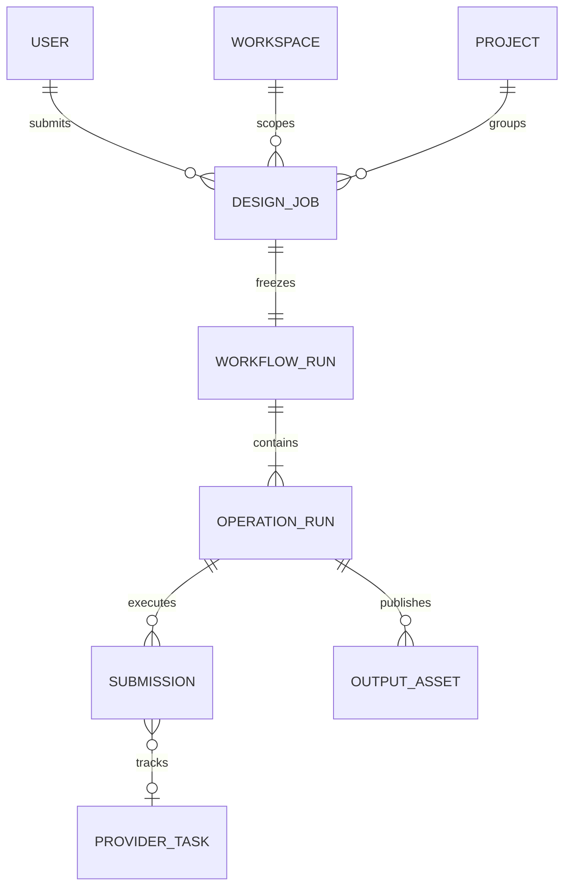

# Read the system from a user action to stored evidence

Reference is a source-reading course. Pick an action you can recognize in the mini program, follow its request into FastAPI, then identify the records and external calls that explain the visible result. You do not need to understand the entire repository before following one chain.

## A concrete first journey {#first-journey}

Use the local real-API path in [the first workflow tutorial](/get-started/quickstart), with mock identity/providers where configured. Frontend Mock mode never reaches FastAPI: it is useful for interface work but cannot demonstrate Redis, workers or PostgreSQL.

Choose a single image action, give it a recognizable name, and keep these five values: current user ID, workspace ID, upload Asset ID, action idempotency key and returned public Job ID. These values connect different processes; filenames and an on-screen progress percentage cannot do that.

The diagram shows process boundaries, not one Python function running from top to bottom. Messages 6 and 11 are separate database transactions; the HTTP response can return before generation finishes. The Poll worker periodically recovers missing handoffs; it is not the mini program's HTTP polling loop.

| Diagram messages | Read next | Question to answer in the source |
| --- | --- | --- |
| 1–2 | [Identity and consent](/reference/flows/wechat-login-flow) · [Feature and prompt discovery](/reference/flows/discovery-prompts-flow) | Which proof does the platform provide, and which permission does our server decide? |
| 3–5 | [Asset admission](/reference/flows/asset-upload-flow) · [browser audio handoff](/reference/flows/voice-upload-flow) | Where are the bytes, and what turns them into a reusable Asset? |
| 5–9 | [Workflow admission and execution](/reference/flows/design-job-lifecycle) · [product-specific branches](/reference/flows/workflow-products-flow) | What is committed before a model can be charged? |
| 10–11 | [Report/HTML/PPTX publication](/reference/flows/report-view-flow) · [runtime diagnosis](/reference/flows/runtime-debugging) | What evidence proves an output exists and belongs to this generation? |
| 12–14 | [History, polling, retry and deletion](/reference/flows/workflow-history-flow) | How does the UI receive the result after the original screen closes? |

## How a source link becomes a learning step {#reading-code}

A link such as `file → function` opens a fixed commit and a function's starting line. In your editor, open that relative file under the correct repository and search for the same function. `src/` belongs to the frontend; `app/` belongs to the backend. A `.vue` file combines page behavior and markup; a `.ts` repository translates UI actions into HTTP; a Python route binds HTTP input to a handler.

Read a function in this order:

1. **Input:** parameters, request model and `Depends(...)`. Dependencies obtain the authenticated user, DB session or storage; they can reject the request before the handler runs.
2. **Branch:** `if`/`isinstance`/`raise`. These explain why two apparently similar requests have different outcomes.
3. **Call:** follow the named service function, not every import. `await` waits for that I/O within this coroutine; it does not mean a background Job has completed.
4. **State:** `select(...)` reads SQL rows; `db.add`/field assignment stages a write; `flush` issues SQL without committing; `commit` makes it durable.
5. **Boundary:** `queue.enqueue_job` schedules another process; provider HTTP can spend money; storage writes bytes separately from database metadata.
6. **Return:** match the response fields to the frontend mapper and reactive page state. A successful HTTP status proves only the operation documented at that endpoint.

Example starting points:

- [src/services/request.ts → request](https://github.com/Orientation-CD/wechat_mini_program/blob/eca0a5f9e0a2aa1cb3fd4f9714114bb3db7fae5f/src/services/request.ts#L369)
- [app/workflows/api.py → create_workflow](https://github.com/Orientation-CD/YuanZhu-AI/blob/b13cc5668920620a274cb91a3393ed9fadac72ae/app/workflows/api.py#L1075)
- [app/workflows/workflow_admission.py → admit_workflow_job](https://github.com/Orientation-CD/YuanZhu-AI/blob/b13cc5668920620a274cb91a3393ed9fadac72ae/app/workflows/workflow_admission.py#L2426)
- [app/worker.py → execute_workflow_submission](https://github.com/Orientation-CD/YuanZhu-AI/blob/b13cc5668920620a274cb91a3393ed9fadac72ae/app/worker.py#L203)

Do not infer the running path from a filename alone. The current API accepts canonical `/v1/workflows`, while some shipped image/audio/video forms still deliberately post to the compatibility `/v1/design-jobs` adapter. The [product route matrix](/reference/flows/workflow-products-flow#frontend-routing) states the actual caller for each branch.

## Choose a domain, then an exact API {#reading-map}

| User question | Full chain |
| --- | --- |
| How does a login code become our account, and why can consent block login? | [Identity, legal documents, sessions and account lifecycle](/reference/flows/wechat-login-flow) |
| Why does a feature appear unavailable? Where do prompt fields come from? | [Discovery and prompt configuration](/reference/flows/discovery-prompts-flow) |
| Why did upload succeed but task submission fail? | [Asset intent → signed POST → completion → immutable input](/reference/flows/asset-upload-flow) |
| How does an upload web-view hand audio back to the mini program? | [Voice handoff session and restricted browser cookie](/reference/flows/voice-upload-flow) |
| How do images, voice, eight copywriting tools and video share one runtime? | [Product-specific request and execution paths](/reference/flows/workflow-products-flow) |
| How does one report wait for generated designs and become HTML plus PPTX? | [Report composition, publication and export](/reference/flows/report-view-flow) |
| What survives a timeout, worker crash, retry or page refresh? | [Durable Workflow lifecycle](/reference/flows/design-job-lifecycle) · [history actions](/reference/flows/workflow-history-flow) |
| How do projects, enterprise seats and referral rewards differ? | [Projects](/reference/flows/project-flow) · [membership](/reference/flows/workspace-membership-flow) · [referrals](/reference/flows/referral-rewards-flow) |
| What really grants tokens after a payment or removes them after refund? | [Payment](/reference/flows/payment-flow) · [Douyin](/reference/douyin-payment) · [refunds](/reference/flows/refund-flow) |

The [per-API route index](/reference/rest-api#generated-route-index) links every public route declaration to its handler and an endpoint-specific explanation. A webhook has a provider trigger; an operator API may have no mini-program button. Those boundaries are stated explicitly instead of inventing a UI caller. Conditional mock routes and browser Admin routes are explained as separate surfaces, not counted as public mobile APIs.

## Keep four kinds of identity separate {#identities}

This is a conceptual map; exact SQL tables/foreign keys are in [the data model](/reference/data-model). Public Workflow ID equals `design_jobs.id`; internal `workflow_runs.id` and `operation_runs.id` are different values. A provider task ID identifies an external charge/execution, not an authorization credential. Expiring output URLs are temporary access capabilities, not durable result identity.

## A guided source-reading exercise {#exercise}

Use a local task already created by the onboarding tutorial; do not purchase a real model run just to read the code.

1. Find its POST request in the developer tool Network panel. Record the actual path and `Idempotency-Key`; explain the UI-to-repository transition with the route matrix.
2. Open the handler link, then `admit_workflow_job`. Locate the replay check before fresh admission. Explain why the original key must be retained after a lost response.
3. Trace its Job ID through the read-only joins in [runtime diagnosis](/reference/flows/runtime-debugging#sql-trace). Identify the frozen run, operation, submission generation and output Asset.
4. Find the step that uploads bytes, the step that publishes SQL output identity, and the step that settles the parent. Explain why these are separate checkpoints.
5. Close/reopen the detail page. Use the GET request and frontend poller to explain why the result survives navigation.

If you cannot name a concrete function or stored identity for a step, return to that chapter's code map. Reading the whole repository alphabetically is not necessary.
