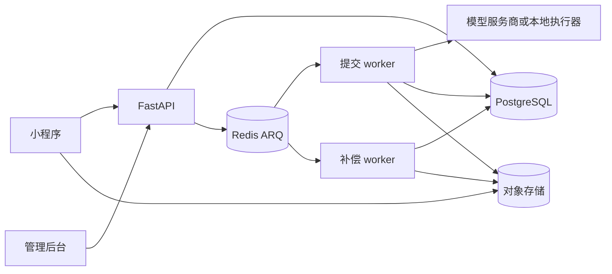

# 系统架构与执行

API 处理有界的 HTTP 请求；worker 根据数据库中的持久记录执行耗时的 AI 与转换任务。队列投递可从 PostgreSQL 状态进行补偿，Redis 不是唯一任务记录。

## 进程职责

| 进程 | 入口 | 职责 |
| --- | --- | --- |
| API | `uvicorn app.main:app` | `/v1`、管理后台页面/表单、文件接力页面、健康检查及 OpenAPI |
| 提交 worker | `arq app.worker.SubmitWorkerSettings` | Workflow Operation/Submission、本地 PPTX 与视频执行 |
| 补偿 worker | `arq app.worker.PollWorkerSettings` | 执行恢复、支付补偿、删除、账号与 Asset 清理 |

当前队列是 `arq:admission_queue` 和 `arq:poll_queue`，由 `app/core/queue_names.py` 定义。worker 类使用 `queue_name`，不使用旧的 provider 队列列表。代码还保留 PPTX 队列常量；当前 PPTX 执行注册在准入 worker 上。

## 从请求到结果

1. 校验严格请求结构、Bearer 会话、工作空间与 Feature 授权；先识别已接收请求的精确幂等重放。
2. 锁定商业与执行配置，核验不可变 Asset，在准入事务中冻结提示词与输入并预留付款钱包的 Tokens。
3. 保存 Workflow run、Operation 图与持久投递证据，再投递执行。
4. 使用冻结的模型/连接配置和执行代际运行 Operation。本地视频/PPTX 执行器另有进程资源、时间与租约边界。
5. 发布不可变结果 Asset，恰好一次结算或释放预留；补偿器恢复符合条件的中断状态。

## 代码分区

| 包 | 职责 |
| --- | --- |
| `app/core`、`app/persistence` | 配置、HTTP 保护、数据库会话、接口模型、ORM 与公共指标 |
| `app/identity`、`app/workspaces` | 认证、法律同意、工作空间、项目与活跃度 |
| `app/workflows`、`app/providers` | 准入、执行、重试、产品 Operation 与服务商协议 |
| `app/assets`、`app/conversion` | 直传、版本化存储、文件接力与 PowerPoint 转换 |
| `app/billing`、`app/marketing`、`app/prompts`、`app/admin` | 商业事务、活动、提示词与管理后台 |

只有显式启用开发选项 `DATABASE_AUTO_CREATE` 时，应用启动才可能创建 schema。生产迁移在切流前执行，应用启动不负责迁移。参见[生产部署](/zh/deploy/production)与[可观测性](/zh/backend/observability)。

---

代码依据 · backend `b13cc566`: [app/main.py](https://github.com/Orientation-CD/YuanZhu-AI/blob/b13cc5668920620a274cb91a3393ed9fadac72ae/app/main.py) · [app/worker.py](https://github.com/Orientation-CD/YuanZhu-AI/blob/b13cc5668920620a274cb91a3393ed9fadac72ae/app/worker.py) · [app/core/queue_names.py](https://github.com/Orientation-CD/YuanZhu-AI/blob/b13cc5668920620a274cb91a3393ed9fadac72ae/app/core/queue_names.py).
