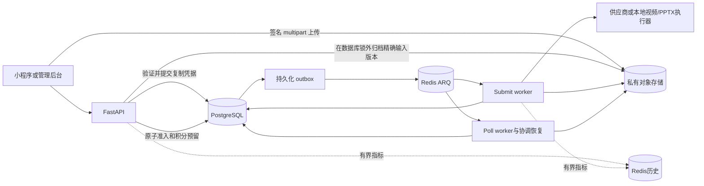

# 架构与执行边界

API 负责准备输入与准入；Submit worker 执行慢速 Operation，Poll worker 对持久化状态做轮询和恢复。PostgreSQL 保存业务事实，对象存储保存精确版本的字节，Redis 负责投递和有界遥测。建议结合[系统导读](/zh/reference/system-walkthrough)追一条实际请求。

## 进程与事实归属

| 进程 | 入口 | 职责 |
| --- | --- | --- |
| API | `uvicorn app.main:app` | 严格 `/v1` 请求、认证、输入准备、准入、后台和健康检查 |
| Submit worker | `arq app.worker.SubmitWorkerSettings` | 执行可运行的 Operation/Submission，以及有预算的本地 PPTX/视频任务 |
| Poll worker | `arq app.worker.PollWorkerSettings` | 供应商轮询、outbox/执行协调、账务补偿和受保留规则约束的对象清理 |

`app/core/queue_names.py` 定义 `arq:admission_queue`、`arq:poll_queue`。Redis 消息是一次投递，不是任务唯一记录。队列丢失后应依据 SQL 中的 outbox/执行记录恢复。API readiness 不证明 worker、供应商余额或视频流水线可用。

## 接受任务的边界

1. 校验请求，先检查同 key、同 body 的精确重放。重放返回已接受 Job，不重复归档、预留或新建执行。
2. 准备直接拥有的输入：先验证整个清单，提交复制凭据和租约，在数据库锁外复制并核验精确存储版本，再发布私有规范定位。准备完成的 Asset 仍可能是会过期的 READY。
3. 进入串行化准入事务，重新检查工作区、Feature/配置、角色/类型/版本 pin、活跃任务数与扣费权限。企业成员先检查公共余额，再检查成员月额度。
4. 在一个事务中将自有输入设为 ACTIVE 且取消过期，创建 Job/Workflow/Operation，冻结执行与价格、预留积分、写入 dispatch outbox。此提交才表示接受付费工作。
5. 根据已提交的 SQL 凭据投递。worker 发布核验后的不可变结果 Asset，并且只结算或释放一次。代次围栏防止旧 worker 覆盖后续尝试。

对象复制与最终 SQL 事务是两个可以恢复的阶段。后续准入拒绝可以留下可复用凭据及会过期的 READY 输入，但不能留下新的 Job 或账务预留。详见[准入时序](/zh/reference/flows/design-job-lifecycle)与[资产生命周期](/zh/reference/flows/asset-upload-flow)。

## 代码地图

| 包 | 先读 | 负责什么 |
| --- | --- | --- |
| `app/assets` | `asset_completion.py`、`asset_input_archival.py` | 核验字节、归档直接拥有输入、保存凭据与精确对象版本 |
| `app/workflows` | `api.py`、`workflow_admission.py` | 公共投影、原子接受、冻结图和账务 |
| `app/workflows/submissions` | coordinator、scheduler、finalizer及本地执行器 | 持久化执行转换和受约束的供应商/本地执行 |
| `app/billing` | `billing.py`、`member_token_quotas.py` | 钱包流水与独立的成员月容量限制 |
| `app/workspaces` | `workspace_api.py`、`projects.py` | 成员关系、创建者私有 Project、owner只读投影 |
| `app/core` | `request_stages.py`、`performance_history.py`、`performance_reports.py` | 安全关联日志与有界运维观测 |

生产数据库变更在切换前执行，应用启动不是迁移执行器。沿用[部署与恢复](/zh/deploy/production)控制。现有 UI 的真实请求路径与兼容边界见[联调状态](/zh/reference/integration-status)，不能从推荐的公共路由名称推断前端已经完成切换。

---

源码依据 · backend `e59716c8`: [app/main.py](https://github.com/Orientation-CD/YuanZhu-AI/blob/e59716c83e087deda8477da5ea7b327a40cf65c5/app/main.py) · [app/worker.py](https://github.com/Orientation-CD/YuanZhu-AI/blob/e59716c83e087deda8477da5ea7b327a40cf65c5/app/worker.py) · [app/workflows/workflow_admission.py](https://github.com/Orientation-CD/YuanZhu-AI/blob/e59716c83e087deda8477da5ea7b327a40cf65c5/app/workflows/workflow_admission.py) · [app/assets/asset_input_archival.py](https://github.com/Orientation-CD/YuanZhu-AI/blob/e59716c83e087deda8477da5ea7b327a40cf65c5/app/assets/asset_input_archival.py).
